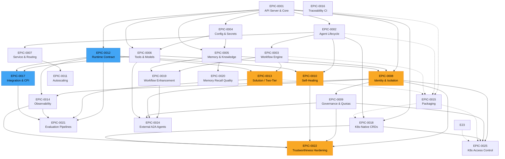

# DCOP Product Backlog

> **Source:** `PROJECT.md` (Declarative Cognitive Orchestration Platform)
> **Traceability schema:** Section 0.5 of PROJECT.md
> **Date generated:** 2025-07-17. Last status review: 2026-10-29.
> **Status:** Living implementation history and remaining-work ledger. Completed rows are historical traceability records; current operational behavior is documented in `README.md`, `TUTORIAL.md`, and `docs/`.

## Current Validation Status

**Next milestone: complete Kognition Studio authoring before resuming the
platform stabilization queue.** On October 29 the owner selected coverage of
all supported user-authored resources, with generated/status resources read-only
and authorization boundaries preserved. [EPIC-0023](#epic-0023---kognition-studio-authoring-completion---in-progress)
records the resource inventory, implementation slices and acceptance criteria.
The [prioritized queue](#43-next-work-queue-2026-10-29) places this milestone first.

The source audit through `e52c2d2` found 51 registered kinds, 20 Studio kind
aliases, 12 visual builders and two dedicated run viewers. Seven aliased kinds
have no visual builder: AutonomyClass, MemoryClaim, SecretRef, Prompt, Model,
ModelInvocationProfile and KnowledgeBaseClass. ModelInvocationProfile is also
absent from the explorer/refresh list. Other configurable kinds are missing from
Studio navigation entirely. Existing builders still use raw JSON for some
structured fields; their presence does not establish full visual field coverage.
These are the pre-implementation source findings. The local implementation
follow-up under EPIC-0023 supersedes the missing-builder wording for the current
worktree without claiming installed Kubernetes or protected-action acceptance.

The October 28 platform reconciliation remains valid within its evidence scope.
Image reproducibility, governed sample installation, gateway restart behavior,
broader GitOps acceptance, remote enforcement and measured NFRs remain queued
after Studio completion; they have not been closed or discarded.

| Evidence | Current interpretation |
|---|---|
| [October backlog review and follow-ups](docs/development-plans/reviews/backlog-review-2026-10-02.md) | Signature verification, native checkpoints, installed AutoGen lifecycle/class-only parity, isolated SPIRE/CSI identity and deterministic both-store candidate promotion/recovery have scoped acceptance. Do not schedule their original implementation again. The original 90-story matrix is historical; the backlog now contains 99 stories. |
| [Model invocation profiles](docs/model-invocation-profiles.md) | ADR-0025 profile/contract resolution and bounded live Foundry conformance are implemented. The eight-scenario live run does not certify installed images or production accounting. Model Gate 3 and autonomy `costThreshold` remain separate, undecided scope. |
| [Governed knowledge and sample acceptance](docs/development-plans/features/knowledge-provider-execution/remaining-sample-blockers-plan.md) | Native and AutoGen pgvector retrieval, maintained SeaweedFS S3, real Azure Blob ingestion/citations, local guarded activation and durable SDK recovery pass the recorded isolated profile. Manual shadow migration is accepted; a successful supported full-bundle installation is not established. |
| [Frozen release and inactive GitOps qualification](docs/development-plans/features/knowledge-provider-execution/local-release-gitops-qualification-2026-10-22.md) | The historical AMD64/ARM64 matrix and inactive Argo sync are qualified for their exact artifacts. October 28 dependency/source changes and the separately qualified Alpine/offline images require a current reproducible release candidate; old Pillow 12.3.0 findings are not the current source dependency selection. |

The October 28 remote snapshot found no open origin issues or pull requests;
this file is the remaining-work ledger. Origin `main` was at `896a58c`, 47 commits behind the
reviewed working branch. Local `main` is also behind that branch. Integrate the
reviewed source deliberately before starting dependent work; do not assume a
new branch from either stale `main` includes it. No push or remote change was
performed. The latest origin and mirror CI runs still cover the October 2
baseline and failed; Enterprise-approved origin runners and a current successful
remote run remain unverified.

This reconciliation reads existing evidence; it does not rerun application
acceptance, scan images, authorize deployment or certify a release. Preserve
retained unknown-effect claims, paused recurring work, original data and
target-specific approval boundaries.

The following table is the historical September 18 checkpoint. Later scoped
evidence and the October 2 assessment supersede its current-status wording without
changing the original receipts or treating historical completed rows as new proof.

The 2026-09-18 review repaired verified defects and completed the checks below.
The security gate remains blocked; this is not an all-green release sign-off.

| Gate | Fresh result |
|---|---|
| Go packages and coverage | Full ordinary and race suites passed after the dependency updates. Authored Go coverage was 83.2%, above the 80% gate. Environment-gated skips are not deployment evidence. |
| Tagged integration | `go test -tags integration -count=1 -timeout=15m ./...` passed with real Kubernetes 1.30.3 envtest binaries. Six retention workspace-binding cases exercise actual API admission. The PostgreSQL package completed in 222.167 seconds. |
| PostgreSQL behavior | All 31 migrations, adoption/resilience checks, restart-safe memory replay, and the four standalone gateway process tests passed. Gateway builds now have a separate five-minute budget before the fresh 60-second runtime readiness budget. |
| Python agent runtime | 123 passed on local Python 3.11; one dependency deprecation warning. CI uses Python 3.12, which this local run does not certify. |
| Python KnowledgeBase ingester | 64 passed on local Python 3.11. |
| Dashboard browser, desktop and mobile | 30 passed; two mobile-only cases intentionally skipped in the desktop project. |
| Studio browser, desktop and mobile | 37 passed; one mobile-only case intentionally skipped in the desktop project. |
| Go quality and build | Incremental golangci-lint reported zero issues. Buf lint/generation consistency and `go build ./cmd/...` passed. The final traceability package passed with the race detector after the packaging tests were added. |
| Helm | 439 supported PowerShell regression assertions passed. Refreshed umbrella dependencies pass Helm lint and render current RuntimeApproval RBAC and corrected retention schemas. Archive/source parity is covered by a Go regression test. The optional helm-unittest plugin was unavailable. |
| Restricted container behavior | PostgreSQL started, accepted SQL, and loaded pgvector with a read-only root filesystem and explicit writable mounts. All five hardened sample deployments became Available on local Docker Desktop Kubernetes; four HTTP endpoints returned 200, and Azurite/MinIO writable-volume checks passed. The isolated namespace was deleted. |
| Go/Python dependency security | govulncheck found no reachable vulnerabilities after upgrading gRPC and Go dependencies; four advisories remain in required modules whose affected code is not called. Both Python requirements audits passed. |
| Repository security | Trivy 0.74 with HIGH/CRITICAL, ignore-unfixed, and vuln/secret/misconfig scanners resolved 19 original configuration findings. The refreshed umbrella adds one SQL-name heuristic finding: four findings remain (one CRITICAL, three HIGH), with zero selected dependency vulnerabilities or secrets. See Section 10.1. No ignores or policy exemptions were added. |
| Remote security evidence | GitHub security endpoints for the configured remote returned 404. Remote alerts are unavailable/unverified, not confirmed absent. |
| Traceability | FR/NFR coverage, NFR verification-plan semantics, validators, and trace CLI fixtures passed. The real-repository trace check completed in 23.59 seconds after replacing per-commit subprocess matching with one awk pass. |

The reported application/test hang was not reproduced. The review did fix trace
CLI subprocess overhead and an observed gateway build/readiness timeout. A later
unfinished PowerShell command was cancelled before execution and is not counted
as an application failure or a completed check.

This checkpoint does not close workload identity, the narrated TC-0316 acceptance,
unimplemented contracts in Section 4.2, or production NFR measurements. Full
patched-revision deployment/provider acceptance and fresh container image builds
remain unverified; the isolated sample checks do not substitute for them. The
September 17 deployed evidence, September 2 `test-results/final-sweep.log`, and
August 31 browser `.last-run.json` predate these fixes. Passing automated suites
does not establish that every requirement is complete or that no defects remain.

---

## 0. Traceability Rules

All identifiers follow the schema defined in PROJECT.md Section 0.5.

| Artifact | ID Pattern | Rule |
|---|---|---|
| Epic | `EPIC-nnnn` | Groups related user stories by architectural concern |
| User Story | `US-nnnn` | Must reference >= 1 FR/NFR/DIFF/MVP/RISK |
| Task | `T-nnnn` | Must reference exactly one US |
| Test Case | `TC-nnnn` | Must reference >= 1 FR/NFR/MVP/DIFF |
| Bug | `BUG-nnnn` | Allocated at triage time |

**Story format:** "As *persona*, I want *capability*, so that *value*."

**Personas** (from Section 4.1):
- **Diego** — Agent Developer (primary)
- **Patricia** — Platform Engineer (secondary)
- **Gabriela** — AI Safety / Governance Officer
- **Sam** — SRE / On-Call
- **Karim** — Data / Knowledge Engineer

**Commit discipline:** Every commit message starts with `T-nnnn`.

---

## 1. Epic Summary

| Epic | Name | MVP Gates | Stories | Dependencies | Status |
|---|---|---|---|---|---|
| EPIC-0001 | Cognitive API Server & Core Infrastructure | MVP-1, MVP-2, MVP-3 | US-0001..US-0005, US-0091 | — | Done |
| EPIC-0002 | Agent Workload Lifecycle | MVP-1 | US-0006..US-0008 | EPIC-0001 | ✅ Done |
| EPIC-0003 | Workflow Engine | MVP-1, MVP-6 | US-0009..US-0010 | EPIC-0001, EPIC-0002 | ✅ Done |
| EPIC-0004 | Configuration & Secrets | MVP-1 | US-0011..US-0012 | EPIC-0001 | ✅ Done |
| EPIC-0005 | Memory & Knowledge Subsystem | MVP-1, MVP-3, MVP-4 | US-0013..US-0017 | EPIC-0001, EPIC-0004 | Core implemented; governed sample automation open (T-0368) |
| EPIC-0006 | Tools & Models | MVP-1, MVP-3 | US-0018..US-0022, US-0057..US-0059, US-0086..US-0087 | EPIC-0001, EPIC-0004 | Core implemented; gateway restart investigation open (T-0369) |
| EPIC-0007 | Service, Routing & Gateway | MVP-1, MVP-6 | US-0023..US-0024 | EPIC-0001, EPIC-0002 | ✅ Done |
| EPIC-0008 | Identity & Isolation (Four-Plane) | MVP-3, MVP-7 | US-0025..US-0030 | EPIC-0001, EPIC-0005, EPIC-0006 | Accepted isolated SPIRE/CSI scope; production enrollment separate |
| EPIC-0009 | Governance, Quotas & Admission | MVP-3 | US-0031..US-0035, US-0060..US-0062 | EPIC-0001, EPIC-0008 | ADR-0014 scope implemented; Model Gate 3/costThreshold need decisions |
| EPIC-0010 | Self-Healing & Probes | MVP-2, MVP-8 | US-0036..US-0038 | EPIC-0001, EPIC-0002, EPIC-0012 | Done |
| EPIC-0011 | Autoscaling | MVP-1 | US-0039 | EPIC-0001, EPIC-0002, EPIC-0007 | ✅ Done |
| EPIC-0012 | Runtime Contract & Pluralism | MVP-5, MVP-9 | US-0040..US-0045 | EPIC-0001, EPIC-0002 | Installed local parity accepted; external porting acceptance parked |
| EPIC-0013 | Two-Tier Declarative Model (Solution) | MVP-6 | US-0046..US-0049 | EPIC-0001, EPIC-0002, EPIC-0003, EPIC-0012 | ✅ Done |
| EPIC-0014 | Observability & Cost Attribution | MVP-4 | US-0050..US-0052 | EPIC-0001, EPIC-0008, EPIC-0012 | Done |
| EPIC-0015 | Packaging & Distribution | MVP-1 | US-0053 | All other EPICs | Partial: release/deployment acceptance and risk dispositions open (Section 10.1) |
| EPIC-0016 | Traceability CI Tooling | — | US-0054..US-0056 | — | Implemented locally; remote enforcement blocked |
| EPIC-0017 | Integration Architecture (ModelClass & CPI) | MVP-1, MVP-2, MVP-5 | US-0063..US-0067 | EPIC-0001, EPIC-0006, EPIC-0012 | Candidate local acceptance complete; paid-provider/production qualification separate |
| EPIC-0018 | Kubernetes-Native CRD Integration | MVP-1, MVP-10 | US-0068..US-0074 | EPIC-0001, EPIC-0002, EPIC-0015 | Done |
| EPIC-0019 | Workflow Engine Enhancement | MVP-1 | US-0075..US-0083 | EPIC-0003, EPIC-0005 | ✅ Done |
| EPIC-0020 | Memory Recall Quality | Post-MVP | US-0084 | EPIC-0005 | ✅ Done |
| EPIC-0021 | Evaluation Pipelines | Post-MVP | US-0085 | EPIC-0012, EPIC-0013, EPIC-0014, EPIC-0017 | Done |
| EPIC-0022 | Demo Trustworthiness Hardening | MVP-3, MVP-4, MVP-7 | US-0088..US-0090 | EPIC-0008, EPIC-0009, EPIC-0014, EPIC-0018 | In progress |
| EPIC-0023 | Kognition Studio Authoring Completion | MVP-1, MVP-3, MVP-4, MVP-7 | US-0092..US-0099 | Existing API slices of EPIC-0001, EPIC-0004, EPIC-0005, EPIC-0006, EPIC-0008, EPIC-0009, EPIC-0013, EPIC-0018, EPIC-0021 | In progress: authoring and core tutorial locally verified; installed/protected-action and pilot qualification open |
| EPIC-0024 | External A2A Agents (ExternalAgent) | MVP-3, MVP-4 (security support) | US-0100..US-0113 | EPIC-0003, EPIC-0004, EPIC-0006, EPIC-0008, EPIC-0009, EPIC-0019, EPIC-0023 | Planned: v1 (US-0100..US-0106) approved; later evolution (US-0107..US-0113) designed, not approved |
| EPIC-0025 | Kubernetes Human Access Control | MVP-3 (security support) | US-0114..US-0123 | EPIC-0008, EPIC-0009, EPIC-0015, EPIC-0018, EPIC-0023 | In progress: US-0114 done, US-0115 in progress; stack 1 (US-0114..US-0120) owner-directed 2026-11-27; US-0121..US-0123 designed, not approved |

---

## 2. Epic Dependency Graph

Legend: Yellow = differentiator epics (DIFF-1, DIFF-2, DIFF-3). Blue = runtime-pluralism (DIFF-4). EPIC-0017 blue = extends runtime pluralism to provider model.

---

## 3. Implementation Phases

The original phases below retain implementation history. The current next
milestone is EPIC-0023, delivered through the Studio slices in Section 4.3 before
the remaining platform queue. Its dependencies are existing supported APIs;
completing Studio does not require implementing deferred backend capabilities.

| Phase | Epics | MVP Gates Addressed | Deliverable Gate (Section 22) |
|---|---|---|---|
| **Phase 1 — Foundation** | EPIC-0001, EPIC-0016 | (infrastructure) | Phase 2: Resource schemas + ADRs |
| **Phase 2 — Resource Model** | EPIC-0002, EPIC-0003, EPIC-0004, EPIC-0005, EPIC-0006 | MVP-1 (partial) | Phase 2: Resource schemas + ADRs |
| **Phase 3 — Runtime & Execution** | EPIC-0012, EPIC-0007, EPIC-0011 | MVP-1, MVP-5, MVP-9 | Phase 3: Runtime Contract + Conformance |
| **Phase 4 — Security & Governance** | EPIC-0008, EPIC-0009 | MVP-3, MVP-7 | Phase 5: Control plane prototype |
| **Phase 5 — Observability & Self-Healing** | EPIC-0014, EPIC-0010 | MVP-2, MVP-4, MVP-8 | Phase 5: Control plane prototype |
| **Phase 6 — Intent Layer & Release** | EPIC-0013, EPIC-0015 | MVP-6, MVP-1 (complete) | Phase 7: MVP release candidate |
| **Phase 7 - Demo Trust Hardening** | EPIC-0022; reopened US-0060 | MVP-3, MVP-4, MVP-7, MVP-8 | Sep 21, 2026 video-ready demonstration |

---

## 4. Detailed Backlog

---

### EPIC-0001 — Cognitive API Server & Core Infrastructure — DONE

> **Goal:** Build the foundational control-plane services: API server, state store, controller manager framework, admission control, resource lifecycle primitives.
> **MVP Gates:** MVP-1, MVP-2, MVP-3
> **Dependencies:** None (root epic)
> **Completed:** 2025-05-20 — All stories implemented, tested (100% coverage), final review passed.

---

#### US-0001 — Cognitive API Server with CRUD, Watch & Persistence ✅

> As **Patricia** (Platform Engineer), I want a REST API server that exposes declarative CRUD and watch semantics for all resource kinds with state persisted transactionally in PostgreSQL, so that the control plane has a durable, consistent foundation.

**Traces:** FR-0001, FR-0002 | NFR-0001, NFR-0002 | MVP-1 | RISK-01, RISK-10

**Tasks:**

| ID | Task | US |
|---|---|---|
| T-0001 | Design API server architecture (REST + watch, versioning, OpenAPI spec generation) ✅ | US-0001 |
| T-0002 | Implement PostgreSQL schema for resource storage (kind, namespace, name, spec, status, metadata, resourceVersion) ✅ | US-0001 |
| T-0003 | Implement CRUD endpoints (Create, Get, List, Update, Delete) with optimistic concurrency (resourceVersion) ✅ | US-0001 |
| T-0004 | Implement watch/event-stream endpoint (long-poll or SSE) with bookmark support ✅ | US-0001 |
| T-0005 | Implement health and readiness endpoints for the API server itself ✅ | US-0001 |

**Test Cases:**

| ID | Test | Traces |
|---|---|---|
| TC-0001 ✅ | Create a resource via POST, retrieve via GET; verify spec matches. Update spec, verify resourceVersion increments. Delete and verify 404 on subsequent GET. | FR-0001, MVP-1 |
| TC-0002 ✅ | Open a watch stream, create a resource in another goroutine; verify the watch delivers ADDED event within 2 s. | FR-0001, NFR-0002, MVP-1 |
| TC-0003 ✅ | Kill and restart the API server process; verify all previously created resources are intact (Postgres durability). | FR-0002, NFR-0001, MVP-1 |
| TC-0004 ✅ | Attempt concurrent updates with stale resourceVersion; verify conflict (409) is returned. | FR-0001, MVP-1 |

---

#### US-0002 — Controller Manager Reconciliation Framework ✅

> As **Patricia** (Platform Engineer), I want a controller manager that hosts per-kind reconcilers using level-triggered reconciliation, so that observed state converges to desired state for every resource.

**Traces:** FR-0003 | NFR-0002 | MVP-1 | RISK-10

**Tasks:**

| ID | Task | US |
|---|---|---|
| T-0006 | Design controller-manager architecture (shared informer cache, work queues, leader election) ✅ | US-0002 |
| T-0007 | Implement generic reconciler loop with exponential backoff, jitter, and max-retries ✅ | US-0002 |
| T-0008 | Implement shared informer + cache that watches the API server and dispatches to per-kind reconcilers ✅ | US-0002 |
| T-0009 | Implement leader election for controller-manager HA ✅ | US-0002 |

**Test Cases:**

| ID | Test | Traces |
|---|---|---|
| TC-0005 ✅ | Register a test reconciler; create a resource; verify the reconciler is invoked within 5 s and status is updated. | FR-0003, NFR-0002, MVP-1 |
| TC-0006 ✅ | Simulate a reconciler failure (return error); verify exponential backoff requeue and eventual retry. | FR-0003, MVP-1 |
| TC-0007 ✅ | Run two controller-manager instances; verify only the leader processes reconciliations; kill the leader and verify failover. | FR-0003, NFR-0001, MVP-1 |

---

#### US-0003 — Admission Control Framework ✅

> As **Gabriela** (Governance Officer), I want validating and mutating admission control that evaluates resources before persistence, so that invalid or non-compliant configurations never enter the system.

**Traces:** FR-0004 | MVP-1, MVP-3 | RISK-09

**Tasks:**

| ID | Task | US |
|---|---|---|
| T-0010 | Design admission pipeline (chain of validating + mutating hooks, ordered execution) ✅ | US-0003 |
| T-0011 | Implement validating admission hook interface + registration ✅ | US-0003 |
| T-0012 | Implement mutating admission hook interface (inject defaults, add labels) + registration ✅ | US-0003 |
| T-0013 | Wire admission pipeline into API server Create/Update paths ✅ | US-0003 |

**Test Cases:**

| ID | Test | Traces |
|---|---|---|
| TC-0008 ✅ | Register a validating hook that rejects Agents without `modelRef`; attempt to create such an Agent; verify 422 rejection with clear error message. | FR-0004, MVP-1 |
| TC-0009 ✅ | Register a mutating hook that injects a default `timeoutSeconds`; create an Agent without it; verify the persisted spec contains the default. | FR-0004, MVP-1 |
| TC-0010 ✅ | Chain a mutating hook (inject label) followed by a validating hook (require that label value); verify the chain works end-to-end. | FR-0004, MVP-3 |

---

#### US-0004 — Resource Lifecycle: Conditions, Finalizers & Immutable Revisions ✅

> As **Sam** (SRE), I want all resources to expose standard status conditions and support finalizers for clean deletion, and I want Agent/Workflow/Solution specs to be immutable revisions so that I can monitor convergence and rollback safely.

**Traces:** FR-0005, FR-0006, FR-0007 | NFR-0002 | MVP-1, MVP-2, MVP-8 | RISK-13

**Tasks:**

| ID | Task | US |
|---|---|---|
| T-0014 | Define standard condition types: `Ready`, `Progressing`, `Healthy`, `BudgetExceeded`, `PolicyViolation`, `DriftDetected` ✅ | US-0004 |
| T-0015 | Implement condition-setting helpers and ensure all reconcilers update conditions on every reconcile pass ✅ | US-0004 |
| T-0016 | Implement finalizer registration and processing (block deletion until external state is cleaned up) ✅ | US-0004 |
| T-0017 | Implement immutable revision model: spec changes to Agent/Workflow/Solution create a new revision; old revisions remain inspectable ✅ | US-0004 |
| T-0018 | Implement revision history query API: list, exact-get, and RFC 6902 spec diff work in standalone and Kubernetes. ✅ | US-0004 |

**Test Cases:**

| ID | Test | Traces |
|---|---|---|
| TC-0011 ✅ | Create an Agent; verify status shows `Ready=False, Progressing=True` initially, then transitions to `Ready=True` after reconciliation completes. | FR-0005, NFR-0002, MVP-1 |
| TC-0012 ✅ | Add a finalizer to a Memory resource; delete the Memory; verify deletion is blocked until the finalizer is removed (external cleanup simulated). | FR-0006, MVP-2 |
| TC-0013 ✅ | Create an Agent, then update its spec; verify a new revision is created and the original revision is still retrievable. Verify revision count increments. | FR-0007, MVP-1 |
| TC-0014 ✅ | Attempt to mutate an existing revision's spec directly; verify it is rejected (immutability enforced). | FR-0007, MVP-1 |

---

#### US-0005 — Cross-Namespace Default-Deny ✅

> As **Gabriela** (Governance Officer), I want cross-namespace resource references to be denied by default and require explicit grants, so that tenant isolation is enforced at the resource level.

**Traces:** FR-0008 | MVP-3 | RISK-11

**Tasks:**

| ID | Task | US |
|---|---|---|
| T-0019 | Implement namespace-scoped reference resolution (all refs resolve within same namespace by default) ✅ | US-0005 |
| T-0020 | Implement cross-namespace grant resource and admission check for cross-namespace references ✅ | US-0005 |

**Test Cases:**

| ID | Test | Traces |
|---|---|---|
| TC-0015 ✅ | Create an Agent in namespace A referencing a Tool in namespace B (no grant); verify admission rejects the reference. | FR-0008, MVP-3 |
| TC-0016 ✅ | Create a cross-namespace grant from B to A for the Tool; retry the Agent creation; verify it succeeds. | FR-0008, MVP-3 |

---

#### US-0091 - Enterprise Multi-Agent Reference Architecture - DONE

> As **Patricia** (Platform Engineer), I want a vendor-neutral, layered reference architecture for enterprise multi-agent platforms, so that platform design and adoption reviews can assess execution, governance, security, data, observability, scale, resilience, and lifecycle responsibilities consistently.

**Traces:** NFR-0001, NFR-0004, NFR-0007, NFR-0008, NFR-0010, NFR-0012, NFR-0013 | MVP-3, MVP-4

**Tasks:**

| ID | Task | US |
|---|---|---|
| T-0367 | **Done:** Consolidate the [enterprise reference architecture](docs/architecture/reference/README.md) into 13 documents and 16 layered diagrams. Include 30 capabilities with acceptance scenarios, 24 official sources, page-cited coverage of all ten OWASP agentic risks, and Kognition evidence covering all 50 registered resource kinds. Clarify trust boundaries, effect recovery, cancellation, replay protection, conformance, and deployment-specific obligations; add root README navigation and preserve the supplied source PDF. | US-0091 |

**Test Cases:**

| ID | Test | Traces |
|---|---|---|
| TC-0317 | **Passed (2026-10-08):** Validate all 13 reference documents for local links/anchors, whitespace, unique coverage IDs, resource-kind coverage, and diagram structure. Parse and render all 16 Mermaid diagrams and check edge-label overlaps. Session-local validation completed with zero broken links, structural errors, or detected overlaps; verify the supplied PDF SHA-256 matches the source register. This is documentation acceptance, not production NFR measurement or certification. | NFR-0001, NFR-0004, NFR-0007, NFR-0008, NFR-0010, NFR-0012, NFR-0013, MVP-3, MVP-4 |

The original core-infrastructure completion date above applies to US-0001 through
US-0005. US-0091 records the later reference-documentation baseline.

---

### EPIC-0002 — Agent Workload Lifecycle ✅ COMPLETED

> **Goal:** Implement the core workload kinds: Agent (Deployment analog), AgentInstance (Pod analog), AgentJob (Job analog).
> **MVP Gates:** MVP-1
> **Dependencies:** EPIC-0001

---

#### US-0006 — Agent Resource Kind ✅

> As **Diego** (Agent Developer), I want to declare an Agent resource with model, instructions, tools, memory, and runtime configuration, so that I can deploy a cognitive workload declaratively.

**Traces:** FR-0100 | NFR-0003 | MVP-1 | RISK-01

**Tasks:**

| ID | Task | US |
|---|---|---|
| T-0021 | Define Agent CRD/schema: spec (modelRef, instructionsRef, tools[], memory{}, runtime{}, companions[], replicas) + status (revisionCount, readyReplicas, conditions) ✅ | US-0006 |
| T-0022 | Implement Agent reconciler: creates AgentInstances matching desired replicas, manages revisions ✅ | US-0006 |
| T-0023 | Implement Agent validation (required fields, ref resolution, schema conformance) ✅ | US-0006 |
| T-0024 | Implement Agent defaulting (inject CognitiveLimitRange defaults, default runtime class) ✅ | US-0006 |

**Test Cases:**

| ID | Test | Traces |
|---|---|---|
| TC-0017 ✅ | Apply a valid Agent manifest; verify reconciler creates the correct number of AgentInstances and status shows `Ready=True`. | FR-0100, NFR-0003, MVP-1 |
| TC-0018 ✅ | Apply an Agent manifest with invalid modelRef (non-existent); verify admission rejects with actionable error. | FR-0100, MVP-1 |
| TC-0019 ✅ | Update Agent spec; verify a new revision is created and new AgentInstances are created for the new revision while old ones are drained. | FR-0100, MVP-1 |

---

#### US-0007 — AgentInstance (Running Session) ✅

> As **Sam** (SRE), I want AgentInstance resources representing individual running sessions of an Agent, so that I can inspect, debug, and manage individual agent executions.

**Traces:** FR-0101 | NFR-0003, NFR-0004 | MVP-1

**Tasks:**

| ID | Task | US |
|---|---|---|
| T-0025 | Define AgentInstance schema: spec (agentRef, revision, sessionContext) + status (phase, conditions, startTime, tokenUsage, toolCalls) ✅ | US-0007 |
| T-0026 | Implement AgentInstance reconciler: dispatches to runtime, tracks lifecycle phases (Pending, Running, Succeeded, Failed) ✅ | US-0007 |
| T-0027 | Implement AgentInstance log/event retrieval API ✅ | US-0007 |
| T-0236 | Add dispatch retry budget to AgentInstance reconciler: configurable retryLimit before marking PhaseFailed, with exponential backoff between attempts ✅ | US-0007 |
| T-0237 | Implement `reconcileRunning` runtime status polling: heartbeat/session-alive check via RuntimeDispatcher, transition to PhaseReady on completion or PhaseFailed on runtime error ✅ | US-0007 |
| T-0238 | Harden AgentInstance reconciler tests: assert first reconcile result (finalizer-add) in multi-reconcile tests to prevent silent failures ✅ | US-0007 |

**Test Cases:**

| ID | Test | Traces |
|---|---|---|
| TC-0020 ✅ | Create an Agent with replicas=2; verify 2 AgentInstances are created and transition to Running phase. | FR-0101, NFR-0004, MVP-1 |
| TC-0021 ✅ | Delete an AgentInstance directly; verify the Agent reconciler re-creates it to maintain desired replicas. | FR-0101, MVP-1 |
| TC-0022 ✅ | Query AgentInstance status; verify token usage and tool-call counts are reported. | FR-0101, MVP-1 |

---

#### US-0008 — AgentJob (One-Shot Execution) ✅

> As **Diego** (Agent Developer), I want to declare an AgentJob for one-shot agent execution with completion semantics, so that I can run batch cognitive tasks that terminate.

**Traces:** FR-0102 | MVP-1

**Tasks:**

| ID | Task | US |
|---|---|---|
| T-0028 | Define AgentJob schema: spec (agentSpec inline or ref, completionPolicy, backoffLimit) + status (completionTime, succeeded, failed) ✅ | US-0008 |
| T-0029 | Implement AgentJob reconciler: creates AgentInstance, monitors for completion, respects backoffLimit on failure ✅ | US-0008 |

**Test Cases:**

| ID | Test | Traces |
|---|---|---|
| TC-0023 ✅ | Create an AgentJob; verify it creates an AgentInstance, runs to completion, and status shows `succeeded=1`. | FR-0102, MVP-1 |
| TC-0024 ✅ | Create an AgentJob that fails; verify retry up to backoffLimit, then final status shows `failed`. | FR-0102, MVP-1 |

---

### EPIC-0003 — Workflow Engine ✅ COMPLETED

> **Goal:** Implement the Workflow resource with DAG-based multi-agent orchestration, durable state (event-sourced), and support for emergent DAG mutation.
> **MVP Gates:** MVP-1, MVP-6
> **Dependencies:** EPIC-0001, EPIC-0002

---

#### US-0009 — Workflow with DAG Execution & Durable State ✅

> As **Diego** (Agent Developer), I want to declare a Workflow resource with a DAG of agent steps, durable crash-resume state, and human-approval gates, so that I can orchestrate multi-agent pipelines reliably.

**Traces:** FR-0103 | NFR-0007, NFR-0008 | MVP-1 | RISK-12

**Tasks:**

| ID | Task | US |
|---|---|---|
| T-0030 | Define Workflow schema: spec (steps[] with agentRef/inline, edges[], approvalGates[], budgets{}) + status (phase, completedSteps, activeStep, conditions) ✅ | US-0009 |
| T-0031 | Implement Workflow reconciler: interprets DAG, dispatches steps as AgentJobs/AgentInstances, tracks completion ✅ | US-0009 |
| T-0032 | Implement event-sourced durable state (Temporal-shaped): persist every step transition, enable crash-resume ✅ | US-0009 |
| T-0033 | Implement human-approval gate: pause workflow, emit Approval event, resume on approval signal ✅ | US-0009 |
| T-0034 | Implement cyclic graph support with budget annotations (maxIterations, maxTokens per cycle) ✅ | US-0009 |

**Test Cases:**

| ID | Test | Traces |
|---|---|---|
| TC-0025 ✅ | Apply a 4-step linear Workflow (planner->researcher->writer->publisher); verify steps execute in order and final status is Succeeded. | FR-0103, MVP-1 |
| TC-0026 ✅ | Kill the controller mid-workflow (after step 2 completes); restart; verify workflow resumes from step 3 (durable state). | FR-0103, NFR-0007, NFR-0008, MVP-1 |
| TC-0027 ✅ | Insert an approval gate before the publisher step; verify workflow pauses; send approval; verify workflow resumes and completes. | FR-0103, MVP-1 |
| TC-0028 ✅ | Create a cyclic workflow with maxIterations=3; verify it executes exactly 3 cycles then terminates. | FR-0103, MVP-1 |

---

#### US-0010 — Emergent DAG Mutation (Planner-Driven) ✅

> As **Diego** (Agent Developer), I want Workflows to support emergent (planner-driven) DAG mutation within declared budgets, so that agent-driven orchestration can dynamically add steps while remaining bounded and auditable.

**Traces:** FR-0104 | MVP-6 | DIFF-1 | RISK-01

**Tasks:**

| ID | Task | US |
|---|---|---|
| T-0035 | Extend Workflow spec with `emergent: { enabled: true, budgets: { maxSteps, maxTokens, maxCost } }` ✅ | US-0010 |
| T-0036 | Implement DAG mutation API: a running workflow step can propose new steps; reconciler validates against budgets and appends to DAG ✅ | US-0010 |
| T-0037 | Implement audit trail for every DAG mutation (who proposed, when, budget consumed) ✅ | US-0010 |

**Test Cases:**

| ID | Test | Traces |
|---|---|---|
| TC-0029 ✅ | Run an emergent workflow where a planner step adds 2 new steps at runtime; verify both execute and the final DAG is inspectable. | FR-0104, MVP-6, DIFF-1 |
| TC-0030 ✅ | Run an emergent workflow that attempts to exceed maxSteps budget; verify the mutation is rejected and the workflow completes with existing steps. | FR-0104, MVP-6 |

---

### EPIC-0004 — Configuration & Secrets ✅ COMPLETED

> **Goal:** Implement Prompt and SecretRef resources for versioned configuration and secure secret indirection.
> **MVP Gates:** MVP-1
> **Dependencies:** EPIC-0001

---

#### US-0011 — Prompt Resource (Versioned Instructions) ✅

> As **Diego** (Agent Developer), I want a first-class Prompt resource that versions my agent instructions separately from the Agent spec, so that I can iterate on prompts without creating new agent revisions.

**Traces:** FR-0200 | MVP-1

**Tasks:**

| ID | Task | US |
|---|---|---|
| T-0038 | Define Prompt schema: spec (content, parameters[], metadata) + status (hash, version) ✅ | US-0011 |
| T-0039 | Implement Prompt reconciler: compute content hash, track version history ✅ | US-0011 |
| T-0040 | Implement Agent->Prompt reference resolution and change propagation (Agent status reflects Prompt changes) ✅ | US-0011 |

**Test Cases:**

| ID | Test | Traces |
|---|---|---|
| TC-0031 ✅ | Create a Prompt and an Agent referencing it; update the Prompt content; verify the Agent's status reflects the Prompt change (e.g., condition `DriftDetected` until re-reconciled). | FR-0200, MVP-1 |
| TC-0032 ✅ | Retrieve Prompt version history; verify all past versions are accessible. | FR-0200, MVP-1 |

---

#### US-0012 — SecretRef Indirection ✅

> As **Patricia** (Platform Engineer), I want SecretRef resources that decouple secret references from secret storage backends, so that agents can access credentials without being locked to a specific secret store.

**Traces:** FR-0201 | MVP-1, MVP-3

**Tasks:**

| ID | Task | US |
|---|---|---|
| T-0041 | Define SecretRef schema: spec (backendType, backendRef, key) + status (synced, lastSyncTime) ✅ | US-0012 |
| T-0042 | Implement SecretRef resolution for at least two backends: internal store and environment variable fallback ✅ | US-0012 |
| T-0043 | Implement SecretRef usage in Agent/Tool resources (injection at runtime dispatch) ✅ | US-0012 |

**Test Cases:**

| ID | Test | Traces |
|---|---|---|
| TC-0033 ✅ | Create a SecretRef pointing to the internal store; reference it from a Tool; verify the runtime receives the resolved secret value. | FR-0201, MVP-1 |
| TC-0034 ✅ | Create a SecretRef with an invalid backend; verify admission rejects or status shows error condition. | FR-0201, MVP-1 |

---

### EPIC-0005 — Memory & Knowledge Subsystem: CORE IMPLEMENTED, sample automation open

> **Goal:** Implement the full memory model: MemoryClass, MemoryClaim, MemoryVolume (PVC analog), Memory types, KnowledgeBase, consistency, provenance, summarization, PII handling.
> **MVP Gates:** MVP-1, MVP-3, MVP-4
> **Dependencies:** EPIC-0001, EPIC-0004

---

#### ✅ US-0013 — Memory Provisioning (MemoryClass / MemoryClaim / MemoryVolume)

> As **Patricia** (Platform Engineer), I want a PVC-like memory provisioning model with MemoryClass (backend tier), MemoryClaim (agent request), and MemoryVolume (provisioned instance), so that memory backends are pluggable and agents request memory declaratively.

**Traces:** FR-0250, FR-0251, FR-0252 | NFR-0004 | MVP-1 | RISK-11

**Tasks:**

| ID | Task | US |
|---|---|---|
| T-0044 ✅ | Define MemoryClass schema: spec (backendType, parameters, reclaimPolicy, summarizationConfig, consistencyMode) | US-0013 |
| T-0045 ✅ | Define MemoryClaim schema: spec (memoryClassName, type [episodic/semantic/working/procedural/shared], capacity, consistencyMode, concurrencyMode [for shared: lww/crdt/lock]) + status (phase [Pending/Bound/Released], boundVolume) | US-0013 |
| T-0046 ✅ | Define MemoryVolume schema: spec (memoryClassName, backendHandle) + status (phase [Available/Bound/Released/Deleted/Retained/Archived], capacity) | US-0013 |
| T-0047 ✅ | Implement MemoryClaim reconciler: binds to a MemoryVolume via the MemoryClass provisioner (pgvector for MVP) | US-0013 |
| T-0048 ✅ | Implement Memory resource with type discrimination (episodic, semantic, working, procedural, shared) and operations (persist, retrieve, summarize, expire) | US-0013 |
| T-0198 ✅ | Implement MemoryClaim/MemoryVolume lifecycle state machine: phase transitions (Pending→Bound→Released for claims; Available→Bound→Released→terminal for volumes) and reclaimPolicy enforcement (Delete, Retain, Archive) | US-0013 |

**Test Cases:**

| ID | Test | Traces |
|---|---|---|
| TC-0035 ✅ | Create a MemoryClass (pgvector), a MemoryClaim of type `episodic`; verify a MemoryVolume is provisioned and the claim status shows `Bound`. | FR-0250, FR-0251, MVP-1 |
| TC-0036 ✅ | Create Memory of each type (episodic, semantic, working, procedural, shared); persist a record to each; retrieve and verify correctness. | FR-0252, MVP-1 |
| TC-0037 ✅ | Delete a MemoryClaim with reclaimPolicy=Delete; verify the underlying MemoryVolume is cleaned up. | FR-0251, MVP-1 |
| TC-0150 ✅ | MemoryClaim lifecycle: create claim → verify Pending → bind → verify Bound → delete owning agent → verify Released → verify reclaimPolicy drives MemoryVolume to correct terminal state (Deleted for Delete, Retained for Retain, Archived for Archive). | FR-0251, MVP-1 |

---

#### US-0014 — KnowledgeBase Resource: CORE IMPLEMENTED, sample automation open

> As **Karim** (Knowledge Engineer), I want a KnowledgeBase resource for operator-curated indexed knowledge that agents can query but not write to, so that knowledge management has a distinct lifecycle from agent-produced memory.

**Traces:** FR-0253, FR-0258, FR-0259, FR-0260, FR-0261, FR-0262 | MVP-1

**Tasks:**

| ID | Task | US |
|---|---|---|
| T-0049 ✅ | Define KnowledgeBase schema: spec (source, indexConfig, refreshPolicy) + status (indexed, lastRefresh, documentCount, generation) | US-0014 |
| T-0050 ✅ | Implement KnowledgeBase reconciler: index source documents, expose semantic search interface | US-0014 |
| T-0051 ✅ | Implement Agent->KnowledgeBase reference and query API for runtime use. The October 28 governed profile adds server-side query embeddings, Knowledge Gateway/CPI pgvector retrieval and native/AutoGen cited results without provider/database credentials in Agent Pods; see [scoped acceptance](docs/development-plans/features/knowledge-provider-execution/remaining-sample-blockers-plan.md). | US-0014 |
| T-0200 ✅ | Define KnowledgeBaseClass schema: spec (provisioner, indexMode, embeddingModel ref, chunkStrategy, reclaimPolicy) + admission validation (see §9A.2) | US-0014 |
| T-0201 ✅ | Implement KB lifecycle state machine in reconciler: Pending → Indexing → Ready → Refreshing → Error, with finalizer/deletion semantics (see §9A.4) | US-0014 |
| T-0202 ✅ | Implement KB multi-source ingestion (directory, url, git, configMap) with incremental re-indexing and refreshPolicy support (periodic, onDemand, webhook) (see §9A.3) | US-0014 |
| T-0204 ✅ | Implement generation-consistent queries during KB refresh: queries serve previous generation while Refreshing; generation counter increments on successful re-index (see §9A.4, §9A.5) | US-0014 |
| T-0205 ✅ | Implement Agent spec KB reference with `required` field: agent readiness depends on KB `Ready` phase when `required: true`; graceful degradation when `required: false` (see §9A.5) | US-0014 |
| T-0325 ✅ | Define KnowledgeBaseClaim CRD + reconciler (ADR-0001): binds a claim to a matching KnowledgeBase by class + selectors, supports built-in in-memory provisioner for zero-config claims | US-0014 |
| T-0326 ✅ | Default `KnowledgeBaseClass` selection via `kognition.dev/is-default-class: "true"` annotation (ADR-0002): admission defaulter fills empty `spec.knowledgeBaseClassName` on KB/KBClaim; validator enforces single default per cluster | US-0014 |
| T-0327 ✅ | Define IndexRun CRD + reconciler: represents a single ingestion attempt for a KB generation; owns a batch/v1 Job that runs the `kognition-kb-ingester` image and writes per-run stats onto KB status | US-0014 |
| T-0328 ✅ | Define IndexSchedule CRD + reconciler: cron-driven creation of IndexRuns for periodic refresh, with concurrencyPolicy and successful/failed run history retention | US-0014 |
| T-0329 ✅ | Add blob source support to KB ingester: `blob/azure` (connection-string, account-key, SAS, workload-identity) and `blob/s3` (static creds, IRSA/OIDC, S3-compatible endpoints) with prefix filtering and per-object content-type detection | US-0014 |
| T-0330 ✅ | Ship pgvector KB ingester Job runtime (`runtime/ingester`, Python 3.12-slim): reads task from `KOGNITION_INGEST_INPUT`, chunks + embeds via KB's embeddingModel, UPSERTs into pgvector, emits one-line JSON summary; wired into build via `make docker` (opt-in via `kbIngester.enabled=true`) | US-0014 |
| T-0368 | **P1, pending:** Integrate the accepted governed pgvector, SeaweedFS S3 and real Azure Blob sample paths into the supported [sample installation](make.ps1) and [sample scripts](samples/), using the [manual shadow bundle](deploy/examples/knowledge-pgvector/manual-shadow.yaml) and ADR-0015/ADR-0025 contracts. Require explicit target/profile selection, provider/database TLS and credential preflight, reviewed resource order and embedding budget, claim cutover, bounded readiness, actionable failures and owned cleanup. Preserve the legacy opt-in path and original indexes; never silently migrate data, create cloud resources or activate a platform. Verify TC-0318 on an approved isolated target. Traces: FR-0253, FR-0260, FR-0262. | US-0014 |

**Test Cases:**

| ID | Test | Traces |
|---|---|---|
| TC-0038 ✅ | Create a KnowledgeBase from a set of test documents; verify indexing completes and status shows document count. | FR-0253, MVP-1 |
| TC-0039 ✅ | Query the KnowledgeBase with a semantic query; verify relevant results are returned. | FR-0253, MVP-1 |
| TC-0040 ✅ | Attempt to write to a KnowledgeBase from an Agent runtime context; verify the write is rejected (read-only for agents). | FR-0253, MVP-1 |
| TC-0155 ✅ | Create a KnowledgeBase referencing a KnowledgeBaseClass; verify lifecycle phases transition Pending → Indexing → Ready; verify status fields (generation, documentCount, indexedChunks, conditions). | FR-0259, MVP-1 |
| TC-0156 ✅ | An Agent without a MemoryGrant for a KnowledgeBase attempts to query it; verify the query is denied (dual-gate enforcement). | FR-0261, MVP-1 |
| TC-0157 ✅ | Grant an Agent a MemoryGrant with verbs `[query, list]` targeting a KnowledgeBase; verify `query` returns search results and `list` returns document metadata. | FR-0261, MVP-1 |
| TC-0158 ✅ | Trigger a KB refresh while an Agent is actively querying; verify the Agent receives results from the previous generation (stale-but-consistent); after refresh completes, verify generation counter incremented and new results available. | FR-0262, MVP-1 |
| TC-0159 ✅ | An Agent in namespace A attempts to query a KnowledgeBase in namespace B without a cross-namespace MemoryGrant; verify the query is denied. | FR-0261, MVP-1 |
| TC-0160 ✅ | Delete a KnowledgeBase while an Agent with `required: true` holds a reference; verify Agent transitions to not-ready. Delete with `required: false`; verify Agent remains ready but queries fail gracefully. | FR-0253, FR-0262, MVP-1 |
| TC-0161 ✅ | Create a MemoryGrant with `targetRef.kind: KnowledgeBase` and verbs `[write, forget]`; verify the admission controller rejects the grant (invalid verbs for KB targets). | FR-0261, MVP-1 |
| TC-0162 ✅ | Create a KnowledgeBaseClass with provisioner `pgvector` and indexMode `hybrid`; create a KnowledgeBase referencing it; verify the provisioner allocates index storage and indexing proceeds. | FR-0258, MVP-1 |
| TC-0181 ✅ | For each supported KB source type (`directory`, `url`, `git`, `configMap`), create a KnowledgeBase with that source; verify ingestion completes and documents are queryable. | FR-0260, MVP-1 |
| TC-0318 | **Pending:** Run the supported governed sample path on a clean approved isolated target without manual manifest/status repair. Verify declared source counts, committed claim bindings, cited native and AutoGen retrieval, explicit revoked-access/provider-failure results, zero raw provider/database credentials in Agent Pods and owned cleanup. Exercise S3 upload/readback and idempotent rerun; make real Blob coverage opt-in with explicit connectivity, credentials and paid-embedding approval. Preserve original indexes and retained unknowns. | FR-0253, FR-0260, FR-0262, MVP-1, MVP-3 |

---

#### US-0015 — Memory Consistency & Provenance ✅

> As **Gabriela** (Governance Officer), I want read-your-writes consistency within sessions and mandatory provenance tracking on all memory records, so that every piece of agent-produced knowledge is traceable to its source reasoning step.

**Traces:** FR-0254, FR-0255 | NFR-0012 | MVP-1, MVP-4 | RISK-11

**Tasks:**

| ID | Task | US |
|---|---|---|
| T-0052 ✅ | Implement session-scoped read-your-writes consistency for Memory operations (write -> immediate read returns latest within same session) | US-0015 |
| T-0053 ✅ | Implement provenance metadata on every memory record: sourceAgentIdentity, sessionId, reasoningStepId, timestamp, grantId | US-0015 |
| T-0054 ✅ | Implement provenance query API: given a memory record, trace back to the reasoning step that produced it | US-0015 |

**Test Cases:**

| ID | Test | Traces |
|---|---|---|
| TC-0041 ✅ | Within a session, write a memory record then immediately read it; verify the write is visible. In a different session, verify eventual consistency (read may not see it immediately). | FR-0254, MVP-1 |
| TC-0042 ✅ | Write a memory record; retrieve its provenance metadata; verify agentIdentity, sessionId, and reasoningStepId are populated. | FR-0255, NFR-0012, MVP-4 |

---

#### US-0016 — Background Summarization ✅

> As **Patricia** (Platform Engineer), I want controller-driven background summarization of memory, so that memory growth is bounded without blocking the agent's reasoning loop.

**Traces:** FR-0256 | MVP-1

**Tasks:**

| ID | Task | US |
|---|---|---|
| T-0055 ✅ | Implement summarization controller: monitors memory size, triggers summarization when threshold is exceeded | US-0016 |
| T-0056 ✅ | Implement summarization strategy (configurable per MemoryClass): merge old episodes, compact semantic duplicates | US-0016 |
| T-0057 ✅ | Implement pre/post summarization state visibility (consumers can see the summarized state and optionally query raw history) | US-0016 |

**Test Cases:**

| ID | Test | Traces |
|---|---|---|
| TC-0043 ✅ | Fill an episodic memory past the summarization threshold; verify the controller triggers summarization and memory size decreases while retaining key facts. | FR-0256, MVP-1 |
| TC-0044 ✅ | After summarization, verify raw history is still accessible via explicit query. | FR-0256, MVP-1 |

---

#### US-0017 — PII Redaction & Right-to-be-Forgotten ✅

> As **Gabriela** (Governance Officer), I want PII redaction in memory records and a right-to-be-forgotten mechanism that cascades deletion through provenance chains, so that the platform meets enterprise data-protection requirements.

**Traces:** FR-0257 | MVP-3 | RISK-09, RISK-11

**Tasks:**

| ID | Task | US |
|---|---|---|
| T-0058 ✅ | Implement PII detection and redaction at memory-write time (configurable rules per Workspace) | US-0017 |
| T-0059 ✅ | Implement right-to-be-forgotten API: tombstone a source record and cascade deletion to all derived records via provenance chain | US-0017 |
| T-0060 ✅ | Implement audit log entries for all RTBF operations | US-0017 |

**Test Cases:**

| ID | Test | Traces |
|---|---|---|
| TC-0045 ✅ | Write a memory record containing PII patterns (email, phone); verify the stored record has PII redacted. | FR-0257, MVP-3 |
| TC-0046 ✅ | Create a provenance chain (record A -> derived record B -> derived record C); invoke RTBF on record A; verify all three are tombstoned. | FR-0257, MVP-3 |
| TC-0151 ✅ | Summarization compacts episodic records; invoke RTBF on a source record; verify the summarized record is also tombstoned via provenance chain (cross-cutting US-0016 × US-0017). | FR-0256, FR-0257, MVP-3 |

---

### EPIC-0006 — Tools & Models: CORE IMPLEMENTED, restart investigation open

> **Goal:** Implement Tool and Model resources with MCP as canonical protocol, process-level sandboxing, human-approval tools, digest-pinned versioning, and opt-in supply-chain verification.
> **MVP Gates:** MVP-1, MVP-3
> **Dependencies:** EPIC-0001, EPIC-0004

---

#### ✅ US-0018 — Tool Resource with MCP Canonical Protocol & Digest Versioning

> As **Diego** (Agent Developer), I want to declare Tool resources using MCP as the canonical protocol with version pinning by digest, so that agents invoke tools through a uniform interface with reproducible behavior.

**Traces:** FR-0300, FR-0303 | MVP-1

**Tasks:**

| ID | Task | US |
|---|---|---|
| T-0061 ✅ | Define Tool schema: spec (protocol [MCP/OpenAPI/native], endpoint, schema, digestPin, metadata) + status (available, lastHealthCheck) | US-0018 |
| T-0062 ✅ | Implement Tool reconciler: validate endpoint reachability, register schema, verify digest if pinned | US-0018 |
| T-0063 ✅ | Implement OpenAPI-to-MCP adapter: compile OpenAPI tool definitions to MCP at registration time | US-0018 |
| T-0064 ✅ | Implement Tool reference resolution from Agent specs | US-0018 |

**Test Cases:**

| ID | Test | Traces |
|---|---|---|
| TC-0047 ✅ | Create a Tool with MCP protocol; verify schema is discoverable and endpoint health is checked. | FR-0300, MVP-1 |
| TC-0048 ✅ | Create a Tool with digestPin; change the tool endpoint to serve a different digest; verify reconciler detects the mismatch and sets status to unhealthy. | FR-0303, MVP-1 |
| TC-0049 ✅ | Create a Tool with OpenAPI protocol; verify it is adapted to MCP internally and invocable through the MCP interface. | FR-0300, MVP-1 |

---

#### US-0019 — Process-Level Tool Sandboxing ✅

> As **Gabriela** (Governance Officer), I want tools to execute in process-level isolation by default with an opt-in trusted in-process tier, so that untrusted tool execution cannot compromise the runtime.

**Traces:** FR-0301 | MVP-3 | RISK-09

**Tasks:**

| ID | Task | US |
|---|---|---|
| T-0065 ✅ | Implement tool execution dispatcher with process-isolation default (separate process or container per tool invocation) | US-0019 |
| T-0066 ✅ | Implement trusted-tier opt-in: tools marked `trusted: true` may execute in-process for reduced latency | US-0019 |
| T-0067 ✅ | Implement resource limits for sandboxed tool execution (CPU, memory, timeout) | US-0019 |

**Test Cases:**

| ID | Test | Traces |
|---|---|---|
| TC-0050 ✅ | Invoke a sandboxed tool that attempts to read the agent's runtime memory space; verify isolation prevents access. | FR-0301, MVP-3 |
| TC-0051 ✅ | Invoke a sandboxed tool that exceeds its timeout; verify it is killed and the agent receives a structured timeout error. | FR-0301, MVP-3 |
| TC-0052 ✅ | Mark a tool as `trusted: true`; verify it executes in-process with lower latency than the sandboxed path. | FR-0301, MVP-1 |

---

#### US-0020 — Human-Approval Tool ✅

> As **Diego** (Agent Developer), I want human approval modeled as both a Tool and a Workflow step backed by an Approval event, so that agents and workflows can gate actions on human decisions.

**Traces:** FR-0302 | MVP-1

**Tasks:**

| ID | Task | US |
|---|---|---|
| T-0068 ✅ | Implement human-approval as a built-in Tool kind (agent calls it; blocks until approved/rejected) | US-0020 |
| T-0069 ✅ | Implement Approval event type: pending, approved, approved-with-modification, rejected, timed-out | US-0020 |
| T-0070 ✅ | Implement approval API endpoint (external systems or humans submit approval/rejection decisions, with optional modification payload) | US-0020 |

**Test Cases:**

| ID | Test | Traces |
|---|---|---|
| TC-0053 ✅ | Agent invokes human-approval tool; verify it blocks. Submit approval via API; verify agent resumes. | FR-0302, MVP-1 |
| TC-0054 ✅ | Agent invokes human-approval tool; submit rejection; verify agent receives rejection and can act accordingly. | FR-0302, MVP-1 |
| TC-0055 ✅ | Agent invokes human-approval tool; let it timeout; verify structured timeout response. | FR-0302, MVP-1 |

---

#### US-0021 — Model Resource ✅

> As **Patricia** (Platform Engineer), I want to declare Model resources for model provider + model registration, so that agents reference models by name and the platform handles provider routing.

**Traces:** FR-0304 | MVP-1

**Tasks:**

| ID | Task | US |
|---|---|---|
| T-0071 ✅ | Define Model schema: spec (provider, modelId, endpoint, capabilities, credentialRef, rateLimit) + status (available, latency, lastCheck) | US-0021 |
| T-0072 ✅ | Implement Model reconciler: health-check endpoint, validate credentials, report capabilities | US-0021 |
| T-0073 ✅ | Implement at least two providers: OpenAI-compatible + Azure OpenAI / Foundry | US-0021 |

**Test Cases:**

| ID | Test | Traces |
|---|---|---|
| TC-0056 ✅ | Create a Model with valid credentials; verify status shows `available=true` and capabilities are reported. | FR-0304, MVP-1 |
| TC-0057 ✅ | Create a Model with invalid endpoint; verify status shows `available=false` with error description. | FR-0304, MVP-1 |
| TC-0058 ✅ | Create two Models (different providers); reference each from separate Agents; verify both work independently. | FR-0304, MVP-1 |

---

#### ✅ US-0022 — Supply-Chain Signature Verification (Opt-In)

> As **Gabriela** (Governance Officer), I want opt-in supply-chain signature verification for Tools and Models at admission time, so that only verified artifacts can be deployed.

**Traces:** FR-0305 | MVP-3 | RISK-09

**Verified implementation, 2026-10-06:** Operator-pinned Sigstore verification
binds kind, workspace, resource name and canonical full spec. Real cryptographic
positive/forgery/rotation tests and an offline signing CLI replace the historical
nonempty-signature hook. This accepted profile signs resource configuration;
independent OCI provenance and remote-weight verification are separate acceptance.

**Tasks:**

| ID | Task | US |
|---|---|---|
| T-0074 ✅ | Implement operator-pinned Sigstore detached signature verification for canonical Tool/Model specifications, exact offline payload generation and fail-closed trust rotation. Verified locally, 2026-10-06. | US-0022 |
| T-0075 ✅ | Implement Workspace-level policy: `requireSignedArtifacts: true/false` (opt-in per workspace) | US-0022 |

**Test Cases:**

| ID | Test | Traces |
|---|---|---|
| TC-0059 ✅ | Enable `requireSignedArtifacts` in a Workspace; create a Tool without a valid signature; verify admission rejects. | FR-0305, MVP-3 |
| TC-0060 ✅ | Create a Tool with a valid signature in a signed-required Workspace; verify admission accepts. | FR-0305, MVP-3 |

---

#### ✅ US-0057 — ToolClass & Tool Lifecycle State Machine

> As **Patricia** (Platform Engineer), I want a `ToolClass` resource that provisions execution tiers (process, sidecar, pod, vm) with transport and sandbox defaults, and a `Tool` lifecycle state machine (Registered → Validating → Ready → Degraded → Terminated), so that tool deployment is declarative and observable.

**Traces:** FR-0306, FR-0307 | MVP-1 | §10A.2, §10A.4

**Tasks:**

| ID | Task | US |
|---|---|---|
| T-0206 ✅ | Define ToolClass schema: spec (executionTier, transport, sandbox defaults, resource limits) + status (provisioned) and admission validation | US-0057 |
| T-0207 ✅ | Implement Tool lifecycle state machine reconciler: Registered → Validating → Ready → Degraded → Terminated with finalizer semantics | US-0057 |

**Test Cases:**

| ID | Test | Traces |
|---|---|---|
| TC-0163 ✅ | Create a ToolClass with executionTier=sidecar; create a Tool referencing it; verify provisioner creates execution tier. | FR-0306, MVP-1 |
| TC-0164 ✅ | Create a Tool; verify state transitions: Registered → Validating → Ready. Delete Tool; verify Terminated with finalizer. | FR-0307, MVP-1 |

---

#### US-0058 — Tool Health, Agent Binding & Invocation Traceability ✅

> As **Diego** (Agent Developer), I want tools to have health probes, readiness-gated agent bindings, and full invocation traceability (OTel + audit), so that tool failures are detected, agents degrade gracefully, and every invocation is auditable.

**Traces:** FR-0309, FR-0310, FR-0311 | MVP-1, MVP-4 | §10A.6, §10A.7, §10A.8

**Tasks:**

| ID | Task | US |
|---|---|---|
| T-0209 ✅ | Implement Agent ↔ Tool binding with `required`/optional readiness gates in agent spec | US-0058 |
| T-0210 ✅ | Implement Tool health probe reconciler (mcp-ping, http-get, tcp, exec) with degradation semantics. Exec probes use class-approved OCI images in restrictive Docker Engine containers for standalone mode and one-shot Kubernetes Jobs for Kubernetes mode. | US-0058 |
| T-0211 ✅ | Implement invocation traceability pipeline — OTel spans + CognitiveAuditLog entries per tool call with cost attribution | US-0058 |

**Test Cases:**

| ID | Test | Traces |
|---|---|---|
| TC-0167 ✅ | Agent with `required: true` tool reference; tool not Ready → agent remains non-ready. Tool becomes Ready → agent becomes ready. | FR-0309, MVP-1 |
| TC-0168 ✅ | Tool health probe fails → tool transitions to Degraded. Probe recovers → tool transitions back to Ready. | FR-0310, MVP-1 |
| TC-0169 ✅ | Invoke a tool; verify OTel span emitted with correct attributes and CognitiveAuditLog entry created with cost attribution. | FR-0311, MVP-4 |

---

#### ✅ US-0059 — MCP Transport & ToolGrant Verb Taxonomy

> As **Patricia** (Platform Engineer), I want MCP transport modes (stdio, sse, http) with protocol compilation from OpenAPI/native/browser/shell, and a ToolGrant verb taxonomy (`invoke`, `discover`, `inspect`) with argument constraints and rate limits, so that tools are accessible via multiple transports and access is fine-grained.

**Traces:** FR-0308, FR-0312 | MVP-1, MVP-3 | §10A.5, §10A.9

**Tasks:**

| ID | Task | US |
|---|---|---|
| T-0208 ✅ | Implement ToolGrant verb taxonomy (`invoke`, `discover`, `inspect`) with argument constraints and rate limits at admission | US-0059 |
| T-0212 ✅ | Implement MCP transport modes (stdio, sse, http) and protocol compilation (OpenAPI/native/browser/shell → MCP). Protocol compilation, streamable HTTP/SSE responses, remote Browser tools over the hardened HTTP executor, and class-approved Shell tools through durable controller-owned sandboxes are implemented. The Tool Gateway can create and observe ToolInvocationRuns but cannot create sandbox workloads. | US-0059 |

**Test Cases:**

| ID | Test | Traces |
|---|---|---|
| TC-0165 ✅ | Create a ToolGrant with verb `invoke`; agent invokes tool → allowed. Agent attempts `inspect` → denied. | FR-0308, MVP-3 |
| TC-0166 ✅ | Create a ToolGrant with `inspect` verb on a tool without inspection support → admission rejects. | FR-0308, MVP-3 |
| TC-0170 ✅ | Define an OpenAPI spec; apply protocol compilation; verify valid MCP tool definition is generated. | FR-0312, MVP-1 |

---

#### US-0086 — Tool Gateway Production Resilience & Cross-Mode Conformance: restart follow-up open

> As **Sam** (SRE), I want Tool Gateway resilience and authorization semantics proven in an enforcing Kubernetes environment and kept identical across standalone and Kubernetes modes, so that tool calls remain governed, available, and predictable during target failures and platform scale-out.

**Traces:** FR-0300, FR-0308, FR-0310, FR-0311 | NFR-0001, NFR-0002, NFR-0012 | MVP-3, MVP-4 | RISK-09, RISK-10

**Tasks:**

| ID | Task | US |
|---|---|---|
| T-0335 ✅ | Run the Tool Gateway network-policy E2E on Cilium. Runtime Pods cannot call Tool endpoints directly; the Tool Gateway reaches only declared `privateEgress` targets; undeclared private targets are denied; internal DNS and Model Gateway public HTTPS egress are verified. | US-0086 |
| T-0336 ✅ | Add a live Tool Gateway resilience E2E using controlled Tool failures and latency. Verify timeout handling, idempotent transient retries, non-idempotent no-retry behavior, per-Tool concurrency rejection, circuit opening, cooldown recovery, and emitted resilience metrics. | US-0086 |
| T-0337 ✅ | Replace per-process Tool Gateway concurrency and circuit state with Kubernetes Lease-based coordination so replicas enforce one shared per-Tool limit and circuit state. Includes lease expiry, Pod replacement handoff, and fail-closed behavior under API errors. | US-0086 |
| T-0338 ✅ | Add a shared Tool Gateway conformance suite that runs the same authorization, receipt replay/conflict, timeout, retry, circuit, quota, audit, and normalized response scenarios in standalone and Kubernetes modes. | US-0086 |
| T-0369 | **P1, investigation pending:** Reproduce the [October 28 restarted Tool Gateway claimant-validation failure](docs/development-plans/features/knowledge-provider-execution/remaining-sample-blockers-plan.md#sample-model-name-alignment) in [gateway tests](internal/toolgateway/) and an isolated [deployed regression](internal/traceability/). Determine whether source, image/configuration drift or process/Pod ownership caused it; repair the owning path only after localization. A distinct authorized invocation must work after supported restart without manual serving-Pod replacement; retain unavailable/unknown original invocations without replay, forged completion or weaker claimant checks. Verify TC-0319. Traces: FR-0300, FR-0311, NFR-0001, NFR-0012. | US-0086 |

**Test Cases:**

| ID | Test | Traces |
|---|---|---|
| TC-0294 ✅ | In a Cilium test cluster, invoke an allowed private Tool through the gateway, attempt the same endpoint directly from a runtime Pod, and attempt an undeclared private endpoint from the gateway. Verify only the declared gateway path succeeds. | FR-0300, FR-0308, MVP-3 |
| TC-0295 ✅ | Use deterministic transient, timeout, and slow Tool targets. Verify retries occur only for idempotent transient failures, concurrency rejects excess calls, a circuit opens at its threshold, cooldown closes it after recovery, and all decisions emit the expected metrics. | FR-0310, FR-0311, NFR-0002, MVP-4 |
| TC-0296 ✅ | Run at least two Tool Gateway replicas with a shared Lease coordinator. Submit concurrent calls and target failures through both replicas; verify the configured global concurrency limit and circuit state are enforced exactly once across replicas, including after Pod replacement. | FR-0310, NFR-0001, NFR-0002 |
| TC-0297 ✅ | Run the shared Tool Gateway conformance scenarios against standalone and Kubernetes transports; verify identical authorization, replay, timeout, retry, circuit, quota, audit, and response results. | FR-0300, FR-0308, FR-0311, NFR-0012 |
| TC-0299 ✅ | Run a real Kubernetes runtime Tool call through the capability exchange. Delete the applicable AgentPolicy and verify the next in-pod call is denied before execution; restore it, exhaust a one-call CognitiveQuota, and verify the next call is denied without incrementing usage. | FR-0300, FR-0308, FR-0453, FR-0455, MVP-3, NFR-0013 |
| TC-0319 | **Pending:** Restart the approved Tool Gateway profile through the supported process/Pod lifecycle and submit a distinct authorized request. Verify successful execution and exact audit/quota settlement without manual repair. Confirm prior unknown invocations are not replayed, stale claimant/foreign-owner attempts fail closed and denied requests produce zero target effects. Record exact image, configuration and process/Pod identities; keep PostgreSQL and Kubernetes ownership semantics covered by the affected regression suites. | FR-0300, FR-0311, NFR-0001, NFR-0012, MVP-3, MVP-4 |

---

#### US-0087 — Model Gateway Data-Plane Authorization ✅

> As **Gabriela** (Governance Officer), I want every model inference request to pass through a Model Gateway that verifies the live workload session, Model revision, grant, and policy before provider execution, so that revocation and credential isolation apply consistently in standalone and Kubernetes modes.

**Traces:** FR-0304, FR-0308, FR-0311 | NFR-0001, NFR-0002, NFR-0012 | MVP-3, MVP-4 | RISK-09, RISK-10

**Decision:** [ADR-0008](docs/adr/0008-model-gateway.md) limits the first slice to API-key authenticated OpenAI-compatible chat Models. Other providers, embeddings, streaming, receipts, global limits, and cost settlement follow the stable gateway boundary.

**Tasks:**

| ID | Task | US |
|---|---|---|
| T-0340 ✅ | Define the Model Gateway invocation boundary, distinct model-session capability claims, provider-neutral core, credential ownership, and initial OpenAI-compatible scope in ADR-0008. | US-0087 |
| T-0341 ✅ | Implement Model session capability issue and verification, bound to namespace, Agent, automatic identity, AgentInstance UID, session, Model name, Model resource version, and Model Gateway audience. | US-0087 |
| T-0342 ✅ | Implement the shared Model Gateway core and Kubernetes HTTP service for API-key OpenAI-compatible chat completions. Re-evaluate live ModelGrant and AgentPolicy, resolve the upstream SecretRef inside the gateway, propagate trace context, and return normalized provider usage and errors. | US-0087 |
| T-0343 ✅ | Route Kubernetes runtime model calls through the Model Gateway. Deliver the session capability only in `/invoke`, redact provider endpoint and credentials from gateway-enabled Pod templates, and preserve direct execution when the gateway is disabled. | US-0087 |
| T-0344 ✅ | Route standalone chat and controller Model execution through the shared Model Gateway core, then add direct, runtime, revocation, credential-redaction, and cross-mode conformance E2Es. | US-0087 |

**Test Cases:**

| ID | Test | Traces |
|---|---|---|
| TC-0299 ✅ | Mint a model-session capability for an active AgentInstance and call the Model Gateway mock OpenAI-compatible target. Verify ModelGrant and AgentPolicy are re-evaluated on each request, Model revision/session mismatches are denied, and a grant revoked after dispatch blocks the next inference turn. | FR-0304, FR-0308, MVP-3 |
| TC-0300 ✅ | Dispatch a Kubernetes Agent to a deterministic OpenAI-compatible mock through the Model Gateway. Verify output and usage are preserved, runtime Pod environment omits provider endpoint and credentials, and the gateway alone reaches the provider with its resolved credential. | FR-0304, FR-0311, NFR-0012, MVP-4 |
| TC-0301 ✅ | Run shared Model Gateway conformance scenarios through standalone CPI, direct chat, and Kubernetes HTTP transports. Verify identical live authorization, policy revocation, provider output/usage, credential forwarding, and safe error behavior; verify Kubernetes rejects a stale capability-bound Model revision while synchronous standalone execution uses the current revision. | FR-0304, FR-0308, FR-0311, NFR-0012 |

---

### EPIC-0007 — Service, Routing & Gateway — DONE

> **Goal:** Implement AgentService (stable endpoint + revision routing) and IntentGateway (external entry point for goals).
> **MVP Gates:** MVP-1, MVP-6
> **Dependencies:** EPIC-0001, EPIC-0002

---

#### US-0023 — AgentService with Stable Name & Revision Pinning ✅

> As **Diego** (Agent Developer), I want an AgentService resource that provides a stable DNS-like endpoint for an Agent with revision pinning, so that consumers always reach the correct agent revision.

**Traces:** FR-0150 | MVP-1

**Tasks:**

| ID | Task | US |
|---|---|---|
| T-0076 | Define AgentService schema: spec (agentRef, revisionPin, loadBalancingStrategy) + status (endpoint, activeRevision, readyInstances) ✅ | US-0023 |
| T-0077 ✅ | Implement AgentService reconciler. Stable standalone and Kubernetes endpoints are published; revision pins use immutable revision snapshots, dedicated Kubernetes workloads, and standalone snapshot invocation. | US-0023 |
| T-0078 | Implement endpoint naming. Kubernetes uses service DNS; standalone publishes an API subresource path. ✅ | US-0023 |

**Test Cases:**

| ID | Test | Traces |
|---|---|---|
| TC-0061 ✅ | Create an AgentService for an Agent; send a request to the service endpoint; verify it reaches a running AgentInstance. | FR-0150, MVP-1 |
| TC-0062 ✅ | Pin AgentService to revision N; create revision N+1; verify Kubernetes traffic selects a dedicated revision workload and standalone invocation uses the same immutable snapshot. | FR-0150, MVP-1 |
| TC-0063 ✅ | Verify the mode-specific endpoint resolves to the correct service. Kubernetes DNS and standalone API-path tests are implemented. | FR-0150, MVP-1 |

---

#### US-0024 — IntentGateway (Minimal) ✅

> As **Diego** (Agent Developer), I want a minimal IntentGateway that accepts HTTP/gRPC requests with Solution goals and routes them to the planner, so that external systems can submit intent-level requests.

**Traces:** FR-0152 | MVP-6 | DIFF-1

**Tasks:**

| ID | Task | US |
|---|---|---|
| T-0079 | Define IntentGateway schema: routes, `http` protocol, optional API-key `authConfig`, and stable logical endpoint status are implemented in standalone and Kubernetes control planes. ✅ | US-0024 |
| T-0080 | Implement IntentGateway server. Standalone and Kubernetes HTTP/gRPC goal submission create target-bound Solutions for Agent, AgentService, and Workflow routes. Kubernetes uses a dedicated gateway Deployment and only advertises its service-DNS endpoint while Available. ✅ | US-0024 |
| T-0081 | Implement request validation and rate limiting at the gateway level ✅ | US-0024 |

**Test Cases:**

| ID | Test | Traces |
|---|---|---|
| TC-0064 ✅ | Submit a goal via HTTP to the IntentGateway; verify a Solution resource is created and the response includes the Solution reference. | FR-0152, MVP-6, DIFF-1 |
| TC-0065 ✅ | Submit an invalid goal (empty body); verify the gateway returns a structured error. | FR-0152, MVP-6 |

---

### EPIC-0008 — Identity & Isolation: ACCEPTED ISOLATED PROFILE, production enrollment separate

> **Goal:** Implement the four-plane cognitive isolation model: Communication, Memory, Tool, and Model isolation with Workspace tenancy, SPIFFE-backed identity, RBAC, and grant-based access.
> **MVP Gates:** MVP-3, MVP-7
> **Dependencies:** EPIC-0001, EPIC-0005, EPIC-0006
> **Differentiator:** DIFF-2 (Four-Plane Isolation)

---

#### US-0025 — Workspace Tenant Boundary ✅

> As **Patricia** (Platform Engineer), I want a Workspace resource as the tenant boundary with default-deny isolation across workspaces, so that multi-tenant deployments are secure by default.

**Traces:** FR-0400 | NFR-0005, NFR-0013 | MVP-3 | RISK-11

**Tasks:**

| ID | Task | US |
|---|---|---|
| T-0082 | Define Workspace schema: spec (quotaRef, policyRef, defaultMemoryClass, settings) + status (agentCount, resourceUsage) ✅ | US-0025 |
| T-0083 | Implement Workspace reconciler: initialize namespace-equivalent isolation, default quota/policy injection ✅ | US-0025 |
| T-0084 | Enforce Workspace boundary: all resource creation must target a Workspace; cross-Workspace access denied by default ✅ | US-0025 |

**Test Cases:**

| ID | Test | Traces |
|---|---|---|
| TC-0066 ✅ | Create two Workspaces; create an Agent in each; verify Agent in Workspace A cannot reference resources in Workspace B. | FR-0400, NFR-0013, MVP-3 |
| TC-0067 ✅ | Create 10 Workspaces; verify each is independently operable with its own resource counts. | FR-0400, NFR-0005, MVP-3 |

---

#### US-0026 — AgentIdentity (SPIFFE-Backed) ✅

> As **Gabriela** (Governance Officer), I want every Agent to carry a SPIFFE-backed verifiable identity, so that tool grants, cost attribution, and audit logs have cryptographic provenance.

**Traces:** FR-0401 | MVP-3, MVP-4 | RISK-09

**Partial completion, 2026-10-06:** Real SPIRE issuance/rotation, UID-bound peer
checks and Python-to-Go-to-mTLS transport pass isolated acceptance. Protected
pod/service-account enrollment, generated Kubernetes socket/sidecar wiring and
AgentIdentity certificate/readiness status propagation remain open.

**Ownership confirmed, 2026-10-10:** Kognition consumes platform-managed SPIRE.
The platform owns issuer installation and enrollment policy; Kognition must
integrate protected Workload API delivery and UID-bound verified status
reporting. This decision does not approve an installation or certify deployed
enrollment. Preserve legacy informational identity behavior separately.

**Scoped acceptance completed:** The owner approved a disposable local kind
profile with platform SPIRE 1.15.3, `csi.spiffe.io` 0.2.9 and Cilium 1.18.3.
Real Kubernetes/PostgreSQL status projection, rotation, issuer outage/reconnect,
normal Agent recreation and SPIRE-authenticated Tool/Memory checks passed.
Task closure covers this implementation and approved profile, not arbitrary
platform enrollment or production readiness. See the
[installed acceptance record](docs/development-plans/reviews/backlog-review-2026-10-02.md#approved-installed-identity-acceptance).

**Verification refreshed, 2026-10-13:** The repository-wide Go race suite passes
with 80.6% authored statement coverage. The stale embedded PostgreSQL test fixture
now applies existing migrations 033/034, so model-canary usage and durable recovery
tests pass. Full new-code lint, chart/archive traceability, header checks and SQL
disposition negative controls pass. Installed evidence remains the recorded
approved profile; the deleted fixture was not recreated. T-0225 is the next local
implementation slice.

**Tasks:**

| ID | Task | US |
|---|---|---|
| T-0085 ✅ | **Complete for the approved local profile:** Optional metadata-only `status.workloadIdentity` binds the current Agent UID, incarnation URI, certificate validity, source generation and readiness. Both controller entrypoints use the bounded authenticated registry. Real Kubernetes/PostgreSQL persistence, rotation, outage/reconnect and recreated-UID denial pass installed acceptance; conversion and status regressions pass. | US-0026 |
| T-0086 ✅ | **Complete for the approved local profile:** Platform-managed SPIRE/CSI delivery, hardened proxy, verified-source readiness, mTLS status, restricted admission/networking and exact Pod/container enrollment are implemented and verified. Both-mode production gateway handlers pass real-SPIRE Tool exchange/execution/replay, Memory search, wrong-peer denial and live grant revocation with normal Gate 3 accounting. The missing Memory live-peer check is fixed. All 12 affected race suites, traceability/security gates and scoped lint pass; evidence was retained before exact-cluster cleanup. Issuer/driver ownership and deployment-specific enrollment remain platform responsibilities. | US-0026 |
| T-0087 ✅ | Inject the reconciled informational URI into dispatch context and runtime status. The opted-in UID-bound SVID transport verifies identity separately; the legacy field is not cryptographic proof. | US-0026 |

**Test Cases:**

| ID | Test | Traces |
|---|---|---|
| TC-0068 ✅ | **Accepted for the approved local profile:** Real issuer/CSI enrollment and authenticated certificate metadata persist in Kubernetes and PostgreSQL, rotate, clear readiness during outage and recover on reconnect. Normal same-name Agent recreation receives a new UID and cannot inherit old registry/readiness evidence. Expiry, malformed evidence, ownership and no-op cases retain focused regressions. | FR-0401, MVP-3 |
| TC-0069 ✅ | **Accepted for the approved local profile:** Existing informational/SDK transport evidence plus installed real-SPIRE Tool exchange/execution/replay and Memory search pass for both stores. A valid same-domain non-Agent SVID and revoked grants are denied before targets. Normal Gate 3 preparation/claim/replay accounting remains enabled; no paid model call or forced approval status is used. | FR-0401, MVP-4 |

---

#### US-0027 — AgentRole & AgentRoleBinding (RBAC with Cognitive Verbs) ✅

> As **Gabriela** (Governance Officer), I want AgentRole and AgentRoleBinding resources that support cognitive verbs (`invoke`, `read-memory`, `call-tool`, `target-model`, `message-agent`), so that authorization is granular at the cognitive-action level.

**Traces:** FR-0402 | MVP-3

**Tasks:**

| ID | Task | US |
|---|---|---|
| T-0088 | Define AgentRole schema: spec (rules[] with apiGroups, resources, verbs [including cognitive verbs]) ✅ | US-0027 |
| T-0089 | Define AgentRoleBinding schema: spec (roleRef, subjects [AgentIdentity refs]) ✅ | US-0027 |
| T-0090 | Implement RBAC evaluation engine: check AgentIdentity against AgentRole for every cognitive action ✅ | US-0027 |

**Test Cases:**

| ID | Test | Traces |
|---|---|---|
| TC-0070 ✅ | Create an AgentRole allowing `read-memory` on a specific Memory; bind it to an AgentIdentity; verify the agent can read that memory. | FR-0402, MVP-3 |
| TC-0071 ✅ | Verify an agent WITHOUT the role binding is denied `read-memory` on the same Memory (default-deny). | FR-0402, MVP-3 |

---

#### US-0028 — AgentCommunicationPolicy (Communication Isolation) ✅

> As **Gabriela** (Governance Officer), I want AgentCommunicationPolicy resources that control which agents may send messages to which other agents, so that inter-agent communication is governed and default-deny.

**Traces:** FR-0403 | MVP-3, MVP-7 | DIFF-2

**Tasks:**

| ID | Task | US |
|---|---|---|
| T-0091 | Define AgentCommunicationPolicy schema: spec (from [label selectors], to [label selectors], verbs [message, call], effect [allow]) ✅ | US-0028 |
| T-0092 ✅ | CommunicationPolicyEngine fails closed without policies and enforces dependent Agent workflow transitions. The Agent Communication Gateway now enforces direct runtime-to-runtime AgentService delegation with live source-session and AgentPolicy revalidation. | US-0028 |
| T-0093 ✅ | Cross-workspace AgentService delegation requires both CrossNamespaceGrant and an explicit target-workspace AgentCommunicationPolicy allow rule. Signed source-session and exact target capabilities, deterministic Service DNS, durable invocation receipts, and runtime `delegate_to_agent` transport enforce the contract. | US-0028 |
| T-0347 ✅ | Add Agent Communication Gateway request metrics, opt-in Prometheus/Grafana monitoring resources, and a live two-replica Kubernetes E2E that proves durable delegation replay safety across distinct gateway Pods. | US-0028 |

**Test Cases:**

| ID | Test | Traces |
|---|---|---|
| TC-0072 ✅ | Without any AgentCommunicationPolicy, attempt agent-to-agent message; verify it is denied (default-deny). | FR-0403, MVP-3, DIFF-2 |
| TC-0073 ✅ | Create a policy allowing `role=writer` to message `role=publisher`; verify the message succeeds. | FR-0403, MVP-7, DIFF-2 |
| TC-0074 ✅ | Verify `role=publisher` cannot message `role=writer` unless a reverse policy exists (directional enforcement). | FR-0403, MVP-7, DIFF-2 |
| TC-0302 ✅ | Complete a source Agent workflow step, then dispatch a dependent target Agent step. Verify default deny records `CommunicationDenied` and creates no target AgentJob; verify an explicit allow policy permits the target job. | FR-0403, MVP-3, DIFF-2 |
| TC-0303 ✅ | In a deployed Kubernetes release, exchange a real source runtime session capability for a target-bound cross-workspace AgentService capability. Verify real target runtime invocation occurs once across replay, changed message conflicts, target policy revocation blocks a new exchange, and Service DNS is controller-derived rather than status-supplied. | FR-0403, MVP-3, DIFF-2, NFR-0001 |
| TC-0304 ✅ | Scale the deployed Agent Communication Gateway to two replicas. Exchange and invoke through one Pod, replay through the other, and verify exactly one target invocation, conflict-safe changed replay, target-policy revocation, request metrics, and replica restoration. | FR-0403, MVP-3, DIFF-2, NFR-0001, NFR-0002 |

---

#### US-0029 — MemoryGrant with Provenance & Cascade Revocation ✅

> As **Gabriela** (Governance Officer), I want MemoryGrant resources that control which agents may read/write/summarize/forget which Memory, with revocation that cascades through provenance, so that memory access is auditable and revocable.

**Traces:** FR-0404 | NFR-0010 | MVP-3, MVP-7 | DIFF-2

**Tasks:**

| ID | Task | US |
|---|---|---|
| T-0094 | Define MemoryGrant schema: spec (agentSelector, targetRef {kind: Memory|KnowledgeBase, name}, verbs [read, write, summarize, forget for Memory; query, list for KnowledgeBase], conditions) + status (active, grantedAt). Kind-aware verb validation at admission (see §9A.6) ✅ | US-0029 |
| T-0095 ✅ | Implement MemoryGrant and AgentRole evaluation through the runtime Memory Policy Gateway. Live grant revocation blocks the next memory operation in both standalone and Kubernetes modes. | US-0029 |
| T-0096 ✅ | Implement cascade revocation. Grant deletion persists a revoked-grant tombstone on the MemoryClaim, marks direct and derived MemoryRecord provenance, and prevents the policy gateway from returning backend records written under the revoked grant. | US-0029 |
| T-0097 ✅ | Persist MemoryGrant evaluation and revocation lifecycle entries, write-ahead audit each cascaded claim or record block, and audit every valid-capability memory operation at the policy gateway, including revoked-policy denials. | US-0029 |
| T-0199 | Implement AgentRole + MemoryGrant dual-gate precedence: AgentRole `read-memory` verb is the coarse RBAC gate; MemoryGrant is the fine data-plane gate; both must pass (defense in depth, see PROJECT.md §7A.2) ✅ | US-0029 |
| T-0203 | Implement MemoryGrant admission webhook for kind-aware verb validation: reject `write`/`summarize`/`forget` when `targetRef.kind` is `KnowledgeBase`; reject `query`/`list` when `targetRef.kind` is `Memory` (see §9A.6) ✅ | US-0029 |

**Test Cases:**

| ID | Test | Traces |
|---|---|---|
| TC-0075 ✅ | Grant an agent `read` access to a Memory; verify reads succeed. Revoke the grant; verify the next read is denied. | FR-0404, NFR-0010, MVP-7, DIFF-2 |
| TC-0076 ✅ | Grant an agent `write` access; agent writes records; revoke the grant; verify records written under that grant are marked revoked and unreadable by other agents. | FR-0404, MVP-7, DIFF-2 |
| TC-0077 ✅ | **MVP-7 demo test:** Revoke a MemoryGrant; verify the denial is visible in the audit log and lineage trace within 5 s. | FR-0404, NFR-0010, NFR-0012, MVP-7, DIFF-2 |
| TC-0152 ✅ | Grant MemoryGrant to an agent WITHOUT AgentRole `read-memory` verb in the Workspace; verify memory access is denied (dual-gate enforcement). | FR-0404, MVP-3, DIFF-2 |
| TC-0153 ✅ | **Load-test note:** Revoke a MemoryGrant with 10K+ downstream provenance records; verify cascade completes within NFR-0010 latency target. | FR-0404, NFR-0010, MVP-7, DIFF-2 |

---

#### US-0030 — ToolGrant & ModelGrant (Tool + Model Isolation) ✅

> As **Gabriela** (Governance Officer), I want ToolGrant and ModelGrant resources that control which agents may invoke which tools and target which models, so that the tool and model isolation planes are complete.

**Traces:** FR-0405, FR-0406 | MVP-3, MVP-7 | DIFF-2

**Tasks:**

| ID | Task | US |
|---|---|---|
| T-0098 | Define ToolGrant schema: spec (agentSelector, toolRef, argumentSchema, rateLimits) + status (active) ✅ | US-0030 |
| T-0099 | Define ModelGrant schema: spec (agentSelector, modelRef, conditions [e.g. data-class restrictions]) + status (active) ✅ | US-0030 |
| T-0100 ✅ | Enforce ModelGrant and AgentPolicy on standalone chat and AgentInstance dispatch in both modes. Enforce ToolGrant, AgentPolicy, and AgentRole on standalone, controller-side workflow, and in-pod Kubernetes Tool Gateway calls. | US-0030 |
| T-0101 | Implement rate-limit enforcement within ToolGrant (calls/period) ✅ | US-0030 |

**Test Cases:**

| ID | Test | Traces |
|---|---|---|
| TC-0078 ✅ | Without a ToolGrant, agent attempts to invoke a tool; verify denial (default-deny). Create a ToolGrant; verify invocation succeeds. | FR-0405, MVP-3, DIFF-2 |
| TC-0079 ✅ | Without a ModelGrant, agent attempts to target a model; verify denial. Create a ModelGrant; verify model call succeeds. | FR-0406, MVP-3, DIFF-2 |
| TC-0080 ✅ | Create a ToolGrant with rateLimits (5 calls/min); invoke 6 times within 1 minute; verify the 6th call is throttled. | FR-0405, MVP-7, DIFF-2 |
| TC-0081 ✅ | Create a ModelGrant with condition `dataClass=restricted`; verify only agents tagged with the matching label can use the model. | FR-0406, MVP-7, DIFF-2 |

---

### EPIC-0009 — Governance, Quotas & Admission: ADR-0014 SCOPE IMPLEMENTED

> **Goal:** Implement policy aggregation, cognitive admission policies, OPA/Rego enforcement, token/cost quotas, and the cognitive scheduler interface.
> **MVP Gates:** MVP-3
> **Dependencies:** EPIC-0001, EPIC-0008

---

#### US-0031 — AgentPolicy & CognitiveAdmissionPolicy ✅

> As **Gabriela** (Governance Officer), I want AgentPolicy resources that aggregate tool/safety/compliance rules and CognitiveAdmissionPolicy resources that validate and mutate at admission time, so that governance is centralized and consistently enforced.

**Traces:** FR-0450, FR-0451 | MVP-3 | RISK-09

**Tasks:**

| ID | Task | US |
|---|---|---|
| T-0102 | Define AgentPolicy schema: spec (toolGrants, safetyRules, complianceRules, scope [workspace/agent]) ✅ | US-0031 |
| T-0103 | Define CognitiveAdmissionPolicy schema: spec (match [resource kinds], validationRules[], mutationRules[]) ✅ | US-0031 |
| T-0104 | Implement CognitiveAdmissionPolicy evaluation in the admission pipeline (wired via US-0003) ✅ | US-0031 |
| T-0105 | Implement AgentPolicy reconciler: compile aggregate policy for each agent based on Workspace + agent-level policies ✅ | US-0031 |

**Test Cases:**

| ID | Test | Traces |
|---|---|---|
| TC-0082 ✅ | Create an AgentPolicy requiring all agents to have a safety-rules annotation; create an Agent without it; verify admission rejects. | FR-0450, MVP-3 |
| TC-0083 ✅ | Create a CognitiveAdmissionPolicy that injects default tool grants for all new Agents in a Workspace; create an Agent; verify grants are injected. | FR-0451, MVP-3 |

---

#### US-0032 — OPA/Rego Policy Enforcement (Admission + Runtime) ✅

> As **Gabriela** (Governance Officer), I want OPA/Rego-based policy evaluation at both admission time and runtime tool/memory/model call time, so that policy enforcement is defense-in-depth.

**Traces:** FR-0452 | MVP-3 | RISK-09

**Tasks:**

| ID | Task | US |
|---|---|---|
| T-0106 | Integrate OPA as the policy engine: bundle loading, Rego policy compilation ✅ | US-0032 |
| T-0107 | Implement admission-time OPA evaluation: resource creation/update triggers Rego evaluation ✅ | US-0032 |
| T-0108 ✅ | Enforce applicable AgentPolicy rules on standalone model calls, controller-side tool calls, runtime memory operations, and in-pod Kubernetes Model and Tool Gateway calls. | US-0032 |

**Test Cases:**

| ID | Test | Traces |
|---|---|---|
| TC-0084 ✅ | Write a Rego policy that denies agents with `modelTier=frontier` in the `dev` workspace; verify admission rejects such agents. | FR-0452, MVP-3 |
| TC-0085 ✅ | Deny a controller-side tool call by AgentPolicy before dispatch. Verify ToolGrant argument constraints have identical in-process and Kubernetes HTTP gateway behavior, denied calls never reach the executor, and redacted policy-violation decisions are durably recorded with grant/policy provenance before receipt completion. | FR-0452, MVP-3 |
| TC-0086 ✅ | **MVP-3 demo test:** Create a policy denying access to a specific tool; verify the tool does not execute (negative test). | FR-0452, MVP-3 |

> **Verification (2026-08-31):** Controller integration coverage rejects both AgentPolicy and ToolGrant argument-pattern violations before dispatch, persists schema-valid `TrustDecisionV1` denial evidence with the matching grant or policy reference, and verifies invocation arguments are absent from audit details. Cross-mode conformance verifies the same argument denial and reason code through the in-process and Kubernetes HTTP Tool Gateway transports. Gateway construction now rejects authorization implementations that cannot evaluate invocation input, and denial-audit persistence failures leave the claimed receipt pending without executing the target. Focused API, controller, and Tool Gateway suites pass.

---

#### US-0033 — CognitiveQuota & CognitiveLimitRange ✅

> As **Patricia** (Platform Engineer), I want CognitiveQuota (workspace-level) and CognitiveLimitRange (per-agent) resources for token, cost, tool-call, and session quotas, so that resource consumption is bounded per tenant and per agent.

**Traces:** FR-0453, FR-0454 | NFR-0006, NFR-0013 | MVP-3

**Tasks:**

| ID | Task | US |
|---|---|---|
| T-0109 | Define CognitiveQuota schema: spec (tokensIn, tokensOut, costPerPeriod, toolCallsPerPeriod, modelTierSeconds, concurrentSessions, memoryMB) per period ✅ | US-0033 |
| T-0110 | Define CognitiveLimitRange schema: spec (default + max per-Agent: tokensPerSession, timeoutPerSession, maxReasoningSteps, toolBudget, costBudget) ✅ | US-0033 |
| T-0111 ✅ | Track token, tool-call, normalized micro-USD cost, and per-model-tier provider seconds per namespace with period resets. Model usage is persisted as immutable, replay-safe pricing snapshots in PostgreSQL and Kubernetes before updating quota projections. | US-0033 |
| T-0112 | Implement CognitiveLimitRange injection: mutating admission injects defaults into Agents that don't specify limits ✅ | US-0033 |

**Test Cases:**

| ID | Test | Traces |
|---|---|---|
| TC-0087 ✅ | Set a CognitiveQuota with `tokensIn=10000` per hour; exhaust the quota; verify subsequent agent sessions are rejected. | FR-0453, NFR-0013, MVP-3 |
| TC-0088 ✅ | Set a CognitiveLimitRange default `maxReasoningSteps=50`; create an Agent without specifying limits; verify the agent receives the default. | FR-0454, MVP-3 |
| TC-0089 ✅ | Set a CognitiveLimitRange max `costPerSession=1.00`; create an Agent requesting `2.00`; verify admission rejects. | FR-0454, MVP-3 |
| TC-0194 ✅ | Create an Agent with 50 valid tool references; verify admission/reconciliation accepts and resolves all references. | NFR-0006, MVP-3 |
| TC-0154 ✅ | Set CognitiveQuota `memoryMB` limit; create MemoryClaims whose total exceeds the quota; verify admission rejects the claim that breaches the limit. | FR-0453, NFR-0013, MVP-3 |

---

#### US-0034 — Multi-Level Quota Enforcement & Hybrid Accounting ✅

> As **Patricia** (Platform Engineer), I want token quota enforcement at scheduler-time, runtime-time, and policy-time with hybrid accounting (pre-reserve ceiling, refund on close), so that quotas are not exploitable.

**Traces:** FR-0455, FR-0456 | NFR-0013 | MVP-3

**Tasks:**

| ID | Task | US |
|---|---|---|
| T-0113 | Implement scheduler-time quota check: reject session if Workspace quota is exhausted ✅ | US-0034 |
| T-0114 ✅ | Enforce per-session ceilings before dispatch, expose live runtime usage, cooperatively terminate sessions that exhaust their token budget, and settle terminal usage only after execution drains. | US-0034 |
| T-0115 ✅ | Deny standalone model, controller-side tool, and in-pod Kubernetes Tool Gateway calls that exceed configured limits. Runtime Tool Gateway quota exhaustion is verified with a live CognitiveQuota E2E. | US-0034 |
| T-0116 | Implement hybrid token accounting: reserve worst-case ceiling at session start, refund unused portion at session close ✅ | US-0034 |

**Test Cases:**

| ID | Test | Traces |
|---|---|---|
| TC-0090 ✅ | Exhaust workspace quota at scheduler-time; attempt new session; verify rejection before any runtime work. | FR-0455, MVP-3 |
| TC-0091 ✅ | Reject a session whose configured ceiling exceeds the per-agent limit before dispatch; terminate a running session after live usage exceeds its token budget and verify no later graph node executes before terminal settlement. | FR-0455, MVP-3 |
| TC-0092 ✅ | Start a session with pre-reserved quota; complete with half the tokens; verify the unused portion is refunded to the workspace quota. | FR-0456, MVP-3 |

---

#### US-0035 — CognitiveScheduler Interface (Naive Round-Robin) ✅

> As **Patricia** (Platform Engineer), I want a pluggable CognitiveScheduler interface with a naive round-robin implementation for MVP, so that session placement is decoupled from the scheduler implementation.

**Traces:** FR-0461 | MVP-1

**Tasks:**

| ID | Task | US |
|---|---|---|
| T-0117 | Define CognitiveScheduler interface: `Schedule(SessionRequest) -> Placement` with extensibility points for future dimensions (token pressure, cost, affinity) ✅ | US-0035 |
| T-0118 ✅ | Implement the naive round-robin scheduler algorithm and use its preferred same-Agent ready replica in production dispatch. | US-0035 |
| T-0119 ✅ | Implement scheduler plugin registration, production controller assembly selection, and runtime scheduler replacement. | US-0035 |

**Test Cases:**

| ID | Test | Traces |
|---|---|---|
| TC-0093 ✅ | Schedule 10 sessions across 3 runtime workers; verify round-robin distribution. | FR-0461, MVP-1 |
| TC-0094 ✅ | Replace the scheduler plugin in production controller assembly; verify its preferred replica reaches dispatch and cross-Agent placement is rejected. | FR-0461, MVP-1 |

> **Verification:** Focused controller, Kubernetes controller, dispatcher, and command tests prove scheduler selection reaches the runtime invoke endpoint, only ready replicas owned by the immutable Agent reference are eligible, and invalid cross-Agent preferences fall back without changing logical Agent identity. The same packages pass with the race detector; the full Go suite, `go vet ./...`, and `git diff --check` pass.

---

#### US-0060 — AutonomyClass Resource & Admission Integration

> As **Patricia** (Platform Engineer), I want to define named autonomy tiers (AutonomyClass) with approval policies and action constraints, so that the platform enforces consistent autonomy levels across all agents.

**Traces:** FR-0313, FR-0316 | MVP-3

**Implementation surfaces:** `docs/adr/`, `api/v1alpha1/autonomy.go`, `internal/controller/invocation_policy_engine.go`, `internal/controller/tool_gateway_authorizer.go`, `internal/runtime/approval.go`, `internal/toolgateway/`, and the corresponding Kubernetes adapters.

**Tasks:**

| ID | Task | US |
|---|---|---|
| T-0213 | Implement AutonomyClass CRD: cluster-scoped with `spec.level`, `spec.approvalPolicy` (toolInvocation, memoryWrite, externalCommunication, costThreshold), `spec.constraints` (maxConcurrentActions, maxTokenBudgetPerAction) ✅ | US-0060 |
| T-0358 | **Completed (2026-08-31):** Accepted [ADR-0014](docs/adr/0014-runtime-autonomy-gate-completion-and-recovery.md), which supersedes ADR-0013 after implementation review. The accepted contract defines effective TrustProfile/AutonomyClass resolution, fail-closed defaults, a RuntimeApproval for every protected action, exact binding, authenticated decisions, expiry fencing, crash recovery, preparation and accounting order, replay/key retention, transport migration, and cross-mode storage semantics. T-0214 may start against ADR-0014. | US-0060 |
| T-0214 | **Completed (2026-09-06):** Implemented ADR-0014 runtime Gate 3 after AuthN and AuthZ for Tool invocation, Memory store/delete, and AgentService exact-capability exchange. Corrective review verified durable and caller-attributed control-plane policy audits, fail-closed audit writes, semantic policy validation, backend-assigned identity parity across create responses, reads, and watch events, optimistic concurrency, and PostgreSQL role-reference race safety. PostgreSQL and Kubernetes conformance, the full Go suite, 91 Python tests, TC-0171, and TC-0172 pass. Model completion and `costThreshold` enforcement remain outside this slice until their contracts are defined. | US-0060 |
| T-0215 | Ship default AutonomyClass resources: `supervised` (level 10), `assisted` (level 50), `autonomous` (level 90) with standard approval policies ✅ | US-0060 |

**T-0214 implementation closure split:**

The first four tasks may run in parallel. T-0362 exclusively owns shared
PostgreSQL RuntimeApproval interfaces and migrations during this wave. The
plane tasks must stop and report a contract gap instead of changing shared
execution-state or persistence contracts. T-0366 starts only after all four
parallel tasks are complete.

| ID | Task | Depends on | Exclusive ownership | Independent verification |
|---|---|---|---|---|
| T-0362 | **Completed (2026-09-06):** Implemented standalone claimant recovery with an explicit stable gateway workload identity and a dedicated PostgreSQL session advisory lock held for the process lifetime. Recovery is limited to `Claimed` approvals with the same workload identity and a different process-start nonce while the lock is held. Focused PostgreSQL integration tests prove lock contention, nonce matching, compare-and-swap conflicts, missing proof, and release behavior. | Existing PostgreSQL execution transitions | `internal/store/postgres/` recovery files, required migrations, and shared store recovery interfaces | Focused PostgreSQL integration tests, including two concurrent process-lock contenders |
| T-0363 | **Completed (2026-09-06):** Completed Tool asynchronous transport and crash-boundary conformance. Pending retries preserve typed input, session, and invocation ID; target contact occurs only after claim; and failures at receipt, audit, claim, target return, settlement, and finalization preserve the durable owner without duplicating the target effect. | Existing Tool Gate 3 and receipt lifecycle | `internal/toolgateway/`, Tool client code under `runtime/agent/`, and Tool-focused tests | Tool Gateway package tests and Python client tests |
| T-0364 | **Completed (2026-09-06):** Completed Memory store/delete receipt and crash-boundary conformance. Stable invocation IDs, exact prepared receipt resumption, no mutation before claim, terminal receipt outcomes, preparation cleanup ownership, and no duplicate mutation after ambiguous completion are covered against both store adapters. | Existing Memory Gate 3 and mutation receipt persistence | `internal/memory/policygateway/` and Memory-focused tests; no shared store contract edits | Memory Policy Gateway package tests against both store adapters |
| T-0365 | **Completed (2026-09-06):** Completed Agent Communication exact-capability and crash-boundary conformance. Complete-message binding, pending retry identity, claim immediately before issuance, bounded capability metadata without token persistence, and no second issuance after ambiguous completion are covered against both store adapters. | Existing Communication Gate 3 | `internal/agentgateway/` and Communication-focused tests; no shared store contract edits | Agent Gateway package tests against both store adapters |
| T-0366 | **Completed (2026-09-06):** PostgreSQL and Kubernetes share all-disposition pre-dispatch conformance and three-key retained replay proofs. The focused suites and `go test ./... -count=1` pass. TC-0171 and TC-0172 pass against deployed targets without pre-approval contact and remove their fixture namespaces during teardown. | T-0362, T-0363, T-0364, T-0365 | Cross-mode conformance harness, E2E tests, and backlog closure evidence | Focused conformance suites followed by `go test ./... -count=1` and applicable Python tests |

**Test Cases:**

| ID | Test | Traces |
|---|---|---|
| TC-0171 | **Completed (2026-09-06):** Created an AutonomyClass with `level: 10` and `toolInvocation: always`; the deployed E2E persisted an approval requirement before execution and completed with clean teardown. | FR-0313, FR-0316, MVP-3 |
| TC-0172 | **Completed (2026-09-06):** Submitted an unclassified Tool invocation for an agent at `assisted` tier; the deployed E2E conservatively persisted an approval requirement, proved target non-contact before approval, exited successfully, and completed with clean teardown. | FR-0313, FR-0316, MVP-3 |
| TC-0173 ✅ | Attempt to create two AutonomyClass resources with the same `spec.level`; verify validation rejects the duplicate. | FR-0313, MVP-3 |

---

#### US-0061 — TrustProfile Scoring & Tier Management ✅

> As **Patricia** (Platform Engineer), I want per-agent TrustProfiles that continuously score agent behavior and automatically manage tier promotion/demotion, so that agent autonomy evolves based on demonstrated trustworthiness.

**Traces:** FR-0314, FR-0317, FR-0318, FR-0319 | MVP-3

**Tasks:**

| ID | Task | US |
|---|---|---|
| T-0216 | Implement the namespaced TrustProfile CRD, semantic admission validation, custom AutonomyClass references, five-dimensional scoring weights, per-class promotion thresholds, and restart-safe status checkpoints ✅ | US-0061 |
| T-0217 | Ingest normalized CognitiveAuditLog decisions on `evaluationInterval`; compute observed task completion, policy compliance, approval alignment, cost efficiency, and tool accuracy signals; deduplicate logical actions; enforce `minActions`, stabilization, review, and `maxClass`; retain legacy idempotent terminal scoring when no audit backend is configured ✅ | US-0061 |
| T-0218 | Implement immediate step-down and critical fallback demotion, persisted warning probation, promotion freeze enforcement, Kubernetes Events, and durable restart-safe trust-change audit evidence ✅ | US-0061 |

**Test Cases:**

| ID | Test | Traces |
|---|---|---|
| TC-0174 ✅ | Create a TrustProfile with `initialClass: supervised`; verify `status.currentClass` starts at `supervised`. | FR-0314, FR-0319, MVP-3 |
| TC-0175 ✅ | Simulate 50+ successful actions with score ≥ 60 over 7 days for an agent with `requireReview: false` for `assisted`; verify auto-promotion to `assisted`. | FR-0314, FR-0317, MVP-3 |
| TC-0176 ✅ | Trigger a `PolicyViolation` with severity `critical` on an `autonomous` agent; verify immediate demotion to `supervised` (fallbackClass). | FR-0318, MVP-3 |
| TC-0177 ✅ | Set `maxClass: assisted` on a TrustProfile; simulate score exceeding autonomous threshold; verify agent stays at `assisted`. | FR-0314, MVP-3 |

---

#### US-0062 — AutonomyReview Lifecycle ✅

> As **Sarah** (Security Lead), I want evidence-based AutonomyReview requests for high-risk tier promotions, so that humans can review and approve or deny autonomous privilege escalation with full audit trail.

**Traces:** FR-0315 | MVP-3

**Tasks:**

| ID | Task | US |
|---|---|---|
| T-0219 | Implement AutonomyReview CRD: namespaced with `spec.agentRef`, `spec.currentClass`, `spec.requestedClass`, `spec.trustProfileRef`, `spec.evidence`, `status.decision`, `status.decidedBy`, `status.reason`, `status.decidedAt`, `status.expiresAt` ✅ | US-0062 |
| T-0220 ✅ | Auto-create one idempotent Pending promotion review per agent, persist its deadline, auto-deny it after TTL with reason `TTL expired`, and update TrustProfile approval statistics and approved promotions exactly once. | US-0062 |
| T-0221 ✅ | Apply authenticated standalone decisions with verified reviewer identity and accurate HTTP errors. Enforce immutable Kubernetes review evidence, authenticated status transitions, controller-only TTL denials, and durable decision audit before privilege changes. | US-0062 |

**Test Cases:**

| ID | Test | Traces |
|---|---|---|
| TC-0178 ✅ | TrustProfile meets autonomous threshold with `requireReview: true`; verify one AutonomyReview is auto-created with decision Pending and a persisted `expiresAt`. | FR-0315, MVP-3 |
| TC-0179 ✅ | Approve a Pending AutonomyReview with an authenticated identity; verify durable audit evidence and an idempotent TrustProfile promotion. | FR-0315, MVP-3 |
| TC-0180 ✅ | Let an AutonomyReview exceed its persisted deadline; verify decision Denied, reason `TTL expired`, valid terminal timestamps, denied TrustProfile statistics, durable audit evidence, and rejection of late decisions. | FR-0315, MVP-3 |

---

### EPIC-0010 — Self-Healing & Probes — DONE

> **Goal:** Implement cognitive probes (HealthProbe, ReadinessProbe, ReasoningProbe) and the restart-ladder response system.
> **MVP Gates:** MVP-2, MVP-8
> **Dependencies:** EPIC-0001, EPIC-0002, EPIC-0012
> **Differentiator:** DIFF-3 (Cognitive Self-Healing)
> **Semantic canary update (2026-08-31):** `ReasoningProbe` dispatches a replay-safe CPI canary with lifecycle timeout and exact token bounds, evaluates the bounded output against `expectedOutcome`, and persists redacted metadata-only result, usage, and audit evidence. The ADR-0012 closure ledger is complete; all RP-001 through RP-011 findings are closed with focused evidence.

---

#### US-0036 — HealthProbe & ReadinessProbe ✅

> As **Sam** (SRE), I want HealthProbe (runtime liveness) and ReadinessProbe (model + tools + memory reachable) on every AgentInstance, so that unhealthy or unready agents are detected and handled automatically.

**Traces:** FR-0500, FR-0501 | NFR-0001 | MVP-2

**Tasks:**

| ID | Task | US |
|---|---|---|
| T-0120 | Define HealthProbe configuration in Agent spec: interval, timeout, failureThreshold ✅ | US-0036 |
| T-0121 | Implement HealthProbe execution: runtime liveness check (process alive, responsive to ping) ✅ | US-0036 |
| T-0122 | Implement ReadinessProbe execution: check model endpoint reachability, tool endpoint health, memory backend connectivity ✅ | US-0036 |
| T-0123 | Implement probe-failure handling: mark AgentInstance as unhealthy/unready; remove from AgentService routing ✅ | US-0036 |

**Test Cases:**

| ID | Test | Traces |
|---|---|---|
| TC-0095 ✅ | Kill the runtime process for an AgentInstance; verify HealthProbe detects failure and the instance is marked unhealthy within the configured interval. | FR-0500, MVP-2 |
| TC-0096 ✅ | Make a model endpoint unreachable; verify ReadinessProbe detects it and the instance is removed from AgentService routing. | FR-0501, MVP-2 |
| TC-0097 ✅ | **MVP-2 demo test:** Kill a runtime process; verify the Agent reconciler re-creates the AgentInstance and it resumes within the configured timeout. | FR-0500, NFR-0001, MVP-2 |

---

#### US-0037 — ReasoningProbe (Cognitive Self-Healing) ✅

> As **Sam** (SRE), I want a ReasoningProbe that periodically runs a small canary reasoning task to detect quality degradation (drift, model regression, prompt corruption), so that cognitive failures are caught before they affect users.

**Traces:** FR-0502 | NFR-0011 | MVP-8 | DIFF-3

**Implementation surfaces:** `docs/adr/`, `api/v1alpha1/probe.go`, `internal/controller/probe_reconciler.go`, `internal/controller/agent_instance_reconciler.go`, `internal/controller/cpi_dispatcher.go`, and focused controller/CPI tests.

**Tasks:**

| ID | Task | US |
|---|---|---|
| T-0124 | Define ReasoningProbe configuration in Agent spec: canaryTask, expectedOutcome, interval, budget, failureThreshold ✅ | US-0037 |
| T-0357 ✅ | **P1 blocker:** Record an accepted canary-execution decision covering the runtime/CPI adapter boundary, Agent/AgentInstance/session binding, replay safety, timeout and token accounting, tool isolation, deterministic CI fixture, exact `expectedOutcome` match semantics, output bounds/redaction, failure taxonomy, and trace/audit correlation. Define the TC-0098/TC-0099 fake-adapter fixtures in the decision. No T-0125 implementation starts before this decision is accepted. | US-0037 |
| T-0125 ✅ | Implement ReasoningProbe execution: dispatch `canaryTask` through the CPI runtime path with an executor-owned lifecycle timeout, exact input accounting, and `maxTokens` enforcement. | US-0037 |
| T-0126 ✅ | Evaluate bounded canary output against `expectedOutcome`, distinguish execution failure from outcome mismatch, and update pass/fail/degraded status. | US-0037 |
| T-0127 ✅ | Emit redacted structured events on ReasoningProbe failure with expected-versus-actual byte counts and digests, trace correlation, and no prompt, expected output, provider output, instruction, or credential disclosure. | US-0037 |

**Test Cases:**

| ID | Test | Traces |
|---|---|---|
| TC-0098 ✅ | Configure `canaryTask: "Return exactly KOGNITION_CANARY_OK"` and `expectedOutcome: "KOGNITION_CANARY_OK"`; have the deterministic fake runtime adapter return that exact bounded output; verify a real canary invocation occurs and passes. | FR-0502, NFR-0011, MVP-8, DIFF-3 |
| TC-0099 ✅ | Use the same canary fixture but return `KOGNITION_CANARY_BAD`; verify outcome mismatch is distinct from transport failure, evidence is redacted and bounded to the decision limit, and the configured failure threshold triggers. | FR-0502, MVP-8, DIFF-3 |
| TC-0100 ✅ | Verify the ReasoningProbe runs at the configured interval (default <= 5 min). | FR-0502, NFR-0011, MVP-8 |

---

#### US-0038 — Restart-Ladder Responses ✅

> As **Sam** (SRE), I want declared restart-ladder responses (Restart, RollbackRevision, DegradeModel, Quarantine, Alert) that the controller executes on probe failure, so that the system self-heals along a predictable, observable escalation path.

**Traces:** FR-0503 | MVP-8 | DIFF-3

**Tasks:**

| ID | Task | US |
|---|---|---|
| T-0128 | Define restart-ladder in Agent spec: ordered list of responses with thresholds and conditions ✅ | US-0038 |
| T-0129 | Implement `Restart` response: recycle the AgentInstance ✅ | US-0038 |
| T-0130 | Implement `RollbackRevision` response: switch to last-known-good Agent revision ✅ | US-0038 |
| T-0131 | Implement `DegradeModel` response: fall back to a cheaper/safer model tier declared in the ladder ✅ | US-0038 |
| T-0132 | Implement `Quarantine` response: stop scheduling new sessions, preserve state for inspection ✅ | US-0038 |
| T-0133 | Implement `Alert` response: emit event, take no automatic action ✅ | US-0038 |
| T-0134 | Implement ladder orchestration: escalate through the ladder if lower-level responses don't restore health ✅ | US-0038 |

**Test Cases:**

| ID | Test | Traces |
|---|---|---|
| TC-0101 ✅ | Configure a restart-ladder [Restart, RollbackRevision, DegradeModel]; trigger HealthProbe failure; verify Restart is attempted first. | FR-0503, MVP-8, DIFF-3 |
| TC-0102 ✅ | Trigger a ReasoningProbe failure that persists after Restart; verify the controller escalates to RollbackRevision. | FR-0503, MVP-8, DIFF-3 |
| TC-0103 ✅ | **MVP-8 demo test:** Trigger a ReasoningProbe failure; verify the system autonomously recovers via the restart ladder and the full event chain (probe-fail -> restart -> rollback -> recovery) is observable in the audit log. | FR-0503, NFR-0011, MVP-8, DIFF-3 |
| TC-0104 ✅ | Trigger repeated failures exceeding all ladder steps; verify the agent is quarantined and no new sessions are scheduled. | FR-0503, MVP-8, DIFF-3 |

---

### EPIC-0011 — Autoscaling ✅ COMPLETED

> **Goal:** Implement AgentAutoscaler with HPA-style horizontal scaling on queue depth and p95 latency.
> **MVP Gates:** MVP-1
> **Dependencies:** EPIC-0001, EPIC-0002, EPIC-0007

---

#### US-0039 — AgentAutoscaler (Horizontal, Queue Depth + Latency) ✅

> As **Patricia** (Platform Engineer), I want an AgentAutoscaler that horizontally scales AgentInstance replicas based on queue depth and p95 latency, so that agents scale to meet demand automatically.

**Traces:** FR-0550 | NFR-0004 | MVP-1

**Tasks:**

| ID | Task | US |
|---|---|---|
| T-0135 | Define AgentAutoscaler schema: spec (agentRef, minReplicas, maxReplicas, metrics [queueDepth, p95Latency], targetValues, scaleUpPolicy, scaleDownPolicy) ✅ | US-0039 |
| T-0136 | Implement AgentAutoscaler reconciler: collect metrics, compute desired replicas, update Agent replicas ✅ | US-0039 |
| T-0137 | Implement scale-up and scale-down stabilization windows to prevent thrashing ✅ | US-0039 |

**Test Cases:**

| ID | Test | Traces |
|---|---|---|
| TC-0105 ✅ | Configure an AgentAutoscaler with minReplicas=1, maxReplicas=5; inject queue depth exceeding target; verify replicas scale up. | FR-0550, NFR-0004, MVP-1 |
| TC-0106 ✅ | After scale-up, reduce queue depth below target; verify replicas scale down after the stabilization window. | FR-0550, MVP-1 |
| TC-0107 ✅ | Verify replicas never exceed maxReplicas or drop below minReplicas regardless of metric values. | FR-0550, MVP-1 |

---

### EPIC-0012 — Runtime Contract & Pluralism — IN PROGRESS

> **Goal:** Define and implement the Runtime Contract, build two runtime adapters (native MCP, AutoGen), create the Conformance Suite, implement the memory backend adapter (pgvector), and establish the gRPC plugin transport.
> **MVP Gates:** MVP-5, MVP-9
> **Dependencies:** EPIC-0001, EPIC-0002
> **Differentiator:** DIFF-4 (Runtime Pluralism)

---

#### US-0040 ✅ — Runtime Contract Definition & Streaming Protocol

> As **Diego** (Agent Developer), I want a well-defined Runtime Contract with streaming session semantics, structured events, cooperative cancellation, checkpointing, and per-session backpressure, so that any conforming runtime can execute agents on this platform.

**Traces:** FR-0600, FR-0601 | MVP-5 | DIFF-4

**Verified repair, 2026-10-06:** Native checkpoints retain full conversation and
tool history in a bounded versioned token. AutoGen fences checkpoint reads,
rejects invalid restored handles, propagates stream close and honors cancellation
deadlines. A forced cancel still requires the caller's hard-kill path.

**Tasks:**

| ID | Task | US |
|---|---|---|
| T-0138 ✅ | Define Runtime Contract as a gRPC + Protobuf service: `CreateSession`, `Step` (streaming), `Cancel`, `Checkpoint`, `Resume`, health/capability reporting | US-0040 |
| T-0139 ✅ | Define structured event schema for the streaming protocol: token events, tool-call events, memory-op events, status events | US-0040 |
| T-0140 ✅ | Implement cooperative cancellation: `Cancel` sends signal, runtime acknowledges within timeout, hard-kill fallback | US-0040 |
| T-0141 ✅ | Implement opaque checkpoint token: runtime produces, control plane stores, resume with token | US-0040 |
| T-0142 ✅ | Implement per-session credit-based backpressure in the streaming protocol | US-0040 |

**Test Cases:**

| ID | Test | Traces |
|---|---|---|
| TC-0108 ✅ | Call `CreateSession` + `Step` on a conforming runtime; verify structured events are received (tokens, tool calls, status). | FR-0600, MVP-5, DIFF-4 |
| TC-0109 ✅ | Call `Cancel` on an active session; verify the runtime acknowledges cancellation and no further events are emitted. | FR-0600, MVP-5 |
| TC-0110 ✅ | Call `Checkpoint`, then `Resume` with the token; verify session resumes from the checkpointed state. | FR-0600, MVP-5 |
| TC-0111 ✅ | Exhaust session credits; verify the runtime pauses until new credits are issued (backpressure). | FR-0601, MVP-5 |

---

#### US-0041 ✅ — Native MCP-Only Minimal Runtime Adapter

> As **Patricia** (Platform Engineer), I want a native MCP-only minimal runtime adapter as the reference implementation, so that the platform can execute agents without external runtime dependencies.

**Traces:** FR-0602 | MVP-5, MVP-9 | DIFF-4

**Tasks:**

| ID | Task | US |
|---|---|---|
| T-0143 ✅ | Implement native MCP runtime adapter: handles CreateSession/Step/Cancel/Checkpoint/Resume, executes agent loop (prompt -> model -> tool -> memory cycle) | US-0041 |
| T-0144 ✅ | Implement context assembly: construct prompt from instructions, memory context, tool schemas, conversation history | US-0041 |
| T-0145 ✅ | Implement tool dispatch within the native runtime: call MCP tools, handle results, feed back to model | US-0041 |
| T-0146 ✅ | Implement memory I/O within the native runtime: read/write memory via the memory backend adapter | US-0041 |

**Test Cases:**

| ID | Test | Traces |
|---|---|---|
| TC-0112 ✅ | Run S1 scenario (single agent with tools and memory) entirely on the native MCP runtime; verify end-to-end execution. | FR-0602, MVP-5, DIFF-4 |
| TC-0113 ✅ | Verify the native runtime passes all Conformance Suite v0.1 tests (US-0043). | FR-0602, MVP-9, DIFF-4 |

---

#### US-0042 — AutoGen Runtime Adapter (kagent-Parity): PARTIAL

> As **Patricia** (Platform Engineer), I want an AutoGen runtime adapter that enables kagent-parity, so that existing AutoGen workloads can run on this platform by changing only the `runtimeClass` field.

**Traces:** FR-0602 | MVP-9 | DIFF-4

**Scoped installed acceptance:** The real 0.7.5 SDK worker, public Go HTTP
adapter, protected configuration, approval barriers and bound-principal v0.1
conformance pass. The approved disposable Kubernetes profile also proves actual
Agent/Tool/Memory execution, native-to-AutoGen switching by runtime class alone,
and encrypted terminal readback after actual controller and worker loss without
effect replay. Unchanged external kagent imports and broader provider registration
remain separate acceptance boundaries; the approved native-only-to-AutoGen
registration profile now passes TC-0119, without production certification.

**Tasks:**

| ID | Task | US |
|---|---|---|
| T-0147 ✅ | Implement real SDK worker and public Go HTTP adapter for protected Runtime Contract calls; local conformance and recovery verified. | US-0042 |
| T-0148 ✅ | **Implemented; approved local installed lifecycle accepted:** Per-workspace encrypted checkpoints, PostgreSQL/Kubernetes CAS claims, quiescent restore, hot keys, expiry and durable-first reclamation pass their focused tests. Actual installed governed SDK execution and encrypted terminal readback after both controller/worker Pods disappear preserve output, 72-token usage and three tool calls with zero contacts/replay. Unknown outcomes remain fenced; owned fixtures are inactive and stopped through original authorities. | US-0042 |
| T-0149 ✅ | Translate actual SDK output/tool-call IDs into structured events, preserving credits, cancellation and approval barriers; local tests verified. | US-0042 |
| T-0150 | **Implemented and locally verified; OPEN for parked live acceptance:** Reviewed strict rendering preserves the pinned prompt and five SDK tool contracts; real Kubernetes/Prometheus/Grafana bridge mappings, grants, nested no-retry jobs and uncertainty fences have local tests. Corrected Tool Gateway integer-revision parsing is deployed and Kubernetes resources/discovery succeed. Host-clock `TIME_ERROR` blocked GeneratePromQL before child execution; full five-tool workflow, live differential/denial/accounting evidence remain pending. The owner ended environment-repair work; clock protections remain unchanged. Five failed jobs and seven claimed recovery records survive normal drain; original-authority inactive recovery passes and the fixture is stopped. See [porting follow-up](docs/development-plans/reviews/backlog-review-2026-10-02.md#reviewed-porting-follow-up-2026-10-10). | US-0042 |

**Test Cases:**

| ID | Test | Traces |
|---|---|---|
| TC-0114 ✅ | **Approved local installed profile:** Production controller-generated SDK Agent invokes the actual Tool Gateway once, stores through Memory Policy Gateway and recalls the exact marker. Live grant denial prevents additional provider/effect contact. Synthetic fixture evidence does not certify external providers or unchanged vendor imports. | FR-0602, MVP-9, DIFF-4 |
| TC-0115 ✅ | Actual SDK Linux worker passes shared v0.1 conformance for an explicit Agent/namespace binding; separate tests enforce credits and namespace rejection. | FR-0602, MVP-9, DIFF-4 |
| TC-0116 ✅ | **Approved local installed profile:** Native-to-AutoGen switch changes only runtime class on the exact same Agent UID/spec/image/input. Both execute the same governed effect sequence/output with 72 tokens, four model calls and one Tool endpoint effect per run. Shared Memory preserves each intentional note; no image/configuration repair occurs between runs. | FR-0602, MVP-9, DIFF-4 |

---

#### US-0043 — Conformance Suite v0.1: ACCEPTED LOCAL PROFILE

> As **Patricia** (Platform Engineer), I want a portable Conformance Suite that validates runtime, memory, and tool plugins against the contract, so that runtime pluralism is real and testable.

**Traces:** FR-0603 | MVP-9 | DIFF-4

**Tasks:**

| ID | Task | US |
|---|---|---|
| T-0151 | Design Conformance Suite structure: test categories (session lifecycle, streaming, cancellation, checkpoint, backpressure, telemetry) ✅ | US-0043 |
| T-0152 | Implement Conformance Suite test runner (Go test suite with recorded replay fixtures) ✅ | US-0043 |
| T-0153 | Implement Conformance Suite for runtime plugins ✅ | US-0043 |
| T-0154 | Implement Conformance Suite for memory backend plugins ✅ | US-0043 |
| T-0155 | Implement Conformance Suite for tool protocol plugins ✅ | US-0043 |

**Test Cases:**

| ID | Test | Traces |
|---|---|---|
| TC-0117 ✅ | Run Conformance Suite against native MCP runtime; verify all tests pass. | FR-0603, MVP-9, DIFF-4 |
| TC-0118 ✅ | Actual SDK container passes the shared bound-principal runtime suite. The generic multi-namespace suite remains unchanged. | FR-0603, MVP-9, DIFF-4 |
| TC-0119 ✅ | **Approved local registration profile:** Native-only installed baseline executes, unregistered AutoGen rejects before effects, then separately reviewed configuration registration enables real SDK dispatch with the identical frozen controller image. Actual generated-worker public lifecycle passes over verified TLS; the exact image separately passes streaming/backpressure conformance. Original authorities recover both targets; no controller-code changes, hot-upgrade claim or unchanged upstream import certification. | FR-0603, MVP-5, DIFF-4 |

---

#### US-0044 ✅ — pgvector Memory Backend Adapter

> As **Patricia** (Platform Engineer), I want a pgvector memory backend adapter as the default MVP memory provider, so that semantic and episodic memory works out of the box.

**Traces:** FR-0607 | MVP-1

**Tasks:**

| ID | Task | US |
|---|---|---|
| T-0156 ✅ | Implement pgvector memory backend adapter: provision schemas, handle CRUD, support vector similarity search | US-0044 |
| T-0157 ✅ | Implement episodic memory operations on pgvector (store, retrieve by time range, retrieve by similarity) | US-0044 |
| T-0158 ✅ | Implement semantic memory operations on pgvector (store with embedding, similarity search, k-NN) | US-0044 |

**Test Cases:**

| ID | Test | Traces |
|---|---|---|
| TC-0120 ✅ | Provision a MemoryVolume via the pgvector adapter; write and read episodic records; verify correctness. | FR-0607, MVP-1 |
| TC-0121 ✅ | Store semantic records with embeddings; query by similarity; verify top-k results are relevant. | FR-0607, MVP-1 |

---

#### US-0045 — gRPC Sidecar Plugin Transport

> As **Patricia** (Platform Engineer), I want a gRPC sidecar plugin transport (CSI/CNI-style) for runtimes, memory backends, tools, and model providers, so that plugins are language-neutral, isolated, and restartable.

**Traces:** FR-0609 | MVP-5

**Tasks:**

| ID | Task | US |
|---|---|---|
| T-0159 | Define gRPC plugin transport protocol: registration, health reporting, capability discovery ✅ | US-0045 |
| T-0160 | Implement the production plugin host with generated protobuf transport, deterministic Runtime plugin selection, controller lifecycle wiring, and configurable hardened sidecars ✅ | US-0045 |
| T-0161 | Implement plugin client SDK (Go) for building new runtime/memory/tool/model plugins ✅ | US-0045 |

**Test Cases:**

| ID | Test | Traces |
|---|---|---|
| TC-0122 ✅ | Start a runtime plugin as a gRPC sidecar; verify the host discovers and connects to it. | FR-0609, MVP-5 |
| TC-0123 ✅ | Kill and restart a sidecar plugin; verify the host reconnects automatically. | FR-0609, MVP-5 |

---

### EPIC-0013 — Two-Tier Declarative Model (Solution -> Agents) ✅

> **Goal:** Implement the keystone differentiator: Solution resource, planner-controller that compiles natural-language goals into concrete L_resource revisions, and Solution lifecycle management.
> **MVP Gates:** MVP-6
> **Dependencies:** EPIC-0001, EPIC-0002, EPIC-0003, EPIC-0012
> **Differentiator:** DIFF-1 (Two-Tier Declarative Model)
> **Status:** Validation, deterministic multi-resource compilation, deployment, revision management, and verified Workspace inheritance and bounded overrides are implemented.

---

#### US-0046 — Solution Resource Kind ✅

> As **Diego** (Agent Developer), I want to declare a Solution resource with a natural-language goal, so that the platform compiles it into a running multi-agent system without manual manifest authoring.

**Traces:** FR-0050 | MVP-6 | DIFF-1

**Tasks:**

| ID | Task | US |
|---|---|---|
| T-0162 | ✅ Define Solution schema: spec (goal [natural language], constraints, preferences) + status (phase, activeRevision, compiledResources, conditions) | US-0046 |
| T-0163 | ✅ Implement Solution validation at admission (goal must be non-empty, constraints must be valid) | US-0046 |
| T-0164 | ✅ Implement Solution status tracking: compilation phase, deployment phase, running phase | US-0046 |

**Test Cases:**

| ID | Test | Traces |
|---|---|---|
| TC-0124 | ✅ Create a Solution with a valid goal; verify the resource is persisted and status shows `Progressing`. | FR-0050, MVP-6, DIFF-1 |
| TC-0125 | ✅ Create a Solution with an empty goal; verify admission rejects with a clear error. | FR-0050, MVP-6 |

---

#### US-0047 — Planner-Controller (Goal -> L_resource Compilation) ✅

> As **Diego** (Agent Developer), I want a planner-controller that reconciles Solution resources by compiling goals into full manifest sets (Agents, Workflows, Tools, Memory, Policies), so that the L_intent -> L_resource pipeline is automated and deterministic.

**Traces:** FR-0051, FR-0052, FR-0053 | NFR-0009 | MVP-6 | DIFF-1

**Tasks:**

| ID | Task | US |
|---|---|---|
| T-0165 | ✅ Implement planner-controller as a standard reconciler watching Solution resources | US-0047 |
| T-0166 | ✅ Expand deterministic goal compilation to a multi-agent Workflow manifest set with Tool, MemoryClaim, and AgentPolicy emission. | US-0047 |
| T-0167 | ✅ Implement seedable determinism: same goal + same model + same seed produces the same plan | US-0047 |
| T-0168 | ✅ Implement the compiled manifest set as an immutable revision attached to the Solution | US-0047 |
| T-0169 | ✅ Implement automatic deployment of the compiled revision (create the child resources) | US-0047 |

**Test Cases:**

| ID | Test | Traces |
|---|---|---|
| TC-0126 | ✅ Create a Solution and verify deterministic Agent, Workflow, Tool, MemoryClaim, and AgentPolicy compilation. | FR-0051, FR-0052, MVP-6, DIFF-1 |
| TC-0127 | ✅ Create the same Solution twice with the same seed; verify the compiled revisions are identical (determinism). | FR-0053, MVP-6, DIFF-1 |
| TC-0128 | ✅ **MVP-6 demo test:** Submit a natural-language goal to a Solution; verify the compiled WorkflowRun executes through the approval gate and produces an end-to-end answer. | FR-0051, NFR-0009, MVP-6, DIFF-1 |

---

#### US-0048 — Solution Revision Management ✅

> As **Diego** (Agent Developer), I want edits to a Solution goal to trigger replan and produce a new immutable revision while old revisions remain inspectable, so that I can iterate on goals and compare results.

**Traces:** FR-0054 | MVP-6 | DIFF-1

**Tasks:**

| ID | Task | US |
|---|---|---|
| T-0170 | ✅ Implement goal-edit detection: when Solution spec.goal changes, trigger re-compilation | US-0048 |
| T-0171 | ✅ Implement revision history for Solutions: list revisions, inspect any revision's compiled resources | US-0048 |
| T-0172 | ✅ Implement rollback: re-activate a previous Solution revision | US-0048 |

**Test Cases:**

| ID | Test | Traces |
|---|---|---|
| TC-0129 | ✅ Create a Solution; edit the goal; verify a new revision is compiled and deployed while the old revision is still inspectable. | FR-0054, MVP-6, DIFF-1 |
| TC-0130 | ✅ Roll back a Solution to a previous revision; verify the old revision's resources are re-activated. | FR-0054, MVP-6 |

---

#### US-0049 — Solution Workspace Inheritance & Override ✅

> As **Patricia** (Platform Engineer), I want Solutions to inherit Workspace quota, policy, and identity by default with optional per-Solution overrides, so that governance applies uniformly with escape hatches.

**Traces:** FR-0055 | MVP-6

**Tasks:**

| ID | Task | US |
|---|---|---|
| T-0173 | ✅ Implement default inheritance: Solution compilation applies Workspace-level quota, policy, and identity to all child resources | US-0049 |
| T-0174 | ✅ Implement per-Solution override block: allow Solution spec to declare explicit quota/policy overrides (validated against Workspace maxima) | US-0049 |

**Test Cases:**

| ID | Test | Traces |
|---|---|---|
| TC-0131 | ✅ Create a Solution in a Workspace with a CognitiveQuota; verify the compiled Agents inherit the Workspace's quota limits. | FR-0055, MVP-6 |
| TC-0132 | ✅ Create a Solution with an override that exceeds Workspace maxima; verify admission rejects the override. | FR-0055, MVP-6 |

---

### EPIC-0014 — Observability & Cost Attribution — DONE

> **Goal:** Implement OTel-based reasoning-lineage tracing, cost attribution, CognitiveAuditLog, CloudEvents wire format, and configurable retention.
> **MVP Gates:** MVP-4
> **Dependencies:** EPIC-0001, EPIC-0008, EPIC-0012

---

#### US-0050 — OTel Reasoning-Lineage Tracing ✅

> As **Sam** (SRE), I want end-to-end OpenTelemetry traces for every reasoning step, tool call, memory operation, and model call with structured attributes and PII redaction, so that I can diagnose agent behavior with full lineage.

**Traces:** FR-0700 | NFR-0012 | MVP-4

**Tasks:**

| ID | Task | US |
|---|---|---|
| T-0175 | Define reasoning-lineage OTel span schema: attributes for prompt, completion, tool args/results, memory reads/writes, model, tokens, cost ✅ | US-0050 |
| T-0176 | Implement trace instrumentation in the runtime: emit spans for every reasoning step, tool call, memory operation ✅ | US-0050 |
| T-0177 | Implement PII redaction at emit time (configurable rules per Workspace) ✅ | US-0050 |
| T-0178 | Implement trace export to pluggable backends (Jaeger, Tempo, Langfuse via OTel collector) ✅ | US-0050 |
| T-0317 | Emit Kubernetes Events (core/v1) from kognition-k8s-controller adapters on reconcile transitions: phase-driven Normal/Warning with Ready-condition reason+message, fingerprint dedupe per object ✅ | US-0050 |
| T-0318 | Read core/v1 Events in kognitionctl dashboard k8s mode via typed client-go (field-selector on involvedObject); drop standalone-only gating so Events tab surfaces for all kinds ✅ | US-0050 |

**Test Cases:**

| ID | Test | Traces |
|---|---|---|
| TC-0133 ✅ | Run an agent session with 3 tool calls and 2 memory operations; export traces; verify the trace contains spans for each reasoning step, tool call, and memory operation. | FR-0700, MVP-4 |
| TC-0134 ✅ | **MVP-4 demo test:** Run a complete workflow (S2 scenario); verify the end-to-end trace contains every reasoning step, tool call, and memory operation across all agents. | FR-0700, NFR-0012, MVP-4 |
| TC-0135 ✅ | Enable PII redaction; run an agent session with PII in prompts; verify exported traces have PII redacted. | FR-0700, MVP-4 |
| TC-0274 ✅ | Apply the multi-agent-workflow sample; force a Warning condition on a Model (invalid credentials); `kubectl get events --field-selector involvedObject.kind=Model,involvedObject.name=<name>` returns a Warning event whose reason/message match the Ready condition. Re-trigger reconcile with no spec change; verify no duplicate event is emitted (fingerprint dedupe). | FR-0700, MVP-4 |
| TC-0275 ✅ | Launch `kognitionctl dashboard` in k8s mode; `GET /api/meta` returns `hasEvents: true`; `GET /api/events/{kind}/{name}?namespace=<ns>` returns the live core/v1 Events sorted by timestamp for every kognition Kind (Agent, Model, Tool, Workflow, AgentJob, AgentInstance, MemoryClaim, AgentIdentity, etc.). | FR-0700, MVP-4 |

---

#### US-0051 — Cost Attribution & CognitiveAuditLog ✅

> As **Patricia** (Platform Engineer), I want cost attribution per Agent/Workspace/Solution/revision and an immutable CognitiveAuditLog, so that every spec change and cognitive operation is traceable and costs are accountable.

**Traces:** FR-0701, FR-0702 | NFR-0012 | MVP-4

**Tasks:**

| ID | Task | US |
|---|---|---|
| T-0179 ✅ | Propagate Workspace, AgentIdentity, session, Solution/revision, and model/provider context through standalone chat, controller workflow tools, and signed Kubernetes Model and Tool Gateway paths. ModelClass pricing parameters emit normalized micro-USD model-cost tags from provider usage. | US-0051 |
| T-0180 ✅ | Persist normalized CostRecords in standalone PostgreSQL and Kubernetes immutable ConfigMaps; expose namespace-scoped aggregation through the API server and `kognitionctl`; enforce `CostRecordTTL` retention in both modes. | US-0051 |
| T-0181 ✅ | Implement append-only CognitiveAuditLog across spec, model, tool, memory, and grant operations. Standalone PostgreSQL persistence and API mutation records are implemented. Kubernetes admission persists one immutable ConfigMap record for each Kognition CRD admission attempt through the fail-closed `/audit` webhook; these records do not claim that another admission stage committed the request. | US-0051 |
| T-0182 ✅ | Implement write-before-effect audit durability for tool and memory side effects. Tool audit records are written through audit-capable stores; the production Kubernetes Memory service persists immutable ConfigMap audit records before writes and fails closed when persistence is unavailable. | US-0051 |
| T-0339 ✅ | Complete deployed Prometheus Operator and Grafana validation with live Tool Gateway scrape discovery, metric queries, alert evaluation, and dashboard panel loading. Automated by `e2e-kubernetes-tool-monitoring`. | US-0051 |
| T-0345 ✅ | Prove Tool Gateway monitoring records fresh circuit, concurrency, and failure series from a resilience run after a verified gateway Pod replacement; the E2E holds the surviving replica across two ServiceMonitor scrape intervals before validating Prometheus, alert rules, and Grafana panels. | US-0051 |
| T-0346 ✅ | Make observability-install require the Kognition Helm release before provisioning Jaeger, Prometheus, or Grafana; both Makefile and PowerShell entrypoints now fail with actionable install guidance when the release is absent. | US-0051 |

**Test Cases:**

| ID | Test | Traces |
|---|---|---|
| TC-0136 ✅ | Run agent sessions across 2 Workspaces; query cost by Workspace; verify accurate attribution. | FR-0701, MVP-4 |
| TC-0137 ✅ | Create, update, and delete an Agent through the API server; verify the append-only CognitiveAuditLog contains create, update, and delete entries. | FR-0702, MVP-4 |
| TC-0138 ✅ | Verify a durable audit-log entry is acknowledged before a Tool executor runs and before configured Memory mutations reach the backend. | FR-0702, NFR-0012, MVP-4 |
| TC-0298 ✅ | Deploy Prometheus Operator and Grafana with the opt-in Tool Gateway monitoring values. Generate successful, replayed, rejected, and circuit-open calls; verify the ServiceMonitor scrapes metrics, each alert evaluates from its intended series, and dashboard panels return data. | FR-0701, FR-0702, NFR-0012 |

---

#### US-0052 — CloudEvents Wire Format & Configurable Retention ✅

> As **Patricia** (Platform Engineer), I want internal events in CloudEvents format with Protobuf payloads and per-tenant configurable retention, so that event interoperability is standard and storage is bounded.

**Traces:** FR-0703, FR-0704 | MVP-4

**Tasks:**

| ID | Task | US |
|---|---|---|
| T-0183 | Implement CloudEvents envelope for all internal events with Protobuf payloads ✅ | US-0052 |
| T-0184 | Implement per-Workspace retention configuration (default 30 days for traces with redacted prompts) ✅ | US-0052 |
| T-0185 | Implement retention enforcement: background sweep that deletes events/traces past retention window ✅ | US-0052 |

**Test Cases:**

| ID | Test | Traces |
|---|---|---|
| TC-0139 ✅ | Emit an event; verify it conforms to CloudEvents specification and the payload is valid Protobuf. | FR-0703, MVP-4 |
| TC-0140 ✅ | Set retention to 1 hour (test setting); generate events; wait > 1 hour; verify old events are swept. | FR-0704, MVP-4 |

---

### EPIC-0015 — Packaging & Distribution: PARTIAL, release acceptance open

> **Goal:** Package the platform as Helm chart + container images with GitOps compatibility.
> **MVP Gates:** MVP-1
> **Dependencies:** All other EPICs (integration)
>
> **Historical closure note (MVP-1):** Helm chart `deploy/helm/kognition` ships with two render modes
> (`standalone`, `kubernetes`) and a 57-case regression suite
> (`deploy/helm/kognition/tests/helm-regression-tests.ps1` — all green). Five distroless
> control-plane images (apiserver, controller-manager, k8s-controller, memory-service, ctl)
> build from the root `Dockerfile`; the Python runtime adapter image builds from
> `runtime/agent/Dockerfile`. `.github/workflows/release.yml` publishes all six images plus
> the Helm chart (OCI) to GHCR on tag push. Argo CD GitOps path is provided via
> `deploy/argocd-application.yaml`. The MCP-bridge / AutoGen runtime adapter image
> (T-0187 stretch) is deferred to MVP-2 — the native runtime ships in MVP-1.

---

#### US-0053 — Helm Chart, Container Images & GitOps Compatibility: PARTIAL

> As **Patricia** (Platform Engineer), I want the platform packaged as a Helm chart with container images and compatible with GitOps tools (Argo CD, Flux), so that I can deploy and operate it using standard Kubernetes workflows.

**Traces:** FR-0800, FR-0802 | MVP-1

**Partial completion, 2026-10-06:** The current release inventory covers fifteen
Go images, native/AutoGen workers, the ingester and all three charts. Local
pgvector/proxy builds, offline SDK artifact tests and core chart assertions pass.
Multi-platform publication, current fresh-install acceptance and guarded GitOps
activation/sync remain open. A manifest or template test is not a deployed receipt.

**Local qualification, 2026-10-22:** The frozen 18-index/36-platform image matrix
passed artifact checks and 834 image-owned runtime tests. A real isolated Git
service and Argo Core synchronized 101 resources at an immutable local revision
without a remote CI pipeline. The inactive target passed the production prepare
verifier and six deployed native-policy probes; both writers remain stopped.
Completed migration evidence survived the former 600-second cleanup threshold.
See the [guarded GitOps procedure](deploy/GITOPS.md). Image findings, publication,
fresh full acceptance, explicit activation and active update/recovery remain open.
Concurrent working-tree changes are outside this frozen qualification.

**Native producer follow-up, 2026-10-22:** Real kubelet attachment, concurrent
streams, additive-allow/policy-replacement isolation, fail-closed guard behavior
and production stdio success/deadline cleanup passed. A separate native ingester
exercise verified persisted pgvector output, three restart/reset attempts,
sandbox restrictions and reconstructed-reconciler finalizer cleanup. Both
controllers remain stopped and installation credentials remain immutable.
Provider-binding and Agent credential lifecycle fixtures remain separate work;
these results do not authorize activation or waive the selected Pillow findings.

**Tasks:**

| ID | Task | US |
|---|---|---|
| T-0186 | **P1, current-candidate release acceptance open:** The October 22 fifteen-target AMD64/ARM64 Go matrix has scoped artifact/SBOM/provenance evidence. Rebuild and qualify the selected current source, including the not-yet-deployed Solution child-lifecycle fix, against the runtime/provider images and charts. External publication and distribution-specific clearance require separate approval. | US-0053 |
| T-0187 | **P1, next release engineering task:** Reconcile canonical build recipes with the separately qualified Alpine/offline image profile, then qualify one reproducible current AMD64/ARM64 native/AutoGen/ingester matrix with image-owned tests, installed versions, SBOM/provenance and fresh unsuppressed scans. Current source selects Pillow 13.0.0, pypdf >=6.21.2 and refreshed Go/base dependencies; neither the old 12.3.0 findings nor the isolated zero-rated-finding image report certify those different default builds. Publication remains separate. | US-0053 |
| T-0188 ✅ | Create Helm chart with configurable values for all components, resource limits, replicas, storage — `deploy/helm/kognition` (19 templates, dual-mode, 57-test regression suite, `helm lint` clean). | US-0053 |
| T-0189 | **P1, broader GitOps acceptance open:** Inactive Argo sync and immutable source/value updates pass the frozen local profile; the separate October 28 governed candidate also passed exact-target local activation and SDK recovery. After current-candidate qualification, verify supported active GitOps updates, activated-controller restart and transaction recovery/compensation with fresh gates and owner approval. Do not describe the separate local activation as complete Argo or production certification. | US-0053 |
| T-0190 ✅ | Maintain the [quickstart](deploy/QUICKSTART.md), [guarded bootstrap](docs/bootstrapping.md) and configured Azure sample/model generation. Installation uses reviewed inactive artifacts and separate approval/activation, not an unrestricted single Helm command. Governed knowledge sample automation is tracked separately in T-0368. | US-0053 |

**Test Cases:**

| ID | Test | Traces | Status |
|---|---|---|---|
| TC-0141 | Install the Helm chart on a fresh cluster; verify all components start and pass health checks. | FR-0800, MVP-1 | **Accepted isolated candidates only:** Frozen inactive-install evidence and the separate October 28 guarded active local candidate pass their recorded profiles. Repeat affected gates for the selected current release source/images; arbitrary fresh installs and production remain unqualified. |
| TC-0142 | Deploy via Argo CD Application; modify Helm values in Git; verify Argo CD syncs and the platform updates. | FR-0802, MVP-1 | **Partial:** Real local inactive Argo sync and reviewed immutable value corrections pass without CI. Active Argo updates, activated-controller restart and exact-transaction recovery/compensation remain open. |
| TC-0143 ✅ | **MVP-1 demo test:** Deploy a 5-agent reference workflow via a single declarative apply (`kognitionctl apply -f scenario.yaml`); verify it runs end-to-end. | FR-0800, MVP-1 | ✅ `samples/five-agent-workflow/scenario.yaml` applies 13 ordered resources in one `kognitionctl` invocation. `e2e/mvp1-five-agent-workflow-e2e.ps1` verified all five agent steps completed with non-empty outputs and the WorkflowRun reached `Ready` on 2026-08-31. |

---

### EPIC-0016 — Traceability CI Tooling: IMPLEMENTED LOCALLY, remote enforcement blocked

> **Goal:** Implement CI-enforced traceability: commit-message validation, FR/NFR coverage verification, and a trace CLI for chain rendering.
> **MVP Gates:** (cross-cutting infrastructure)
> **Dependencies:** None

---

#### US-0054 — CI Commit-Message & PR-Description Validation: IMPLEMENTED LOCALLY

> As **Patricia** (Platform Engineer), I want CI to enforce that every commit message starts with `T-nnnn` and every PR description references at least one `US-nnnn`, so that traceability discipline is maintained automatically.

**Traces:** FR-0900 | RISK-13

**Tasks:**

| ID | Task | US |
|---|---|---|
| T-0191 | Implement commit-message linter (regex: `^T-\d{4}`) as a commit-msg hook and CI check ✅ | US-0054 |
| T-0192 | Implement PR-description validator: scan for `US-nnnn` references; fail if none found ✅ | US-0054 |

**Test Cases:**

| ID | Test | Traces |
|---|---|---|
| TC-0144 | Local valid/invalid commit fixtures pass. **Remote enforcement blocked:** Origin runners require Enterprise approval; repaired mirror checks need a remote run. | FR-0900 |
| TC-0145 | Local story-reference validators pass. **Remote acceptance open:** No new live PR/runner receipt was produced for this candidate. | FR-0900 |

---

#### US-0055 — CI FR/NFR Coverage Verification ✅

> As **Gabriela** (Governance Officer), I want CI to verify that every MVP-scoped FR and NFR is covered by at least one TC and one US, so that requirement coverage gaps are caught before release.

**Traces:** FR-0901 | RISK-13

**Tasks:**

| ID | Task | US |
|---|---|---|
| T-0193 | Implement coverage scanner: parse BACKLOG.md, extract FR/NFR references from US and TC, report uncovered requirements ✅ | US-0055 |
| T-0194 | Integrate coverage scanner as a CI check that fails on uncovered MVP-scoped requirements ✅ | US-0055 |

**Test Cases:**

| ID | Test | Traces |
|---|---|---|
| TC-0146 ✅ | Run the coverage scanner against this BACKLOG.md; verify all MVP-scoped FRs and NFRs are covered. | FR-0901 |
| TC-0147 ✅ | Remove a TC covering FR-0001; re-run scanner; verify it reports the gap. | FR-0901 |

---

#### US-0056 — Trace CLI for Chain Rendering ✅

> As **Sam** (SRE), I want a `tools/trace` CLI that renders the full traceability chain (FR -> US -> T -> TC -> commit) for any identifier, so that I can quickly navigate from requirement to implementation.

**Traces:** FR-0902

**Verified repair, 2026-10-06:** The Linux executable mode, decorated-ID parsing,
duplicate parent unions and unknown-story rejection pass real-backlog fixtures.
The historical duplicate-ID registry remains preserved and separately tracked.

**Tasks:**

| ID | Task | US |
|---|---|---|
| T-0195 | Implement `tools/trace` CLI: parse BACKLOG.md + git log, build traceability graph ✅ | US-0056 |
| T-0196 | Implement chain rendering: `tools/trace FR-0001` outputs US, T, TC, and commits linked to FR-0001 ✅ | US-0056 |
| T-0197 | Implement reverse chain: `tools/trace T-0001` outputs the US, FRs, and TCs linked to that task ✅ | US-0056 |

**Test Cases:**

| ID | Test | Traces |
|---|---|---|
| TC-0148 ✅ | Run `tools/trace FR-0001`; verify output includes US-0001, T-0001..T-0005, and TC-0001..TC-0004. | FR-0902 |
| TC-0149 ✅ | Run `tools/trace T-0001`; verify output includes US-0001 and FR-0001, FR-0002. | FR-0902 |

---

### EPIC-0017 — Integration Architecture (ModelClass & CPI): ACCEPTED LOCAL PROFILE

> **Goal:** Establish ModelClass as the fourth provisioner dimension alongside ToolClass, MemoryClass, and KnowledgeBaseClass; define the Capability Provider Interface (CPI) as a uniform gRPC SPI for all provisioner dimensions; implement provider registration, health contract, and CPI conformance profiles.
> **MVP Gates:** MVP-1, MVP-2, MVP-5
> **Dependencies:** EPIC-0001, EPIC-0006, EPIC-0012
> **Differentiator:** DIFF-4 (Runtime Pluralism — extends to provider model)

---

#### US-0063 — ModelClass Resource & Model Provisioner Lifecycle: COMPLETE FOR APPROVED LOCAL PROFILE

> As **Patricia** (Platform Engineer), I want a ModelClass resource that defines provider tiers for models (latency class, cost tier, context window, modality) with a full lifecycle state machine, so that model provisioning follows the same declarative pattern as tools, memory, and knowledge bases.

**Traces:** FR-0320, FR-0321 | MVP-1, MVP-2 | DIFF-4

**Completion correction, 2026-10-05:** Class lifecycle and ordinary health probes
do not complete version-canary promotion. The explicit candidate-binding choice
is accepted in [ADR-0020](docs/adr/0020-model-version-binding.md); schema, exact
digest and capability binding, bounded inference promotion and retained-binding
rollback are implemented. Durable usage/audit accounting, restart fencing and
concurrent-edit protection pass local tests. Approved October 13 disposable
PostgreSQL/Kubernetes acceptance now covers the normal migration runner,
promotion/rollback, exact protected token reservation/settlement, known-outcome
recovery without inference replay, quota denial and retained unknown claims.
The owned fixture is removed with evidence retained. The authorized CPI
registration test repair waits for actual Connected/Ready health without
weakening its assertions. Final module-wide race verification, 80.6% authored
coverage against the unchanged 80% gate, and full lint pass. T-0225 is closed for
this approved deterministic local profile; paid-provider and production rollout
certification remain separate. Earlier timeout/failure receipts remain in the
[qualified acceptance and gate record](docs/development-plans/reviews/backlog-review-2026-10-02.md#model-candidate-local-acceptance-2026-10-13).

**Tasks:**

| ID | Task | US |
|---|---|---|
| T-0222 | Define ModelClass schema: spec (provider, latencyClass, costTier, contextWindow, modalities, healthProbe, versionPin) + status (provisioned, activeVersion, health) ✅ | US-0063 |
| T-0223 | Implement ModelClass reconciler: validate provider reachability, register model, verify version pin, report health ✅ | US-0063 |
| T-0224 | Implement Model lifecycle state machine: Registered → Validating → Ready → Degraded → Terminated with finalizer semantics ✅ | US-0063 |
| T-0225 | **Complete for approved deterministic local profile:** Signed exact-candidate promotion/rollback, cost/tier/token denial, protected atomic reservations and immutable settlements, durable known-result recovery without another inference, retained unknown claims and restart/concurrent-edit fencing pass focused tests and both-store deployed acceptance. Complete module-wide race, 80.6% authored coverage, full lint and security/traceability pass after the authorized readiness-test repair. Evidence retained and owned fixture removed; paid providers and production rollout remain separate. | US-0063 |

**Test Cases:**

| ID | Test | Traces |
|---|---|---|
| TC-0182 | Create a ModelClass with provider and latencyClass; verify reconciler provisions and status transitions to Ready. ✅ | FR-0320, MVP-1, DIFF-4 |
| TC-0183 | **Accepted for approved deterministic local profile:** Exact signed v1/v2 candidate promotion, failed canary retains the previous serving binding, restart/recovery makes no duplicate inference, quota denial makes zero calls and unknown outcomes remain fenced. Real PostgreSQL and Kubernetes stores passed; paid providers and production rollout remain separate. | FR-0321, MVP-2 |
| TC-0184 | Terminate a ModelClass; verify finalizer drains active sessions before deletion completes. ✅ | FR-0320, MVP-1 |

---

#### US-0064 — Model Health Probes & Degradation Semantics ✅

> As **Sam** (SRE), I want model health probes with automatic degradation and recovery, so that unhealthy model providers are detected and traffic is rerouted without manual intervention.

**Traces:** FR-0322, FR-0323 | MVP-2, MVP-3 | DIFF-4

**Tasks:**

| ID | Task | US |
|---|---|---|
| T-0226 | Implement model health probe types: inference-ping (lightweight completion), latency-threshold, error-rate-threshold ✅ | US-0064 |
| T-0227 | Implement degradation semantics: Ready → Degraded on probe failure, automatic recovery on probe success after stabilisation window ✅ | US-0064 |
| T-0228 | Implement model fallback routing: on Degraded, route to next-priority ModelClass in the same latencyClass tier ✅ | US-0064 |

**Test Cases:**

| ID | Test | Traces |
|---|---|---|
| TC-0185 ✅ | Configure an inference-ping probe; simulate provider latency exceeding threshold; verify status transitions to Degraded. | FR-0322, MVP-2 |
| TC-0186 ✅ | With a Degraded model, verify traffic routes to the fallback ModelClass in the same tier. | FR-0323, MVP-3 |
| TC-0187 ✅ | Restore the degraded provider; verify status returns to Ready after the stabilisation window. | FR-0322, MVP-2 |

---

#### US-0065 — Capability Provider Interface (CPI) Specification & Registration ✅

> As **Patricia** (Platform Engineer), I want a unified Capability Provider Interface (CPI) with Identity, Lifecycle, and Extension RPCs, so that all provisioner dimensions (tools, memory, knowledge, models) integrate with the control plane through a single contract.

**Traces:** FR-0610, FR-0611 | MVP-5 | DIFF-4

**Tasks:**

| ID | Task | US |
|---|---|---|
| T-0229 | Define CPI gRPC service: IdentityRPC (GetProviderInfo — name, version, capabilities, dimension), LifecycleRPC (Provision, Deprovision, Validate, HealthCheck), ExtensionRPC (arbitrary key-value) ✅ | US-0065 |
| T-0230 | Implement CPI provider registration protocol: provider connects, announces capabilities via IdentityRPC, control plane records in ProviderRegistry ✅ | US-0065 |
| T-0231 | Implement CPI health contract: periodic HealthCheck calls, provider-reported readiness, control plane aggregation into provisioner status ✅ | US-0065 |
| T-0232 | Implement ProviderRegistry resource: tracks registered providers, their dimension, capabilities, health status, and connection state ✅ | US-0065 |

**Test Cases:**

| ID | Test | Traces |
|---|---|---|
| TC-0188 ✅ | Register a provider via CPI IdentityRPC; verify ProviderRegistry records the provider with correct dimension and capabilities. | FR-0610, MVP-5 |
| TC-0189 ✅ | Call LifecycleRPC.Provision for a model resource; verify the provider receives the provision request and reports success. | FR-0611, MVP-5 |
| TC-0190 ✅ | Kill a registered provider; verify HealthCheck detects the failure and ProviderRegistry updates status to Unavailable. | FR-0611, FR-0612, MVP-5 |

---

#### US-0066 — CPI Conformance Profiles ✅

> As **Patricia** (Platform Engineer), I want CPI conformance profiles that extend the Conformance Suite (FR-0603) to validate providers across all capability dimensions, so that provider compliance is testable and enforceable.

**Traces:** FR-0612, FR-0613 | MVP-5 | DIFF-4

**Tasks:**

| ID | Task | US |
|---|---|---|
| T-0233 ✅ | Define CPI conformance profile structure: per-dimension test categories (identity, lifecycle, health, extension) with required/optional tiers | US-0066 |
| T-0234 ✅ | Implement CPI conformance test runner: reuse Conformance Suite infrastructure (US-0043), add CPI-specific test fixtures | US-0066 |
| T-0235 ✅ | Implement conformance profiles for all four dimensions: tool-provider, memory-provider, kb-provider, model-provider | US-0066 |

**Test Cases:**

| ID | Test | Traces |
|---|---|---|
| TC-0191 ✅ | Run CPI conformance suite against a model provider; verify all required tests pass. | FR-0613, MVP-5, DIFF-4 |
| TC-0192 ✅ | Run CPI conformance suite against the pgvector memory provider; verify all required tests pass. | FR-0613, MVP-5, DIFF-4 |
| TC-0193 ✅ | Run CPI conformance suite against an MCP tool provider; verify all required tests pass. | FR-0613, MVP-5, DIFF-4 |

---

#### US-0067 — In-Process CPI Driver Interface & Built-in Providers ✅

> As **Diego** (Agent Developer), I want an in-process CPI driver interface with built-in providers (openai-compatible, foundry, anthropic, ollama, aws-bedrock), so that Model resources can validate, health-check, and invoke real LLM backends without waiting for the full gRPC CPI (US-0065).

**Traces:** FR-0320, FR-0321, FR-0322 | MVP-1 | DIFF-4

**Rationale:** This is the "in-tree plugin" phase (analogous to K8s in-tree volume plugins before CSI). The Go interface defined here becomes the contract that the gRPC CPI (US-0065) will wrap in MVP-5. Starting with in-process drivers lets us ship working inference in MVP-1 while keeping the same separation of concerns.

**Tasks:**

| ID | Task | US |
|---|---|---|
| T-0236 | Define `cpi.Driver` Go interface: `Name() string`, `Validate(ctx, ModelSpec, ModelClassSpec) error`, `Probe(ctx, ModelSpec) (*HealthResult, error)`, `Complete(ctx, *CompletionRequest) (*CompletionResponse, error)`, `Embed(ctx, *EmbedRequest) (*EmbedResponse, error)` ✅ | US-0067 |
| T-0237 | Implement `cpi.Registry`: in-process driver registration by provisioner name, lookup, list registered drivers ✅ | US-0067 |
| T-0238 | Implement `openai-compatible` built-in driver: supports any OpenAI-compatible API (OpenAI, vLLM, LocalAI, LM Studio) with configurable base URL ✅ | US-0067 |
| T-0239 | Implement `foundry` built-in driver with API-key and Managed Identity auth (via azidentity). ADR-0025 adds pinned portable ModelInvocationProfile/adapter contracts, shared server-side embedding preparation and explicit compatibility validation; bounded real Foundry conformance is recorded in [model invocation profiles](docs/model-invocation-profiles.md). ✅ | US-0067 |
| T-0240 | Implement `anthropic` built-in driver: Anthropic Messages API with native tool-use support ✅ | US-0067 |
| T-0241 | Implement `ollama` built-in driver: local Ollama HTTP API for dev/test environments ✅ | US-0067 |
| T-0242 | Implement `aws-bedrock` built-in driver: AWS Bedrock InvokeModel API with SigV4 auth ✅ | US-0067 |
| T-0243 | Integrate CPI driver into Model reconciler: replace string-based validation with `driver.Validate()` + `driver.Probe()` for status updates ✅ | US-0067 |
| T-0244 | Integrate CPI driver into agent runtime: resolve Model → get driver → call `driver.Complete()` during agent step execution ✅ | US-0067 |

**Test Cases:**

| ID | Test | Traces |
|---|---|---|
| TC-0194 ✅ | Register an openai-compatible driver; create a Model with matching className; verify reconciler calls Validate and Probe, status transitions to Ready. | FR-0320, MVP-1, DIFF-4 |
| TC-0195 ✅ | Create a Model referencing a non-existent provisioner; verify reconciler reports error condition "DriverNotFound". | FR-0320, MVP-1 |
| TC-0196 ✅ | Configure foundry driver with invalid credentials; verify Probe returns Degraded status with authentication error condition. | FR-0322, MVP-1 |
| TC-0197 ✅ | Execute agent step with a granted Model; verify runtime resolves driver and calls Complete() with correct parameters. | FR-0321, MVP-1, DIFF-4 |
| TC-0198 ✅ | Register ollama driver for local testing; verify Complete() returns a valid response against a running Ollama instance. | FR-0320, MVP-1 |

---

### EPIC-0018 — Kubernetes-Native CRD Integration — DONE

> **Goal:** Make Kognition resources first-class Kubernetes citizens via CustomResourceDefinitions (CRDs) and controller-runtime, enabling `kubectl` interaction, native RBAC, GitOps (ArgoCD/Flux), and API discovery while preserving the standalone deployment mode for non-K8s environments.
> **MVP Gates:** MVP-1 (declarative lifecycle), MVP-10 (K8s-native experience)
> **Dependencies:** EPIC-0001 (API server core), EPIC-0002 (agent lifecycle), EPIC-0015 (packaging)
> **Architecture:** Dual-mode — CRD+controller-runtime for K8s clusters; standalone (current) for edge/local/non-K8s.

---

#### US-0068 — K8s-Native Type Definitions & Code Generation ✅

> As **Patricia** (Platform Engineer), I want Kognition resource types defined as proper Kubernetes API types with `metav1.ObjectMeta`, kubebuilder markers, and generated deepcopy methods, so that they can be registered as CRDs and managed via `kubectl`.

**Traces:** FR-0001, FR-0003 | NFR-0001 | MVP-1, MVP-10

**Tasks:**

| ID | Task | US |
|---|---|---|
| T-0244 | Create `api/k8s/v1alpha1/` package with `groupversion_info.go` establishing `kognition.dev/v1alpha1` K8s group ✅ | US-0068 |
| T-0245 | Define K8s-native struct types for Tier-1 resources: Agent, AgentInstance, Tool, Model, Workflow, Memory (embedding `metav1.TypeMeta` + `metav1.ObjectMeta`, preserving Spec/Status split) ✅ | US-0068 |
| T-0246 | Add kubebuilder markers: `+kubebuilder:object:root=true`, `+kubebuilder:subresource:status`, `+kubebuilder:printcolumn`, `+kubebuilder:validation` ✅ | US-0068 |
| T-0247 | Configure `controller-gen` for deepcopy generation and CRD schema output; add to Makefile ✅ | US-0068 |
| T-0248 | Define K8s-native struct types for Tier-2 resources: ToolClass, ToolGrant, ModelClass, ModelGrant, MemoryClass, MemoryClaim, SecretRef, Prompt ✅ | US-0068 |
| T-0249 | Define K8s-native struct types for Tier-3 resources: AgentPolicy, CognitiveAdmissionPolicy, CognitiveQuota, CognitiveLimitRange, AgentIdentity, AgentRole, AgentRoleBinding, Workspace ✅ | US-0068 |

**Test Cases:**

| ID | Test | Traces |
|---|---|---|
| TC-0194 ✅ | Run `controller-gen` CRD generation; verify all Tier-1 CRD YAML files are produced with correct group/version/kind and OpenAPI v3 schemas. | FR-0001, MVP-10 |
| TC-0195 ✅ | Verify generated deepcopy functions compile and produce independent copies (mutate copy, assert original unchanged). | FR-0001, MVP-10 |

---

#### US-0069 — Bidirectional Conversion Layer (Internal ↔ K8s Types) ✅

> As **Patricia** (Platform Engineer), I want a conversion layer that translates between Kognition's internal types and K8s-native types losslessly, so that the same business logic (reconcilers, admission) operates in both standalone and K8s modes.

**Traces:** FR-0001, FR-0003 | NFR-0001, NFR-0002 | MVP-10

**Tasks:**

| ID | Task | US |
|---|---|---|
| T-0250 | Implement `convert.ToKubernetes(internalObj) → k8sObj` for all resource kinds (maps int64 ResourceVersion to string, maps internal ObjectMeta to metav1.ObjectMeta) ✅ | US-0069 |
| T-0251 | Implement `convert.FromKubernetes(k8sObj) → internalObj` for all resource kinds (reverse mapping) ✅ | US-0069 |
| T-0252 | Implement round-trip fuzz tests: for each kind, generate random internal objects, convert to K8s, convert back, assert equality ✅ | US-0069 |

**Test Cases:**

| ID | Test | Traces |
|---|---|---|
| TC-0196 ✅ | Round-trip fuzz test (1000 iterations) for Agent, Tool, Model, Workflow — no data loss. | FR-0001, MVP-10 |
| TC-0197 ✅ | Edge cases: empty labels, large annotations, zero-value ResourceVersion, maximum name length (253 chars). | FR-0001, NFR-0001, MVP-10 |

---

#### US-0070 — Controller-Runtime Reconciler Adapters ✅

> As **Patricia** (Platform Engineer), I want controller-runtime reconciler adapters that delegate to the existing reconciliation logic, so that CRD-based resources converge to desired state using the proven reconcilers.

**Traces:** FR-0003 | NFR-0002 | MVP-1, MVP-10

**Tasks:**

| ID | Task | US | Done |
|---|---|---|---|
| T-0253 | Create `internal/k8s/controller/` package with controller-runtime manager setup (scheme registration, health probes, leader election, metrics) | US-0070 | ✅ |
| T-0254 | Implement `AgentReconciler` adapter: fetches CRD object, converts to internal, delegates to existing `controller.AgentReconciler`, writes status back to CRD | US-0070 | ✅ |
| T-0255 | Implement `AgentInstanceReconciler` adapter with the same pattern | US-0070 | ✅ |
| T-0256 | Implement remaining Tier-1 reconciler adapters: Workflow, Tool, Model, Memory | US-0070 | ✅ |

**Test Cases:**

| ID | Test | Traces |
|---|---|---|
| TC-0198 ✅ | envtest: Create an Agent CRD, verify reconciler sets status.phase = Running and creates AgentInstance. | FR-0003, MVP-1, MVP-10 |
| TC-0199 ✅ | envtest: Update Agent spec, verify reconciler detects drift and triggers rolling update of AgentInstance. | FR-0003, MVP-10 |
| TC-0200 ✅ | envtest: Delete Agent, verify finalizer cleanup and cascaded AgentInstance deletion. | FR-0003, MVP-10 |

---

#### US-0071 — K8s Admission Webhook Server ✅

> As **Gabriela** (Governance Officer), I want Kognition's admission logic exposed as ValidatingWebhookConfiguration and MutatingWebhookConfiguration resources, so that governance policies are enforced natively by the Kubernetes API server.

**Traces:** FR-0005, FR-0006 | NFR-0001 | MVP-3, MVP-10

**Tasks:**

| ID | Task | US | Status |
|---|---|---|---|
| T-0257 | Create `internal/k8s/webhook/` package with controller-runtime webhook server setup | US-0071 | ✅ |
| T-0258 | Implement webhook handlers that delegate to existing `internal/admission/` validators and defaulters | US-0071 | ✅ |
| T-0259 | Generate ValidatingWebhookConfiguration and MutatingWebhookConfiguration manifests via controller-gen | US-0071 | ✅ |
| T-0260 | Integrate cert-manager Certificate/Issuer for webhook TLS | US-0071 | ✅ |
| T-0316 | Webhook hardening pass: defensive `mergeMutatedMeta` across all 18 CRD kinds in `convertToK8s`, envtest harness, and Helm wiring for `memoryclaims`/`memoryvolumes` (tracked in WEBHOOK_REVIEW.md) | US-0071 | ✅ |

**Test Cases:**

| ID | Test | Traces |
|---|---|---|
| TC-0201 ✅ | envtest: Submit Agent with missing required field → expect admission rejection with validation error details. | FR-0005, MVP-3, MVP-10 |
| TC-0202 ✅ | envtest: Submit Agent without optional fields → verify mutating webhook applies defaults. | FR-0006, MVP-10 |
| TC-0245 ✅ | Unit: mutator that adds a label on Agent → resulting JSON patch contains a `/metadata/labels` op (metadata-merge regression). | FR-0006, MVP-10 |
| TC-0246 ✅ | Unit (table-driven): label-preservation regression across the 14 additional CRD kinds routed through `convertToK8s` (mergeMutatedMeta coverage). | FR-0006, MVP-10 |
| TC-0247 ✅ | envtest: ValidatingWebhookConfiguration wired to real apiserver denies `Agent` lacking `modelRef`. | FR-0005, MVP-3, MVP-10 |
| TC-0248 ✅ | envtest: MutatingWebhookConfiguration sets `spec.replicas=3` and patch is persisted on the stored object. | FR-0006, MVP-10 |
| TC-0249 ✅ | envtest: Valid `Agent` with no admission hooks installed passes both webhooks and is persisted. | FR-0006, MVP-10 |

---

#### US-0072 — K8s-Native Controller Manager Binary ✅

> As **Patricia** (Platform Engineer), I want a `kognition-k8s-controller` binary that runs all CRD reconcilers and webhooks under a single controller-runtime manager, so that I can deploy Kognition on any Kubernetes cluster with a single component.

**Traces:** FR-0003 | NFR-0001, NFR-0002 | MVP-1, MVP-10

**Tasks:**

| ID | Task | US |
|---|---|---|
| T-0261 | Create `cmd/kognition-k8s-controller/main.go` wiring controller-runtime manager, scheme registration, reconcilers, webhook server, and metrics endpoint ✅ | US-0072 |
| T-0262 | Add Dockerfile.k8s-controller with multi-stage build ✅ | US-0072 |

**Test Cases:**

| ID | Test | Traces |
|---|---|---|
| TC-0203 ✅ | Binary builds successfully, starts up in envtest, passes leader election, and reconciles a test Agent CRD. | FR-0003, NFR-0001, MVP-10 |

---

#### US-0073 — CRD Helm Chart & Deployment Manifests ✅

> As **Patricia** (Platform Engineer), I want the Helm chart updated with CRDs, RBAC, ServiceAccount, and webhook configurations, so that `helm install kognition` on a K8s cluster gives me a fully operational Kognition control plane.

**Traces:** FR-0001, FR-0003 | NFR-0001 | MVP-10

**Tasks:**

| ID | Task | US |
|---|---|---|
| T-0263 | Add generated CRD YAMLs to `deploy/helm/kognition/crds/` ✅ | US-0073 |
| T-0264 | Add ClusterRole + ClusterRoleBinding for kognition-controller RBAC (all verbs on kognition.dev/*) ✅ | US-0073 |
| T-0265 | Add webhook Service + cert-manager Certificate to chart templates ✅ | US-0073 |
| T-0266 | Add `values.yaml` mode toggle: `mode: kubernetes` (CRD) vs `mode: standalone` (current API server + Postgres) ✅ | US-0073 |

**Test Cases:**

| ID | Test | Traces |
|---|---|---|
| TC-0204 ✅ | `helm template` in `kubernetes` mode produces CRDs, controller deployment, webhook config, RBAC. | FR-0001, MVP-10 |
| TC-0205 ✅ | `helm template` in `standalone` mode produces current architecture (apiserver + controller-manager + postgres). | FR-0001, MVP-1 |

---

#### US-0074 — kubectl-kognition Plugin ✅

> As **Diego** (Agent Developer), I want a `kubectl kognition` plugin that provides agent-specific UX (chat, logs, approve, status overview), so that I get a rich CLI experience beyond basic `kubectl get/describe`.

**Traces:** FR-0001 | MVP-10

**Tasks:**

| ID | Task | US |
|---|---|---|
| T-0267 | Create `cmd/kubectl-kognition/` with cobra subcommands: `chat`, `logs`, `approve`, `status` ✅ | US-0074 |
| T-0268 | Implement `kubectl kognition chat <agent> "prompt"` — connects to agent's service endpoint via port-forward ✅ | US-0074 |
| T-0269 | Implement `kubectl kognition status` — tabular overview of all agents with phase, replicas, model, last-active ✅ | US-0074 |
| T-0270 | Implement `kubectl kognition approve <review-id>` — approves pending AutonomyReview ✅ | US-0074 |

**Test Cases:**

| ID | Test | Traces |
|---|---|---|
| TC-0206 ✅ | `kubectl-kognition status` returns table with correct columns for deployed agents. | FR-0001, MVP-10 |
| TC-0207 ✅ | `kubectl-kognition chat` sends message and receives streamed response. | FR-0001, MVP-10 |

---

### EPIC-0019 — Workflow Engine Enhancement (Data Flow, Conditions & Parallel Dispatch)

> **Goal:** Bring the Workflow engine from functional-MVP to production-ready by adding data flow between steps, CEL condition evaluation, parallel fan-out, WorkflowRun separation, error handling, tool steps, memory integration, approval API, and observability.
> **MVP Gates:** MVP-1
> **Dependencies:** EPIC-0003 (complete), EPIC-0005 (for P7 memory integration)
> **Design Reference:** PROJECT.md §11A

---

#### US-0075 — Data Flow: Template-Based Output Passing Between Steps ✅

> As **Diego** (Agent Developer), I want step inputs to reference outputs from prior steps using template syntax (`{{ .Steps.<name>.Output }}`), so that I can compose multi-step workflows where each step builds on previous results.

**Traces:** FR-0103 | US-0009 | PROJECT.md §11A.2

**Tasks:**

| ID | Task | US |
|---|---|---|
| T-0271 | Implement output capture: copy AgentJobStatus.Output → WorkflowStatus.StepStatuses[name].Output on step completion ✅ | US-0075 |
| T-0272 | Implement template context object construction (steps, input, params) for step dispatch ✅ | US-0075 |
| T-0273 | Implement Go text/template evaluation of step input fields at dispatch time ✅ | US-0075 |
| T-0274 | Enforce 64 KiB output size limit with UTF-8-safe truncation marker ✅ | US-0075 |
| T-0275 | Emit `TemplateResolutionFailed` condition on template errors ✅ | US-0075 |

**Test Cases:**

| ID | Test | Traces |
|---|---|---|
| TC-0211 | 3-step workflow (A→B→C) where B.input references A.output and C.input references B.output; verify outputs propagate correctly. ✅ | FR-0103 |
| TC-0212 | Step references a non-existent step name in template; verify `TemplateResolutionFailed` condition. ✅ | FR-0103 |
| TC-0213 | Step output exceeds 64 KiB; verify truncation with marker and downstream step receives truncated value. ✅ | FR-0103 |
| TC-0214 | Workflow with params; verify `{{ .Params.key }}` resolves correctly in step input. ✅ | FR-0103 |

---

#### US-0076 — CEL Condition Evaluation for Edge & Step Routing ✅

> As **Diego** (Agent Developer), I want edge and step conditions expressed in CEL to be evaluated at runtime, so that my workflows can route dynamically based on step outputs and execution state.

**Traces:** FR-0103, FR-0104 | US-0009 | PROJECT.md §11A.3

**Tasks:**

| ID | Task | US |
|---|---|---|
| T-0276 | ✅ Integrate google/cel-go library; define CEL environment with `steps`, `input`, `params` variables | US-0076 |
| T-0277 | ✅ Implement edge condition evaluation: after source step completes, evaluate each outgoing edge condition | US-0076 |
| T-0278 | ✅ Implement step condition evaluation: gate step dispatch on its own condition field | US-0076 |
| T-0279 | ✅ Implement `Skipped` phase for steps whose condition evaluates to false | US-0076 |
| T-0280 | ✅ Add 100ms CEL evaluation timeout with graceful error handling | US-0076 |

**Test Cases:**

| ID | Test | Traces |
|---|---|---|
| TC-0215 | ✅ Branching workflow: A→B (condition: output contains "yes") and A→C (condition: output contains "no"); verify correct branch taken. | FR-0103 |
| TC-0216 | ✅ Step with `condition: 'steps.A.phase == "Succeeded"'` when A fails; verify step is Skipped. | FR-0103 |
| TC-0217 | ✅ All-matching edge semantics: A→B and A→C both have true conditions; verify BOTH B and C are dispatched. | FR-0103 |
| TC-0218 | ✅ CEL expression exceeds 100ms timeout (pathological regex); verify graceful error and step failure. | FR-0103 |
| TC-0219 | ✅ Edge with empty condition (backward compat); verify it fires unconditionally. | FR-0103 |

---

#### US-0077 — Parallel Fan-Out Dispatch ✅

> As **Diego** (Agent Developer), I want independent workflow steps to execute concurrently when their dependencies are satisfied, so that my workflows complete faster.

**Traces:** FR-0103 | NFR-0007 | US-0009 | PROJECT.md §11A.4

**Tasks:**

| ID | Task | US |
|---|---|---|
| T-0281 | Refactor reconcileAcyclic to dispatch ALL ready steps per reconciliation pass (not just one) ✅ | US-0077 |
| T-0282 | Implement `spec.maxParallelSteps` throttle with active-step counting ✅ | US-0077 |
| T-0283 | Implement `failFast` mode: cancel pending AgentJobs on any step failure ✅ | US-0077 |
| T-0284 | Implement `continueOnError` mode: allow remaining parallel steps to complete ✅ | US-0077 |
| T-0285 | Implement fan-in completion gate: target step waits for ALL sources to reach terminal state ✅ | US-0077 |

**Test Cases:**

| ID | Test | Traces |
|---|---|---|
| TC-0220 | Diamond DAG (A→[B,C]→D): verify B and C run concurrently; D waits for both. ✅ | FR-0103 |
| TC-0221 | Fan-out with maxParallelSteps=1: verify steps B and C execute sequentially despite no dependency. ✅ | FR-0103 |
| TC-0222 | failFast mode: B fails while C is running; verify C is cancelled and workflow fails. ✅ | FR-0103 |
| TC-0223 | continueOnError mode: B fails while C is running; verify C completes and D evaluates conditions. ✅ | FR-0103 |

---

#### US-0078 — WorkflowRun: Template/Instance Separation ✅

> As **Diego** (Agent Developer), I want to create multiple independent runs of the same Workflow template with different parameters, so that I can reuse workflow definitions and inspect execution history.

**Traces:** FR-0103, FR-0104 | US-0009, US-0010 | PROJECT.md §11A.5

**Tasks:**

| ID | Task | US |
|---|---|---|
| T-0286 | ✅ Define WorkflowRun CRD schema (spec: workflowRef, parameters, input; status: phase, steps[], conditions[]) | US-0078 |
| T-0287 | ✅ Implement WorkflowRunReconciler — migrate execution logic from WorkflowReconciler | US-0078 |
| T-0288 | ✅ Refactor WorkflowReconciler to template validation only (graph validity, schema) | US-0078 |
| T-0289 | ✅ Implement concurrent run support with spec.maxConcurrentRuns throttle | US-0078 |
| T-0290 | ✅ Implement history GC: delete oldest WorkflowRuns when count > spec.historyLimit | US-0078 |
| T-0291 | ✅ Implement WorkflowRun parameterization: merge spec.parameters with Workflow.spec.defaults | US-0078 |

**Test Cases:**

| ID | Test | Traces |
|---|---|---|
| TC-0224 | ✅ Create 3 WorkflowRuns from same Workflow with different params; verify all run independently with correct parameter values. | FR-0103 |
| TC-0225 | ✅ Set maxConcurrentRuns=1; create 2 runs; verify second queues until first completes. | FR-0103 |
| TC-0226 | ✅ Set historyLimit=2; complete 4 runs; verify only 2 most recent remain. | FR-0103 |
| TC-0227 | ✅ Delete Workflow; verify running WorkflowRun continues to completion (non-cascading). | FR-0103 |

---

#### US-0079 — Error Handling & Retry Semantics ✅

> As **Diego** (Agent Developer), I want per-step retry policies with exponential backoff, timeouts, and fallback edges, so that my workflows can recover from transient failures without manual intervention.

**Traces:** FR-0103 | NFR-0007, NFR-0008 | US-0009 | PROJECT.md §11A.6

**Tasks:**

| ID | Task | US |
|---|---|---|
| T-0292 | Implement per-step retryPolicy (maxRetries, backoff.initial, backoff.multiplier, backoff.max) ✅ | US-0079 |
| T-0293 | Implement per-step timeout with AgentJob cancellation on expiry ✅ | US-0079 |
| T-0294 | Implement `continueOnError` per-step flag: step failure doesn't block dependents ✅ | US-0079 |
| T-0295 | Add `TimedOut` step phase; integrate with retry and fallback logic ✅ | US-0079 |

**Test Cases:**

| ID | Test | Traces |
|---|---|---|
| TC-0228 ✅ | Step with maxRetries=2 fails twice then succeeds on 3rd attempt; verify workflow completes. | FR-0103, NFR-0007 |
| TC-0229 ✅ | Step with timeout=5s runs for 10s; verify AgentJob cancelled, step marked TimedOut, retry triggered. | FR-0103, NFR-0007 |
| TC-0230 ✅ | Fallback edge: A fails (final) → edge condition routes to fallback step B; verify B executes. | FR-0103 |
| TC-0231 ✅ | continueOnError step fails; verify downstream dependent step still executes. | FR-0103 |
| TC-0250 ✅ | Admission rejects Retry.MaxAttempts < 0. | FR-0103 |
| TC-0251 ✅ | Admission rejects unparseable Retry.Backoff duration. | FR-0103 |
| TC-0252 ✅ | Admission rejects unparseable Retry.MaxBackoff duration. | FR-0103 |
| TC-0253 ✅ | Admission rejects Retry.BackoffMultiplier < 0. | FR-0103 |
| TC-0254 ✅ | Admission rejects unparseable WorkflowStep.Timeout duration. | FR-0103 |
| TC-0255 ✅ | Admission accepts valid Retry and Timeout configuration. | FR-0103 |
| TC-0256 ✅ | computeBackoff grows exponentially by BackoffMultiplier. | FR-0103 |
| TC-0257 ✅ | computeBackoff caps delay at MaxBackoff. | FR-0103 |
| TC-0258 ✅ | Retry exhaustion fails workflow and clears NextRetryAt. | FR-0103, NFR-0007 |
| TC-0259 ✅ | Retry exhaustion with continueOnError keeps workflow Ready. | FR-0103 |
| TC-0260 ✅ | Step Timeout without Retry policy fails workflow immediately. | FR-0103, NFR-0007 |
| TC-0261 ✅ | Admission rejects Retry.MaxBackoff smaller than Retry.Backoff. | FR-0103 |

---

#### US-0080 — Tool Steps (Deterministic, No LLM) ✅

> As **Diego** (Agent Developer), I want to declare workflow steps that invoke a Tool directly (without spawning an LLM agent), so that deterministic transforms execute instantly without LLM cost.

**Traces:** FR-0103, FR-0400 | US-0009, US-0018 | PROJECT.md §11A.7

**Tasks:**

| ID | Task | US |
|---|---|---|
| T-0296 ✅ | Extend WorkflowStep schema with `type: "agent" \| "tool"` discriminator (default: "agent") | US-0080 |
| T-0297 ✅ | Implement tool step dispatch via in-controller `WorkflowToolInvoker` reusing `internal/runtime.ToolDispatcher` (direct invocation, no pod, no new CPI RPC) | US-0080 |
| T-0298 ✅ | Enforce ToolGrant validation for tool steps via `ToolGrantEngine.EvaluateToolAccess` (same policy as agent tool calls) | US-0080 |
| T-0299 ✅ | Capture tool invocation response as StepStatus.Output (same data flow as agent steps) | US-0080 |

> **Note:** Production `WorkflowToolInvoker` is wired in `cmd/kognition-controller-manager/main.go` using `internal/runtime/toolexec`, which provides a `runtime.ToolExecutor` covering **OpenAPI** (HTTPS JSON over `Tool.spec.endpoint`) and **MCP** (JSON-RPC 2.0 `tools/call` over HTTP). Native, browser, and shell protocols are explicitly out of scope and return `StructuredToolError{Code:"ToolProtocolUnsupported"}`. The same executor instance backs both sandboxed and trusted dispatch paths; per-step isolation is enforced via the dispatcher's context timeout.

**Test Cases:**

| ID | Test | Traces |
|---|---|---|
| TC-0232 ✅ | Workflow with tool step; verify execution via `WorkflowToolInvoker` (no AgentJob created) with output captured to StepStatus. | FR-0103, FR-0400 |
| TC-0233 ✅ | Tool step where invoker returns error (grant-denied or executor failure); verify step marked Failed and workflow ends Failed. | FR-0103, FR-0400 |
| TC-0234 ✅ | Mixed workflow: tool step → agent step; verify tool step output flows into downstream agent step input resolution. | FR-0103, FR-0400 |
| TC-0262 ✅ | Admission rejects tool-typed step missing `toolRef.name`. | FR-0103, FR-0400 |
| TC-0263 ✅ | Admission rejects agent-typed step that carries a `toolRef`. | FR-0103, FR-0400 |
| TC-0264 ✅ | Admission rejects step with unknown `type` value. | FR-0103, FR-0400 |

---

#### US-0081 — Memory Integration Across Workflow Steps ✅

> As **Diego** (Agent Developer), I want workflow steps to share a MemoryClaim so that agents across a workflow run can collaborate through shared memory context.

**Traces:** FR-0103, FR-0300 | US-0009, US-0013 | PROJECT.md §11A.8

**Tasks:**

| ID | Task | US |
|---|---|---|
| T-0300 ✅ | Extend Workflow spec with `memoryClaim: { memoryClassName, accessMode }` | US-0081 |
| T-0301 ✅ | Implement per-run MemoryClaim creation on WorkflowRun start | US-0081 |
| T-0302 ✅ | Inject memoryClaimRef into AgentJobs created by workflow steps | US-0081 |
| T-0303 ✅ | Implement retention policy: Retain/Delete on WorkflowRun completion | US-0081 |
| T-0304 ✅ | Implement per-step memoryClaim override for isolated steps | US-0081 |

**Test Cases:**

| ID | Test | Traces |
|---|---|---|
| TC-0235 ✅ | 3-step workflow with shared memoryClaim; step 2 reads memory written by step 1; verify data accessible. | FR-0103, FR-0300 |
| TC-0236 ✅ | Workflow with retentionPolicy=Delete; after run completes, verify MemoryClaim deleted. | FR-0103, FR-0300 |
| TC-0237 ✅ | Step with per-step memoryClaim override; verify it uses isolated memory, not workflow-level claim. | FR-0103, FR-0300 |

---

#### US-0082 — Approval API (Dedicated Subresource) ✅

> As **Patricia** (Platform Engineer), I want a dedicated REST subresource for workflow approvals with multi-approver support and timeouts, so that approval workflows have a proper audit trail and don't require direct annotation editing.

**Traces:** FR-0103 | US-0009 | PROJECT.md §11A.9

**Tasks:**

| ID | Task | US |
|---|---|---|
| T-0305 ✅ | Implement WorkflowRun `/approval` subresource (POST approve/reject with step, decision, comment, approver) | US-0082 |
| T-0306 ✅ | Implement multi-approver quorum: `requiredApprovers` count before gate opens | US-0082 |
| T-0307 ✅ | Implement approval timeout: auto-reject after configured duration | US-0082 |
| T-0308 ✅ | Emit K8s Event + optional webhook on approval request creation | US-0082 |
| T-0309 ✅ | Store approval/rejection records in WorkflowRun status (timestamp, identity, comment) | US-0082 |
| T-0310 ✅ | Maintain backward compat: annotation-based approval still works via bridge | US-0082 |

**Test Cases:**

| ID | Test | Traces |
|---|---|---|
| TC-0238 ✅ | POST to /approval subresource with decision=approved; verify gate opens and workflow continues. | FR-0103 |
| TC-0239 ✅ | Multi-approver (requiredApprovers=2): first approval insufficient; second approval opens gate. | FR-0103 |
| TC-0240 ✅ | Approval timeout expires; verify step marked as rejected and workflow handles failure. | FR-0103 |
| TC-0241 ✅ | Annotation-based approval on new system; verify backward compat bridge works. | FR-0103 |
| TC-0280 ✅ | CRD-only path: single ApprovalDecision with requiredApprovers=1 opens the gate. | FR-0103 |
| TC-0281 ✅ | CRD-only path: single approve with requiredApprovers=2 keeps the gate closed. | FR-0103 |
| TC-0282 ✅ | CRD-only path: two distinct approvers satisfy requiredApprovers=2 and open the gate. | FR-0103 |
| TC-0283 ✅ | CRD-only path: duplicate approvers do not double-count toward the quorum. | FR-0103 |
| TC-0284 ✅ | CRD-only path: a single deny ApprovalDecision short-circuits the gate to Failed. | FR-0103 |
| TC-0285 ✅ | CRD-only path: annotation-based approval continues to work alongside ApprovalDecision. | FR-0103 |
| TC-0286 ✅ | CRD-only path: ApprovalDecisions in a different namespace do not satisfy the gate. | FR-0103 |
| TC-0287 ✅ | CRD-only path: ApprovalDecisions targeting a different step/iteration are ignored. | FR-0103 |
| TC-0288 ✅ | CRD-only path: a late-arriving ApprovalDecision is picked up on the next reconcile. | FR-0103 |
| TC-0289 ✅ | CRD-only path: in a cyclic workflow, approvals are scoped to their iteration. | FR-0103 |

---

#### US-0083 ✅ — Workflow Observability (Spans & Metrics)

> As **Patricia** (Platform Engineer), I want workflow executions to produce OTel traces with per-step spans and Prometheus metrics, so that I can monitor workflow performance and debug failures.

**Traces:** FR-0103, FR-0700 | US-0009, US-0050 | PROJECT.md §11A.10

**Tasks:**

| ID | Task | US |
|---|---|---|
| T-0311 ✅ | Create root span per WorkflowRun; create child spans per step dispatch | US-0083 |
| T-0312 ✅ | Inject trace context (trace-id, parent-span-id) into AgentJob annotations | US-0083 |
| T-0313 ✅ | Add span attributes: workflow.name, workflow.run, step.name, step.type, step.iteration | US-0083 |
| T-0314 ✅ | Implement restart-safe Prometheus projections for active runs, retained terminal runs, and retained step-duration sum and observations | US-0083 |
| T-0315 ✅ | Implement `kognitionctl workflow logs <run>` — step timeline with durations and phases | US-0083 |

**Test Cases:**

| ID | Test | Traces |
|---|---|---|
| TC-0242 ✅ | Run 3-step workflow; verify OTel trace contains root span + 3 child spans with correct attributes. | FR-0103, FR-0700 |
| TC-0243 ✅ | Query Prometheus metrics endpoint; verify retained terminal-run and step-duration evidence is reconstructed after restart. | FR-0103, FR-0700 |
| TC-0244 ✅ | `kognitionctl workflow logs` displays timeline with step names, durations, and final phases. | FR-0103, FR-0700 |
| TC-0245 ✅ | WorkflowRun lifecycle keeps durable start and completion timestamps stable and projects each retained run and owned step once across many reconciles. | FR-0103, FR-0700 |
| TC-0246 ✅ | Deletion of an in-flight WorkflowRun persists a terminal `Failed` outcome before cleanup and moves the run from active to retained evidence. | FR-0103, FR-0700 |
| TC-0247 ✅ | Standalone Workflow reconciles dispatch AgentJobs without injecting trace-context annotations. | FR-0103, FR-0700 |

---

## 4.1 Post-MVP / Discovered Work

> Items captured after the MVP scope closed. Not committed to any sprint; surface during refinement.

### EPIC-0020 — Memory Recall Quality (Semantic / Vector Search)

> **Goal:** Replace the runtime's keyword-substring memory recall with semantic recall so agents reliably surface relevant records — including those written by other agents sharing the same `MemoryVolume`.
> **MVP Gates:** Post-MVP
> **Dependencies:** EPIC-0005 (Memory subsystem), EPIC-0017 (ModelClass — embedding deployment)
> **Status:** Implemented. The memory service provides server-side embedding, BM25 fallback, hybrid RRF recall, runtime `memory_recall` and `memory_store` tools with no-confabulation honesty and `metadata.tag` filtering, dispatcher URL wiring, and QUICKSTART documentation.

**Problem (discovered 2026-06-28):** The original runtime `memory_recall` tool ranked records by substring-hit count over `record.content`. On a zero-token-match query (for example, `"shared policy"` against a corpus where no record contains either token), the tool returned the most recent `top_k` records. The LLM treated those records as the answer and could confabulate. Sharing across agents worked, but recall quality and `metadata.tag` filtering were missing.

**Implementation:** `kognition-memory-service` owns embedding and search orchestration, so the runtime stays embedder-free and every provider benefits. Text queries use BM25 over raw content and, when an embedder is available, fuse lexical and semantic rankings with reciprocal rank fusion. Precomputed vectors continue to use semantic search directly.

**Tradeoff:** BM25 fallback scans the selected memory volume through the backend `List` contract. This keeps the behavior backend-neutral, but large production volumes should move lexical ranking into an indexed backend implementation.

#### US-0084 — Semantic memory recall with no-match honesty ✅

> As **Diego** (Agent Developer), I want `memory_recall` to return semantically relevant records (and an explicit "no relevant memories" signal when nothing matches), so that my agents stop confabulating answers from unrelated recent writes.

**Traces:** FR-0252, FR-0254 | OPEN-MEM-* (R1) | Post-MVP

**Tasks:**

| ID | Task | US |
|---|---|---|
| T-0319 ✅ | Add embedding configuration to `kognition-memory-service` (endpoint, deployment name, model, dimensions); reject partial configuration while preserving vector passthrough. | US-0084 |
| T-0320 ✅ | Embed-on-write: in `/v1/memory/store`, compute and persist `MemoryRecord.embedding` when an embedder is configured; keep raw content for hybrid/BM25 fallback. | US-0084 |
| T-0321 ✅ | Embed-on-query: in `/v1/memory/search`, when caller sends `query` (text) instead of `vector`, embed server-side; preserve existing `vector` passthrough. | US-0084 |
| T-0322 ✅ | Route `memory_recall` through `/v1/memory/search` with the query text and return `"No relevant memories found."` when no relevant result exists. | US-0084 |
| T-0323 ✅ | Honor `metadata.tag` in `memory_recall` and accept an optional `tag` argument so shared writes are queryable without returning records from other tags. | US-0084 |
| T-0324 ✅ | Expose embedding configuration through Helm and document Foundry, OpenAI-compatible, and Ollama wiring in `deploy/QUICKSTART.md` and `samples/`. | US-0084 |

**Test Cases:**

| ID | Test | Traces |
|---|---|---|
| TC-0276 ✅ | Two agents share `MemoryVolume V`. Agent A writes `"Every release must include an SBOM."` Agent B calls `memory_recall({"query":"shared policy"})` and the SBOM record is the top-1 hit (semantic match, not substring). | FR-0252, FR-0254 |
| TC-0277 ✅ | Recall against an empty or fully unrelated volume returns the literal string `"No relevant memories found."`, never an arbitrary recent record. | FR-0252 |
| TC-0278 ✅ | Records written with `metadata.tag="shared"` are returned by `memory_recall({"query":"...", "tag":"shared"})`; records with other tags are excluded. | FR-0252 |
| TC-0279 ✅ | Memory service with no embedding deployment configured: text search uses BM25 fallback; `/store` succeeds and persists `embedding=null`. | FR-0250 |

---

### EPIC-0021 — Evaluation Pipelines — DONE

> **Goal:** Define and execute first-class Evaluation resources so agent and Solution behavior can be measured with repeatable datasets, graders, and regression gates.
> **MVP Gates:** Post-MVP
> **Dependencies:** EPIC-0012 (Runtime Contract), EPIC-0013 (Solution planner), EPIC-0014 (Observability), EPIC-0017 (CPI providers)
> **Status:** Complete. Evaluation resources execute repeatable Agent and Solution revision checks, retain regression history, and gate Solution promotion.

#### US-0085 — Evaluation Resource and Runner ✅

> As **Patricia** (Platform Engineer), I want declarative Evaluation resources with datasets, graders, metrics, and result history, so that agent and Solution changes can be regression-tested before promotion.

**Traces:** PROJECT.md §8.1 Operations (`Evaluation`), .vscode/PROJECT_BOOTSTRAP.md Resource: Evaluation | Post-MVP

**Tasks:**

| ID | Task | US |
|---|---|---|
| T-0331 ✅ | Define Evaluation schema: spec targetRef, datasetRef, graders, metric thresholds, schedule, and status run history. | US-0085 |
| T-0332 ✅ | Implement Evaluation reconciler: create EvaluationRun records, invoke the selected runtime target, collect grader outputs, and persist pass/fail/degraded status. | US-0085 |
| T-0333 ✅ | Add built-in graders for task success, hallucination/safety checks, latency, cost, tool reliability, and memory quality. | US-0085 |
| T-0334 ✅ | Integrate Evaluation results with promotion gates for Solution revisions and runtime/provider conformance workflows. | US-0085 |

**Test Cases:**

| ID | Test | Traces |
|---|---|---|
| TC-0290 ✅ | Create an Evaluation targeting an Agent with a small dataset; verify an EvaluationRun is created and reaches a terminal status. | PROJECT.md §8.1 |
| TC-0291 ✅ | Configure metric thresholds; verify passing results mark the Evaluation as Passed and threshold breaches mark it Failed or Degraded. | PROJECT.md §8.1 |
| TC-0292 ✅ | Run an Evaluation against a Solution revision; verify results are tied to the Solution name and revision for regression comparison. | PROJECT.md §8.1, US-0047 |
| TC-0293 ✅ | Configure a promotion gate requiring Evaluation success; verify a failing Evaluation blocks promotion and records an actionable condition. | PROJECT.md §8.1 |

---

### EPIC-0022 - Demo Trustworthiness Hardening - IN PROGRESS

> **Goal:** Make Kognition's existing runtime trust enforcement understandable and reproducible, then close the highest-value semantic probe gap while keeping the demonstration reproducible.
> **MVP Gates:** MVP-3, MVP-4, MVP-7, MVP-8. US-0037 and its ADR-0012 contract-hardening ledger are complete.
> **Dependencies:** EPIC-0008 (four-plane isolation), EPIC-0009 (governance), EPIC-0014 (audit and traces), EPIC-0018 (Kubernetes projection).
> **Completion gate:** Reproducible technical evidence and an explicitly attested presenter rehearsal.
> **Status:** In progress. Planned on 2026-08-26 after final Executive Challenge and source-level capability review. P0 implementation, three-run evidence, and the Run Proof technical rehearsal are complete; only manual attestation of the narrated TC-0316 rehearsal remains open. T-0358's reviewed blocker decision is accepted as ADR-0014, and the P2 runtime autonomy implementation completed under T-0214 on 2026-09-06. P1a presentation links and P1b semantic-canary hardening are complete.

#### Delivery Strategy

| Priority | Scope | Exit gate | Schedule |
|---|---|---|---|
| P0 - video critical | US-0088, US-0089, US-0090: normalized Tool and Memory trust decisions, cross-mode query API, Trust Focus presentation, deterministic approval/revocation demo, and recording storyboard | TC-0305..TC-0307 and TC-0309..TC-0314 plus TC-0316 pass; demo succeeds three consecutive times from a clean environment | Aug 26 through Sep 13 |
| P1a - presentation evidence | T-0360: configured Jaeger deep links and a short-window Tool Gateway Grafana dashboard using existing low-cardinality metrics | TC-0315 passes; failure or absence never blocks the primary Trust Focus demo | Complete |
| P1b - semantic canary and hardening | T-0357, US-0037, and all ADR-0012 closure-ledger findings | TC-0098 and TC-0099 remain green; RP-001 through RP-011 have focused closure evidence | Complete |
| P2 - runtime autonomy | T-0214: implement ADR-0014 trust-tier-driven runtime approval policy | Complete: ADR-0014 constraints and TC-0171/TC-0172 pass across standalone and Kubernetes modes | Completed 2026-09-06 |

#### Presentation Architecture

| Surface | Demo responsibility | On-camera use | Failure behavior |
|---|---|---|---|
| Kognition Trust Focus | Explain one customer workflow from identity and scoped authority through approval and outcome; show four-plane posture and live decision stream. | Sole competition-video screen for no more than 1 minute 55 seconds. | Standalone fallback must preserve the trust story and omit Kubernetes-only claims. |
| Prometheus | Collect low-cardinality gateway and workflow metrics. | Never shown directly. | Does not block Trust Focus. |
| Grafana | Prove aggregate Tool Gateway outcomes, latency, and resilience with explicit 15-minute panels. | Optional 10-15 second operational drill-down. | Link is unavailable and the demo continues. |
| Jaeger | Prove trace correlation for one successful invocation. | Optional approximately 10 second trace drill-down. | Link is unavailable for missing trace IDs or backend configuration; denied decisions remain explainable in Trust Focus. |

The presentation must not imply that existing Tool Gateway Grafana metrics cover Memory, Model, or Communication planes. Prometheus labels must remain low cardinality and must not contain agent names, session IDs, invocation IDs, resource names, or trace IDs.

#### Complexity Analysis

**Risk:** Medium for P0. High for the full P0/P1/P2 scope.

##### Known Work

| Work | Evidence | Estimate |
|---|---|---:|
| Query audit records in standalone and Kubernetes modes | `internal/store/postgres/auditlog.go` and `internal/k8s/audit/configmap_store.go` already implement `observability.AuditStore.Query`. | 2-3 days |
| Extend the local dashboard | `cmd/kognitionctl/cmd/dashboard_assets` is embedded vanilla JavaScript with existing list/detail and browser-test patterns. | 2-3 days |
| Display TrustProfile and ApprovalDecision resources | The generic dashboard resource API already lists arbitrary installed Kognition resources. | 0.5-1 day |
| Demonstrate live memory and tool policy decisions | Existing gateway E2Es already cover authorization, audit, revocation, quota, and replay behavior. | 2-3 days |
| Package a repeatable Kubernetes demo | Existing Helm, sample, and PowerShell E2E patterns provide the deployment and assertion model. | 2-3 days |

##### Identified Risks

| Risk | Why it is uncertain | Impact | Mitigation |
|---|---|---|---|
| Audit detail schemas differ by producer | Current `AuditEntry.Details` is producer-defined JSON rather than a normalized decision contract. | Explorer could show incomplete or misleading explanations. | T-0348 defines one versioned, redacted contract before UI work starts. P0 normalizes only Tool and Memory paths. |
| Kubernetes audit query volume | ConfigMap-backed audit storage has bounded query and decode limits. | A busy cluster could make the explorer slow or fail. | Require time/namespace filters, capped limits, newest-first presentation, and actionable overflow errors. |
| Semantic probe dispatch crosses runtime boundaries | `RuntimeDispatcher` currently exposes dispatch and status, not an isolated canary invocation contract. | P1 may require broader runtime/CPI changes than the available window allows. | Timebox design and test first. Do not start implementation until P0 is green. |
| Dynamic autonomy approval implementation risk | ADR-0014 defines the exact durable runtime gate, and T-0214 now implements its RuntimeApproval lifecycle across the protected Tool, Memory, and Agent Communication paths. | Regressions could block workloads, duplicate side effects, or lose approvals on restart. | Keep the completed T-0214 cross-mode and crash-boundary conformance suites green. |
| Demo environment instability | Current Cilium test-cluster work has had rollout/readiness failures. | Feature-complete code may still fail during recording. | Maintain a standalone fallback and a known-good Kubernetes path; require three clean rehearsals before recording. |

##### Dependencies

| Dependency | Owner | Status | Impact if delayed |
|---|---|---|---|
| Four-plane Gateway audit producers | Kognition | Implemented with normalized, redacted Tool, Memory, Model, and Communication decisions | Complete for the Demo trust-decision scope. |
| PostgreSQL and ConfigMap audit query stores | Kognition | Implemented | Low risk; blocks cross-mode query endpoint if regressions appear. |
| Dashboard resource and local server APIs | Kognition | Implemented | Low risk; extension point for US-0089. |
| Stable standalone and Kubernetes demo environments | Kognition | Verified on 2026-09-06: the supported Kubernetes deployment completed at Helm revision 9 with all workloads ready and stable external runtime-auth credential hashes | Complete for automated deployment readiness; standalone remains the documented fallback. |
| External model provider for P1 canary | Provider credentials and quota | Available but operationally variable | P1 only; deterministic mock remains required for CI. |

##### Open Decisions Resolved for P0

- The Trust Decision Explorer is read-only. It does not mutate grants or submit approvals.
- P0 normalized Tool and Memory decisions. T-0351 completed P1 parity for Model and Communication decisions.
- Approval evidence comes from durable ApprovalDecision resources and workflow events, not the in-memory broker alone.
- Decision records contain references, versions, outcomes, and bounded redacted reasons. They never contain credentials, raw prompts, model responses, or unrestricted tool arguments.
- Dynamic trust-tier approval enforcement is not required for the video-critical demo.

##### Delivery Scenarios

| Scenario | Scope | Base effort | If risks materialize | Trade-off | Recommended |
|---|---|---:|---:|---|---|
| A - Evidence first | P0 only | 10-14 engineering days | 15-18 days | Strongest challenge alignment with the lowest architecture risk; semantic judgment remains a stated learning goal. | Yes |
| B - Evidence plus presentation polish | P0 and P1a | 12-17 engineering days | 18-22 days | Adds visually credible operational and trace proof without changing the core trust contract. | Conditional |
| C - Evidence, presentation, and semantic probe | P0, P1a, and P1b | 18-25 engineering days | 26-34 days | Stronger behavioral claim, but consumes all schedule buffer and must stop on any P0 regression. | Only after Sep 10 gate |
| D - Full adaptive trust loop | P0, P1a, P1b, and P2 | 26-37 engineering days | 38+ days | Strongest eventual product, but unsafe before the video deadline and likely to reduce demo reliability. | No |

##### Calendar Plan

| Date | Gate |
|---|---|
| Aug 26-28 | T-0348 contract and failing tests; stabilize one demo environment. |
| Aug 29-Sep 5 | T-0349 and T-0350 backend decision emission/query; TC-0305..TC-0307 passing. |
| Sep 6-10 | T-0352..T-0354 and T-0359 Trust Focus UI and browser coverage; TC-0309..TC-0311 and TC-0314 passing. |
| Sep 11-13 | T-0355, T-0356, and T-0361 demo automation/storyboard; TC-0316 and three clean rehearsals; P0 freeze. |
| Sep 11-15 | Attempt T-0360 Jaeger/Grafana polish only after Trust Focus is stable; this track cannot block recording. |
| Sep 14-18 | Keep TC-0098 and TC-0099 green while completing ADR-0012 findings in ledger order; P0 regressions remain first priority. |
| Sep 19-20 | Record, review, and upload the project video with one day of contingency. |
| Sep 21 | Submission contingency only; video deadline is 11:59 PM Pacific Time. |

#### US-0088 - Normalized Trust Decisions and Query API ✅

> As **Gabriela** (Governance Officer), I want every controlled agent operation to produce a normalized, redacted trust decision that I can query, so that I can verify which identity, grant, policy, and approval state caused an allow, deny, or revoke outcome.

**Traces:** FR-0308, FR-0311, FR-0403, FR-0404, FR-0702 | MVP-3, MVP-4, MVP-7 | Demo 2026 Trustworthy Agents

**Implementation surfaces:** `docs/adr/`, `internal/observability/auditlog.go`, `internal/toolgateway/store_ledger.go`, `internal/memory/policygateway/server.go`, `internal/modelgateway/`, `internal/agentgateway/`, `internal/store/postgres/auditlog.go`, `internal/k8s/audit/configmap_store.go`, `cmd/kognitionctl/cmd/dashboard.go`.

**Tasks:**

| ID | Task | US |
|---|---|---|
| T-0348 ✅ | **P0 blocker:** Accept `docs/adr/0011-trust-decision-contract.md` and add a machine-readable `api/schemas/trust-decision-v1.schema.json`. Define `schemaVersion: 1`, closed enums for plane/outcome/reasonCode, canonical resource references, identity/session/invocation/trace fields, approval evidence, and redaction rules. The schema must reject credentials, raw prompts, model responses, and unrestricted arguments. No T-0349 or T-0350 implementation starts before the ADR and schema are accepted. | US-0088 |
| T-0349 ✅ | **P0:** Emit the normalized contract from Tool and Memory Gateway allow, deny, replay, and live-revocation paths using the existing write-before-effect audit stores. Preserve existing audit consumers and never record raw prompts, credentials, unrestricted arguments, or provider responses. | US-0088 |
| T-0350 ✅ | **P0:** Add `GET /api/trust-decisions` backed by PostgreSQL in standalone mode and the ConfigMap audit store in Kubernetes mode. Require `namespace`; accept optional `agentIdentity`, `sessionId`, `plane`, `outcome`, `since`, `until`, and `limit`; default an omitted time range to the previous 24 hours and `limit` to 100; reject invalid ranges or limits above 500. Return `{apiVersion, items, truncated}` with deterministic `timestamp DESC, id DESC` ordering and actionable bounded-store overflow/decode errors. | US-0088 |
| T-0351 ✅ | **P1:** Extend normalized decision emission and conformance coverage to Model and Agent Communication Gateways after P0 is frozen. | US-0088 |

**Test Cases:**

| ID | Test | Traces |
|---|---|---|
| TC-0305 ✅ | Serialize Tool and Memory allow/deny/revoke decisions; verify the versioned schema is stable, reason codes are actionable, references include resource versions where available, and sensitive fields are absent. | FR-0311, FR-0404, FR-0702, NFR-0012 |
| TC-0306 ✅ | Execute authorized and revoked Tool and Memory operations; verify each side effect has the expected write-before-effect decision and a denied or revoked operation never reaches its target. | FR-0308, FR-0404, MVP-3, MVP-7 |
| TC-0307 ✅ | Seed the same allow, deny, revoke, and replay decision fixtures in PostgreSQL and ConfigMap audit stores; query both dashboard APIs with each supported filter; verify equivalent validation, 24-hour default window, ordering, limits, truncation, overflow handling, and normalized JSON. | FR-0702, NFR-0012 |
| TC-0308 ✅ | **P1:** Run Model and Agent Communication allow/deny/revocation cases and verify the same decision contract and cross-mode semantics. | FR-0308, FR-0403, DIFF-2 |

---

#### US-0089 - Trust Decision Explorer ✅

> As **Gabriela** (Governance Officer), I want a read-only decision timeline that explains agent authority in plain language and links to its source resources, so that I can assess trust without interpreting raw YAML, logs, or traces.

**Traces:** FR-0700, FR-0702 | MVP-4, MVP-7 | Demo 2026 Trust Through Transparency, Trust Signals That Matter

**Implementation surfaces:** `cmd/kognitionctl/cmd/dashboard.go`, `cmd/kognitionctl/cmd/dashboard_test.go`, `cmd/kognitionctl/cmd/dashboard_assets/index.html`, `cmd/kognitionctl/cmd/dashboard_assets/app.js`, `cmd/kognitionctl/cmd/dashboard_assets/style.css`.

**Tasks:**

| ID | Task | US |
|---|---|---|
| T-0352 ✅ | **P0:** Add TrustProfiles and ApprovalDecisions to the dashboard governance catalog and add a dedicated Trust Decisions view backed by T-0350. | US-0089 |
| T-0353 ✅ | **P0:** Render a newest-first decision list and a chronological detail timeline grouped by `sessionId` and `invocationId`. Use fixed labels for identity, request, authorization checks, approval evidence, execution outcome, and trace correlation; link known resource references; render `Evidence unavailable` for absent fields instead of inferring a result. | US-0089 |
| T-0354 ✅ | **P0:** Add filter state, loading/empty/error/overflow states, keyboard navigation, narrow-screen layout, safe text rendering, and browser tests at desktop and mobile viewports. | US-0089 |
| T-0359 ✅ | **P0:** Add a read-only Trust Focus mode that opens directly from `view=trust`, scopes to `runId`, and hides unrelated navigation/edit controls. The stable first viewport must show the four-plane protection strip, real outcome summary, live decision stream, and selected evidence detail without layout shift. Preserve selection across auto-refresh and clearly show stale/disconnected state. | US-0089 |
| T-0360 ✅ | **P1a:** Add optional configured `Open trace` and `Open metrics` links from Trust Focus. Improve the Tool Gateway Grafana ConfigMap with explicit panel layout, 15-minute default range, five-second refresh, invocation total, outcome mix, p95 latency, and resilience totals using existing metrics. Keep the title scoped to Tool Gateway Operations and add no high-cardinality labels. | US-0089 |

**Test Cases:**

| ID | Test | Traces |
|---|---|---|
| TC-0309 ✅ | Load TrustProfiles, ApprovalDecisions, and Trust Decisions in standalone and Kubernetes dashboards; verify namespace filtering and source-resource navigation. | FR-0700, FR-0702 |
| TC-0310 ✅ | Render allow, deny, and revoke fixtures with missing optional evidence; verify reason labels remain accurate, unavailable evidence is explicit, and no policy conclusion is fabricated. | FR-0702, MVP-4 |
| TC-0311 ✅ | Inject HTML-like details, long identifiers, and redacted sensitive fields; verify text is escaped, secrets stay absent, keyboard navigation works, and desktop/mobile screenshots have no overlap or clipping. | NFR-0012 |
| TC-0314 ✅ | Open `view=trust&runId=<demoRunId>&focus=1` at 1440x900 and 390x844. Verify the first desktop viewport contains the four-plane strip, outcome summary, stream, and evidence detail; mobile has no overlap or clipped controls; auto-refresh adds a decision without moving the selected detail or resizing primary regions. | FR-0700, FR-0702, MVP-4 |
| TC-0315 ✅ | With Jaeger and Grafana URLs configured, verify Trust Focus opens the exact selected trace and the Tool Gateway Operations dashboard; generate deterministic Tool events and verify every Grafana panel returns data. Without configuration or trace ID, verify links are absent or explicitly unavailable and no secret-bearing URL is rendered. | FR-0700, FR-0702, NFR-0012 |

> **Verification (2026-08-31):** Trust Focus browser coverage passed in desktop and mobile projects for exact configured links, selected-trace changes, missing trace IDs, absent configuration, and secret-bearing URL rejection. Helm regression verified the scoped dashboard title, five-second refresh, 15-minute range, five required panels, and low-cardinality query grouping. A live Grafana deployment loaded UID `tool-gateway-operations`; every required panel returned data through the default Prometheus datasource. The monitoring wrapper's prerequisite resilience suite separately failed its circuit-open assertion after returning HTTP 200 instead of 403; this does not invalidate the direct TC-0315 dashboard and panel evidence and remains outside US-0089.

---

#### US-0090 - Repeatable Trustworthiness Demonstration - IN PROGRESS

> As **Diego** (Agent Developer), I want one deterministic demonstration that proves scoped authority, explicit human approval, live revocation, and evidence, so that judges can verify the trustworthy-agent value without relying on architecture claims.

**Traces:** MVP-3, MVP-4, MVP-7 | DIFF-2 | Demo 2026 Human-Aware Autonomy, Responsible Personalization, Broad Impact

**Implementation surfaces:** `samples/trustworthiness/`, `e2e/trustworthiness-e2e.ps1`, `deploy/helm/kognition/`, and the dashboard/gateway surfaces exercised by US-0088 and US-0089.

**Tasks:**

| ID | Task | US |
|---|---|---|
| T-0355 | **P0:** Add versioned demo manifests and an idempotent runner parameterized by `demoRunId`. Preflight requires the unique `kognition-demo-<demoRunId>` namespace/workspace to be absent; each operation uses idempotency key `<demoRunId>:<stepName>`; each run writes a machine-readable assertion report and proves an allowed Tool/Memory operation, a denied operation, an explicitly configured Workflow approval and ApprovalDecision, live grant revocation without restarting the policy gateway, and the resulting decision timeline. Cleanup removes the scoped resources and verifies no scoped workload remains. Three-run verification means three sequential runner invocations with distinct run IDs and successful preflight, assertions, and cleanup for each run. ✅ | US-0090 |
| T-0356 | **P0:** Add a demo runbook, automated assertions, claim measurements, cleanup steps, and video checklist. The primary path uses the known-good Kubernetes context. The fallback uses standalone mode with deterministic local Tool and Memory fixtures and is invoked when Kubernetes preflight fails. Require three consecutive primary-path runs from unique clean scopes before recording. ✅ | US-0090 |
| T-0361 | **P0:** Add the 1-minute-55-second customer-story storyboard and recording checklist: Trust Focus is the sole competition-video screen; browser viewport/zoom, run ID, primary customer, protected business action, narration claims, fallback cuts, and prohibited on-camera secrets are fixed before rehearsal. Jaeger and Grafana remain off-camera technical follow-up surfaces. ✅ | US-0090 |

**Test Cases:**

| ID | Test | Traces |
|---|---|---|
| TC-0312 ✅ | Run the complete demo from a clean supported environment three consecutive times; verify allow, deny, approval, revocation, audit correlation, cleanup, and no duplicate side effects. | MVP-3, MVP-4, MVP-7, DIFF-2 |
| TC-0313 ✅ | Point preflight at an unavailable Kubernetes context, verify it fails before mutation, then execute the documented standalone fallback with deterministic local Tool and Memory fixtures. Verify allow, deny, approval evidence, revocation, and the decision explorer remain demonstrable, while Kubernetes-only claims are explicitly marked unavailable. | NFR-0001, NFR-0002 |
| TC-0316 | Rehearse the fixed storyboard against one successful demo run. Verify the customer, protected action, approval, revocation, evidence, and Microsoft pathway sequence completes within 1 minute 55 seconds without manual resource editing, credential entry, unexplained empty panels, or unsupported claims; verify the final screen remains on Trust Focus. | MVP-3, MVP-4, MVP-7, DIFF-2 |

> **Verification (2026-08-30):** Three consecutive primary runs passed all 11 assertions with 20 timeline entries and clean teardown, with no labeled Kubernetes resources remaining. The private reports retain run IDs `trust-final-a-20260828`, `trust-final-b2-20260830`, and `trust-final-c-20260830`. The unavailable-context fallback passed TC-0313. The prior isolated browser rehearsal completed in 1.39 measured seconds, retained a private screenshot, encountered no page errors or empty states, and finished on a live Trust Focus screen. TC-0316 was reopened because that technical traversal did not validate the new narrated customer story or 1-minute-55-second video contract.
>
> **Run Proof verification (2026-09-06):** The updated automated fallback rehearsal passed in 1.36 measured seconds. It displayed run-matched Run Proof for `Delegated research with runtime protection`, the protected action `Publish delegated research result`, fallback mode, `Passed`, and `6/6 passed`; inspected all four executable decisions; reported no empty states or browser errors; finished Live on Trust Focus; and verified process cleanup. The report and screenshot remain private, identified by rehearsal `tc0316-runproof-final3`. This completes the automated technical evidence only. TC-0316 remains open until a presenter completes and attests every recording-checklist item, including the spoken narration and the 1-minute-55-second take.

---

### EPIC-0023 - Kognition Studio Authoring Completion - IN PROGRESS

> **Goal:** Author every supported user-configurable Kognition resource visually, inspect generated state safely, and perform supported execution/decision actions through their existing authorized paths.
> **Priority:** Next milestone, ahead of T-0369, T-0186/T-0187, T-0368 and broader T-0189 acceptance.
> **Scope approved:** 2026-10-29. Local implementation evidence follows; the whole milestone is not closed.
> **Implementation surfaces:** [Studio client](cmd/kognitionctl/cmd/studio_assets/app.js), [navigation](cmd/kognitionctl/cmd/studio_assets/index.html), [styles](cmd/kognitionctl/cmd/studio_assets/style.css), [resource API adapter](cmd/kognitionctl/cmd/dashboard.go), [kind mappings](cmd/kognitionctl/cmd/helpers.go), [canonical types](api/v1alpha1/), [browser tests](cmd/kognitionctl/cmd/studio_assets/browser.test.js) and [Studio test configuration](playwright.studio.config.js).

**Implementation follow-up, 2026-10-29:** The checked-in
[resource catalog](cmd/kognitionctl/cmd/studio_assets/resource-catalog.json) and
[structured form client](cmd/kognitionctl/cmd/studio_assets/resources.js) now
classify all 51 kinds, expose previously missing configuration families and
provide All API fields alongside existing guided builders. AutonomyClass,
MemoryClaim and SecretRef have create/edit/readback coverage through the actual
standalone Studio adapter and API server with an isolated test store. The catalog
retains mode-specific schemas and JSON scalar encodings, including resources
whose fields are outside `spec`.

Local desktop/mobile tests pass for the first builders, all newly authorable
families' rendering, explicit launches, read-only records, lossless editing,
reference creation/return, canonical profile pinning and visible denials.
The current full browser run reports 61 passed and one intentional desktop skip.
Affected catalog, Studio, shared Dashboard/API and scope Go tests pass, and the
CLI builds with the new embedded assets. See the [Studio guide](docs/studio.md)
and [scoped source security review](docs/development-plans/features/studio/security-review-code.md).

**Remaining qualification:** Installed Kubernetes admission/authorization and
complete persistence acceptance across every family remain open. Additional
AutonomyReview/authority administration is not added by generic forms; existing
Workflow approval stays on its supported path. Broader role/selector validation,
field-by-field acceptance and provider-specific limits still need their planned
cases. T-0370/T-0371 and T-0372..T-0374 have local implementation evidence;
T-0375..T-0389 have shared implementation or partial coverage and must not be
closed merely because a form renders. No live cluster, provider or installation
was changed.

**Tutorial mode implementation, 2026-10-29:** The owner selected isolated practice and
a short first-Agent journey, with optional focused lessons afterward. The
[tutorial plan](docs/development-plans/features/studio/tutorial-mode-plan.md),
[accepted ADR-0026](docs/adr/0026-studio-tutorial-execution.md) and
[architectural safety review](docs/development-plans/features/studio/tutorial-mode-security-review-architecture.md)
record the researched approach. The owner approved implementation. A separate
practice origin/tab is a Studio safety choice, not a universal tutorial
convention. The initial first-Agent lesson and local isolation/progress tests
are implemented under US-0099; focused extensions and the human pilot remain
open. No production or installed-backend acceptance is implied.

**Pre-implementation coverage baseline:** The inventory below accounts for all 51 kinds in the
[canonical registry](api/v1alpha1/register.go). A registered schema alone does
not prove executable backend support. T-0370 must verify scope, ownership,
immutability, supported fields, mode and authorized actions for every row.

| Surface | Kinds | Required Studio treatment |
|---|---|---|
| Existing visual builders, 12 | Agent, Workflow, Tool, ToolClass, KnowledgeBase, KnowledgeBaseClaim, ModelGrant, MemoryGrant, ToolGrant, CrossNamespaceGrant, Evaluation, EvaluationDataset | Preserve existing behavior and audit supported-field completeness; a whole-spec JSON/YAML fallback is not visual coverage. |
| Recognized kinds without builders, 7 | AutonomyClass, MemoryClaim, SecretRef, Prompt, Model, ModelInvocationProfile, KnowledgeBaseClass | Add discoverable create/edit forms, typed supported fields, validation, references and safe YAML round trips. ModelInvocationProfile also needs explorer/refresh wiring. |
| Additional configuration/workload kinds, 17 | AgentJob, MemoryClass, KnowledgeBaseIndexSchedule, ModelClass, AgentPolicy, CognitiveAdmissionPolicy, CognitiveQuota, CognitiveLimitRange, Workspace, AgentRole, AgentRoleBinding, AgentCommunicationPolicy, TrustProfile, AgentService, IntentGateway, Solution, AgentAutoscaler | Add authoring for implemented contracts, including scope-aware navigation and references. Saving drafts must not silently launch work or weaken policy. |
| Ownership-sensitive resources, 3 | AgentIdentity, Memory, MemoryVolume | Distinguish supported explicit/static configuration from controller-generated identity, attachment and bound-volume state. Only supported user-owned configuration is editable; issued identity, binding/status and generated ownership remain read-only. |
| Execution resources, 4 | AgentInstance, WorkflowRun, KnowledgeBaseIndexRun, EvaluationRun | Provide explicit supported launch actions and read-only live results, conditions, usage and linked resources; do not allow arbitrary editing of an active run or its status. Preserve existing WorkflowRun/EvaluationRun viewers. |
| Generated/data-plane records, 2 | ToolInvocationRun, MemoryRecord | Provide appropriately redacted read-only inspection through supported APIs. No generic authoring, receipt fabrication or bypass of memory policy operations. |
| Protected review/decision resources, 3 | AutonomyReview, RuntimeApproval, ApprovalDecision | Inspect safely; expose decisions only through supported authenticated, authorized action paths. Never fabricate approver identity, claims, execution outcomes or status. RuntimeApproval must remain excluded from generic CRUD. |
| Standalone authority resources, 2 | ControlPlaneRole, ControlPlaneRoleBinding | Respect standalone-only scope and exclusion from generic CRUD. Expose administration only if an existing authorized management path supports it; otherwise show a clear unavailable explanation. Do not add a generic bypass to satisfy UI coverage. |
| Backend-deferred resource, 1 | ModelAutoscaler | Record the actual backend support state. Keep unsupported execution explicitly unavailable; this milestone does not implement deferred model-tier scaling. |

**Definition of done:** Every registry kind has an explicit supported UI
treatment and mode/scope contract. Every supported user-authored resource has
discoverable creation and editing, typed controls for supported structured
fields, correct references, actionable validation, YAML import/export and
deploy/reload round-trip evidence. Domain text such as prompts, Rego and
arbitrary user payloads may use text/code inputs; a raw whole-spec editor does
not replace a builder. Generated resources and protected fields remain read-only.
Unavailable capabilities are explained, never counted as working forms.
Representative standalone and Kubernetes acceptance, desktop/mobile layout,
keyboard use, error/conflict handling and secret redaction must pass.

#### US-0092 - Studio Resource Coverage and Safe Authoring Contract - LOCALLY IMPLEMENTED

> As **Patricia**, I want Studio to identify every resource's supported scope, ownership and actions, so that navigation and authoring reflect the actual platform contract.

**Traces:** FR-0001, FR-0004, FR-0005, FR-0008 | MVP-1, MVP-3

| ID | Task | US |
|---|---|---|
| T-0370 | **First:** Audit the 51-kind inventory against [registered types](api/v1alpha1/), [CLI mappings](cmd/kognitionctl/cmd/helpers.go), admission and backend routes. Establish testable coverage expectations for create/edit/launch/view/decision, scope, ownership, immutability and mode, including all 12 existing builders. Resolve conditional ownership cases before exposing controls; mark backend-deferred behavior explicitly. Traces: FR-0001, FR-0004, FR-0008. | US-0092 |
| T-0371 | After T-0370, align [Studio navigation and creation](cmd/kognitionctl/cmd/studio_assets/index.html), client kind/refresh mappings and [API scope handling](cmd/kognitionctl/cmd/dashboard.go). Reuse existing field/API helpers. Distinguish cluster-scoped resources from namespace resources, unavailable permissions from empty lists, and errors from successful absence. Preserve protected generic-CRUD exclusions, user drafts, resource identity and API conflicts. Traces: FR-0001, FR-0004, FR-0008. | US-0092 |

| ID | Test | Traces |
|---|---|---|
| TC-0320 | **Pending:** Compare the canonical registry with Studio's coverage expectations. Every kind has exactly one classified treatment and every supported authorable kind has a reachable create/edit path; no stale alias, missing refresh target or silently omitted registered kind passes. | FR-0001, FR-0004 |
| TC-0321 | **Pending:** Exercise namespace changes, cluster-scoped resources, empty/denied/failed lists and conflicting updates. Verify correct target scope, visible errors, preserved drafts and zero generic mutation requests for protected or generated-only resources. | FR-0001, FR-0004, FR-0008, MVP-3 |

#### US-0093 - AutonomyClass, MemoryClaim and SecretRef Builders - LOCAL ACCEPTANCE PASSED

> As **Diego**, I want to create an Agent's autonomy tier, memory claim and secret references in Studio, so that its prerequisites do not require leaving the visual authoring flow.

**Traces:** FR-0201, FR-0251, FR-0313, FR-0316 | MVP-1, MVP-3

| ID | Task | US |
|---|---|---|
| T-0372 | After T-0371, add an AutonomyClass builder in the [Studio client](cmd/kognitionctl/cmd/studio_assets/app.js) with schema-correct level, supported approval policies and action constraints, cluster scope and Agent reference selection. Clearly distinguish stored/deferred Model Gate 3 or `costThreshold` semantics from implemented enforcement; do not expand ADR-0014. Traces: FR-0313, FR-0316. | US-0093 |
| T-0373 | After T-0371, add MemoryClaim creation/editing with supported class, capacity, access and lifecycle fields, typed validation, backend-supported options and binding status inspection. Preserve namespace/class scope, immutable/bound fields and existing Agent/Workflow references. Traces: FR-0251. | US-0093 |
| T-0374 | After T-0371, add SecretRef creation/editing for supported backend reference/key configuration only. Validate against existing admission, preserve unknown/imported fields and show unsupported backends explicitly. Never resolve, display, export, log or persist secret values in browser state/storage; this does not add Vault or raw Secret management. Traces: FR-0201. | US-0093 |

| ID | Test | Traces |
|---|---|---|
| TC-0322 | **Pending:** Create, deploy, reload and edit a cluster-scoped AutonomyClass, then select it from an Agent without YAML editing. Preserve constraints and metadata; reject invalid levels/policies and distinguish unsupported enforcement. | FR-0313, FR-0316, MVP-3 |
| TC-0323 | **Pending:** Create a namespaced MemoryClaim, select it from an Agent, preserve its full supported spec through YAML/form/reload and display binding without making bound status/ownership editable. Invalid class/capacity inputs fail visibly. | FR-0251, MVP-1 |
| TC-0324 | **Pending:** Create and round-trip supported SecretRef reference configuration. Verify unsupported-backend/authorization errors and assert zero resolved secret values in rendered UI, exported manifests, browser storage and captured requests/reports. | FR-0201, MVP-3 |

#### US-0094 - Model, Prompt and Storage-Class Builders - PENDING

> As **Karim**, I want complete visual model, prompt and storage configuration, so that Agent and knowledge dependencies can be authored with their supported contracts.

**Traces:** FR-0200, FR-0250, FR-0253, FR-0258, FR-0304, FR-0320 | MVP-1

| ID | Task | US |
|---|---|---|
| T-0375 | After T-0371/T-0374, add Prompt, Model, ModelInvocationProfile and ModelClass builders using [model/profile types](api/v1alpha1/) and ADR-0025. Support namespace-local profile and SecretRef selection, supported adapter contracts, digest binding, typed parameters and explicit immutable-profile revision creation. Prompt content stays text; no model-name heuristics, credential resolution or implicit paid probe. Traces: FR-0200, FR-0304, FR-0320. | US-0094 |
| T-0376 | After T-0371/T-0373, add MemoryClass and KnowledgeBaseClass builders and the supported explicit/static Memory/MemoryVolume authoring identified by T-0370. Use typed backend/chunking/embedding/reclaim fields and correct reference scope; preserve generated handles, committed bindings and controller-owned state. Unsupported consistency modes or provisioners must not be presented as implemented. Traces: FR-0250, FR-0253, FR-0258. | US-0094 |

| ID | Test | Traces |
|---|---|---|
| TC-0325 | **Pending:** Visually author Prompt, ModelClass, immutable ModelInvocationProfile and referencing Model; deploy/reload with exact profile digest and no field loss. Reject unsupported contracts/settings, preserve references and require an explicit new revision for immutable changes. No provider request occurs on form editing/saving. | FR-0200, FR-0304, FR-0320, MVP-1 |
| TC-0326 | **Pending:** Round-trip supported MemoryClass/KnowledgeBaseClass and explicit/static memory configuration; verify embedding/class references, reclaim behavior settings and schema validation. Generated or bound handles/status cannot be forged or edited. | FR-0250, FR-0253, FR-0258, MVP-1, MVP-3 |

#### US-0095 - Policy, Quota, Identity and Trust Builders - PENDING

> As **Gabriela**, I want visual governance configuration with explicit authority boundaries, so that protection can be authored and reviewed without manipulating generated security state.

**Traces:** FR-0314, FR-0317, FR-0318, FR-0319, FR-0400, FR-0401, FR-0402, FR-0403, FR-0450, FR-0451, FR-0453, FR-0454 | MVP-3, MVP-7

| ID | Task | US |
|---|---|---|
| T-0377 | After T-0371, add Workspace, CognitiveQuota and CognitiveLimitRange builders with typed resource budgets, units, defaults and scope-aware references in the [Studio client](cmd/kognitionctl/cmd/studio_assets/app.js). Match admission limits and expose effective/read-only usage separately from configured limits. Traces: FR-0400, FR-0453, FR-0454. | US-0095 |
| T-0378 | After T-0371, add AgentPolicy, CognitiveAdmissionPolicy and AgentCommunicationPolicy builders with structured rules, selectors, references and effects; use a code input for Rego where appropriate. Preserve live default-deny, namespace boundaries and admission errors; no policy bypass or promise of deferred semantics. Traces: FR-0403, FR-0450, FR-0451. | US-0095 |
| T-0379 | After T-0371, add AgentRole/AgentRoleBinding builders and only the user-owned AgentIdentity configuration confirmed by T-0370. Keep principal/reference scope explicit; display issued identities, SVID status and controller ownership read-only. Protected ControlPlaneRole administration is handled by T-0386, never generic CRUD. Traces: FR-0401, FR-0402. | US-0095 |
| T-0380 | After T-0371/T-0372, add the TrustProfile builder with typed scoring configuration, supported promotion/demotion/review settings and AutonomyClass references. Keep observed scores, effective tiers, evidence/history and generated reviews read-only. Traces: FR-0314, FR-0317, FR-0318, FR-0319. | US-0095 |

| ID | Test | Traces |
|---|---|---|
| TC-0327 | **Pending:** Create/edit/reload Workspace, CognitiveQuota and CognitiveLimitRange with exact units/defaults; surface invalid/admission-denied budgets and preserve usage/status as read-only. | FR-0400, FR-0453, FR-0454, MVP-3 |
| TC-0328 | **Pending:** Round-trip nested policy selectors/rules/effects and Rego text; verify namespace-bound references, actionable validation and unchanged default-deny behavior. | FR-0403, FR-0450, FR-0451, MVP-3, MVP-7 |
| TC-0329 | **Pending:** Author permitted roles/bindings and identity configuration, reject invalid principals/scope and prove the UI cannot alter issued identity or use excluded authority resources through generic routes. | FR-0401, FR-0402, MVP-3 |
| TC-0330 | **Pending:** Round-trip TrustProfile weights, thresholds, windows, review policies and class references. Observed scores, effective tier and review outcomes remain uneditable and unsupported options are explicit. | FR-0314, FR-0317, FR-0318, FR-0319, MVP-3 |

#### US-0096 - Solution, Workload, Routing and Scaling Builders - PENDING

> As **Diego**, I want visual authoring for supported higher-level workloads, routing and scaling, so that Studio covers complete declarative applications.

**Traces:** FR-0050, FR-0054, FR-0055, FR-0102, FR-0150, FR-0152, FR-0550 | MVP-1, MVP-6

| ID | Task | US |
|---|---|---|
| T-0381 | After T-0371 and applicable reference builders, add Solution and AgentJob builders in the [Studio client](cmd/kognitionctl/cmd/studio_assets/app.js), reusing Agent controls for supported inline job specs. Preserve bounded Workspace overrides, revision selection, completion/retry/budget fields and server-owned compiled children/status. Any creation that launches work requires an explicit action and existing policy enforcement. Traces: FR-0050, FR-0054, FR-0055, FR-0102. | US-0096 |
| T-0382 | After T-0371, add AgentService and IntentGateway builders with supported target/revision/protocol/routing fields and correct namespace references. Keep weighted routing/federation or other deferred options unavailable; editing configuration must not submit a goal or invoke a target. Traces: FR-0150, FR-0152. | US-0096 |
| T-0383 | After T-0371, add AgentAutoscaler authoring for supported targets, replica bounds and queue-depth/latency policies. Record ModelAutoscaler as backend-deferred unless T-0370 establishes a separately accepted implemented contract; do not add scaling backends as part of this UI milestone. Traces: FR-0550. | US-0096 |

| ID | Test | Traces |
|---|---|---|
| TC-0331 | **Pending:** Round-trip Solution goals, bounded overrides and AgentJob reference/inline specs, revision and retry/budget settings. Preserve generated child identities/status and require explicit consent for actions that start execution. | FR-0050, FR-0054, FR-0055, FR-0102, MVP-1, MVP-6 |
| TC-0332 | **Pending:** Author/reload AgentService and IntentGateway, validate targets and scope, and verify no invocation occurs while editing. Deferred routing options cannot masquerade as supported behavior. | FR-0150, FR-0152, MVP-1 |
| TC-0333 | **Pending:** Author/reload supported AgentAutoscaler policies with valid bounds, reject invalid metrics/targets and explain unavailable ModelAutoscaler support without sending an activation request. | FR-0550, MVP-1 |

#### US-0097 - Execution Viewers and Authorized Operational Actions - PENDING

> As **Sam**, I want explicit run launchers, read-only operational evidence and authorized decision actions, so that Studio supports operations without treating execution state as editable configuration.

**Traces:** FR-0001, FR-0005, FR-0101, FR-0103, FR-0255, FR-0262, FR-0302, FR-0311, FR-0315, FR-0316 | MVP-3, MVP-4, MVP-7

| ID | Task | US |
|---|---|---|
| T-0384 | After T-0371, add or complete explicit supported AgentInstance, WorkflowRun, KnowledgeBaseIndexRun and EvaluationRun launch flows and KnowledgeBaseIndexSchedule authoring. Reuse existing preview/run APIs and namespace/revision bindings. Show inputs, scope and possible provider/indexing effects before confirmation; saving a draft must not silently run work or enable recurring schedules. Traces: FR-0101, FR-0103, FR-0262. | US-0097 |
| T-0385 | After T-0370/T-0371, complete read-only inspection for generated instances/runs, ToolInvocationRun, MemoryRecord and generated/bound AgentIdentity/Memory/MemoryVolume state through supported APIs. Preserve existing WorkflowRun/EvaluationRun viewers, show conditions/usage/ownership and sanitize evidence; do not offer edit/delete actions that bypass the resource lifecycle. Traces: FR-0001, FR-0005, FR-0255, FR-0311. | US-0097 |
| T-0386 | After T-0370/T-0371, integrate supported authenticated actions for AutonomyReview and ApprovalDecision and safe RuntimeApproval inspection. Approver identity and allowed transitions come from the server. Respect generic-CRUD exclusions for RuntimeApproval/ControlPlaneRole/ControlPlaneRoleBinding; authority administration may use only an existing authorized management path and must explain unavailable modes/routes. Do not invent status writes or grant broader backend access. Traces: FR-0302, FR-0315, FR-0316. | US-0097 |

| ID | Test | Traces |
|---|---|---|
| TC-0334 | **Pending:** Launch each supported run explicitly, observe its correlated read-only result and verify no launch on form edit, draft save or navigation. Exercise invalid references, permission denial and schedule opt-in without unintended paid/recurring work. | FR-0101, FR-0103, FR-0262, MVP-3 |
| TC-0335 | **Pending:** Inspect generated runs, receipts, records and bound resources; verify identity, conditions and sanitized evidence, with no mutable execution/status/ownership controls or lifecycle-bypassing requests. | FR-0001, FR-0005, FR-0255, FR-0311, MVP-4 |
| TC-0336 | **Pending:** Exercise permitted and denied human decisions with server-bound actor identity, expiry/conflict handling and immutable evidence. Assert zero generic mutation requests for RuntimeApproval/ControlPlaneRole/ControlPlaneRoleBinding and clear unavailable-mode explanations. | FR-0302, FR-0315, FR-0316, MVP-3, MVP-7 |

#### US-0098 - Complete Visual Fields, Round Trips and Studio Acceptance - PENDING

> As **Diego**, I want supported fields, references and validation to work consistently across Studio, so that visual authoring is a reliable alternative to hand-editing manifests.

**Traces:** FR-0001, FR-0004, FR-0008, FR-0100, FR-0103, FR-0201, FR-0300, FR-0304 | MVP-1, MVP-3

| ID | Task | US |
|---|---|---|
| T-0387 | After T-0370/T-0371, audit and complete the 12 existing builders against supported canonical fields, including nested Agent probes/restart settings and Workflow/Tool/KB/Evaluation options. Replace whole-structured-field JSON-only shortcuts with appropriate controls; preserve arbitrary domain payload editors where needed, unknown imported fields, immutable fields and disabled/unavailable settings. Traces: FR-0001, FR-0100, FR-0103, FR-0300, FR-0304. | US-0098 |
| T-0388 | After T-0371, deliver consistent reference selection and creation/navigation, required/optional and numeric/duration/enum validation, dirty/discard/conflict behavior and YAML/form/export round trips in [Studio](cmd/kognitionctl/cmd/studio_assets/). Preserve the calling draft when configuring a missing dependency. Opening or switching forms must not change manifests, lose nested fields, implicitly deploy dependencies or hide errors. Traces: FR-0001, FR-0004, FR-0008, FR-0201. | US-0098 |
| T-0389 | After the applicable T-0372 through T-0388 slices pass, run registry-wide authoring/view/action checks and representative real Studio API create/update/reload acceptance in standalone and an approved isolated Kubernetes fixture. Extend [desktop/mobile browser tests](cmd/kognitionctl/cmd/studio_assets/browser.test.js), keyboard/focus/layout checks and affected Go API tests. Verify the built CLI embeds current assets and update [Studio help](cmd/kognitionctl/cmd/studio.go)/documentation to match actual coverage. No live cloud or paid calls without separate approval. Traces: FR-0001, FR-0004, FR-0008. | US-0098 |

| ID | Test | Traces |
|---|---|---|
| TC-0337 | **Pending:** Verify supported structured fields in existing and new builders with representative nested fixtures. Import YAML, edit one field, switch views, export, deploy and reload; preserve all unrelated values/metadata and distinguish omission from zero/false. A raw whole-spec editor cannot satisfy visual coverage. | FR-0001, FR-0100, FR-0103, FR-0300, FR-0304, MVP-1 |
| TC-0338 | **Pending:** Create an Agent's missing Prompt/Model/profile/SecretRef/AutonomyClass/MemoryClaim dependencies through Studio, return to its preserved draft and select them with correct scope. Verify invalid input, dirty/discard, conflicts, server errors and secret-value redaction without implicit deployment or provider effects. | FR-0001, FR-0004, FR-0008, FR-0201, MVP-3 |
| TC-0339 | **Pending:** Run complete desktop/mobile and keyboard coverage plus representative real API round trips in both supported modes. Verify no clipping, accessible controls, explicit protected/unavailable treatments, preserved existing preview/run behavior and current assets in the built Studio command. Record isolated target, commands and cleanup; mocked browser routes alone are insufficient for deploy acceptance. | FR-0001, FR-0004, FR-0008, MVP-1, MVP-3 |

---

#### US-0099 - Isolated Studio First-Agent Tutorial - LOCALLY IMPLEMENTED

> As **Diego** using Studio for the first time, I want a guided practice journey through creating and previewing an Agent, so that I can learn the actual interface without changing real resources or spending provider budget.

**Traces:** FR-0001, FR-0008, FR-0100, FR-0200 | MVP-1 (learning support only; not production MVP verification)

**Scope:** [Accepted ADR-0026](docs/adr/0026-studio-tutorial-execution.md),
[tutorial plan](docs/development-plans/features/studio/tutorial-mode-plan.md) and
[operating guide](docs/studio.md#tutorial-mode). The first lesson uses the
common/standalone resource view; native-schema comparisons and optional chapters
are follow-on work.

| ID | Task | US |
|---|---|---|
| T-0390 | **Locally complete:** Implement the separate loopback practice service and `studio --tutorial` boot guard in [practice backend](internal/studiotutorial/) and [Studio launcher](cmd/kognitionctl/cmd/studio_tutorial.go). Reuse assets without privileged routes/adapters, validate origin/session ownership, deny unsupported operations and bind service shutdown to its owner. Traces: FR-0001, FR-0008. | US-0099 |
| T-0391 | **Locally complete:** Implement the non-modal seven-task lesson in [tutorial client](cmd/kognitionctl/cmd/studio_assets/tutorial.js), with actual builders, synthetic saves/previews, semantic progression, explicit skipping/pause/reset and mobile/keyboard guidance. Preserve the original live tab and never automate real work. Traces: FR-0001, FR-0100, FR-0200. | US-0099 |
| T-0392 | **Locally complete:** Add metadata-only local progress with validated curriculum/step IDs, synthetic resume checkpoints, atomic writes, OS file locking, reset generations and visible memory-only degradation. Do not persist prompts, chat, manifests, resource names or credentials. Traces: FR-0001, FR-0008. | US-0099 |
| T-0393 | **Locally complete:** Add race-enabled practice tests, CLI boot/lifecycle tests and [real-server tutorial browser coverage](cmd/kognitionctl/cmd/studio_assets/tutorial.browser.test.js). Verify zero live fallback, forbidden origins, outcome-based progress, storage privacy, original Studio regressions and responsive actions. Traces: FR-0001, FR-0008, FR-0100. | US-0099 |
| T-0394 | **Pending:** After T-0393, observe five to eight first-time users and complete manual screen-reader/zoom checks from the [tutorial plan](docs/development-plans/features/studio/tutorial-mode-plan.md). Verify independent task transfer and clear understanding of practice versus real effects; revise copy before broad release. Traces: FR-0001, FR-0100. | US-0099 |

| ID | Test | Traces |
|---|---|---|
| TC-0340 | **Locally passed:** Start practice with forced Kubernetes mode and missing kubeconfig, reuse its separate owned listener, reject foreign/ownerless requests and unsupported privileged operations, then shut down without live HTTP/provider/tool effects. | FR-0001, FR-0008 |
| TC-0341 | **Locally passed:** Complete the first-Agent journey on desktop/mobile through actual synthetic HTTP routes: valid draft, instructions, YAML round trip, practice save/readback, explicitly simulated preview and independent edit/safety answer. Clicking Next alone cannot complete tasks. | FR-0001, FR-0100, FR-0200 |
| TC-0342 | **Locally passed:** Verify content-free progress, compatible checkpoint reconstruction, unknown-field/ID rejection, atomic merge/reset fencing and explicit unavailable-storage warnings. No real resource or learner payload is persisted. | FR-0001, FR-0008 |
| TC-0343 | **Local automation passed:** Exercise keyboard Show me/Escape, pause/resume/reset/reload, reduced motion, narrow layouts and existing Studio browser regressions. Tabs and practice actions remain independently clickable. Manual assistive-technology qualification belongs to TC-0344. | FR-0001, FR-0100 |
| TC-0344 | **Pending:** Complete the new-user pilot and manual screen-reader/zoom qualification. Every participant must distinguish simulated results from live deployment/provider execution; record friction and revise the lesson without adding a completion timer. | FR-0001, FR-0100 |

---

### EPIC-0024 - External A2A Agents (ExternalAgent) - PLANNED

> **Goal:** Let a Workflow collaboration member or step call an agent that Kognition does not run, through an explicit, governed trust boundary, and grow that boundary into a complete recommended interop capability.
> **Design:** [ExternalAgent plan](docs/development-plans/features/external-agent/plan.md) and [ADR-0030](docs/adr/0030-external-agent-outbound-a2a.md) (Proposed). Requirements: FR-0617..FR-0623 in [PROJECT.md](PROJECT.md).
> **Builds on:** [workflow collaboration](docs/workflow-collaboration.md), [ADR-0029](docs/adr/0029-workflow-execution-boundaries.md), the Studio catalog (EPIC-0023) and the existing `SecretRef`, grant and quota mechanisms.
> **Scope approved:** v1 only (US-0100..US-0106), 2026-11-18: static endpoint, pinned Agent Card digest, bearer-token credential through `SecretRef`, operator egress allow-list. US-0107..US-0113 record the intended later evolution and are **not approved for implementation**; each needs its own approval and security review.
> **Direction:** outbound only. Inbound federation (exposing Kognition Agents over A2A) remains FR-0616 and is aligned in US-0113. MCP stays a `Tool`; `ExternalAgent.spec.protocol` accepts `A2A` only until US-0113.

**Release map**

| Release | Stories | Capability |
|---|---|---|
| v1 | US-0100..US-0106 | Resource, credential, governance, A2A client transport, workflow integration, Studio/docs, acceptance |
| v1.1 | US-0107 | mTLS with custom CA and workload-identity-derived credentials |
| v1.2 | US-0108 | OAuth 2.0 client credentials, token exchange and rotation |
| v1.3 | US-0109 | Agent Card refresh, signature verification and drift policy |
| v1.4 | US-0110 | Probes, metrics, cost/quota attribution and Trust Explorer |
| v2 | US-0111..US-0113 | Data classification, long-running/streaming/resilience, further protocols and conformance |

**Final-state definition of done (all releases):** an operator can register a remote
A2A agent with strong mutual authentication or an exchanged short-lived credential,
see its verified identity, capability set and health, restrict who may use it and
what data may be sent, run it in any collaboration strategy or step with bounded
cost and time, resume or cancel it correctly after a restart, and audit every call
by ExternalAgent, card digest and remote task ID. No secret is visible to workflow
authors or persisted outside the Secret store.

**Dependencies between stories:** US-0100 first; US-0101 and US-0102 can proceed
after US-0100; US-0103 needs US-0101 and US-0102; US-0104 needs US-0103; US-0105
needs US-0104; US-0106 closes v1. US-0107..US-0113 need US-0106 acceptance.
Recommended order: US-0109 before wide unattended partner use, then US-0107,
US-0108, US-0110, US-0111, US-0112, US-0113.

**Use-case coverage:** UC-1..UC-8 in the plan map to stories as follows: UC-1..UC-4
US-0103/US-0104/US-0106; UC-5 US-0104; UC-6 US-0102; UC-7 US-0102/US-0110; UC-8
US-0109/US-0108.

#### US-0100 - ExternalAgent Resource, Card Pin and Endpoint Admission - PLANNED

> As **Patricia**, I want to register a remote A2A agent as an `ExternalAgent` with a static endpoint and a pinned Agent Card digest, so that I know exactly which remote service Kognition may call and what card it was approved against.

**Traces:** FR-0617, FR-0004, FR-0008 | MVP-3 (security support; not an MVP gate)

| ID | Task | US |
|---|---|---|
| T-0395 | Add the namespaced `ExternalAgent` type to [api/v1alpha1](api/v1alpha1/): required `protocol` (`A2A`), `endpoint`, `card.digest`, optional `card.skills`, `credentialRef`, `limits` with platform defaults and ceilings, `status.observedCardDigest` and conditions. Register the kind, regenerate the CRD, schema, deepcopy and the Helm chart CRD, and update the kind inventory and Studio catalog test expectations. Traces: FR-0617. | US-0100 |
| T-0396 | Implement the canonical Agent Card digest (RFC 8785 JSON canonicalisation, SHA-256) and the endpoint classifier in a new internal package: DNS-name-plus-port only; reject IP literals, userinfo, paths, schemes, loopback, link-local, cluster-internal and metadata ranges; provide the connect-time resolved-address check. Traces: FR-0617, FR-0618. | US-0100 |
| T-0397 | Add the `ExternalAgent` validator and immutability rules to the admission webhook for both modes: required fields, limit ceilings, `protocol` enum, `endpoint` rules, `credentialRef` existence, and `protocol`/`endpoint`/`card.digest` immutability while referenced by a running collaboration. Add the reconciler that sets `CardPinned`, `Reachable` and `Ready` conditions; a failed probe affects readiness only. Traces: FR-0617, FR-0004. | US-0100 |

| ID | Test | Traces |
|---|---|---|
| TC-0345 | **Pending:** Schema, defaults and canonical digest: round-trip an `ExternalAgent`, verify limit defaults/ceilings, reject missing or unknown `protocol`, and prove the digest is stable across field order and whitespace and changes with any card field. | FR-0617 |
| TC-0346 | **Pending:** Endpoint safety: admission rejects IP literals, userinfo, paths, schemes and names resolving to loopback, link-local, private-cluster or metadata addresses. The transport re-checks the resolved address at connect time and refuses a name that rebinds after admission and any redirect. | FR-0617, FR-0618, MVP-3 |
| TC-0347 | **Pending:** Immutability and status: `protocol`, `endpoint` and `card.digest` cannot change while referenced by a running collaboration; a card mismatch sets `CardPinned=False` without deleting the resource; a failed probe sets `Reachable=False` and leaves reconciliation intact. | FR-0617, FR-0004 |

#### US-0101 - Bearer Credential Through SecretRef - PLANNED

> As **Gabriela**, I want the remote credential held only in a Secret and read only by the call path, so that workflow authors, Studio, logs and ledgers never see it.

**Traces:** FR-0201, FR-0617, FR-0618 | MVP-3

| ID | Task | US |
|---|---|---|
| T-0398 | Resolve `credentialRef` through the existing `SecretRef` path inside the transport only, at call time, and attach it as a bearer token to the pinned endpoint's connection. Never copy it into status, events, ledger, handles, logs, traces, errors or metrics; redact it in any error that wraps a transport failure. Traces: FR-0201, FR-0618. | US-0101 |
| T-0399 | Refuse to send the credential to any host other than the pinned endpoint: no redirects, no card-supplied URLs and no endpoint substitution. Add a secret-scanning assertion helper used by the transport, admission and Studio tests. Traces: FR-0618. | US-0101 |

| ID | Test | Traces |
|---|---|---|
| TC-0348 | **Pending:** Run a full call with a sentinel token and assert it appears in no status, event, ledger or handle ConfigMap, log, trace attribute, metric label, error string, Studio response or exported manifest. A redirect or card URL pointing elsewhere receives no token. | FR-0201, FR-0618, MVP-3 |

#### US-0102 - Grant, Egress Allow-List, Data Limits and Audit - PLANNED

> As **Gabriela**, I want explicit authorisation, an operator allow-list and an audit trail for every outbound call, so that no workflow reaches a remote agent or releases data without a recorded decision.

**Traces:** FR-0618, FR-0008, FR-0405, FR-0702, FR-0311 | MVP-3, MVP-4, MVP-7

| ID | Task | US |
|---|---|---|
| T-0400 | Resolve OD-1 and add the grant: an `ExternalAgentGrant` kind (or equivalent `invoke` verb) modelled on `ToolGrant`, enforced at admission for the reference and re-checked at runtime before every send. Cross-namespace use also requires a `CrossNamespaceGrant`. Revocation stops later sends and cancels in-flight tasks. Traces: FR-0618, FR-0008, FR-0405. | US-0102 |
| T-0401 | Resolve OD-2 and add the operator egress allow-list: a Helm value rendered to a controller-read ConfigMap plus a `NetworkPolicy` that limits controller egress to the listed hosts. Admission rejects an `ExternalAgent` whose endpoint is not on the list and sets `EgressAllowed`. Add the Helm flag that enables the feature (default off). Traces: FR-0618. | US-0102 |
| T-0402 | Add chart RBAC: the controller may read only the Secrets referenced by admitted `ExternalAgent` resources, with admission or a scoped Role preventing broader reads. Update the chart package, notices and sample hardening expectations. Traces: FR-0618, FR-0201. | US-0102 |
| T-0403 | Send only the member or step's declared input, enforce `maxRequestBytes`, and write an audit entry before send containing ExternalAgent, namespace, card digest, member and run, with the remote task ID added on receipt. Treat persistence failure as blocking, matching the write-before-effect rule. Traces: FR-0618, FR-0702, FR-0311. | US-0102 |

| ID | Test | Traces |
|---|---|---|
| TC-0349 | **Pending:** Without a grant, admission rejects `externalAgentRef`; with a grant for one workflow identity, another namespace's workflow remains rejected. No implicit access exists. | FR-0618, FR-0405, MVP-7 |
| TC-0350 | **Pending:** Cross-namespace reference needs a `CrossNamespaceGrant`. Revoking the grant mid-run blocks the next send, cancels the in-flight remote task and fails the member with a distinct reason. | FR-0618, FR-0008, MVP-3 |
| TC-0351 | **Pending:** Only the declared input is sent; a payload over `maxRequestBytes` fails before any network call; prior outputs and unrelated workflow data never appear in the captured request. | FR-0618, MVP-3 |
| TC-0352 | **Pending:** The rendered chart grants Secret read only for referenced names, and an attempt to read another Secret fails. With the flag off, no ExternalAgent RBAC or policy is rendered. | FR-0618, FR-0201, MVP-3 |
| TC-0353 | **Pending:** An endpoint outside the allow-list is rejected at admission, `EgressAllowed` is false, and the rendered NetworkPolicy matches the list. In the AKS fixture, egress to an unlisted host is blocked. | FR-0618, MVP-3 |
| TC-0354 | **Pending:** Every send produces an audit entry before the network call and a completed entry with the remote task ID; a failed audit write blocks the send. The entries contain no payload or secret. | FR-0618, FR-0702, FR-0311, MVP-4 |

#### US-0103 - Client-Only A2A Wire Transport - PLANNED

> As **Diego**, I want an ExternalAgent member to behave like a local member for restart, cancel, timeout and token limits, so that collaboration stays predictable when a member is remote.

**Traces:** FR-0619, FR-0456, FR-0700, FR-0311 | MVP-3, MVP-4

| ID | Task | US |
|---|---|---|
| T-0404 | Implement the remote mode of the `driver.Transport` in [a2atransport](internal/collaboration/a2atransport/) with the a2a-go client (gRPC, `a2a-version: 1.0`, TLS required): fetch and verify the card against the pin, `SendMessage`, bounded `GetTask` polling and terminal-state mapping. No server or listener. Traces: FR-0619. | US-0103 |
| T-0405 | Persist the remote task ID in the ledger's `-handles` ConfigMap before the first observation; resume `GetTask` after a restart; mark an ambiguous send `Unknown` and never resend it. Add the ledger member `kind` discriminator and make older controllers reject unknown kinds. Traces: FR-0619. | US-0103 |
| T-0406 | Enforce `taskTimeout`, `maxResponseBytes` and `maxConcurrentTasks` locally; map cancel and timeout to the remote cancel call (best effort, result recorded); fail the member on `input-required`, `auth-required`, non-text or malformed replies with `InvalidPayload`. Traces: FR-0619. | US-0103 |
| T-0407 | Implement usage accounting: reserve the allowance before send, charge `kognition.dev/usage` when present capped at the allowance, otherwise the whole allowance; settle through the existing quota path. Traces: FR-0619, FR-0456. | US-0103 |
| T-0408 | Mark the remote reply as untrusted data throughout: it is only message content for the next local member or the final result, never a tool call, grant, instruction to the platform or template input without the existing escaping. Add OpenTelemetry spans and metrics with the ExternalAgent as an attribute and no payload. Traces: FR-0619, FR-0700. | US-0103 |

| ID | Test | Traces |
|---|---|---|
| TC-0355 | **Pending:** Using the a2a-go bufconn fixture, a card whose digest differs from the pin fails closed before any message is sent. A matching card proceeds. | FR-0617, FR-0619, MVP-3 |
| TC-0356 | **Pending:** Timeout, oversized response, oversized request and concurrency-cap cases each fail with the documented reason, call remote cancel where applicable and release the reservation. | FR-0619, MVP-3 |
| TC-0357 | **Pending:** Kill the controller after the task ID is persisted and verify resume without a second `SendMessage`; kill it before the ID is persisted and verify the member is `Unknown` and not resent. A completed turn is never repeated. | FR-0619, MVP-3 |
| TC-0358 | **Pending:** A hostile reply containing instructions, tool-call-shaped JSON, template syntax and oversized or non-text parts is treated as data, fails or is escaped as specified, and cannot change permissions, limits or the next member's tools. | FR-0619, MVP-3 |
| TC-0359 | **Pending:** Usage cases: reported within allowance, reported above allowance (capped), absent (full allowance) and negative or malformed. Settlement matches the rule and the quota projection stays consistent after restart. | FR-0619, FR-0456, MVP-3 |
| TC-0360 | **Pending:** Cancelling or deleting the WorkflowRun cancels the remote task, records the outcome and leaves no task handle in a runnable state. A cancel that fails remotely is recorded and not retried indefinitely. | FR-0619, MVP-3 |

#### US-0104 - ExternalAgent Members and Steps in Workflows - PLANNED

> As **Diego**, I want to name an ExternalAgent as a collaboration member or as a step target, so that remote agents can take part in any strategy without learning a new workflow model.

**Traces:** FR-0620, FR-0103, FR-0104 | MVP-1

| ID | Task | US |
|---|---|---|
| T-0409 | Add `externalAgentRef` to the collaboration member and to `WorkflowStep` in the API types, mutually exclusive with `agentRef` and, for steps, with `toolRef`. Update the distinct-member rule to count distinct Agent or ExternalAgent, and keep all strategy rules unchanged. Resolve OD-5: Kubernetes only, with a clear standalone-mode rejection. Traces: FR-0620. | US-0104 |
| T-0410 | Extend the [workflow collaboration validator](internal/admission/workflow_collaboration_validator.go) and the step validator: reference existence, grant, allow-list, feature flag off, and cross-namespace rules. Traces: FR-0620, FR-0618. | US-0104 |
| T-0411 | Route members and steps to the remote transport in the [collaboration controller](internal/controller/workflow_collaboration.go) and the step executor, keeping `Agent` members on the AgentJob transport. Include external members in turn, message, delegation and token accounting, and in the final outcome. Traces: FR-0620, FR-0103. | US-0104 |

| ID | Test | Traces |
|---|---|---|
| TC-0361 | **Done:** Admission matrix: both refs set, neither set, duplicate ExternalAgent members, mixed Agent and ExternalAgent distinct rule, flag off, and an ExternalAgent as coordinator, synthesizer or finalizer. Each fails with a specific message. Admission stays pure, so a missing ExternalAgent or ExternalAgentGrant is refused at runtime before any contact, recorded as a `DispatchRefused` task reason and covered by the transport tests. | FR-0620, FR-0618, MVP-1 |
| TC-0362 | **Deferred:** v1 external agents are collaboration members only. A step-level `externalAgentRef` needs a security review of the no-automatic-retry rule first. When taken up, an ordinary step with `externalAgentRef` runs through the bufconn fixture, returns its result to the next step and honours timeout, retry exclusion and cancel. | FR-0620, FR-0103, MVP-1 |
| TC-0363 | **Done:** Strategy matrix: Supervisor, Parallel, Handoff and Peer each pass with one external member and with a mixed team, covering delegation counts, handoff ownership, peer finalizer completion and token limits. | FR-0620, FR-0104, MVP-1 |

#### US-0105 - Studio, kognitionctl, Documentation and Sample - PLANNED

> As **Diego**, I want to create and reference an ExternalAgent from Studio and learn it from the documentation, so that interop does not require hand-written YAML.

**Traces:** FR-0623, FR-0001 | MVP-1

| ID | Task | US |
|---|---|---|
| T-0412 | Add an ExternalAgent builder to the [Studio client](cmd/kognitionctl/cmd/studio_assets/app.js) and catalog, with typed fields, card digest entry, grant and allow-list hints, no secret values, and an ExternalAgent picker in the Team step and ordinary step forms. Show the Problems-panel messages for the admission rules. Traces: FR-0623, FR-0001. | US-0105 |
| T-0413 | Add `kognitionctl`/`kubectl-kognition` kind mappings, print columns (endpoint, digest prefix, conditions) and a card-digest helper command that fetches a card and prints its canonical digest for review. Traces: FR-0623. | US-0105 |
| T-0414 | Write the user guide (extend [workflow collaboration](docs/workflow-collaboration.md) and add an ExternalAgent guide), update the Helm and security guides, and add a runnable sample with a local A2A test endpoint plus its manifest-admission test in [samples/workflows](samples/workflows/). Traces: FR-0623. | US-0105 |

| ID | Test | Traces |
|---|---|---|
| TC-0364 | **Pending:** Studio browser tests: create and reload an ExternalAgent, pick it in a collaboration member and a step, see Problems-panel errors, and confirm no secret value is rendered, stored or exported. | FR-0623, FR-0001, MVP-1 |
| TC-0365 | **Pending:** The sample and documentation snippets are admitted by the real validator, and the digest helper output matches the canonical digest used by admission. | FR-0623, MVP-1 |

#### US-0106 - v1 Acceptance and Interop Qualification - PLANNED

> As **Sam**, I want the v1 feature proven end to end on a real cluster against a real A2A endpoint, so that I can operate it with known limits and failure modes.

**Traces:** FR-0617, FR-0618, FR-0619, FR-0620, FR-0623 | MVP-3

| ID | Task | US |
|---|---|---|
| T-0415 | Add the full security and strategy regression suite to the race run and chart tests, and a release-gate checklist in the plan. Add chart tests for flag off/on. Traces: FR-0617..FR-0620. | US-0106 |
| T-0416 | Deploy a second a2a-go test service in a separate namespace of the approved AKS cluster, register it as an ExternalAgent with allow-list, grant and bearer Secret, and run all four strategies plus a step against it, including a restart and a cancel. Record the evidence and clean up. Traces: FR-0617..FR-0620. | US-0106 |
| T-0417 | Run a fresh install in a new namespace with the flag on and off, then run one third-party A2A endpoint check if the owner supplies one. Record operational limits, failure modes and runbook notes, and update the traceability totals. Traces: FR-0617..FR-0623. | US-0106 |

| ID | Test | Traces |
|---|---|---|
| TC-0366 | **Pending:** Chart flag off renders no ExternalAgent RBAC, CRD enablement or NetworkPolicy changes and admission rejects every reference; flag on renders them as specified. | FR-0617, FR-0618, MVP-3 |
| TC-0367 | **Pending:** Live interop on AKS: all four strategies and a single step reach the second service, survive a controller restart, cancel and time out correctly, and respect grant revocation and the allow-list. Evidence and cleanup recorded. | FR-0617..FR-0620, MVP-3 |
| TC-0368 | **Pending:** Fresh-install check with the feature on and off in a new namespace; existing collaboration with local Agents behaves unchanged. | FR-0617, FR-0620, MVP-1 |

#### US-0107 - mTLS and Workload-Identity-Derived Credentials - NOT APPROVED

> As **Patricia**, I want mutual TLS and platform-derived credentials for a remote agent, so that both sides authenticate each other and no long-lived bearer token is needed.

**Traces:** FR-0621, FR-0401 | MVP-3

| ID | Task | US |
|---|---|---|
| T-0418 | Add `tls` to `ExternalAgent`: custom CA bundle reference, server name, client certificate `SecretRef`, minimum TLS version; admission rules and status condition for certificate expiry. Traces: FR-0621. | US-0107 |
| T-0419 | Implement mTLS in the transport and certificate reload without restart; reuse the platform's SPIFFE/workload-identity issuer where the remote accepts it (ADR-0018) and record the verified peer identity in audit. Traces: FR-0621, FR-0401. | US-0107 |
| T-0420 | Add an ADR for the authentication contract, chart wiring and documentation. Traces: FR-0621. | US-0107 |

| ID | Test | Traces |
|---|---|---|
| TC-0369 | **Not scheduled:** Handshake succeeds with the configured CA and client certificate, fails for an untrusted CA, wrong server name, expired certificate and revoked certificate, and reloads a rotated certificate without dropping an in-flight task. | FR-0621, MVP-3 |
| TC-0370 | **Not scheduled:** A workload-identity credential is derived per call, never persisted, and the audit entry records the verified peer identity. | FR-0621, FR-0401, MVP-3 |

#### US-0108 - OAuth 2.0 Client Credentials, Token Exchange and Rotation - NOT APPROVED

> As **Patricia**, I want short-lived tokens obtained from the partner's identity provider and rotated without disruption, so that credential theft has a small blast radius.

**Traces:** FR-0621, FR-0201 | MVP-3

| ID | Task | US |
|---|---|---|
| T-0421 | Add an `auth` union (`bearer`, `oauth2ClientCredentials`, `tokenExchange`) with endpoint, scope and audience fields, allow-listed token endpoints and SSRF rules equal to the main endpoint. Traces: FR-0621. | US-0108 |
| T-0422 | Implement token acquisition, in-memory caching bounded by expiry, single-flight refresh and exchange of the workload token; never persist tokens. Traces: FR-0621, FR-0201. | US-0108 |
| T-0423 | Support credential rotation: dual-valid `SecretRef` versions, rotation condition and metrics, and no in-flight task failure on rotation. Traces: FR-0621. | US-0108 |

| ID | Test | Traces |
|---|---|---|
| TC-0371 | **Not scheduled:** Token acquired, cached, refreshed before expiry under concurrency with a single upstream request, and discarded on failure; token endpoint outside the allow-list is rejected. | FR-0621, MVP-3 |
| TC-0372 | **Not scheduled:** Token exchange scopes audience and scope to the ExternalAgent; a token for another audience is rejected by the fixture. | FR-0621, MVP-3 |
| TC-0373 | **Not scheduled:** Rotating the secret during active tasks causes no failures and later calls use the new credential; the old one is never reused after the overlap window. | FR-0621, FR-0201, MVP-3 |

#### US-0109 - Agent Card Refresh, Signature Verification and Drift Policy - NOT APPROVED

> As **Gabriela**, I want card changes detected and reviewed under a policy, so that a partner cannot silently change what a remote agent claims to do.

**Traces:** FR-0622, FR-0305 | MVP-3

| ID | Task | US |
|---|---|---|
| T-0424 | Add scheduled card refresh with backoff and a `cardPolicy` (`Pin`, `AcceptCompatible`, `RequireApproval`); store the observed digest and a bounded history in status. Traces: FR-0622. | US-0109 |
| T-0425 | Verify Agent Card signatures where present, with an operator-pinned trust configuration modelled on ADR-0017; reject invalid signatures. Traces: FR-0622, FR-0305. | US-0109 |
| T-0426 | Detect skill-set and security-scheme changes, hold the ExternalAgent in `CardReviewRequired` until approved through an authenticated decision path, and block new sends meanwhile without cancelling in-flight tasks. Traces: FR-0622. | US-0109 |

| ID | Test | Traces |
|---|---|---|
| TC-0374 | **Not scheduled:** A changed card under `Pin` blocks sends; under `AcceptCompatible` a compatible change updates the observed digest and an incompatible one blocks; history stays bounded. | FR-0622, MVP-3 |
| TC-0375 | **Not scheduled:** Valid, invalid, missing and rotated-key signatures behave per the trust configuration. | FR-0622, FR-0305, MVP-3 |
| TC-0376 | **Not scheduled:** An added skill or changed security scheme requires an authenticated approval; unapproved changes never reach production calls. | FR-0622, MVP-3 |

#### US-0110 - Operations: Probes, Metrics, Cost, Quota and Trust Explorer - NOT APPROVED

> As **Sam**, I want visibility into the health, cost and use of each remote agent, so that I can operate and budget for it.

**Traces:** FR-0623, FR-0453, FR-0701, FR-0702 | MVP-4

| ID | Task | US |
|---|---|---|
| T-0427 | Add periodic reachability and card probes with conditions, backoff and per-ExternalAgent metrics (latency, errors, tasks, bytes, charged tokens). Traces: FR-0623. | US-0110 |
| T-0428 | Attribute cost and quota to the ExternalAgent, workspace and workflow; add an optional per-ExternalAgent `CognitiveQuota` dimension and reporting of charged versus reported usage. Traces: FR-0453, FR-0701. | US-0110 |
| T-0429 | Surface external calls in the Trust Decision query API and Trust Explorer (ADR-0011) and add dashboards and alerts. Traces: FR-0702, FR-0623. | US-0110 |

| ID | Test | Traces |
|---|---|---|
| TC-0377 | **Not scheduled:** Probe outcomes drive conditions and metrics; an unreachable remote does not stall reconciliation. | FR-0623, MVP-4 |
| TC-0378 | **Not scheduled:** Cost and quota attribution match expected charges for reported, absent and capped usage, and a quota denial blocks the send. | FR-0453, FR-0701, MVP-4 |
| TC-0379 | **Not scheduled:** Allow, deny, failure and cancel decisions appear in the query API and explorer with redacted content. | FR-0702, MVP-4 |

#### US-0111 - Data Classification and Release Policy - NOT APPROVED

> As **Gabriela**, I want data classes and a release policy for outbound calls, so that restricted data can never reach a remote agent not approved for it.

**Traces:** FR-0618, FR-0450, FR-0451 | MVP-3

| ID | Task | US |
|---|---|---|
| T-0430 | Define a minimal classification taxonomy and `ExternalAgent.spec.data.allowedClasses`, with an ADR covering how classes attach to Workflow inputs, Memory, Knowledge and step outputs. Traces: FR-0618, FR-0450. | US-0111 |
| T-0431 | Propagate classes through collaboration lineage (ADR-0029) and block a send when any contributing source exceeds the allowed classes; make the decision auditable. Traces: FR-0618, FR-0451. | US-0111 |
| T-0432 | Add `CognitiveAdmissionPolicy` hooks and Studio controls for the policy. Traces: FR-0451, FR-0623. | US-0111 |

| ID | Test | Traces |
|---|---|---|
| TC-0380 | **Not scheduled:** Admission rejects a workflow that binds a restricted input to a member not allowed to receive it; the runtime gate blocks a lineage that gains a restricted source after admission. | FR-0618, FR-0451, MVP-3 |
| TC-0381 | **Not scheduled:** Class changes on a source take effect for later sends; audit shows the decision. | FR-0618, MVP-3 |

#### US-0112 - Long-Running Tasks, Streaming and Resilience - NOT APPROVED

> As **Sam**, I want long tasks, streaming updates and sensible failure handling, so that slow or flaky partners do not stall or duplicate work.

**Traces:** FR-0619, FR-0500 | MVP-2

| ID | Task | US |
|---|---|---|
| T-0433 | Support task subscription or push notification where the remote advertises it, with the same limits, handle persistence and cancel rules as polling. Traces: FR-0619. | US-0112 |
| T-0434 | Add a per-ExternalAgent circuit breaker and exponential backoff; retries only for operations proven not to have created a task. Traces: FR-0619, FR-0500. | US-0112 |
| T-0435 | Support multiple endpoints with failover that never duplicates a task, and document the semantics. Traces: FR-0619. | US-0112 |
| T-0436 | Extend the step timeout contract to tasks longer than 24 hours behind an explicit opt-in and approval. Traces: FR-0619. | US-0112 |

| ID | Test | Traces |
|---|---|---|
| TC-0382 | **Not scheduled:** Streaming and push updates yield the same final result as polling, survive reconnects and enforce byte and time limits. | FR-0619, MVP-2 |
| TC-0383 | **Not scheduled:** The breaker opens after the configured failures, recovers, and never retries an ambiguous send. | FR-0619, FR-0500, MVP-2 |
| TC-0384 | **Not scheduled:** Failover between endpoints never creates two tasks for one turn and records which endpoint ran it. | FR-0619, MVP-2 |

#### US-0113 - Additional Protocols, Inbound Alignment and Conformance - NOT APPROVED

> As **Patricia**, I want a conformance suite and a clear path to other protocols and inbound A2A, so that interop claims can be tested and extended.

**Traces:** FR-0616, FR-0617, FR-0613 | MVP-5

| ID | Task | US |
|---|---|---|
| T-0437 | Build an A2A conformance suite for the outbound client (versions, task states, errors, size limits) usable against third-party agents. Traces: FR-0617, FR-0613. | US-0113 |
| T-0438 | Define the extension mechanism for a second `protocol` value (ADR) without changing the Workflow API, and decide whether protocol-specific fields move into typed sub-blocks. Traces: FR-0617. | US-0113 |
| T-0439 | Align outbound and inbound A2A (FR-0616): shared card model, version negotiation and an end-to-end Kognition-to-Kognition interop test across two clusters. Traces: FR-0616, FR-0617. | US-0113 |

| ID | Test | Traces |
|---|---|---|
| TC-0385 | **Not scheduled:** The conformance suite passes against the bufconn fixture and the reference A2A SDK server, and reports unsupported versions explicitly. | FR-0617, FR-0613, MVP-5 |
| TC-0386 | **Not scheduled:** A second protocol value can be added with no change to the Workflow API and no regression of the A2A path. | FR-0617, MVP-5 |
| TC-0387 | **Not scheduled:** Two clusters interoperate in both directions with the same card model. | FR-0616, MVP-5 |

### EPIC-0025 - Kubernetes Human Access Control - IN PROGRESS

> **Goal:** Give people and automation a maintained, least-privilege way to use Kognition in Kubernetes mode: native Kubernetes roles for every resource kind and action, proven against a real API server and documented with an explicit responsibility boundary. Identity-provider integration stays with the platform operator.
> **Design:** [Access control plan](docs/development-plans/features/kubernetes-access-control/plan.md) and [ADR-0031](docs/adr/0031-kubernetes-human-access-control.md) (Proposed). Requirements: FR-0410..FR-0419 in [PROJECT.md](PROJECT.md).
> **Builds on:** identity and approvals (EPIC-0008, EPIC-0009), the Kubernetes CRDs and webhooks (EPIC-0018), the chart (EPIC-0015) and Studio (EPIC-0023).
> **Scope directed by the owner, 2026-11-27:** stack 1, US-0114..US-0120. US-0121..US-0123 are designed but **not approved**; each needs its own ADR, approval and security review. Standalone-mode alignment is a separate follow-on epic.
> **Open decisions:** OD-1..OD-5 in ADR-0031. A task that depends on one says so. ADR-0031 stays Proposed until reviewed.
> **Behavior preserved:** no existing authorization check changes meaning. Tasks that add a check (T-0450, T-0452) start with a failing characterization test.

**Delivery rules (every task):** write the named test case first and record that it fails for the expected reason; implement the smallest change; rerun until green; run the affected packages, `go vet`, the repository linters and the 80% coverage gate; add tests at each applicable tier (unit, Helm, envtest, kind) rather than only the lowest. A story is done only when all its test cases pass at their tier and its documentation matches verified behavior. Each story is one pull request in a stack, in the order below.

**Delivery order**

| Order | Story | Depends on | Priority |
|---|---|---|---|
| 1 | US-0114 Access catalog and classification | None | P1 |
| 2 | US-0115 Chart-shipped human roles | US-0114 | P1 |
| 3 | US-0116 Authorization proven on a real API server | US-0115 | P1 |
| 4 | US-0117 Separation-of-duties hardening | T-0446 (T-0452 also needs OD-2) | P1 (T-0452 blocked) |
| 5 | US-0118 Documentation | US-0115, US-0116 | P1 |
| 6 | US-0119 Access check and denial experience | US-0116 | P2 (T-0458 P3) |
| 7 | US-0120 Kind end-to-end qualification | US-0115 | P2 |
| Later | US-0121, US-0122, US-0123 | US-0120 acceptance | Not approved |

**Final-state definition of done (stack 1):** an operator installs the chart, binds
existing users and groups to documented Kognition roles in a namespace, and each role
allows exactly what the catalog says and nothing else, verified with real API-server
evidence for bearer-token and certificate principals. No shipped role can read Secrets,
write controller status (apart from the autonomy decision), delete in bulk, or grant
authority it should not hold. Every shipped kind has an access class and a new kind
cannot ship without one. The known gaps (interactive chat, bearer-only decision
endpoints, non-CRD audit evidence) are stated, not hidden.

#### US-0114 - Access Catalog and Classification - DONE

> As **Patricia**, I want every Kognition resource kind classified by the consequence of granting access, with the human roles generated from that classification, so that a new kind cannot ship without an access decision and roles cannot drift.

**Traces:** FR-0410, FR-0411 | MVP-3 (security support; not an MVP gate)

| ID | Task | US |
|---|---|---|
| T-0440 | Add `internal/accesscatalog`: typed access classes, the classification of all 55 kinds from plan section 5, the role definitions from plan section 6 expressed as `rbacv1.PolicyRule` sets built from classes (explicit resources and verbs, no wildcards), the custom action definitions and the opt-in aggregation target map. No Kubernetes client dependency. Traces: FR-0411. | US-0114 |
| T-0441 | Add a test helper that loads the shipped CRDs from `deploy/helm/kognition/crds` (group, plural, scope, `status` subresource) and use it to assert classification completeness, uniqueness and scope consistency, and that every class a role names exists. Written first; fails until T-0440 classifies every kind. Traces: FR-0411. | US-0114 |
| T-0442 | Add `tools/access-catalog`, which renders the human-role Helm template deterministically from the catalog and supports `--check` to fail on drift; add `make` and `make.ps1` targets. Traces: FR-0411. | US-0114 |

| ID | Test | Traces |
|---|---|---|
| TC-0388 | **Passing:** Classification completeness: every shipped CRD kind has exactly one class; no entry names a missing CRD; cluster-scoped kinds appear only in `class` or `system`; a temporary CRD fixture with an unclassified kind fails with that kind's name. | FR-0411, MVP-3 |
| TC-0389 | **Passing:** Role safety invariants over every generated role: no wildcard in groups, resources, verbs or names; no `deletecollection`; no `secrets`, `pods/exec`, `pods/portforward` or `serviceaccounts/token`; read-only access to `system` kinds; no `*/status` write except `autonomyreviews/status` for `kognition-autonomy-reviewer`; `SecretRef` (class `credential`) is reachable only by `kognition-grant-admin`; no role other than the named autonomy exception combines authoring, delegation and decision rights; each role stays within its documented classes; no role depends on another. The catalog's answer for every (role, kind, verb) equals a reference evaluation of the generated rules. | FR-0411, FR-0410, MVP-3 |
| TC-0390 | **Passing:** The generator is deterministic (two runs are byte-identical with stable ordering); `--check` passes on a clean tree and fails on a modified template; the output parses as valid `rbacv1` objects. | FR-0411 |

#### US-0115 - Chart-Shipped Human Roles - IN PROGRESS (T-0444 and TC-0393 open)

> As **Patricia**, I want the chart to install inert, maintained Kognition ClusterRoles, so that I can bind my existing groups to them instead of hand-writing RBAC for 55 kinds.

**Traces:** FR-0412, FR-0410 | MVP-3 (security support; not an MVP gate)

| ID | Task | US |
|---|---|---|
| T-0443 | Add the generated `deploy/helm/kognition/templates/human-roles.yaml`, rendered only in `mode: kubernetes` and when `rbac.humanRoles.enabled` is true (default true under OD-3, pending maintainer confirmation), with the `kognition.dev/access-role` label, no bindings and no aggregation labels. Add values, `values.schema.json` entries and chart documentation. Traces: FR-0412. | US-0115 |
| T-0444 | Add the opt-in `rbac.humanRoles.aggregateToBuiltIn` (default none) that adds `rbac.authorization.k8s.io/aggregate-to-view`, `-edit` or `-admin` labels to a documented subset of roles; reject unknown targets in the schema. Lowest priority in the story. Traces: FR-0412. | US-0115 |
| T-0445 | Add Helm unit tests in `deploy/helm/kognition/tests`, matching assertions in `helm-regression-tests.ps1` and a CI step that runs `tools/access-catalog --check`. Traces: FR-0412, FR-0411. | US-0115 |

| ID | Test | Traces |
|---|---|---|
| TC-0391 | **Passing:** Kubernetes mode renders the 15 expected ClusterRoles with names and labels; standalone mode renders none; `rbac.humanRoles.enabled=false` renders none; no RoleBinding or ClusterRoleBinding references a human role in any mode; no aggregation labels by default. | FR-0412 |
| TC-0392 | **Passing:** Every resource in a rendered role belongs to an installed CRD (or the RBAC resources used by `kognition-access-admin`); that role's `bind` is limited to exactly the `kognition-*` role names; rendered output equals generator output. | FR-0412, FR-0411, MVP-3 |
| TC-0393 | **Pending:** Aggregation is off by default; each allowed target adds exactly the documented labels; an unknown target fails schema validation; no aggregated built-in role gains `secrets` or wildcard access. | FR-0412 |

#### US-0116 - Authorization Proven on a Real API Server - PLANNED

> As **Gabriela**, I want evidence from a real Kubernetes API server that each role allows exactly what it should, so that I can trust the roles without reading them.

**Traces:** FR-0419, FR-0414, FR-0413 | MVP-3 (security support; not an MVP gate)

| ID | Task | US |
|---|---|---|
| T-0446 | Add an `integration`-tagged envtest harness that starts kube-apiserver with the RBAC authorizer (verify the default flags and set `--authorization-mode=RBAC` explicitly if needed), installs the Kognition CRDs and the generated roles, creates principals with distinct credentials, and exposes helpers that evaluate an action by `SubjectAccessReview` and by a real request as that principal. Traces: FR-0419. | US-0116 |
| T-0447 | Add a catalog-driven role by kind by verb matrix test: bind each role to a fresh principal (RoleBinding for namespaced roles, ClusterRoleBinding for cluster roles) and assert allowed exactly where the catalog says, including another namespace, cluster-scoped kinds and `status` writes. Traces: FR-0419, FR-0411. | US-0116 |
| T-0448 | Test the custom actions: `use` limited by `resourceNames`, `approve` and `reject` independently grantable, `reconcile`, and the `autonomyreviews/status` exception; exercise the existing admission that binds `ApprovalDecision.spec.approver` and `AutonomyReview.status.decidedBy` to the caller under real authenticated identities. Traces: FR-0414, FR-0413. | US-0116 |
| T-0449 | Add escalation and negative controls: `kognition-access-admin` can bind Kognition roles but cannot bind a role that adds permissions it lacks (`cluster-admin`, a Secret-reading role), can bind a role whose permissions it already holds (the native subset case), and cannot create ClusterRoleBindings or edit Roles; `kognition-builder` and `kognition-consumer` cannot create RoleBindings; no shipped role can read Secrets or open `pods/portforward`; viewer and auditor cannot read `SecretRef`; deleting a binding denies the next request. Traces: FR-0419, FR-0413. | US-0116 |

| ID | Test | Traces |
|---|---|---|
| TC-0394 | **Pending:** Matrix: for every role, kind, verb and scope the `SubjectAccessReview` result and the real request outcome agree with the catalog; cross-namespace and cluster-scoped checks are included; every denial leaves no created or changed object. | FR-0419, FR-0411, MVP-3 |
| TC-0395 | **Pending:** Custom actions: `use` on workflow A is allowed and on B denied when `resourceNames` names A; `approve` without `reject` works and the reverse; `reconcile` is separate; a forged `approver` or `decidedBy` is rejected; anonymous callers are denied. | FR-0414, FR-0413, MVP-3 |
| TC-0396 | **Pending:** Escalation: an access-admin cannot bind a role that adds permissions it does not hold (`cluster-admin`, a Secret-reading role) or create a cluster binding, and binding a role whose permissions it already holds is permitted (the subset case, recorded as the native RBAC behavior); a builder cannot create a ToolGrant, ModelGrant or SecretRef; no role reads Secrets; viewer and auditor cannot read `SecretRef`; `kognition-platform-admin` is not cluster-admin. | FR-0419, FR-0413, MVP-3 |
| TC-0397 | **Pending:** Request-time evaluation: removing a binding or changing a group takes effect on the next request; a `SubjectAccessReview` evaluation error on a webhook-checked action is treated as unavailable and never as allowed. | FR-0419, FR-0414 |

#### US-0117 - Separation-of-Duties Hardening - PLANNED

> As **Gabriela**, I want to be sure a person cannot approve their own request, obtain authority through a controller they lack directly, or grant more than they hold, so that role separation cannot be bypassed.

**Traces:** FR-0413 | MVP-3 (security support; not an MVP gate)

| ID | Task | US |
|---|---|---|
| T-0450 | Characterize self-approval first: where a submitter is recorded, determine whether the same identity can decide its own `RuntimeApproval` or vote on an `ApprovalDecision` gate it triggered. Write the failing test, then add an admission check comparing the recorded submitter with the decider if it is not already prevented; document the residual where no submitter is recorded. Traces: FR-0413. | US-0117 |
| T-0451 | Review each controller-mediated creation path (`Solution`, `MemoryClaim` to `MemoryVolume`, `KnowledgeBaseIndexSchedule` to `KnowledgeBaseIndexRun`, `AgentAutoscaler`, workflow collaboration `AgentJob`s, `EvaluationRun`): record what the controller creates, under whose authority, and the most an author lacking the corresponding create permission can obtain. Classify each as bounded controller-owned provisioning (allowed and recorded, for example `MemoryClaim` to `MemoryVolume`) or as a user-selected definition or delegated capability that must not exceed the author's authority. Add tests and fixes for any path of the second kind that exceeds it and record accepted residuals in a review record beside the plan. Traces: FR-0413. | US-0117 |
| T-0452 | **Blocked on OD-2** (proposal in [ADR-0031](docs/adr/0031-kubernetes-human-access-control.md): option C). Implement the approved grant-creation rule: admission authorizes the requesting user with a `SubjectAccessReview` for verb `grant` on the grant's target (`tools`, `models`, `memoryclaims`, `externalagents`, `agentroles`; cluster-wide for a wildcard or `to: "*"` share, plus the hold-the-permissions rule for `AgentRole` rules) before accepting `ToolGrant`, `ModelGrant`, `MemoryGrant`, `ExternalAgentGrant`, `CrossNamespaceGrant`, `AgentRole` and `AgentRoleBinding`, failing closed, with the controller account the only exemption; add the verb to `kognition-grant-admin` and the catalog so the shipped role keeps working and no other role holds it. Written test-first. Traces: FR-0413. | US-0117 |
| T-0470 | Authorize `AgentJob` submission with the caller's identity (plan G9): admission requires verb `invoke` on the Agent named by `spec.agentRef` and `create` on `agents` for an inline `spec.agentSpec`, on create and on updates that change either, failing closed on evaluation error, with the controller's own service account as the only exemption (it creates jobs for Solutions, Workflows and Evaluations after their own checks). Needs an `AgentJob` admission path in Kubernetes mode. Written test-first, including a consumer-only and a scoped-`invoke` negative case. Prerequisite for shipping the consumer role's `agentjobs` permission. Traces: FR-0413, FR-0414. | US-0117 |
| T-0471 | Optional hardening (plan G10): chart switch `rbac.humanRoles.protectPlatformBindings` (default off) that installs a `ValidatingAdmissionPolicy` denying deletion of chart-owned RoleBindings by principals outside an operator-listed set of groups; decide the default and the exemption list with the maintainer. Traces: FR-0413. | US-0117 |
| T-0472 | Fail-closed admission (plan G11): the validating webhook that carries the authorization checks must not run with `failurePolicy: Ignore`. Reject `Ignore` for it in `values.schema.json`, or require an explicit named opt-out documented as unsupported for production; add a chart test that the rendered webhook is `Fail` by default and that `Ignore` is refused. Written test-first. Traces: FR-0413, FR-0414. | US-0117 |
| T-0473 | Send the authenticated user's `uid` in the admission `SubjectAccessReview`s: add it to the admission `UserInfo`, populate it from the request, and pass it in the reviewer, so authorizers keyed on `uid` see the same identity the workflow `use` review already sends. Written test-first. Traces: FR-0413, FR-0414. | US-0117 |
| T-0467 | Decide and implement authorizing every `WorkflowRun` creation (not only protected submissions) with the submitter's identity for verb `use` on the named workflow, failing closed on evaluation error, preserving the ADR-0029 executor model; or record the residual if the decision is to keep the protected-only boundary. Write the failing test first. Traces: FR-0413, FR-0414. | US-0117 |

| ID | Test | Traces |
|---|---|---|
| TC-0398 | **Pending:** Self-approval: a principal holding both consumer and approver cannot decide its own run or request, and a different approver can; the check covers both approval paths; the residual is documented where no submitter is recorded. | FR-0413, MVP-3 |
| TC-0399 | **Pending:** Confused deputy: for each reviewed path, a principal without the related permission cannot obtain through the controller any user-selected definition, grant or provider spend it could not create directly; bounded controller-owned provisioning (such as `MemoryClaim` to `MemoryVolume`) is permitted and recorded; denials leave no created object. | FR-0413, MVP-3 |
| TC-0400 | **Blocked on OD-2:** A grant-admin cannot create a grant whose target it is not authorized for; an evaluation error rejects the grant (fail closed); a permitted grant is accepted and audited. | FR-0413, MVP-3 |
| TC-0417 | **Pending:** A principal holding only the consumer role cannot create an `AgentJob` with an inline `spec.agentSpec` (it lacks `create` on `agents`) and cannot run an Agent outside a scoped `invoke` grant through `spec.agentRef`; it can run the Agent its `invoke` grant names; a builder-and-consumer principal can do both; an evaluation error rejects the job; the controller's service account is accepted without review; verified on a real API server. | FR-0413, FR-0414, MVP-3 |
| TC-0418 | **Pending (optional, T-0471):** With protection enabled, an access-admin cannot delete a chart-owned RoleBinding but can still delete bindings it created; with it disabled the documented namespace-wide revocation authority is unchanged. | FR-0413 |
| TC-0414 | **Pending:** A principal with `create` on `workflowruns` but without `use` on workflow B cannot create an ordinary (non-protected) `WorkflowRun` for B, and can for workflow A when `resourceNames` names A; an evaluation error rejects the create; or the accepted residual is documented. | FR-0413, FR-0414, MVP-3 |

#### US-0118 - Access Control Documentation - PLANNED

> As **Patricia**, I want clear, verified documentation of the roles, the responsibility boundary and the known limitations, so that I can grant access correctly without reading source.

**Traces:** FR-0418, FR-0410 | MVP-3 (security support; not an MVP gate)

| ID | Task | US |
|---|---|---|
| T-0453 | Add the reader guide `docs/concepts/access-control.md` and register it with the website (`website/site.mjs`, sidebar, tests): responsibility boundary, role catalog, bundles, neutral binding examples, custom actions, limitations (interactive chat needs `AgentInstance` rights no role grants, `use` enforced for protected submissions only, `SecretRef` unreadable by viewer and auditor, access-admin as a privileged delegator, bearer-only decision endpoints, non-CRD evidence) and the verification command. State only behavior verified by US-0116. Traces: FR-0418, FR-0410. | US-0118 |
| T-0454 | Update the operator documents: the [security guide](docs/security.md) (Kubernetes access control and the bearer-token boundary of decision endpoints), the Kubernetes and AKS getting-started guides (grant access after install), [Studio](docs/studio.md) and the CLI reference; add content-map and resource-model links. Traces: FR-0418. | US-0118 |
| T-0455 | Generate the role and class tables used in the documents from the catalog and add a drift test so documentation, chart and catalog cannot diverge. Traces: FR-0418, FR-0411. | US-0118 |

| ID | Test | Traces |
|---|---|---|
| TC-0401 | **Pending:** Drift: the role and class tables in documentation equal the catalog output; adding a kind or changing a role without updating the documents fails. | FR-0418, FR-0411 |
| TC-0402 | **Pending:** The published page set test, `npm --prefix website run check`, the build and the link check pass with the new page; every code link resolves; each behavioral claim maps to a passing TC of US-0116 or US-0117. | FR-0418 |

#### US-0119 - Access Check and Denial Experience - PLANNED

> As **Diego**, I want to see what I am allowed to do and understand why an action was denied, so that I can ask for the right role instead of guessing.

**Traces:** FR-0415, FR-0414 | MVP-3 (security support; not an MVP gate)

| ID | Task | US |
|---|---|---|
| T-0456 | Add `kognitionctl auth can-i <verb> <kind>[/<name>] [-n namespace]` and `kognitionctl auth list [-n namespace]` for Kubernetes mode using `SelfSubjectAccessReview` and `SelfSubjectRulesReview`, filtered to `kognition.dev`; in standalone mode return a clear unsupported message. Output is advisory. Traces: FR-0415. | US-0119 |
| T-0457 | Map Forbidden failures on the interactive chat path (`pods` list, `pods/portforward`, `secrets` get) to a message naming the missing permission, why chat needs it and the documented limitation, without logging tokens. Traces: FR-0415, FR-0416. | US-0119 |
| T-0458 | P3. Add an advisory access endpoint to local Studio and use it to disable controls the caller cannot use, with an explanation; every action still fails server-side when forged. Traces: FR-0415. | US-0119 |

| ID | Test | Traces |
|---|---|---|
| TC-0403 | **Pending:** `auth can-i` and `auth list` against envtest RBAC agree with `SubjectAccessReview` for several principals; standalone mode prints the unsupported message; output contains no tokens. | FR-0415, MVP-3 |
| TC-0404 | **Pending:** Each missing chat-path permission yields the expected message and exit code, with no secret value in output or logs. | FR-0415, FR-0416 |
| TC-0405 | **Pending:** Disabled Studio controls match `SelfSubjectRulesReview`; a forged request for a denied action returns the server's 403 and changes nothing; the explanation is keyboard and screen-reader accessible. | FR-0415, MVP-3 |

#### US-0120 - Kind End-to-End Qualification - PLANNED

> As **Gabriela**, I want the roles exercised on a real cluster with real credential types, so that I know they hold outside a test harness.

**Traces:** FR-0419, FR-0412 | MVP-3 (security support; not an MVP gate)

| ID | Task | US |
|---|---|---|
| T-0459 | Add a kind end-to-end script and `make`/`make.ps1` target (`e2e-kubernetes-access`) that installs the chart, creates principals with distinct credential types (client certificate and ServiceAccount token), binds representative roles in two namespaces, and runs the allowed and denied matrix including cross-namespace, escalation and revocation cases, retaining an evidence record. Traces: FR-0419, FR-0412. | US-0120 |
| T-0460 | Run it in the protected-branch or nightly kind tier and after chart upgrade; retain the evidence artifact; document the run in [testing](docs/testing.md). Traces: FR-0419. | US-0120 |

| ID | Test | Traces |
|---|---|---|
| TC-0406 | **Pending:** Representative roles enforce allowed and denied operations for both credential types; denied operations start no work. | FR-0419, FR-0412, MVP-3 |
| TC-0407 | **Pending:** Removing a binding or group membership is denied on the next request; a binding in one namespace never reaches another. | FR-0419 |
| TC-0408 | **Pending:** `helm upgrade` keeps operator-created bindings and updates the roles in place; a role change appears in `SelfSubjectRulesReview` without recreating bindings; disabling the roles removes only chart-owned roles. | FR-0412, FR-0419 |

#### US-0121 - Aggregated Action API - NOT APPROVED

> As **Diego**, I want to invoke an authorized Agent and, as an approver, decide requests without unscoped access to other callers' results, so that least-privilege end users can actually use Kognition.

**Traces:** FR-0416, FR-0414 | MVP-3 (security support; not an MVP gate)

| ID | Task | US |
|---|---|---|
| T-0461 | Write the ADR and threat model for an aggregated `actions` API: trust of the aggregation proxy, forwarded identity, delegated authorization, availability and failure behavior, and the exact actions (invoke, approve, reject, cancel). Needs its own approval and security review. Traces: FR-0416, FR-0414. | US-0121 |
| T-0462 | After approval, implement the extension API server with delegated authentication and authorization, the invoke action without unscoped access to other callers' results, approval actions with client-certificate parity, and chart, CLI and Studio integration. Traces: FR-0416, FR-0414. | US-0121 |
| T-0468 | **Blocked on OD-1** (proposal in [ADR-0031](docs/adr/0031-kubernetes-human-access-control.md): option C now, option D long-term). Smaller path for OD-1: admission requires verb `invoke` on the named Agent for the requesting user on `AgentInstance` creation (controller account exempt), and a separate opt-in `kognition-chat` role holds `create` and `get` on `agentinstances`, with namespace-wide visibility of chat results documented as accepted by the owners. If the owners require per-caller isolation first, this task is replaced by T-0462. Written test-first. Traces: FR-0416, FR-0414. | US-0121 |

| ID | Test | Traces |
|---|---|---|
| TC-0409 | **Not scheduled:** An action is allowed or denied identically for bearer-token and client-certificate principals, including `resourceNames` scoping. | FR-0416, FR-0414, MVP-3 |
| TC-0410 | **Not scheduled:** A consumer invokes an authorized Agent without reading other callers' results; a wrong Agent or namespace is denied; forged forwarded identity headers are rejected. | FR-0416, MVP-3 |
| TC-0415 | **Not scheduled:** A principal without `invoke` on Agent B cannot create an `AgentInstance` for B; a principal with `invoke` on A can; an evaluation error rejects the create. | FR-0416, FR-0414, MVP-3 |

#### US-0122 - Hosted Studio Per-User Identity - NOT APPROVED

> As **Gabriela**, I want a centrally hosted Studio to act as each signed-in person and never as a shared privileged identity, so that per-user authorization and audit survive the hosted deployment.

**Traces:** FR-0417 | MVP-3 (security support; not an MVP gate)

| ID | Task | US |
|---|---|---|
| T-0463 | Write the ADR for hosted Studio identity modes (OD-4): the accepted way a per-user credential reaches the Kubernetes API, session and expiry handling, and why impersonation is excluded or separately approved. Traces: FR-0417. | US-0122 |
| T-0464 | After approval, implement the chosen mode and the hosted-Studio deployment contract. Traces: FR-0417. | US-0122 |

| ID | Test | Traces |
|---|---|---|
| TC-0411 | **Not scheduled:** Requests carry the signed-in user's identity end to end and Kubernetes audit names that user; a missing or expired credential never falls back to a shared identity. | FR-0417, MVP-3 |
| TC-0412 | **Not scheduled:** User credentials are never persisted or logged, and expiry and refresh behave as documented. | FR-0417, MVP-3 |

#### US-0123 - Auditor Access to Non-CRD Evidence - NOT APPROVED

> As **Gabriela**, I want an auditor to read evidence held in ledger ConfigMaps and the trust query API under the same role model, so that audit access is not an exception.

**Traces:** FR-0415 | MVP-3, MVP-4 (security support)

| ID | Task | US |
|---|---|---|
| T-0465 | Design the access path and authorization for evidence stored outside CRDs (OD-5), covering the ConfigMap audit store and the trust decision query API. Traces: FR-0415. | US-0123 |
| T-0466 | After approval, implement it and extend `kognition-auditor` accordingly. Traces: FR-0415. | US-0123 |

| ID | Test | Traces |
|---|---|---|
| TC-0413 | **Not scheduled:** An auditor reads the evidence, a non-auditor is denied, and `data` content stays excluded. | FR-0415, MVP-4 |

---

## 4.2 Verified Remaining Implementation Work

> **Status reconciled:** Current source and approved disposable installed runtime acceptance, recorded in the linked backlog review. Historical receipts retain their original profile and date. Isolated evaluators and test-only helpers do not count as production completion.

| Area | Production behavior now | Remaining acceptance criteria | Related backlog rows |
|---|---|---|---|
| Studio authoring | All 51 kinds have catalog-backed treatment; previously missing configuration families have structured forms and navigation. Existing guided builders retain an All API fields alternative. First-builder actual standalone API round trips and the full local desktop/mobile suite pass. | Complete installed Kubernetes and every-family persistence/field acceptance plus remaining protected operational actions. Rendering alone does not close T-0375..T-0389; keep the Studio milestone ahead of the platform queue. | EPIC-0023, T-0370..T-0389, TC-0320..TC-0339 |
| Memory provisioning | MemoryClaim provisions the memory service before binding, retries the persisted handle, and deprovisions on `ReclaimDelete` in both modes. Runtime Memory Policy Gateway enforces AgentIdentity, AgentRole, MemoryGrant, live revocation, and provenance-cascade blocking. | None for the current provisioning and policy-gateway scope. Governed knowledge retrieval is recorded separately below. | T-0047, T-0096 |
| Governed knowledge samples | Knowledge Gateway/CPI pgvector queries resolve embeddings server-side through pinned model contracts. Native/AutoGen cited retrieval, scoped committed generations, grant revocation, isolated S3 and real Blob ingestion pass the [October 28 manual profile](docs/development-plans/features/knowledge-provider-execution/remaining-sample-blockers-plan.md). Agent Pods have no raw backend credentials or direct database/provider access. | Integrate the accepted manual path into supported sample installation and verify a clean reproducible run. The real-Blob legacy installer still selects the direct-vector-store profile; successful indexing/readiness alone is insufficient. | T-0051, T-0329, T-0368, TC-0318 |
| Invocation policy | Standalone chat, AgentInstance dispatch, controller-side workflow tools, runtime memory operations, in-pod Kubernetes Model and Tool Gateway calls, dependent Agent workflow steps, and direct AgentService delegation enforce their applicable live policies. | None for the current policy and direct-delegation scope. | T-0347 |
| Quota accounting | Chat and AgentInstance sessions reserve token ceilings and settle exact terminal usage. AgentInstance runtimes expose live graph usage, accept cooperative cancellation when a token budget is exhausted, drain synchronous model and tool calls, and prevent later graph nodes before terminal settlement. Provider-reported model usage records immutable pricing snapshots, normalized micro-USD cost, and rounded-up provider seconds by model tier. PostgreSQL applies each event and quota projection atomically; Kubernetes persists deterministic immutable events and rebuilds conflict-safe projections. Both modes support cross-replica idempotency, process restart, quota reset boundaries, and reclamation after 24 hours. Workflow and in-pod Tool Gateway calls charge tool-call budgets. | None for the current quota accounting and runtime termination scope. | T-0114, T-0180 |
| Artifact signatures | Operator-pinned Sigstore verification binds canonical Tool/Model specifications; exact offline payload generation, required-workspace denial and trust rotation pass cryptographic tests. | None for the accepted configuration-signing implementation. Independent OCI/remote provenance and release certification remain separate. | T-0074, T-0075, TC-0059, TC-0060 |
| Native checkpoints | Versioned bounded tokens retain complete conversation/tool history; quiescence, fresh adapter restore and no tool reexecution pass regression tests. | None for the repaired checkpoint implementation. Legacy history-less tokens require explicit migration; checkpoint data remains sensitive. | T-0141, T-0143, TC-0110, TC-0113 |
| AutoGen runtime | Real 0.7.5 SDK lifecycle, governed installed execution/class-only parity, encrypted terminal readback and native-only-to-SDK configuration registration pass their approved local profiles. Actual generated-worker public lifecycle and exact-image conformance pass; original-authority cleanup preserves evidence. | Unchanged external kagent import requires reviewed real Kubernetes/Prometheus/Grafana tool semantics and grants. Arbitrary additional providers, hot upgrades, production, SPIRE enrollment and release publication remain outside accepted scope. | T-0148, T-0150, TC-0114, TC-0116, TC-0119 |
| Model candidate versions | Exact signed candidate bindings, bounded inference promotion/rollback, protected exact token accounting and known-outcome recovery pass local regressions and approved disposable real-store acceptance. Final full race, 80.6% authored coverage and lint pass. Original unknown claims remain retained; the fixture is removed with evidence. | None for the accepted local contract. Paid-provider and production rollout certification remain separate. | T-0225, TC-0183 |
| Workload identity | T-0085/T-0086 and TC-0068/TC-0069 are accepted for the approved isolated SPIRE/CSI profile. Both stores pass live status/rotation/outage/recreation and real-SPIRE Tool/Memory authorization, replay, wrong-peer and revoked-grant checks. | Each deployment still requires platform-owned issuer/driver, enrollment, registry integrity and network-profile validation. This acceptance does not certify arbitrary Helm rollouts, multi-replica certificate semantics or production readiness. | T-0085, T-0086, T-0087, TC-0068, TC-0069 |
| Trust and reviews | TrustProfiles periodically ingest normalized durable decisions and compute five observed scoring dimensions with restart-safe checkpoints, action deduplication, stabilization, minimum-action gates, custom class ordering, bounded history, probation, and durable trust-change evidence. Review-required promotion creates one evidence-bound Pending AutonomyReview with a persisted deadline. Authenticated decisions and TTL auto-denials emit durable evidence, and approved promotions are revalidated before idempotent application. Effective trust-tier resolution now drives the durable runtime approval policy for the protected Tool, Memory, and Agent Communication paths in both storage modes. | None for the completed ADR-0014 and T-0214 scope. Model Gate 3 and autonomy `costThreshold` require separate contracts and task rows; ADR-0025 invocation profiles and existing quota/cost accounting do not implement those approval semantics. | T-0214, T-0362..T-0366, TC-0171, TC-0172 |
| Reasoning probes | ReasoningProbe claims canonical schedule slots and dispatches the configured canary through the CPI path with an executor-owned lifecycle timeout, exact input accounting, output bounds, tool isolation, and replay fencing. Exact `expectedOutcome` matching drives pass, mismatch, and execution-failure status; terminal result, usage, and audit payloads contain bounded metadata and exclude sensitive request and response content. All ADR-0012 closure-ledger findings RP-001 through RP-011 are closed. | None for the ADR-0012 contract. | ADR-0012 closure ledger |
| Trust decision evidence | PostgreSQL and Kubernetes ConfigMap audit stores expose normalized, redacted Tool, Memory, Model, and Communication decisions through a safe cross-mode query API and Trust Focus explorer. Standalone chat, shared AgentInstance CPI dispatch, Kubernetes Model Gateway calls, and shared workflow Agent dispatch emit the same Model or Communication contract. Quota denial, authorization, completion, provider failure, missing usage, workflow fan-in, and cyclic invocation evidence preserve write-before-effect ordering; persistence failures block controlled effects. Allow, deny, revocation, completion, failure, ordering, target reachability, redaction, and cross-mode query behavior are verified. ReasoningProbe retains its separate replay-safe `reasoning-probe/v1` audit transaction. Optional Jaeger and Grafana drill-down links are complete. | Complete the narrated 1-minute-55-second presentation rehearsal under TC-0316. This does not change the completed four-plane decision contract or US-0089. | T-0348, T-0349, T-0350, T-0351, T-0360, TC-0305..TC-0308, TC-0315, TC-0316 |
| Kubernetes history | Internal events round-trip through core/v1 Events. Agent, Prompt, and Solution revisions persist as immutable owner-linked ConfigMaps with list, exact-get, and RFC 6902 spec diff support. ApprovalDecision requeues the referenced WorkflowRun. | Revision ConfigMap retention is not covered by T-0185, which applies to events and traces. Add a dedicated task and acceptance test before treating revision retention as scheduled work. | T-0018 |
| AgentService and gateway | Standalone AgentService invokes its Agent through the secured chat path. Kubernetes publishes a core Service to runtime pods. IntentGateway supports wildcard HTTP and unary gRPC goal routing to Agent, AgentService, and Workflow targets in both modes, with Kubernetes serving through a dedicated availability-gated ClusterIP deployment. Direct AgentService routing is covered through gateway submission, Solution compilation, AgentJob/AgentInstance propagation, and focused dispatcher endpoint tests. | None for the current routing scope. | T-0077, T-0079, T-0080 |
| Tool transports | Controller-side OpenAPI, MCP over stdio, SSE, streamable HTTP, Browser, and class-approved Shell execution are implemented with the required transport compilation and isolation. | None for the declared T-0212 scope. Tool Gateway creation of sandbox workloads is excluded from T-0212 and requires a dedicated future task if adopted. | T-0212 |
| Scheduler ✅ | Scheduler interfaces, plugins, algorithms, production selection, and same-Agent ready-replica dispatch integration are implemented and validated. | None. | T-0118, T-0119 |
| Plugin host | The Kubernetes controller runs the protobuf plugin host with discovery, health, reconnect, and shutdown lifecycle wiring. Named Runtime classes select ready plugins deterministically and dispatch through the generated Runtime client, while `default` and `native` retain built-in behavior. Helm supports hardened plugin sidecars on a shared Unix socket volume. | None for the T-0160 Runtime plugin consumption and host lifecycle scope. Additional production consumers for Memory, Tool, and Model plugin capabilities require dedicated acceptance rows. | T-0160, T-0161 |
| Solution planner | Solutions validate, compile deterministic multi-agent Workflow, Tool, MemoryClaim, and AgentPolicy resources, deploy them, and maintain revision history in both modes. Workspace inheritance and bounded overrides are implemented. The October 28 source fix preserves existing child metadata, finalizers and status during updates; its Kubernetes-adapter regression passes. | The child-lifecycle fix is not in the recorded running controller image. Include it in the current candidate and verify supported upgrade/update behavior; do not reimplement the repaired source or erase existing resources to claim update success. | T-0017, T-0166, T-0173, T-0174, T-0186, T-0189, TC-0131, TC-0132 |
| Cost and audit | Standalone PostgreSQL and Kubernetes immutable ConfigMaps persist normalized, attributed CostRecords and expose namespace-scoped aggregation and TTL retention. Append-only CognitiveAuditLog covers API/spec, model, tool, memory, and grant operations; Tool and production Memory side effects fail closed unless their audit record is durably acknowledged first. | None for the current normalized cost, aggregation, retention, and Tool/Memory write-before-effect scope. | T-0179, T-0180, T-0181, T-0182 |
| Tool Gateway restart | Existing cross-mode resilience, live policy, replica coordination and authority checks have scoped acceptance. The October 28 manual sample run separately recorded claimant-validation failure after restart; replacing an exact idle serving Pod restored a distinct calculator invocation. | Reproduce and localize that observation, then verify restart without manual repair. The root cause is not established by the recovery workaround. Preserve original unavailable records and all claimant checks. | T-0335..T-0338, T-0369, TC-0319 |
| Traceability CI | Trace CLI execution/parsing, local validators and strict CI configuration are implemented. Remote checks still cover `896a58c`, not the current source. | Reconcile the integration baseline, publish source only when authorized, obtain approved origin runners and verify a current successful CI/PR-enforcement run. Clean up historical ID collisions and the undefined MVP-10 registry reference separately. | T-0191, T-0192, T-0195, T-0196, T-0197 |
| Packaging security | Historical multi-platform release artifacts, isolated producer/provider TLS and credential lifecycle, inactive GitOps and the separate active governed candidate have recorded evidence. Current source updates dependency pins; the zero-rated-finding local candidate uses a different Alpine/offline Python build profile. | Qualify a reproducible current release matrix and distribution notices; verify active GitOps update/recovery against that candidate. Refresh exact scanner/risk and target approval evidence rather than inheriting different-artifact findings or approvals. | T-0186, T-0187, T-0188, T-0189, TC-0141, TC-0142 |

## 4.3 Next Work Queue, 2026-10-29

**Owner-selected order:** Complete EPIC-0023 Studio authoring first. Start with
the shared scope/navigation contract, then AutonomyClass, MemoryClaim and
SecretRef as the first end-to-end feature slice; continue through all supported
authorable families and final acceptance. The platform queue below resumes
after that milestone. P1 denotes selected development work, not an asserted
production incident or P0 emergency.

| Studio order | Work | Prerequisite | Acceptance |
|---|---|---|---|
| First | T-0370/T-0371: resource inventory and safe UI wiring | Existing supported API/admission contracts | TC-0320/TC-0321; every kind classified, correct scope, visible errors and preserved protected exclusions. |
| Second | T-0372/T-0373/T-0374: AutonomyClass, MemoryClaim, SecretRef | T-0371 | TC-0322..TC-0324; create, edit, reference, YAML round-trip and real API reload without secret values or generated-state editing. |
| Third | T-0375..T-0380: models, prompts, storage classes, policy, quota, identity and trust | T-0371 and task-specific prerequisite builders | TC-0325..TC-0330; supported fields and exact cross-resource/namespace bindings. Independent families may proceed concurrently once foundations pass. |
| Fourth | T-0381..T-0386: workloads, routing, supported scaling, launchers, viewers and protected actions | T-0371 and applicable reference/authority contracts | TC-0331..TC-0336; explicit execution consent, read-only generated state and server-authorized decisions. |
| Throughout, then final gate | T-0387/T-0388/T-0389: existing field gaps, shared UX and complete acceptance | Field/UX work begins after T-0370/T-0371; final gate depends on all applicable builder/action slices | TC-0337..TC-0339; no missing supported authorable kind, destructive round trip, silent error or layout/keyboard regression. |

**Deferred platform queue:** Retain the following relative order after Studio;
these tasks are pending, not cancelled. No publication, cluster repair or live
provider work is authorized merely by this reprioritization.

| Rank | Priority | Work | Readiness and dependencies | Completion evidence |
|---|---|---|---|---|
| 1 | P1 | T-0369: Tool Gateway restart investigation | After Studio, reproduce against the reviewed source; root cause remains unconfirmed. Live verification requires an approved isolated target and exact current images. | TC-0319: a distinct authorized request succeeds after restart without manual Pod replacement; stale owners fail closed and original unknown invocations are not replayed. |
| 2 | P1 | T-0187 and T-0186: reproducible current image matrix | Build/scan work can run alongside T-0369. Select and document the intended release profile before claiming parity with the separately qualified Alpine/offline candidate; freeze any confirmed restart fix into final artifacts. | Current source and both architectures are bound to image digests, installed dependency versions, image-owned tests, SBOM/provenance, matching charts and fresh scans. Include the repaired Solution update path. No external publication is implied. |
| 3 | P1 | T-0368: supported governed sample installation | After Studio, implementation can start from the accepted manual bundle and existing ADRs. Deployed closure needs the selected candidate from rank 2 and any applicable confirmed rank-1 repair. Preserve explicit opt-in migration and target approval. | TC-0318 passes without manual repair, with cited native/AutoGen queries, source counts, negative controls, idempotency and owned cleanup. A real-Blob run requires separately approved access and embedding budget. |
| 4 | P1 | T-0189: active GitOps update and recovery | Depends on a qualified current candidate and passing affected restart/sample checks. Reuse the supported writer-freeze, fresh acceptance and exact-target approval protocol. | TC-0141/TC-0142 identify their exact supported profile; active Argo updates, activated-controller restart and transaction recovery/compensation pass without replaying approvals or unknown effects. |
| Parallel delivery track | P1 | T-0191/T-0192/T-0195/T-0196/T-0197: current remote enforcement | Integration/source-publication authorization and Enterprise-approved runners are external dependencies. No open PR is blocking local development; neither stale local nor origin `main` includes all reviewed changes. | Current remote CI and a valid/invalid PR/commit enforcement exercise produce actual receipts. Mirror success alone does not establish origin protection. Do not block unrelated local implementation on publication. |
| 5 | P2 | NFR qualification harness and measured runs | Choose the supported candidate, workload, provider/cost budget and failure model first. Refine dedicated task/test rows under owning stories before implementation; Section 5 mappings alone do not measure targets. | Profile-bound p95 reports for reconciliation <10s, cold start <5s and Solution <60s; 100 Agents, 10 Workspaces, 50 Tools, revocation <5s, noisy-neighbor impact and timed RPO <=1h/RTO <=30min recovery. Retain scoped probe-interval and write-before-effect evidence. |
| Parallel release track | P2 | T-0186/T-0187: public distribution prerequisites | Obtain applicable release reviews before distributing artifacts. Legal/history/telemetry/attribution review and owner approval are distinct from source push, image remediation and local deployment acceptance. | Complete notices for shipped components, approved history/secret dispositions, required repository policies and actual publication approval for the exact distribution. |
| 6 | P2 | Traceability registry refinement | Resolve historical T/TC collisions, undefined MVP-10 and misleading NFR test associations before relying on them for measured coverage. Preserve existing receipts and IDs; define an explicit migration. | Unambiguous requirement/story/task/test mappings and passing validators, without treating a mapped or historically completed test as numeric acceptance. |
| Owner-dependent | P2 | TC-0316: narrated demonstration | Resume only when the owner resumes recording. Technical browser traversal and Run Proof are complete; no new dashboard implementation is established as necessary. | Presenter attests every storyboard/checklist item and the complete narrated take within 1 minute 55 seconds. |
| Parked | Not scheduled | T-0150: full upstream porting acceptance | The owner stopped clock/VM repair on October 10. Local mappings and strict rendering are implemented; do not restart environment repair or weaken clock/unknown-effect protections without renewed approval. | On a separately approved supported target: real five-tool/child workflow, reference comparisons, live grant denial, no-replay uncertainty and accounting. |

**Completed scoped work to preserve:** T-0148 installed SDK lifecycle/parity,
T-0085/T-0086 isolated SPIRE/CSI, T-0225 deterministic candidate quota/recovery,
ADR-0025 invocation contracts and the October 28 manual governed knowledge path.
Gateway authority SEC-F1-002/SEC-F1-003 and KSV-0049 have their own qualified
[authority review](docs/development-plans/features/gateway-authority-hardening/security-review-code.md)
and [finding closure](docs/development-plans/features/gateway-authority-hardening/finding-closure-2026-10-20.md).
Those receipts do not certify another source tree, image set or target.

### Scope decisions before additional feature development

These are refinement candidates, not approved implementation or missing work
inside already accepted slices. Allocate dedicated tasks/tests only after the
contract or explicit deferral is approved.

| Suggested order | Candidate | Owning story | Decision needed |
|---|---|---|---|
| First if broader autonomy is required | Model Gate 3 and autonomy `costThreshold` | US-0060 | Define protected Model actions, normalized cost/estimate unit, reservation and approval binding, unknown-outcome recovery and both-store conformance. Preserve ADR-0014's accepted Tool/Memory/Communication scope; invocation profiles and quotas are not approval semantics. |
| Next for long-lived installations | Immutable revision retention | US-0004, US-0048 | Define limits, ownership, referenced rollback revisions and deletion safety. T-0185 event/trace retention does not cover revision ConfigMaps. |
| Before stronger shared-memory claims | Linearizable/CRDT/lock semantics | US-0015 | Select supported backend guarantees, multi-writer/failure semantics or explicit deferral. Schema fields and session read-your-writes are insufficient. |
| Only with a product requirement | Vault backend | US-0012 | Reconcile FR-0201 with current admission rejection; define authentication, rotation and failures or explicitly defer it. |
| Only with a supported consumer | Additional plugin consumers, providers and execution tiers | US-0045, US-0067 | Define Memory/Tool/Model plugin consumption, additional runtime/backend or sidecar/VM ownership and deployed conformance. Existing Runtime plugin-host completion is not missing work. |
| Only with expanded evaluation scope | Pinned-Agent, Workflow and Solution evaluation | US-0085 | Define snapshot/target support and promotion/regression acceptance or retain the current evaluation scope. |

Other explicitly deferred scheduling, routing, scaling, federation and ecosystem
features remain in the [historical scope reconciliation](docs/development-plans/reviews/backlog-review-2026-10-02.md#preserve-deferred-scope).
Do not promote them into the next implementation wave based on aspirational
design fields alone.

---

## 4.4 Owner-Directed Work, 2026-11-27: EPIC-0025 Priority and Delivery Plan

The owner directed this order on 2026-11-27: document the access-control design,
record the backlog, prioritize, then implement test-first as stacked pull
requests. It does not reorder the Studio milestone or the deferred platform queue
above; EPIC-0025 touches the chart roles, new tests and documentation, and shares
only T-0458 with Studio work, which is the lowest priority and waits.

| Rank | Priority | Work | Readiness and dependencies | Completion evidence |
|---|---|---|---|---|
| 1 | P1 | US-0114: T-0440..T-0442 | Done in the first implementation PR of the stack. Design is [ADR-0031](docs/adr/0031-kubernetes-human-access-control.md) and the [plan](docs/development-plans/features/kubernetes-access-control/plan.md). | TC-0388..TC-0390 pass; every kind classified. The CI drift check that runs `tools/access-catalog --check` is T-0445 and starts once the template exists (US-0115). |
| 2 | P1 | US-0115: T-0443, T-0445 | Done in the second implementation PR; T-0444 (opt-in aggregation) remains. OD-3 (install default) is implemented as the proposed default (enabled) and still needs maintainer confirmation. | TC-0391, TC-0392 pass in the Go chart tests; the regression suite and the CI drift step pass. |
| 3 | P1 | US-0116: T-0446..T-0449 | After rank 2. Verify the envtest API server's authorization mode first. | TC-0394..TC-0397 pass in the `integration` tier against Kubernetes 1.30.x. |
| 4 | P1 | US-0117: T-0450, T-0451, T-0467, T-0470, T-0472, T-0473 | Start after T-0446 (needs a real API server). T-0451, T-0467 and T-0470 begin with a failing characterization test; T-0470 is a prerequisite for shipping the consumer role's `agentjobs` permission. T-0472 and T-0473 are small, independent and ready now. T-0471 is optional (P3). T-0452 and T-0468 are blocked on the OD-2 and OD-1 decisions (see the ADR review section). | TC-0398, TC-0399, TC-0414, TC-0417, TC-0419, TC-0420 pass; the review record lists accepted residuals. |
| 5 | P1 | US-0118: T-0453..T-0455 | After ranks 2 and 3, so documentation states only verified behavior. Needs Node 24 for website validation. | TC-0401, TC-0402 pass. |
| 6 | P2 | US-0119: T-0456, T-0457 | After rank 3. | TC-0403, TC-0404 pass. |
| 7 | P2 | US-0120: T-0459, T-0460 | After rank 2; needs the kind tier. | TC-0406..TC-0408 pass with a retained evidence record. |
| 8 | P3 | T-0444 aggregation; T-0458 Studio advisory | After their stories' P1/P2 tasks. | TC-0393; TC-0405. |
| Blocked | P1 | T-0452 and TC-0400 | OD-2 grant anti-escalation needs a maintainer decision. | TC-0400. |
| Not approved | — | US-0121..US-0123 | Each needs an ADR, approval and security review after stack 1. Not scheduled. | — |

**Decisions needed from the maintainer:** OD-1..OD-5 in ADR-0031. Only OD-2 and
OD-3 gate stack 1; the others gate the unapproved stories.

**Stacked pull requests:** one per story, each based on the previous branch, so
each review is bounded and the stack can merge in order. Documentation and
backlog pull requests precede implementation. No cluster, provider or cloud
resource is modified by the unit, Helm and envtest tiers; the kind tier creates
and removes only its own disposable cluster.

---

## 5. NFR Verification Plan

These are verification mappings, not measured completion claims. Numeric
load/latency/isolation and disaster-recovery acceptance remains open until a
reproducible report identifies the candidate, environment, workload, sample
window and observed threshold. Retain existing functional, probe-scheduling and
write-before-effect evidence within its supported scope.

| NFR | Target (MVP) | Verification Method | Related TCs |
|---|---|---|---|
| NFR-0001 | CP availability 99% | Chaos test: kill API server, verify recovery; leader election failover | TC-0003, TC-0007, TC-0097 |
| NFR-0002 | Reconciliation p95 < 10 s | Benchmark: create 50 Agents, measure time to `Ready=True` | TC-0005, TC-0011 |
| NFR-0003 | Cold-start p95 < 5 s | Benchmark: create Agent, measure time to first Step response | TC-0017 |
| NFR-0004 | 100 concurrent agents | Load test: deploy 100 Agents simultaneously, verify all reach Ready | TC-0020, TC-0105 |
| NFR-0005 | 10 Workspaces | Integration test: create 10 Workspaces with agents in each | TC-0067 |
| NFR-0006 | 50 tools per agent | Integration test: create Agent with 50 tool refs, verify all resolve | TC-0194 |
| NFR-0007 | RPO 1 hour | DR test: snapshot Postgres, simulate data loss, restore, verify < 1 hour gap | TC-0026 |
| NFR-0008 | RTO 30 minutes | DR test: destroy control plane, restore from backup, measure time to operational | TC-0026 |
| NFR-0009 | Solution p95 < 60 s | Benchmark: submit S3 goal, measure time to running system | TC-0128 |
| NFR-0010 | MemoryGrant revocation < 5 s | Integration test: revoke grant, time next denied read | TC-0075, TC-0077 |
| NFR-0011 | ReasoningProbe interval <= 5 min | Integration test: verify probe fires within configured interval | TC-0100 |
| NFR-0012 | Audit-log write-before-effect | Integration test: verify log entry timestamp precedes tool-call execution | TC-0138 |
| NFR-0013 | Noisy-neighbor isolation | Load test: one tenant floods; verify other tenant's latency unaffected | TC-0087 |

---

## 6. MVP Success Criteria Test Map

| MVP Criterion | Description | Primary TCs | Completed |
|---|---|---|---|
| **MVP-1** | 5-agent workflow deploys via single declarative apply and runs E2E | TC-0025, TC-0143 | Yes |
| **MVP-2** | Kill runtime -> auto re-creation and resumption | TC-0097 | Yes |
| **MVP-3** | Policy denying tool access -> tool does not execute (negative test) | TC-0086 | Yes |
| **MVP-4** | E2E OTel trace contains every reasoning step, tool call, memory op | TC-0134 | Yes |
| **MVP-5** | Second runtime provider added without controller changes | TC-0119 | Yes for the approved local native-only-to-AutoGen registry transition and actual public lifecycle, with an unchanged frozen controller image; not arbitrary-provider or hot-upgrade certification. |
| **MVP-6** | Solution from NL goal -> running multi-agent system in < 60 s | TC-0128 | Partial: functional execution exists; measured timing acceptance remains open |
| **MVP-7** | MemoryGrant revocation blocks access, visible in audit log | TC-0077 | Yes |
| **MVP-8** | Semantic ReasoningProbe canary dispatch, exact outcome evaluation, failure thresholds, restart-ladder recovery, and ADR-0012 contract hardening are complete. | TC-0098, TC-0099, TC-0103 | Yes |
| **MVP-9** | Two runtime adapters pass Conformance Suite | TC-0117, TC-0118 | Yes for accepted bound-principal native/actual SDK v0.1 profile; TC-0116 installed class-only parity also passes. Broader unchanged external imports remain separate. |

---

## 7. Differentiator Coverage

| DIFF | Claim | Epics | Key TCs |
|---|---|---|---|
| **DIFF-1** | Two-tier declarative model (Solution -> Agents) | EPIC-0013 | TC-0126, TC-0128, TC-0129 |
| **DIFF-2** | Four-plane cognitive isolation | EPIC-0008 | TC-0072..TC-0081 |
| **DIFF-3** | Cognitive self-healing has semantic canary execution, bounded outcome evaluation, restart-ladder recovery, and complete ADR-0012 contract hardening. | EPIC-0010 | TC-0098..TC-0104 |
| **DIFF-4** | Runtime pluralism (conformance-backed) | EPIC-0012 | TC-0112..TC-0119 |

---

## 8. Coverage Matrix Summary

### FR -> US Mapping

| FR Range | Area | User Stories |
|---|---|---|
| FR-0001..FR-0008 | Control Plane Core | US-0001..US-0005 |
| FR-0050..FR-0055 | Two-Tier Model | US-0046..US-0049 |
| FR-0100..FR-0104 | Workload Kinds | US-0006..US-0010, US-0075..US-0083 |
| FR-0150, FR-0152 | Service & Routing | US-0023..US-0024 |
| FR-0200..FR-0201 | Config & Secrets | US-0011..US-0012 |
| FR-0250..FR-0257 | Memory & Knowledge | US-0013..US-0017 |
| FR-0300..FR-0312 | Tools & Models | US-0018..US-0022, US-0057..US-0059 |
| FR-0400..FR-0406 | Identity & Isolation | US-0025..US-0030 |
| FR-0450..FR-0456, FR-0461 | Governance & Quotas | US-0031..US-0035 |
| FR-0313..FR-0319 | Agent Autonomy & Trust | US-0060..US-0062 |
| FR-0500..FR-0503 | Self-Healing & Probes | US-0036..US-0038 |
| FR-0550 | Autoscaling | US-0039 |
| FR-0600..FR-0603, FR-0607, FR-0609 | Runtime Contract | US-0040..US-0045 |
| FR-0700..FR-0704 | Observability & Cost | US-0050..US-0052 |
| FR-0800, FR-0802 | Packaging | US-0053 |
| FR-0900..FR-0902 | Traceability Tooling | US-0054..US-0056 |
| FR-0320..FR-0323 | Model Provider (ModelClass) | US-0063..US-0064 |
| FR-0610..FR-0613 | CPI & Integration | US-0065..US-0066 |
| FR-0308, FR-0311, FR-0403..FR-0404, FR-0700, FR-0702 | Demo Trust Evidence | US-0088..US-0090 |
| FR-0617..FR-0623 | ExternalAgent (outbound A2A) | US-0100..US-0113 |
| FR-0410..FR-0419 | Kubernetes Human Access Control | US-0114..US-0123 |

The cross-cutting reference-documentation story US-0091 traces NFR-0001,
NFR-0004, NFR-0007, NFR-0008, NFR-0010, NFR-0012, NFR-0013, MVP-3, and MVP-4.
Its documentation acceptance does not close deployment or measured NFR gates.

Studio stories US-0092..US-0099 add visual authoring, safe operational and tutorial
surfaces across the mapped API areas. Their exact FR references appear in each
story and task; existing backend completion does not close these UI acceptance
criteria.

### Totals

| Artifact | Count |
|---|---|
| Epics | 25 |
| User Stories | 123 |
| Tasks (distinct IDs) | 472 across 478 definition rows; historical ID collisions remain |
| Test Cases (distinct IDs) | 407 across 417 definition rows; historical ID collisions remain |
| MVP FRs covered | 97 |
| NFRs covered | 13 |
| DIFFs covered | 4 |

---

## 9. Forward-Slot Table (Section 29.8 Backfill)

This table maps PROJECT.md Section 29.8 forward-slot entries to this backlog.

| Slot | Artifact | Backlog Reference |
|---|---|---|
| EPIC-nnnn | Epic definitions | Section 1 (this document) |
| US-nnnn | User stories | Section 4 (this document) |
| T-nnnn | Tasks | Section 4 (per-story tables) |
| TC-nnnn | Test cases | Section 4 (per-story tables) |
| BUG-nnnn | Bugs | Allocated at triage time (not pre-allocated) |

---

## 10. Post-F.1 Security Follow-Ups (Deferred from ADR-0014 slice F.1)

Captured during the F.1 security review. Not blockers for F.1 (compaction reconciler + tombstone CRD + workspace-lease serialization) because they concern pre-existing gateway RBAC / identity semantics rather than the compaction fence itself. Track and address before enabling controller-side RuntimeApproval Lease coordination across gateway identities in production.

| ID | Finding | Notes |
|---|---|---|
| SEC-F1-002 | Gateway lifecycle and execution authority must deny human-decision forgery, cross-plane completion and foreign-container finalization while preserving legitimate workflows. | Closed 2026-10-19 for the qualified isolated deployed gateway profile: explicit plane/decision authority, exact Pod/container ownership, immutable recovery facts and all three production gateway workflows pass. See the [qualified authority review](docs/development-plans/features/gateway-authority-hardening/security-review-code.md). Production activation remains separate. |
| SEC-F1-003 | Gateway Lease authority must constrain coordination names, declared namespaces and ownership independently of RBAC CREATE limitations. | Closed 2026-10-19 for the qualified isolated deployed gateway profile: named read/update RBAC, mandatory fail-closed native Lease policy, real-token denial controls and deployed replica concurrency pass. Arbitrary workspace onboarding and production rollout remain separate. |

### 10.1 Release Review Security Blockers (2026-09-18)

The table below preserves the September 18 scanner baseline and its original
closure requirements. Later namespace-limited authority, independent admission
and SG-01 through SG-13 controls have scoped local closure evidence in the
[security gate backlog](docs/development-plans/features/knowledge-provider-execution/security-gate-backlog.md).
Do not schedule those implemented controls again from this historical table or
carry its cluster-wide permission description forward as a current assessment.

Current release/deployment acceptance remains open. Exact candidate/target
dispositions remain target-specific. Gateway ConfigMap escalation is repaired,
and the exact October 20 local scanner occurrences have fresh owner-approved
dispositions with residual writer trust explicitly retained. The qualified
SEC-F1-002/SEC-F1-003 local closure does not accept broader release risks;
see the [later security review](docs/development-plans/features/knowledge-provider-execution/security-review-code.md).
Namespace limits do not eliminate credential and Service/NetworkPolicy risks
inside enrolled namespaces. Historical approvals do not accept the new candidate
or its target, and zero detected secrets is not a configuration-risk waiver.

| Finding | Evidence and disposition | Required closure |
|---|---|---|
| KSV-0041, CRITICAL | The bundled controller ClusterRole grants cluster-wide Secret management. The source chart grants the same authority; `internal/k8s/controller/kb_ingester.go` creates and reads ingestion input Secrets. Removing all Secret access would break ingestion. | Design namespace-scoped authority and compatible controller watches/clients, or obtain an explicit reviewed security decision. Verify ingestion and cross-workspace isolation before changing the permission contract. |
| KSV-0056, HIGH (two findings) | The controller ClusterRole can mutate Services and NetworkPolicies. AgentService reconciliation creates, updates, and deletes Services; runtime isolation creates NetworkPolicies. The chart currently has no namespace-scoped controller-role mode. | Bound controller authority without disabling routing or runtime isolation, then exercise allowed and denied namespace operations and rerun the scanner. |
| KSV-0109, HIGH | The refreshed migration ConfigMap is flagged for `006_token_reservations.sql`, `007_token_reservation_quota_periods.sql`, and a `preparation_token` SQL constraint. These are schema definitions, not embedded credential values. This is a scanner heuristic false positive, still unsuppressed. | Record a narrowly reviewed false-positive disposition for this migration-only ConfigMap; do not suppress ConfigMap secret checks repository-wide. |

---

*End of backlog. Highest allocated IDs are T-0367 and TC-0317. The 2026-09-18 inventory found historical duplicate definition IDs: T-0236, T-0237, T-0238, T-0244; TC-0194, TC-0195, TC-0196, TC-0197, TC-0198, TC-0245, TC-0246, TC-0247, TC-0299. Existing references remain unchanged pending a dedicated migration and traceability audit. The totals above count distinct IDs, not completed acceptance criteria. New allocations must follow PROJECT.md Section 0.5 and must not reuse existing identifiers.*
