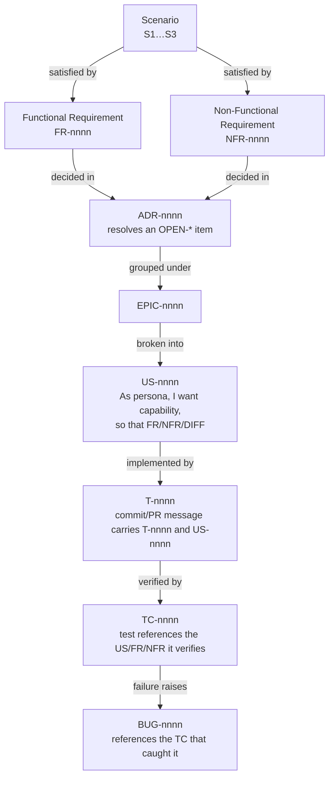
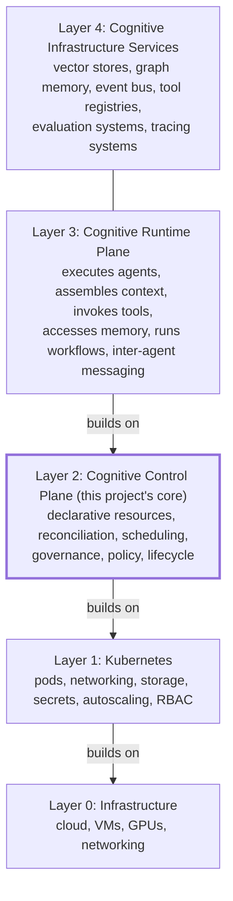
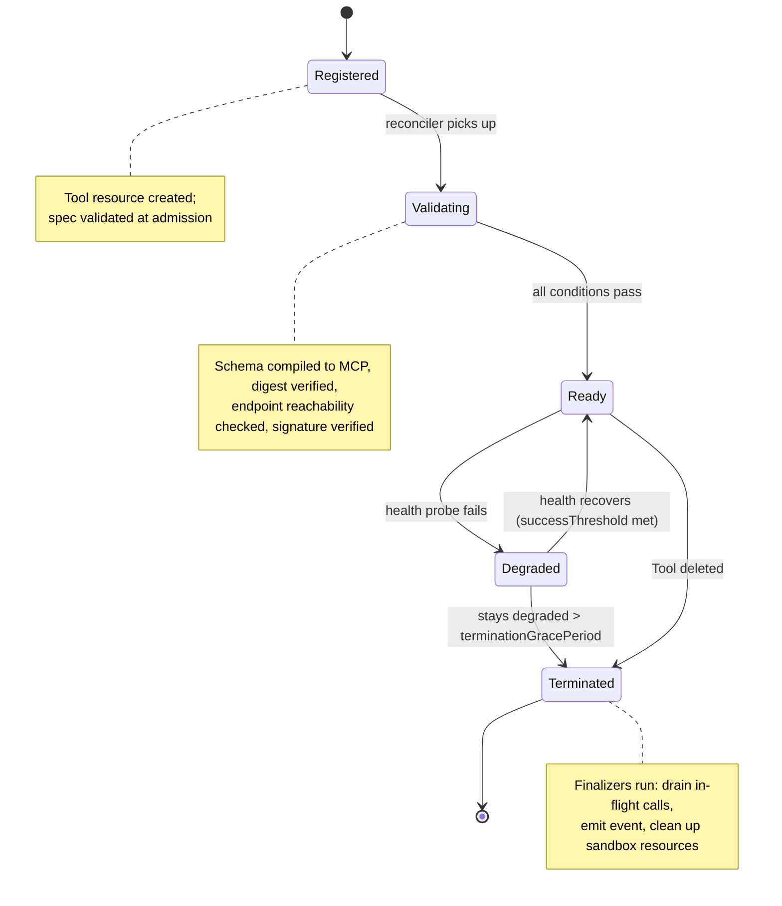
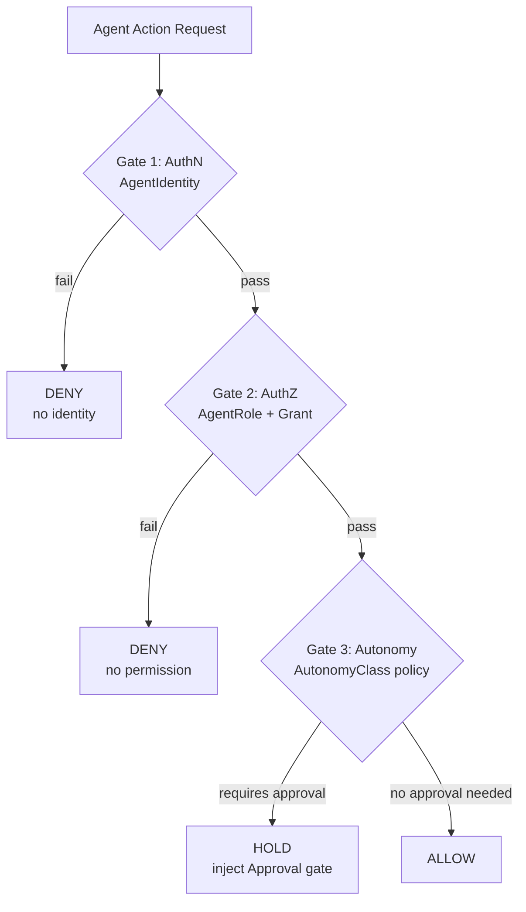
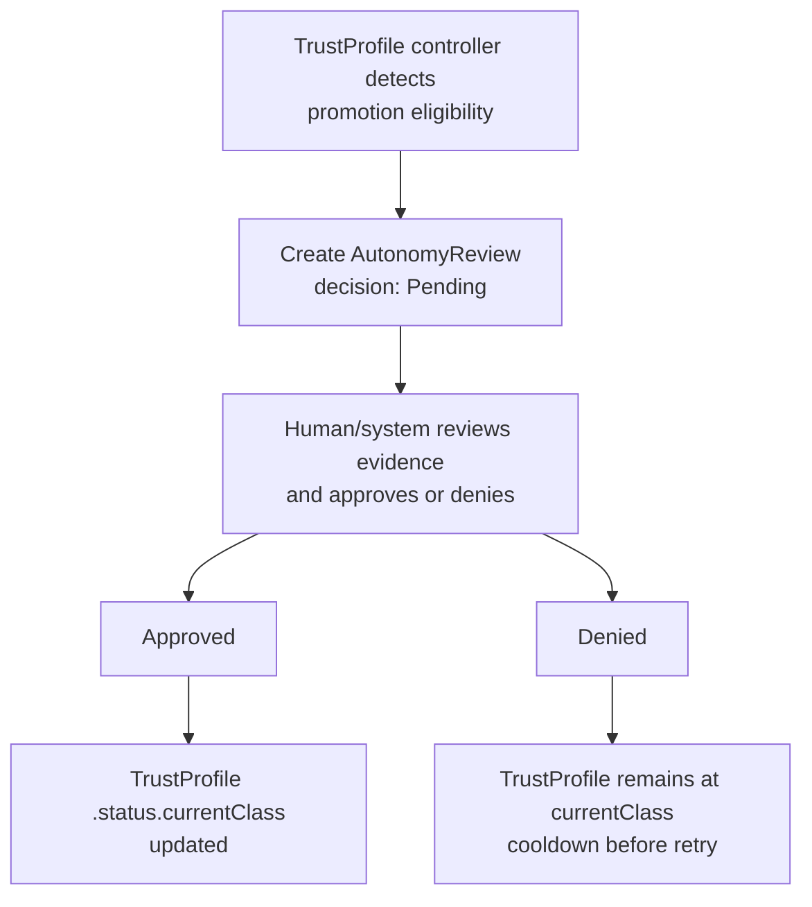
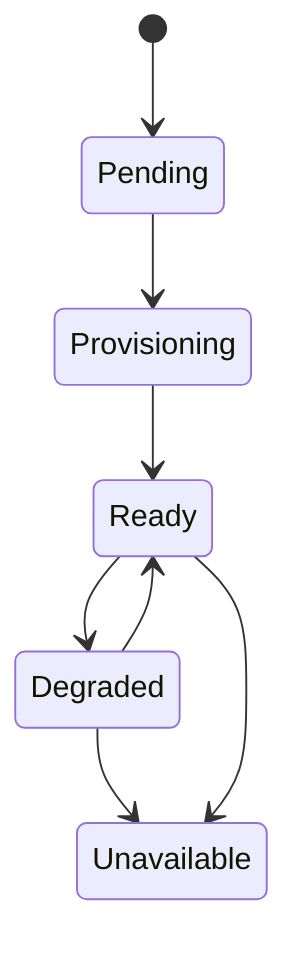
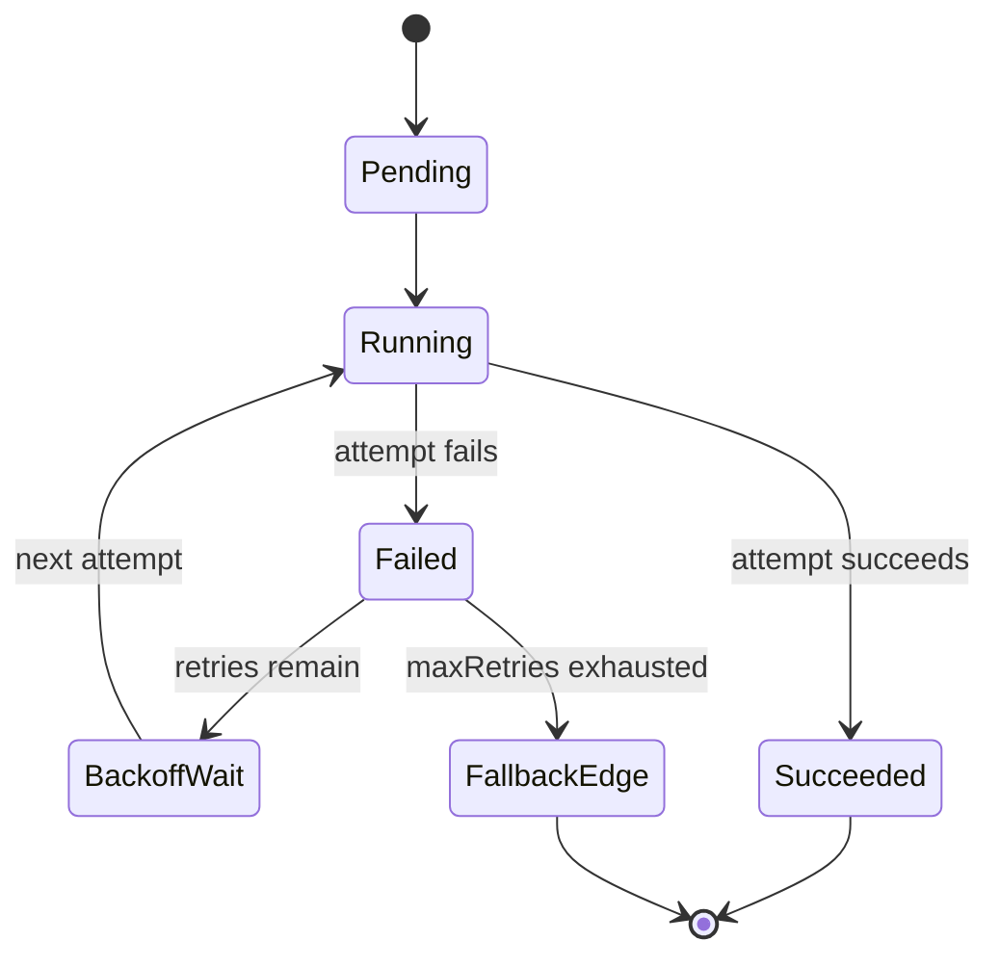

# PROJECT.md — Declarative Cognitive Orchestration Platform

> **Status:** Living design and traceability specification. Last operational review: 2026-08-09.
> **Positioning review:** 2026-11-09. Sections 1 through 3 and their related traceability entries reflect current upstream documentation and release metadata. This review does not certify runtime compatibility, performance, production readiness, or a new execution backend.
> **Purpose:** Record intended contracts, historical decisions, requirements, and open design work. This document includes aspirational and post-MVP behavior.
> **Operational authority:** Use [README.md](README.md), [TUTORIAL.md](TUTORIAL.md), the guides under [docs/](docs/), and [`api/v1alpha1/register.go`](api/v1alpha1/register.go) for currently supported behavior. A completed requirement marker here records project traceability; it does not override current runtime documentation.

---

## 0. Document Conventions

- **DECIDED** — Locked decision, do not change without an ADR.
- **PROPOSED** — Working assumption, subject to review.
- **OPEN** — Explicit gap that must be resolved before backlog decomposition.
- **DEFERRED** — Acknowledged, but intentionally postponed past MVP.
- **ANTI-GOAL** — Explicitly out of scope; rejecting this is part of the design.

Every architectural decision that survives review will be promoted to an ADR (Architecture Decision Record) under `docs/adr/`.

---

## 0.5 Traceability & Identifier Schema

Everything in this project must be traceable from a business-level need down to the line of code that implements it and the test that verifies it. This section defines the **stable identifier schema** and the **traceability chain** that all downstream artifacts (user stories, tasks, tests, ADRs, PRs, commits) MUST use.

### 0.5.1 Identifier schema

| Prefix | Artifact | Lives in | Owner | Stability |
|---|---|---|---|---|
| `S<n>` | Reference Scenario | §4.2 | This doc | LOCKED |
| `AG-<nn>` | Anti-Goal | §3.3 | This doc | LOCKED |
| `CR-<nn>` | Constraint (license, governance, deployment) | §29.3 | This doc | LOCKED |
| `DIFF-<n>` | Differentiation hypothesis; no priority-of-invention claim | §3.6.4 / §29.5 | This doc | LOCKED |
| `FR-<nnnn>` | Functional Requirement | §29.1 | This doc | STABLE — never renumbered, never reused |
| `NFR-<nnnn>` | Non-Functional Requirement | §29.2 | This doc | STABLE — never renumbered, never reused |
| `MVP-<n>` | MVP Success Criterion | §20.2 | This doc | LOCKED |
| `OPEN-<AREA>-<n>` | Open question / unresolved decision | inline | This doc | resolved → ADR-NNNN |
| `RISK-<nn>` | Project risk | §21 | This doc | STABLE |
| `ADR-<nnnn>` | Architecture Decision Record | `docs/adr/ADR-NNNN-*.md` | repo | created when an OPEN item is resolved |
| `EPIC-<nnnn>` | Backlog Epic | work-item board | backlog | groups related US |
| `US-<nnnn>` | User Story | work-item board | backlog | implements one or more FR/NFR/DIFF |
| `T-<nnnn>` | Task | work-item board | backlog | implements one US |
| `TC-<nnnn>` | Test Case | `tests/` + work-item board | repo | verifies one US/FR/NFR |
| `BUG-<nnnn>` | Defect | work-item board | backlog | references TC that exposed it |

**Numbering rules:**

- IDs are **never reused**. A deleted `FR-0042` is gone forever; the next FR is `FR-0043`.
- IDs are **never renumbered** to "tidy up". Re-ordering by ID is meaningless; structure is in groupings, not in the number.
- New FR/NFR IDs allocated in monotonically increasing order at the time they are added. Width-padded to 4 digits.
- ADR/US/T/TC IDs follow the same rule, allocated by the tool that creates them (board or repo helper).

### 0.5.2 The traceability chain

Every implementation artifact carries forward references to its parents and backward references to its children, so the chain is navigable in both directions:



### 0.5.3 Authoring rules (MANDATORY for all downstream work)

1. **Every user story MUST reference at least one** of: `FR-`, `NFR-`, `DIFF-`, `MVP-`, or `RISK-` ID in its body. A US with no parent reference is invalid and will be rejected at refinement.
2. **Every task MUST reference exactly one** parent `US-nnnn`.
3. **Every test case MUST reference at least one** of: `FR-`, `NFR-`, `MVP-`, `DIFF-` ID it verifies.
4. **Every PR description MUST list** the `T-nnnn` it implements and the `TC-nnnn` it adds or modifies.
5. **Every commit message MUST start with** the `T-nnnn` ID (e.g. `T-0123: implement Solution admission webhook`).
6. **Every ADR MUST list** the `OPEN-*` items it closes; closing items are then struck from §25.
7. **Every OPEN item resolved without an ADR** (trivial decisions) MUST still be marked resolved in §25 with a one-line rationale and a date.
8. **Resource kinds in §8.1 each get a synthetic `FR-` row** in §29.1 so they can be referenced by user stories.

### 0.5.4 Tooling expectations

- The work-item board (§6.x of board-config; GitHub Issues or Azure DevOps) MUST support custom fields or labels for: parent IDs, FR/NFR/DIFF references, ADR references, test references.
- A repository-side check (CI hook) MUST validate commit messages and PR descriptions for required ID prefixes. Failing PRs are blocked. (Tracked as `FR-0900` in §29.1.)
- A documentation-side check MUST verify that every FR/NFR has at least one matrix row in §29 and that every OPEN item is either listed in §25 or has been resolved via an ADR.
- A `tools/trace.go` (or equivalent) CLI MUST be able to render the chain for any ID: `trace FR-0042` shows every US, T, TC, ADR, and code path linked to it.

### 0.5.5 Out of scope for traceability

These intentionally do NOT carry IDs:

- Exposition prose in §1–7A (the narrative; the IDs are in the matrices).
- Diagrams.
- Glossary entries.

If a piece of prose introduces a requirement, that requirement MUST be added to §29 with a fresh `FR-` or `NFR-` ID and the prose MUST reference it.

---

## 1. Project Identity

| Field | Value | Status |
|---|---|---|
| Working name | Kognition | DECIDED |
| Repository name | `kognition` | DECIDED |
| API group domain | `kognition.dev` | DECIDED |
| Project positioning | Declarative control plane for governed agent systems | PROPOSED |
| Short tagline | "Declarative control for governed agent systems." | PROPOSED |
| One-line description | Kognition manages agents, workflows, shared memory and knowledge, and enforces resource access, budgets, and autonomous-action approvals across supported execution runtimes. | PROPOSED |

"Kubernetes for cognition" remains architectural shorthand. Declarative APIs,
reconciliation, Kubernetes deployment, MCP, and observability are shared
capabilities in this ecosystem, rather than evidence of unique differentiation.

### Open Questions / Gaps

- ~~**OPEN-ID-1:**~~ **RESOLVED (2026-05-25).** Project name is **Kognition** (`kognition`). Repo folder already renamed. CLI: `kognitionctl`. Container registry namespace: `kognition`. This avoids the word "agent" in the brand (per §3.6.6 risk) and the word "framework" (per anti-goal AG-01).
- ~~**OPEN-ID-2:**~~ **RESOLVED (2026-05-25).** Canonical API group domain is **`kognition.dev`**. All CRDs use `*.kognition.dev` (e.g. `agents.kognition.dev/v1alpha1`). Already reflected in existing implementation and samples.
- ~~**OPEN-ID-3:**~~ **RESOLVED (2026-05-25).** The project is a **CNCF-aspirant open-source project** intended for community use. This implies: Apache-2.0 license, CNCF-compatible governance, DCO sign-off on contributions, and adherence to CNCF Code of Conduct from day one.

The owner decision on 2026-10-10 supersedes the preceding historical license
and contribution assumptions: Microsoft-owned first-party code uses MIT, the
Microsoft CLA and Microsoft Open Source Code of Conduct. See [CONTRIBUTING.md](CONTRIBUTING.md).
Public distribution requires the applicable release reviews. No CNCF admission or
Microsoft public-release approval is implied.

---

## 2. Problem Statement

### 2.1 The pain we are solving

Building production-grade multi-agent systems today requires hand-assembling fragmented pieces:

- An agent framework (LangGraph, AutoGen, CrewAI, Semantic Kernel, Agno, Microsoft Agent Framework).
- A workflow engine (Temporal, Prefect, Airflow, or bespoke).
- A vector database (pgvector, Milvus, Weaviate, Qdrant).
- A graph or relational store for episodic/long-term memory.
- An LLM gateway (LiteLLM, Portkey, AI Gateway).
- A tool protocol (MCP, OpenAPI, function calling).
- An observability stack (OpenTelemetry, Langfuse, Phoenix).
- A policy/governance layer (custom, OPA, guardrails).
- An evaluation harness (Ragas, DeepEval, custom).
- Infrastructure glue (Helm, Terraform, K8s manifests).

Each piece has its own lifecycle, configuration language, failure modes, and operational model. Platforms such as AX, kagent, and Dapr Agents already integrate several of these concerns. Kognition addresses the remaining integration work around shared cognitive resources, resource-specific authorization, autonomous-action approvals, budgets, and recovery across supported runtimes.

### 2.2 Operating and governing agent systems

Agent frameworks, workload control planes, sandbox substrates, and durable execution engines address different parts of production operation. Their responsibilities overlap; no single category establishes that a particular agent action remains authorized after policy changes, approval, suspension, or failure.

Kognition's hypothesis is that platform teams benefit from one declarative operating model for desired agent-system state, shared memory and knowledge, and governed effects. The value must be demonstrated against existing platforms through exact execution profiles and observable enforcement outcomes.

### 2.3 Hypothesis

> If cognitive workloads are modeled as declarative Kubernetes-style resources with reconciliation, scheduling, and policy primitives that understand tokens, context windows, memory, and tools, then teams can build, operate, and govern multi-agent systems with the same operational rigor they apply to microservices today.

### Open Questions / Gaps

- **OPEN-PROBLEM-1:** Is the primary buyer the **platform engineer** (operating agents for others) or the **agent developer** (building agents)? The two have different priorities (the platform engineer wants policy, isolation, quotas; the developer wants productivity, debugging, iteration speed). The split affects every UX decision.
- **OPEN-PROBLEM-2:** Quantify the pain. We need at least 3 concrete reference scenarios (e.g. "a 12-agent research workflow with shared memory and human approval") that the platform must make demonstrably easier than today's stack. Without these, we cannot evaluate design tradeoffs.
- **OPEN-PROBLEM-3:** Is "running on Kubernetes" a hard requirement or a deployment target among others? Many enterprise buyers do not run K8s for AI workloads (they use serverless, dedicated GPU clusters, or managed services). Decide whether K8s is the substrate or merely the inspiration.

---

## 3. Vision & Strategic Positioning

### 3.1 Long-term vision

Provide a declarative control plane for governed agent systems. Keep desired state, resource access, budgets, approvals, and durable effect records explicit while integrating qualified execution runtimes and provider backends.

### 3.2 What we are building (3 framings)

1. A **cognitive control plane**: declarative APIs, reconciliation, governance.
2. A **cognitive runtime integration platform**: qualified execution adapters and provider backends for agents, workflows, memory, and tools.
3. A **declarative operating model**: the shared vocabulary and lifecycle for agentic systems.

### 3.3 What we are explicitly NOT building (Anti-Goals)

- **AG-01:** We are not building yet another agent authoring framework. We orchestrate runtimes; we do not replace them. Existing frameworks (LangGraph, Microsoft Agent Framework, AutoGen, etc.) should be pluggable as runtime providers.
- **AG-02:** We are not building a new LLM. We are model-agnostic.
- **AG-03:** We are not building a new vector database, graph database, or message bus. We orchestrate existing ones.
- **AG-04:** We are not building a no-code agent designer. The primary interface is declarative YAML/JSON manifests and APIs; UI is downstream.
- **AG-05:** We are not replacing Kubernetes. We run on top of it (or initially: alongside it).
- **AG-06:** We are not building a generic workflow engine for non-cognitive workloads. Temporal/Argo/Airflow already exist.

### 3.5 Two-Tier Declarative Model (Intent → Resource)  *(Round 1 — PROPOSED)*

The design exposes **two declarative surfaces**. Their integration is a differentiation hypothesis, without a claim that either surface is unprecedented.

| Layer | Name | What the user writes | Audience |
|---|---|---|---|
| **L_intent** | Solution / Goal | "Research topic X, summarize findings, get human approval before publishing." (natural language or a high-level structured goal) | Primary persona, non-coders, business users |
| **L_resource** | Agent / Workflow / Memory / Tool / Policy | Concrete declarative manifests for the runtime to reconcile | Power users, platform engineers, advanced authors |

**Architecture rule:** L_intent is **compiled** to L_resource by a planner (itself an Agent-typed controller). L_resource records explicit desired state. The runtime only ever reconciles L_resource. This gives:

- An inspectable resource revision whose replay does not require another planning call. Identical goals do not guarantee identical model outputs or plans.
- Natural-language ergonomics at the top.
- A clean escape hatch: advanced users skip the planner and author L_resource directly.
- Replayability: a given L_intent compilation produces an immutable L_resource revision that can be re-deployed without re-planning.

**Implications already accepted:**

- The platform ships **both** layers; neither is optional in the long term.
- The planner is implemented as a controller, not a one-shot CLI tool; it can re-plan on drift or user edits.
- The CLI / web UI in the original vision targets **L_intent**; `kubectl`-style tooling targets L_resource.

See §11 (Workflow Model) and §6.3 for downstream consequences.

### Open Questions / Gaps

- **OPEN-INTENT-1:** Define the L_intent → L_resource compiler contract: does the planner emit a *full* manifest set, or a *patch* against existing resources? (PROPOSED: full manifest set producing a new revision; patches are a v2 concern.)
- **OPEN-INTENT-2:** Determinism guarantees of the compiler. Same goal + same model + same context should ideally produce the same plan. (PROPOSED: best-effort determinism with seedable runs; full determinism is research, not MVP.)
- **OPEN-INTENT-3:** Should L_intent itself be a first-class resource kind (e.g. `Solution`) so that the planner reconciles against the goal, not just runs once? (PROPOSED: yes — this is what makes "self-healing" intent meaningful.)

---

### 3.4 Competitive and adjacent landscape

Evidence date: **2026-11-09**. The linked upstream documentation and release
metadata establish declared scope, rather than comparative deployment acceptance.
Revalidate this snapshot before external publication. Published scale and latency
figures are upstream claims or targets, not benchmarks performed by Kognition.

| Project and primary sources | Scope observed | Relationship to Kognition |
| --- | --- | --- |
| [Google AX](https://github.com/google/ax), [concepts](https://github.com/google/ax/blob/main/docs/concepts.md), [v0.3.1](https://github.com/google/ax/releases/tag/v0.3.1) | Declarative `Task`, `Workspace`, and `Model` resources; custom runners; task lifecycle on Agent Substrate. Breaking-change warning remains | Direct overlap in workload orchestration; compare system-level governance and shared-resource lifecycle |
| [Agent Substrate](https://github.com/agent-substrate/substrate), [architecture](https://github.com/agent-substrate/substrate/blob/main/docs/concepts/architecture.md), [v1.0.0](https://github.com/agent-substrate/substrate/releases/tag/v1.0.0) | Sandboxed actors on worker pools, suspension/restoration, routing, identity, network mediation, and external credential injection | Candidate optional execution backend; distinct from an agent framework or cognitive resource model |
| [kagent](https://github.com/kagent-dev/kagent/tree/v1.0.0), [Substrate transition](https://kagent.dev/blog/the-future-of-kagent), [v1.0.0](https://github.com/kagent-dev/kagent/releases/tag/v1.0.0) | Declarative agents/templates, multiple harnesses, models, MCP servers, sessions, UI, and Substrate-backed execution | Closest direct competitor. Current Go/Python ADK, Claude, Codex, and custom harness support supersedes the earlier AutoGen-only comparison |
| [Rossoctl, formerly Kagenti](https://github.com/rossoctl/rossoctl), [architecture](https://github.com/rossoctl/rossoctl/blob/main/docs/concepts/core/architecture.md), [AuthBridge](https://github.com/rossoctl/rossoctl/blob/main/docs/security/authbridge.md) | Kubernetes platform, agent/tool onboarding, identity, discovery, proxy enforcement, token exchange, and observability | Direct overlap in enterprise infrastructure and mediated access; identity and external enforcement are shared concepts |
| [Dapr Agents](https://github.com/dapr/dapr-agents), [Dapr Workflow](https://docs.dapr.io/developing-applications/building-blocks/workflow/workflow-overview/) | Agent applications using durable workflows, virtual actors, messaging, state, access scopes, and declarative infrastructure | Alternative distributed application architecture; candidate integration with separately qualified semantics |
| [LangGraph](https://docs.langchain.com/oss/python/langgraph/overview), [LangSmith Deployment](https://docs.langchain.com/langsmith/deployment) | Stateful graph execution, memory, interrupts, streaming, and deployment/control-plane capabilities with cross-framework support | Application/runtime platform alternative; distinguish open-source LangGraph from separately licensed commercial deployment capabilities |
| [AgentScope 2.0](https://github.com/agentscope-ai/agentscope), [Runtime consolidation notice](https://github.com/agentscope-ai/agentscope-runtime) | Framework, multi-tenant serving, teams, RAG, resource sharing, persistence, and sandbox integrations. The former Runtime repository directs users to 2.0 | Platform and resource-management overlap as well as a possible runtime integration |
| [Microsoft Agent Framework](https://github.com/microsoft/agent-framework) | Agent and multi-agent workflow SDKs, declarative agents, checkpoints, human intervention, middleware, observability, and hosting integrations | Candidate framework integration; overlaps with orchestration and developer experience |
| [Temporal](https://github.com/temporalio/temporal), [Restate](https://docs.restate.dev/ai) | Durable execution, recovery, coordination, and agent integration patterns | Execution-engine alternatives or complements; durability and approvals alone are shared capabilities |
| [Kubernetes Agent Sandbox](https://github.com/kubernetes-sigs/agent-sandbox) | Sandbox, template, claim, and warm-pool CRDs with identity, storage, and lifecycle; delegates isolation to configured sandbox runtimes | Infrastructure complement/backend candidate, separate from Agent Substrate |

Kubeflow/KServe and Ray remain adjacent serving/compute infrastructure. AutoGen,
AG2, CrewAI, and other authoring SDKs remain relevant to the adapter backlog.
Their presence here does not establish a supported Kognition integration.

### Open Questions / Gaps

- **OPEN-VISION-1:** Maintain the sourced snapshot in §3.4 and validate the claimed differences against exact upstream versions and Kognition acceptance profiles before scope freeze or publication. This documentation review does not close comparative execution acceptance.
- **OPEN-VISION-2:** Demonstrate the proposed advantage in integrated resource governance, exact-action authority, shared memory/knowledge lifecycle, and recovery. The two-tier authoring model remains a hypothesis; runtime independence and declarative deployment alone are insufficient differentiation.
- **OPEN-VISION-3:** Decide explicitly whether this project should target CNCF sandbox eventually. If yes, it constrains governance, IP, dependencies, and code-of-conduct from day one.

---

### 3.6 Differentiation and integration boundaries

The positioning emphasizes governed agent systems and recognizes direct
competition in orchestration and platform operation. This section distinguishes
current contracts, scoped acceptance, and proposed integrations. It makes no
priority-of-invention or blanket competitor-absence claims.

#### 3.6.1 AX and Agent Substrate

AX controls agent tasks and prepared workspaces. Agent Substrate supplies the
underlying sandboxed actor lifecycle and worker pools. They overlap with different
parts of Kognition and should be assessed independently:

- AX `Workspace` prepares repositories, files, MCP configuration, and skills.
  Kognition `Workspace` expresses a tenant/policy scope. Translation requires
  explicit semantics rather than matching kind names.
- Substrate separates actor activation from ordinary Kubernetes scheduling and
  mediates network access. Its external credential injection and policy extension
  points invalidate claims that competing isolation is limited to Kubernetes RBAC.
- A sandbox snapshot preserves execution state; cognitive memory and knowledge
  require their own authorization, provenance, retention, and lifecycle.
- Checkpoint behavior depends on the selected backend/profile. The current
  [AX runner contract](https://github.com/google/ax/blob/main/docs/runner.md)
  describes a restored workspace with a new process tree. Do not equate every
  suspend/resume path with preservation of RAM or in-flight effects.

#### 3.6.2 Kognition evidence and limits

| Evidence class | Current evidence | Limit on positioning |
| --- | --- | --- |
| Resource model | [Canonical registry](api/v1alpha1/register.go) includes agents, workflows, memory/knowledge claims, grants, quotas, autonomy, and approvals | Registration or schema presence does not establish working end-to-end execution |
| Governed action execution | [ADR-0014](docs/adr/0014-runtime-autonomy-gate-completion-and-recovery.md), [Tool Gateway](internal/toolgateway/gateway.go), and [runtime profiles](docs/runtime-binding-profiles.md) describe durable approval/execution ownership and scoped acceptance | Qualify the exact action plane, deployment mode, failure path, and release set; no general exactly-once effect guarantee |
| Runtime contract and adapters | [Runtime interface](internal/runtime/contract.go) and [binding profiles](docs/runtime-binding-profiles.md) cover sessions, streaming, cancellation, checkpoints, native execution, and an AutoGen worker | Other frameworks remain proposed until their exact adapters and deployment profiles pass conformance |
| kagent compatibility | [Offline import planner](docs/runtime-binding-profiles.md#offline-kagent-compatibility-planning) assesses bounded, pinned AutoGen-era inputs without executing them | It emits a non-executable plan with blockers, not current kagent compatibility or unchanged-workload acceptance |
| Deployment and provider independence | [Refactor plan](docs/development-plans/refactoring/repository-refactor-plan.md) retains standalone and Kubernetes modes and proposes a cloud-independent core | Existing cloud dependencies, local capability gaps, and standalone governed-retrieval gaps require qualification; repository extraction and Substrate integration are not approved by this review |

#### 3.6.3 Side-by-side capability matrix

| Concern | AX | Agent Substrate | Kognition |
| --- | --- | --- | --- |
| Primary abstraction | Task in a prepared workspace | Sandboxed actor assigned to a worker | Agent system with workflows, shared resources, and governance |
| Work composition | Workload/harness plans and delegates | Hosts stateful workloads | Explicit Workflow/WorkflowRun and Solution planning model |
| Execution infrastructure | Uses Substrate actor lifecycle | Worker pools, sandbox isolation, suspension, restoration, and activation routing | Current dispatch/runtime implementations; no equivalent density/activation benchmark established here |
| Authority | Task/model configuration and substrate controls | Actor identity, atespace authorization, mediated networking, credential injection, extensible enforcement | Resource-specific gateways/grants and exact-action approval/execution contracts |
| State | Prepared filesystem; runner/profile-specific recovery | Execution snapshots and storage | Runtime checkpoints plus separately governed memory and knowledge resources |
| Extensibility | Custom runner/container contract | Framework-agnostic workload hosting | Cognitive Runtime contract with profile-specific adapter qualification |
| Deployment | Kubernetes with Substrate | Kubernetes worker infrastructure | Standalone and Kubernetes modes with documented acceptance gaps |

The landscape table in §3.4 covers other platforms. Absence of a named resource
from their documentation is not proof that they lack equivalent behavior.

#### 3.6.4 Differentiation hypotheses and evidence

Lead with the integrated operating model and verify its observable outcomes:

1. **Governed actions across failure and recovery.** Separate authentication,
   resource authorization, human approval, execution ownership, quota accounting,
   and uncertain outcomes. [ADR-0014](docs/adr/0014-runtime-autonomy-gate-completion-and-recovery.md)
   defines the exact-action contract. Snapshot restoration must never revive
   stale authority or create a second execution owner.
2. **Shared cognitive resources with independent lifecycle.** Memory and knowledge
   classes/claims/grants express allocation, access, refresh, retention, and
   revocation independently of agent containers. [ADR-0015](docs/adr/0015-provider-integration-boundaries.md)
   separates core governance from provider execution. Revocation blocks future
   governed access; it cannot erase information already delivered or copied.
3. **Auditable delegated autonomy.** AutonomyClass, TrustProfile, AutonomyReview,
   and RuntimeApproval make authority ceilings and decisions explicit. A trust
   score does not prove correctness or safety and does not replace grants.

The existing identifiers remain stable: `DIFF-1` covers two-tier authoring,
`DIFF-2` resource-specific isolation, `DIFF-3` reasoning probes/recovery, and
`DIFF-4` runtime conformance. They are hypotheses to demonstrate, not claims of
exclusive capability or current support for every design in this document.
YAML, CRDs, reconciliation, Kubernetes, MCP, checkpoints, human intervention,
and OpenTelemetry are shared ecosystem capabilities.

#### 3.6.5 Qualified integration strategy

Status: **PROPOSED evaluation**, except for the existing contracts and scoped
acceptance linked in §3.6.2. This positioning update does not approve backend
replacement, repository extraction, or deployment migration.

| Integration surface | Direction | Qualification boundary |
| --- | --- | --- |
| Cognitive runtime | Keep native and AutoGen profiles explicit; evaluate other framework adapters under FR-0604 | Sessions, streaming, backpressure, cancellation, checkpoints, identity, and supported capabilities; no one-field migration promise |
| Compute/sandbox lifecycle | Evaluate optional Agent Substrate integration under OPEN-DIFF-4 before duplicating its actor infrastructure | Placement and sandbox lifecycle differ from the existing Runtime session/step contract; interface changes require design review and an ADR where appropriate |
| AX workloads | Consider an adapter for installations that already use AX; prefer evaluating direct Substrate integration first | Define one lifecycle owner and avoid competing reconciliation loops; AX is not a mandatory dependency |
| Workflow execution | Dapr Workflow/Temporal remain proposed engine adapters under FR-0605; Restate is adjacent prior art | Approval, cancellation, replay, and external-effect semantics need explicit mapping and tests |
| Memory, knowledge, and tools | Reuse existing provider/SDK boundaries and evaluate FR-0607/FR-0608 adapters | Preserve current grants, scope, revocation, quotas, citations, and failure semantics; backend or protocol compatibility alone is insufficient |
| kagent manifests | Preserve the bounded offline planner; FR-0606 remains a proposed compatibility shim | Pin source schema/version and review model/tool bindings; AutoGen support does not establish kagent 1.x compatibility |
| Deployment and packaging | Preserve standalone and Kubernetes targets; stage cloud-independent boundaries in the current repository | Follow the [refactor plan](docs/development-plans/refactoring/repository-refactor-plan.md); local execution, mode parity, release sets, and extraction require separate gates |

For a candidate execution backend, evaluate forced routing through governance
gateways, tenant/workload identity mapping, fresh capability validation after
restore, stale-snapshot rejection, and durable effect records independent of
snapshot state. Happy-path restoration alone cannot establish compatibility.

#### 3.6.6 Risks specific to this positioning

| Risk | Mitigation |
|---|---|
| Existing platforms converge on the same features | Compare exact versions and end-to-end enforcement outcomes rather than resource names or invention claims |
| "Yet another Kubernetes agent platform" perception | Lead with governed effects, shared cognitive resources, and recovery evidence |
| Adapter or compatibility claims exceed acceptance | Publish exact qualified profiles and limitations; retain blocked imports as non-executable plans |
| Restored snapshots revive stale authority or replay effects | Revalidate current authority and preserve durable execution ownership outside sandbox snapshots |
| Scope expands into a competing actor/sandbox implementation | Evaluate existing infrastructure under OPEN-DIFF-4; preserve the standalone target and approved deployment boundaries |

### Open Questions / Gaps  *(Round 2)*

- **OPEN-DIFF-1:** Qualify the existing MVP-6 Solution-planning and MVP-7 memory-revocation demos. Lead public positioning with the governed-action and recovery evidence in §3.6.4. Revocation claims concern future governed reads, not erasure of previously delivered context.
- **OPEN-DIFF-2:** Qualify the native and AutoGen profiles as the initial conformance set. Additional framework adapters remain proposed without release-date or current-kagent parity promises.
- **OPEN-DIFF-3:** Validate the governed-agent-systems positioning against platform-engineer scenarios. Recognize direct competition with AX, kagent, Rossoctl, and other platforms alongside opportunities for qualified integration.
- **OPEN-DIFF-4:** Evaluate Agent Substrate as an optional compute/sandbox backend. Decide lifecycle ownership, identity mapping, gateway routing, capability refresh, snapshot/effect recovery, standalone behavior, and measured acceptance before approving architecture or implementation.

---

## 4. Personas & Primary Use Cases

### 4.1 Personas (PROPOSED — to be validated)

| Persona | Goal | Pain today |
|---|---|---|
| **Platform Engineer (Patricia)** | Operate a multi-tenant agent platform for many internal teams | No standard API; every team brings their own stack; no governance |
| **Agent Developer (Diego)** | Build and ship a 3–10 agent workflow into production | Glue code everywhere; brittle memory; no rollout strategy |
| **AI Safety / Governance Officer (Gabriela)** | Enforce policies on what agents can do, see, and spend | No central enforcement point; audits are forensic, not preventive |
| **SRE / On-Call (Sam)** | Diagnose a misbehaving agent at 2am | No reasoning lineage; logs are unstructured; rollback is manual |
| **Data / Knowledge Engineer (Karim)** | Curate the knowledge bases agents rely on | Ingestion pipelines are bespoke per agent |

### 4.2 Reference scenarios  *(Round 1 — LOCKED)*

These three scenarios are the testbed against which every design decision is judged. Every API, resource, and runtime feature in the MVP must demonstrably support at least one of them; together they must cover all three.

#### S1 — Single-agent assistant with tools and memory
*Smallest viable "it works" demo.*

- One `Agent` with one model, 2–3 MCP tools, episodic memory, and semantic recall from a `KnowledgeBase`.
- Proves: runtime contract, memory I/O, tool invocation, basic policy, telemetry.
- L_intent expression: trivial — user can author L_resource directly.

#### S2 — Linear multi-agent pipeline with a human-approval gate
*Proves multi-agent orchestration and human-in-the-loop.*

- 4 agents (planner → researcher → writer → publisher) with an explicit approval step before publishing.
- Shared episodic memory; tool-permission boundaries differ per agent (only the publisher can call the external publish tool).
- Proves: `Workflow`, inter-agent message passing, `AgentPolicy`, human-approval tool, durable workflow state (crash-resume mid-pipeline).
- L_intent expression: optional — both authoring modes demonstrated.

#### S3 — Dynamic solution from a natural-language goal
*Proves the L_intent → L_resource compiler. This is the demo that sells the platform.*

- User submits a `Solution` resource containing a natural-language goal (e.g. "Monitor a list of competitor product launches and produce a weekly summary with verified citations").
- Platform's planner-controller compiles this into a concrete L_resource revision: N agents, their workflow, required tools, memory layout, policies.
- The compiled solution deploys and runs end-to-end without further user intervention.
- Edits to the goal trigger replan + a new revision; old revisions remain inspectable.
- Proves: two-tier declarative model, planner-as-controller, immutable revisions, end-to-end "declare outcome → get system" UX.

### Open Questions / Gaps

- **OPEN-PERSONA-2:** Are there non-LLM cognitive workloads we want to support (classical ML, rule engines, hybrid systems)? Affects "Agent" abstraction breadth. (PROPOSED: defer; `Agent` is LLM-shaped for MVP, with a runtime-provider interface that *could* admit non-LLM workloads later.)

---

## 5. Scope

### 5.1 MVP scope (PROPOSED)

MVP must prove the **declarative + reconciliation thesis** end-to-end on a single reference scenario, with the smallest possible surface area.

In-scope for MVP:

1. CRDs (or CRD-equivalents): `Agent`, `Tool`, `Memory`, `KnowledgeBase`, `Workflow`, `AgentPolicy`.
2. Cognitive API Server (CRUD + watch + admission).
3. Controller Manager with reconcilers for the above resources.
4. One reference Cognitive Runtime that executes a single agent and a simple DAG workflow.
5. One memory backend (PROPOSED: pgvector + Postgres for episodic).
6. One tool protocol (PROPOSED: MCP).
7. One model provider abstraction with at least two providers (PROPOSED: OpenAI-compatible + Azure OpenAI / Foundry).
8. OpenTelemetry-based tracing of reasoning lineage.
9. Namespaced multi-tenancy.
10. One reference scenario runnable end-to-end via `kubectl apply -f`.
11. **At least two runtime adapters**, validated against the Conformance Suite (§3.6.5). The initial qualification targets are the native runtime and an AutoGen worker, with exact version, identity, capability, and deployment profiles. Current kagent compatibility is a separate acceptance question (`OPEN-DIFF-2`).
12. **Conformance Suite v0.1** (`OPEN-K8S-13`): a portable test bench that runtime / memory / tool plugins must pass. Required so runtime pluralism is real, not marketing.
13. **Four-plane isolation (`AgentCommunicationPolicy`, `MemoryGrant`, `ToolGrant`, `ModelGrant`) wired end-to-end**, with default-deny posture and enforcement at admission AND at runtime call time. Demonstrate resource-specific enforcement under DIFF-2 (§3.6.4).
14. **`ReasoningProbe`** and at least two declared restart-ladder responses (`RollbackRevision`, `DegradeModel`), with observable failure and recovery under DIFF-3. This target does not assert invention priority or production qualification.
15. **`Solution` resource + planner-controller** sufficient to compile S3's natural-language goal into a runnable revision. Retain the DIFF-1 authoring hypothesis (§3.6.4) without claiming exclusive capability.
16. `CognitiveQuota` + `CognitiveLimitRange` enforcement at all three points (admission, runtime, policy), per `OPEN-K8S-4`.
17. `IntentGateway` (minimal): single HTTP/gRPC entry point that accepts a `Solution` goal and routes it.
18. `AgentService` (minimal): stable name + revision pinning (no weighted split in MVP).
19. `AgentAutoscaler` (minimal): horizontal scaling on queue depth + p95 latency.

### 5.2 Post-MVP (DEFERRED)

- Cognitive Scheduler with token/cost-aware placement (MVP uses naive placement).
- `AgentService` (canary, traffic splitting, versioning).
- `Evaluation` and `ReflectionPolicy` resources.
- Multiple memory backends, graph memory, shared memory across agents.
- Federation across clusters.
- Marketplace of `AgentClass` and `Tool` definitions.
- Web UI.

### 5.3 Out of scope (permanent)

See §3.3 Anti-Goals.

### Open Questions / Gaps

- **OPEN-SCOPE-1:** Confirm the MVP reference scenario. Picking it early shapes every API.
- **OPEN-SCOPE-2:** Decide whether MVP runs **on Kubernetes** (CRDs + operators from day one) or **as a standalone control plane** (own API server, Kubernetes integration later). The bootstrap implies the former; the latter is significantly faster to prototype and avoids early lock-in. This is the single highest-leverage decision in the project.
- **OPEN-SCOPE-3:** Is `Workflow` MVP-essential, or can MVP be "single-agent with tools and memory" and `Workflow` come in v0.2? Cutting it would dramatically shrink MVP.

---

## 6. Architectural Vision

### 6.1 Layered model



### 6.2 Separation of concerns

- **Kubernetes** handles infrastructure orchestration.
- **DCOP** handles cognitive orchestration on top.
- The two must compose cleanly; DCOP must not duplicate Kubernetes responsibilities.

### Open Questions / Gaps

- **OPEN-ARCH-1:** Where does the boundary lie between "control plane" (Layer 2) and "runtime plane" (Layer 3)? Concretely: who owns context assembly, retry logic, and reasoning loops? The bootstrap is ambiguous. A clean contract is required before backlog.
- **OPEN-ARCH-2:** Is the runtime plane a single process per agent, a shared multi-tenant service, or a pool of workers consuming from a queue? Each option has different isolation, cost, and latency profiles.
- **OPEN-ARCH-3:** Define the failure-domain boundaries. If the control plane is down, do running agents keep running? (Kubernetes answer: yes — kubelet keeps pods running. We should match this.)

---

## 7. Core Components

For each component, the bootstrap proposes a Kubernetes analog. We adopt the analogs as **mental models, not implementation mandates**.

### 7.1 Cognitive API Server (analog: kube-apiserver)

- Exposes declarative APIs (REST + watch; gRPC PROPOSED for internal).
- Persists desired state.
- Validates and admits resources.
- Emits change events for controllers.

### 7.2 Cognitive State Store (analog: etcd)

- **PROPOSED for MVP:** PostgreSQL (operational simplicity, transactional semantics, mature tooling).
- **OPEN-COMP-1:** etcd vs Postgres vs FoundationDB. Decision drivers: watch semantics, transaction model, operability, ecosystem familiarity. Postgres is the pragmatic MVP choice; etcd is the K8s-native choice; FoundationDB is overkill at this stage.

### 7.3 Cognitive Scheduler (analog: kube-scheduler)

- Decides **where and on which model/runtime** a cognitive workload runs.
- Dimensions beyond CPU/memory: token pressure, context availability, model capability, semantic locality, tool locality, latency, cost, trust (`TrustProfile.status.currentScore` and `currentClass` — see §10B), session affinity.
- **MVP simplification (PROPOSED):** ship a naive scheduler (round-robin across runtimes; static model selection) and design the interface for pluggability so the real scheduler can be swapped in.

### 7.4 Agentlet (analog: kubelet)

- Runs on worker nodes (or as a sidecar).
- Manages local execution lifecycle, context assembly, tool calls, memory I/O, telemetry, health.
- **OPEN-COMP-2:** Does the Agentlet survive control-plane outages? (Should — match kubelet semantics.)
- **OPEN-COMP-3:** Is the Agentlet a separate process or a library embedded in the runtime? Concrete deployment shape must be decided.

### 7.5 Controller Manager (analog: kube-controller-manager)

- Hosts reconcilers for every resource kind.
- Each controller owns a single resource kind (Operator pattern).

### 7.6 Cognitive Runtime

- The actual execution engine for a session/task/agent.
- Runtime providers are pluggable: Microsoft Agent Framework, LangGraph, AutoGen, custom.
- **OPEN-COMP-4:** Define the **Runtime Contract** (§12). This is the most important API in the system.

### Open Questions / Gaps

- **OPEN-COMP-5:** Which components are MVP-required vs deferred? Initial proposal: API Server, State Store, Controller Manager, one Cognitive Runtime, one Agentlet are MVP; Scheduler stub-only.
- **OPEN-COMP-6:** Implementation language(s). Bootstrap proposes Go for control plane and Rust/Go for runtime. Mixing increases operational burden; picking one (Go) reduces risk. **PROPOSED:** Go for everything in MVP; Rust deferred to a specific component that justifies it.

---

## 7A. Kubernetes Analogy & Holistic Coverage  *(Round 2 — PROPOSED)*

This chapter is the canonical reference for how the platform maps Kubernetes primitives into cognitive primitives. The point is not to mimic Kubernetes syntactically; it is to **reuse the architectural patterns that made Kubernetes work** — declarative spec/status, level-triggered reconciliation, separation of policy from execution, default-deny isolation, level-based self-healing — and stretch them across every dimension a serious multi-agent platform must cover.

If a concern below has no proposed resource or controller, that is a gap to close in this round.

### 7A.1 Master analogy map

| Concern | Kubernetes primitive | Cognitive analog (this platform) | MVP? |
|---|---|---|---|
| **Workload spec** | Pod | `AgentInstance` (a running session of an Agent) | ✅ |
| **Replicated workload** | Deployment | `Agent` (manages revisions + replicas of AgentInstances) | ✅ |
| **Replica controller** | ReplicaSet | (internal) AgentRevision | ✅ |
| **Stateful workload** | StatefulSet | `SessionSet` (ordered, stable-identity, durable sessions — e.g. long-running conversational agents) | ⏳ |
| **One-per-node workload** | DaemonSet | `AgentDaemon` (e.g. a telemetry/guardrail agent on every runtime node) | ⏳ |
| **Batch run** | Job | `AgentJob` (one-shot agent execution with completion semantics) | ✅ |
| **Scheduled batch** | CronJob | `AgentCronJob` | ⏳ |
| **High-level intent** | (none) | `Solution` — L_intent resource, planner-compiled | ✅ |
| **Stable endpoint** | Service | `AgentService` (versioned, load-balanced front for Agent replicas) | ✅ (minimal) |
| **External entry** | Ingress / Gateway API | `IntentGateway` (entry point that accepts goals/messages, routes to Solutions/Agents) | ✅ (minimal) |
| **Agent-to-agent isolation** | NetworkPolicy | `AgentCommunicationPolicy` (who may message/call whom) | ✅ (default-deny) |
| **Pod-to-storage isolation** | (none directly) | `MemoryGrant` (who may read/write which Memory) | ✅ |
| **Persistent storage claim** | PersistentVolumeClaim | `MemoryClaim` (an Agent requests memory of a given class/size/policy) | ✅ |
| **Storage backend tier** | StorageClass | `MemoryClass` (e.g. fast-volatile, durable-pgvector, graph-neo4j) | ✅ |
| **Concrete persistent storage** | PersistentVolume | `MemoryVolume` (bound, provisioned memory instance) | ✅ |
| **Workload identity** | ServiceAccount | `AgentIdentity` (SPIFFE-backed) | ✅ |
| **Authorization** | RBAC | `AgentRole` / `AgentRoleBinding` (verbs over resources + cognitive verbs: `invoke`, `read-memory`, `call-tool`) | ✅ |
| **Tenant boundary** | Namespace | `Workspace` (cognitive namespace; default-deny across workspaces) | ✅ |
| **Resource caps per tenant** | ResourceQuota | `CognitiveQuota` (token-in, token-out, $/h, tool-calls/min, model-class quotas) | ✅ |
| **Per-workload defaults/caps** | LimitRange | `CognitiveLimitRange` (default + max per-Agent token, time, $, tool budgets) | ✅ |
| **Voluntary disruption budget** | PodDisruptionBudget | `SessionDisruptionBudget` (do not drain more than N% of in-flight sessions at once) | ⏳ |
| **Priority + preemption** | PriorityClass | `AgentPriorityClass` (interactive vs batch vs background reflection) | ⏳ |
| **Autonomy tier** | PriorityClass (named levels) | `AutonomyClass` (named tiers — supervised/assisted/autonomous — with approval policies and action constraints) | ✅ |
| **Trust scoring** | HPA + custom metrics | `TrustProfile` (per-agent metric-driven trust evaluation; manages tier promotion/demotion on sliding window) | ✅ |
| **Tier promotion review** | CertificateSigningRequest | `AutonomyReview` (evidence-based human approval for tier promotion; Pending → Approved/Denied) | ✅ |
| **Negative scheduling** | Taints | `RuntimeTaint` / `ModelTaint` (e.g. node has restricted-data; only tolerating agents may schedule) | ⏳ |
| **Positive scheduling** | Tolerations | `Toleration` (agent declares it can tolerate a taint) | ⏳ |
| **Affinity** | Node/Pod affinity | `RuntimeAffinity` / `ModelAffinity` / `MemoryAffinity` / `SessionAffinity` (semantic locality) | ⏳ |
| **Probes** | liveness/readiness/startup | `AgentHealthProbe` (heartbeat), `ReadinessProbe` (model+tools reachable), `ReasoningProbe` (canary task succeeds) | ✅ |
| **Horizontal scaling** | HPA | `AgentAutoscaler` (scales replicas on queue depth, latency, token pressure, cost-per-task) | ✅ (minimal) |
| **Vertical scaling** | VPA | `ModelAutoscaler` (promote agent to a stronger model tier under SLO pressure; demote under cost pressure) | ⏳ |
| **Cluster scaling** | Cluster autoscaler | `RuntimeAutoscaler` (add runtime workers; tied to K8s autoscaler when on K8s) | ⏳ |
| **Event-driven scaling** | KEDA | Built into `AgentAutoscaler` (queue-depth, event-lag, schedule triggers) | ⏳ |
| **Configuration** | ConfigMap | `Prompt` (and inline config blocks for non-prompt config) | ✅ |
| **Secrets** | Secret | `SecretRef` (indirection to K8s Secret / Vault / internal) | ✅ |
| **Init containers** | initContainers | `PreflightStep` in Agent/Workflow (pre-conditions, warmups) | ⏳ |
| **Sidecars** | sidecar containers | `CompanionAgent` (e.g. critic, guardrail, fact-checker attached to a primary agent) | ⏳ |
| **Admission control** | ValidatingAdmissionWebhook / MutatingAdmissionWebhook | `CognitiveAdmissionPolicy` (validate prompts/tools/quotas/safety at admission; mutate to inject defaults) | ✅ (subset) |
| **Policy engine** | OPA / Gatekeeper / Kyverno | Native policy DSL backed by OPA/Rego, applied at admission **and** at runtime tool-call time | ✅ |
| **Custom resources** | CRDs | Resource extension API (same model) | ✅ |
| **Operators** | Operator pattern | Controllers per kind (the project IS an operator suite) | ✅ |
| **Service mesh** | Istio / Linkerd | `AgentMesh` (mTLS, retries, circuit breaking, traffic split between agent revisions) | ⏳ |
| **Traffic split / canary** | Argo Rollouts / Flagger | Built into `AgentService` revision routing | ⏳ |
| **Observability** | Metrics/Logs/Traces | Same wire format (OTel), with reasoning-lineage extension | ✅ |
| **Cost / billing** | (kubecost, OpenCost) | Built-in: every reasoning step, tool call, and model call is cost-tagged via `CognitiveQuota`/`AgentIdentity` | ✅ |
| **Package format** | Helm chart | `SolutionBundle` (Solution + referenced resources packaged for distribution) | ⏳ |
| **Marketplace** | Artifact Hub | Agent/Tool/Solution catalog | ⏳ |
| **GitOps** | Argo CD / Flux | First-class: all resources are reconciled from desired state; Git is a fine source | ✅ (compatible) |
| **Audit log** | apiserver audit | `CognitiveAuditLog` (every spec change + every reasoning step + every tool call) | ✅ |
| **Worker agent on node** | kubelet | `Agentlet` | ✅ |
| **Scheduler** | kube-scheduler | `CognitiveScheduler` | ✅ (stub in MVP) |
| **API server** | kube-apiserver | `CognitiveAPIServer` | ✅ |
| **State store** | etcd | Postgres (control-plane store) | ✅ |
| **Controller manager** | kube-controller-manager | `CognitiveControllerManager` | ✅ |

### 7A.2 Isolation model (the NetworkPolicy analog — critical)

This is the most under-specified concern in agentic platforms today and a major differentiator.

Default posture: **everything default-deny**. An Agent created in a Workspace can do nothing across boundaries until explicitly granted.

Four orthogonal isolation planes:

1. **Communication isolation** — `AgentCommunicationPolicy`
   - Controls which Agents may send messages / make calls to which other Agents.
   - Selectors by label (e.g. `role=critic` may receive from `role=writer` only).
   - Workspace-scoped by default; explicit grants required for cross-workspace.

2. **Memory isolation** — `MemoryGrant` (fine-grained data plane) + `AgentRole` (coarse-grained RBAC)
   - Two authorization layers, both must pass (defense in depth):
     - **`AgentRole`** (coarse gate): grants the _capability_ to perform memory operations in a Workspace (verb: `read-memory`). Without this, MemoryGrants are irrelevant.
     - **`MemoryGrant`** (fine gate): grants access to a _specific_ Memory or KnowledgeBase. Verbs for Memory: `read` / `write` / `summarize` / `forget`. Verbs for KnowledgeBase: `query` (semantic search) / `list` (enumerate documents); `write`, `summarize`, and `forget` are invalid for KB targets and rejected at admission.
   - An Agent needs both: `AgentRole` authorizing `read-memory` in the Workspace AND a `MemoryGrant` on the target Memory or KnowledgeBase.
   - Provenance preserves the grant under which a record was written; revocation can cascade.
   - Cross-workspace MemoryGrant is explicitly **deferred to post-MVP** (see §30, GAP-4).

3. **Tool isolation** — `ToolGrant` (subset of `AgentPolicy`)

  **Triple-gate model** (extends the dual gate with a runtime autonomy layer): an agent must pass three sequential gates before any consequential action:

   1. **Gate 1 — AuthN** (`AgentIdentity`): SPIFFE-backed identity verification. No identity → no action.
   2. **Gate 2 — AuthZ** (`AgentRole` + `ToolGrant`/`MemoryGrant`/`ModelGrant`): the agent must hold BOTH an `AgentRole` with the appropriate verb (coarse RBAC gate) AND a matching fine-grained Grant on the specific resource (fine data-plane gate). Default-deny: no Grant → no invocation.
  3. **Gate 3 — Runtime autonomy** (`AutonomyClass` approval policy): even with identity and authorization, the agent's effective trust tier may require an exact-bound durable `RuntimeApproval` before the action. The shared resolver and lifecycle are defined by ADR-0014. See §10B.

  Admission validates static configuration; it does not approve an action. The execution boundary evaluates all three gates against live identity, authorization, trust, and target state. Gate 3 is dynamic as the agent's trust score evolves, and it can hold an otherwise-authorized action without overriding Gate 2.

   **Verb taxonomy:** `invoke` (execute tool), `discover` (read tool schema/metadata), `inspect` (read invocation history/metrics). Each verb must be explicitly granted.

   **Argument constraints:** A `ToolGrant` may include a JSON Schema subset (`argumentConstraints`) that restricts which arguments the agent may pass. Validated at runtime before invocation dispatch.

   **Rate limits:** Per-grant `rateLimits` (calls/min, calls/hour, calls/day) enforced at the invocation dispatcher, in addition to workspace-level `CognitiveQuota` tool-call limits.

   **Enforcement points:** (a) admission — validate ToolGrant references valid Tool, argument constraints are a subset of Tool `inputSchema`; (b) runtime — invocation dispatcher checks grant match, verb authorization, argument constraint compliance, and rate limits before dispatching to the tool sandbox.

   Full resource spec, lifecycle, and YAML in §10A.5.

4. **Model isolation** — `ModelGrant`
   - Controls which Agents may target which model providers/models.
   - Required for regulated-data segregation (e.g. "PII-tagged agents may only use the on-prem model").

All four are evaluated at admission **and** at runtime call time (defense in depth, like K8s admission + NetworkPolicy enforcement at the dataplane).

### 7A.3 Quotas, Limits & Budgets

Cognitive workloads need K8s-style multi-dimensional quotas, but the dimensions are different:

| Dimension | `CognitiveQuota` (per workspace) | `CognitiveLimitRange` (per Agent) |
|---|---|---|
| Input tokens / period | ✅ | ✅ |
| Output tokens / period | ✅ | ✅ |
| Cost ($) / period | ✅ | ✅ |
| Tool calls / period | ✅ (overall + per tool) | ✅ |
| Model-tier seconds / period | ✅ (e.g. "frontier" hours) | ✅ |
| Concurrent sessions | ✅ | ✅ |
| Max reasoning steps per task | — | ✅ |
| Wall-clock per session | — | ✅ |
| Memory MB (per `MemoryClass`) | ✅ | ✅ |

Budget enforcement is **multi-level**: scheduler-time (admit/reject), runtime-time (throttle), and policy-time (deny tool call). Exhaustion produces structured events that autoscalers and controllers can react to.

### 7A.4 Self-healing & probes

Level-triggered reconciliation is reused for cognition with three probe kinds:

- **HealthProbe** — process/runtime liveness (analog: liveness).
- **ReadinessProbe** — model endpoint + required tools reachable, auth valid, memory backend reachable (analog: readiness).
- **ReasoningProbe** — a small canary task succeeds end-to-end within budget (no K8s analog — this is the cognitive twist). Failure modes: drift, model regression, prompt corruption, tool API change.

Failure responses (declared per Agent, like K8s `restartPolicy`):
- `Restart` — recycle the AgentInstance.
- `RollbackRevision` — return to last-known-good Agent revision.
- `DegradeModel` — fall back to a cheaper/safer model tier.
- `Quarantine` — stop scheduling new sessions; preserve state for inspection.
- `Alert` — emit event; do nothing automatic.

### 7A.5 Autoscaling

Three distinct autoscalers (mirroring HPA / VPA / Cluster Autoscaler):

- **`AgentAutoscaler`** — horizontal: scale AgentInstance replicas on queue depth, p95 latency, queue lag (KEDA-style event-driven triggers built in), token pressure, cost-per-task SLO.
- **`ModelAutoscaler`** — vertical: promote/demote model tier per Agent based on SLO and budget signals. (No clean K8s analog — this is the cognitive equivalent of VPA.)
- **`RuntimeAutoscaler`** — cluster: add/remove runtime worker pools. When on K8s, delegates to cluster-autoscaler.

### 7A.6 Load balancing & routing

`AgentService` is the cognitive analog of K8s Service + Gateway API:

- **Identity**: stable DNS-like name (`research-agent.research-workspace`) and gRPC endpoint.
- **Revision routing**: percentage-based traffic split between revisions (canary, blue/green).
- **Session affinity**: sticky routing keyed by session id so memory locality is preserved.
- **Load-balancing strategies**: round-robin, least-busy, semantic-aware (route similar requests to recently-warm replicas for cache reuse).
- **Cross-revision policy**: which Tools/Memory each revision may access; revisions are upgrade-isolated.

`IntentGateway` is the cognitive analog of Ingress / Gateway API: external entry point that accepts goals (L_intent submissions) or chat messages and routes them to the right `Solution` / `AgentService`.

### 7A.7 Scheduling primitives

Mirrors K8s scheduling with cognitive dimensions added:

- **`RuntimeTaint`** / **Toleration** — e.g. tainting a runtime node as `data-class=restricted:NoSchedule` so only Agents tolerating it can land there.
- **Affinity** — `ModelAffinity` (prefer specific provider), `MemoryAffinity` (place sessions near their warm memory), `SessionAffinity` (sticky session→replica), `ToolAffinity` (co-locate near a slow tool).
- **`AgentPriorityClass`** — interactive > batch > background-reflection; preemption rules included.

### 7A.8 Workload identity, supply chain, admission

- **`AgentIdentity`** — every Agent run receives a deterministic SPIFFE URI for attribution, cost records, and audit context. Cryptographic SVID issuance and mTLS verification remain pending.
- **Supply chain** — `Tool` and `Model` images/endpoints are pinned by digest; signature verification at admission (Sigstore/cosign).
- **`CognitiveAdmissionPolicy`** — validating + mutating admission: enforces quotas, validates prompts against safety policy, injects sidecar `CompanionAgent`s (guardrails) where required.

### 7A.9 Holistic coverage checklist

Every row below must have a proposed home before backlog. If a row is empty, it is a Round 2 gap.

| Concern | Home (resource / controller / mechanism) | Status |
|---|---|---|
| Declarative spec | All resource kinds | ✅ |
| Self-healing | Controllers + probes + restartPolicy | ✅ |
| Multi-tenancy | `Workspace` | ✅ |
| Agent isolation | `AgentCommunicationPolicy` | ✅ |
| Memory isolation | `MemoryGrant` | ✅ |
| Tool isolation | `ToolGrant` (in AgentPolicy) | ✅ |
| Model isolation | `ModelGrant` | ✅ |
| Token quotas | `CognitiveQuota` / `CognitiveLimitRange` | ✅ |
| Cost quotas | `CognitiveQuota` / `CognitiveLimitRange` | ✅ |
| Rate limits | `CognitiveQuota` + Tool-level | ✅ |
| Scheduling | `CognitiveScheduler` + taints/tolerations/affinity | ✅ |
| Load balancing | `AgentService` | ✅ |
| Canary / rollout | `AgentService` revision routing | ✅ |
| Autoscaling | `AgentAutoscaler` / `ModelAutoscaler` / `RuntimeAutoscaler` | ✅ |
| Authn/identity | `AgentIdentity` (SPIFFE) | ✅ |
| Authz | `AgentRole` / `AgentRoleBinding` | ✅ |
| Admission | `CognitiveAdmissionPolicy` | ✅ |
| Policy at runtime | OPA-backed enforcement at tool/memory/model call | ✅ |
| Audit | `CognitiveAuditLog` | ✅ |
| Observability | OTel + reasoning-lineage extension | ✅ |
| Cost attribution | Per-Agent / per-Workspace via identity | ✅ |
| Configuration | `Prompt` + inline | ✅ |
| Secrets | `SecretRef` | ✅ |
| Packaging | `SolutionBundle` | ✅ |
| Marketplace | Catalog of bundles (post-MVP) | ⏳ |
| GitOps | Reconciliation from desired state | ✅ |
| Disaster recovery | State-store backup + revision history | ✅ |
| Human-in-the-loop | Approval tool + `Approval` event | ✅ |
| Evaluation | `Evaluation` resource | ⏳ |
| Reflection / self-improvement | `ReflectionPolicy` | ⏳ |
| Agent autonomy & trust | `AutonomyClass` / `TrustProfile` / `AutonomyReview` | ✅ |
| Federation | (post-MVP) | ⏳ |

### Open Questions / Gaps  *(Round 2)*

- **OPEN-K8S-1:** Confirm the master analogy map (§7A.1) as the canonical reference; reject or rename rows in this review.
- **OPEN-K8S-2:** Are `AgentInstance` and `Agent` both user-facing resources (like Pod and Deployment in K8s), or is `AgentInstance` purely internal? PROPOSED: user-facing for debugging/observability, but normally created only by `Agent` reconciler.
- **OPEN-K8S-3:** Lock the four-plane isolation model (§7A.2). The biggest open question: do we ship all four in MVP, or only Communication + Memory + Tool, with Model deferred?
- **OPEN-K8S-4:** Define `CognitiveQuota` enforcement points precisely: scheduler-time + runtime-time + policy-time. Confirm all three are MVP.
- **OPEN-K8S-5:** Decide whether `ReasoningProbe` is MVP or post-MVP. PROPOSED: MVP — it is the unique cognitive contribution to self-healing and is the only way to detect drift cheaply.
- **OPEN-K8S-6:** `AgentAutoscaler` in MVP or only design? PROPOSED: design + interface in MVP; HPA-style implementation (queue-depth + latency triggers) in MVP; `ModelAutoscaler` deferred.
- **OPEN-K8S-7:** `AgentService` minimum viable feature set in MVP. PROPOSED: stable name + revision routing (no traffic split) in MVP; weighted split and session affinity in v0.2.
- **OPEN-K8S-8:** `IntentGateway` — MVP or post-MVP? PROPOSED: minimal MVP version (single HTTP/gRPC endpoint that accepts a `Solution` goal) because S3 demo needs it.
- **OPEN-K8S-9:** Companion sidecar agents (guardrails, critics) — how attached? PROPOSED: declared in `Agent` spec under `companions:`; injected at admission like K8s sidecars.
- **OPEN-K8S-10:** Supply-chain signing for Tools and Models — mandatory or opt-in in MVP? PROPOSED: opt-in MVP, mandatory in v1.0.

---

## 8. Declarative Resource Model

### 8.1 Resource catalog

Updated to reflect the Kubernetes-analog coverage in §7A. Resources are grouped by concern.

#### Workload kinds
| Kind | K8s analog | Purpose | MVP? |
|---|---|---|---|
| `Solution` | (none) | L_intent goal compiled by planner-controller into L_resource revision | ✅ |
| `Agent` | Deployment | Declarative cognitive workload (revisions + replicas) | ✅ |
| `AgentInstance` | Pod | A single running session of an Agent (usually internal) | ✅ |
| `AgentJob` | Job | One-shot agent execution | ✅ |
| `AgentCronJob` | CronJob | Scheduled agent execution | ⏳ |
| `SessionSet` | StatefulSet | Stable-identity, ordered sessions | ⏳ |
| `AgentDaemon` | DaemonSet | One agent per runtime node | ⏳ |
| `Workflow` | (Argo Workflow) | Multi-agent orchestration (DAG + emergent) | ✅ |
| `AgentClass` | (RuntimeClass) | Reusable template / defaults | ⏳ |

#### Service & routing
| Kind | K8s analog | Purpose | MVP? |
|---|---|---|---|
| `AgentService` | Service | Stable endpoint + revision routing | ✅ (minimal) |
| `IntentGateway` | Ingress / Gateway API | External entry for goals / chat | ✅ (minimal) |

#### Configuration & secrets
| Kind | K8s analog | Purpose | MVP? |
|---|---|---|---|
| `Prompt` | ConfigMap | Versioned instructions referenced by Agents | ✅ |
| `SecretRef` | Secret (referenced) | Indirection to a secret store | ✅ |

#### Memory & knowledge
| Kind | K8s analog | Purpose | MVP? |
|---|---|---|---|
| `MemoryClass` | StorageClass | Memory backend tier (e.g. fast-volatile, pgvector, neo4j) | ✅ |
| `MemoryClaim` | PersistentVolumeClaim | Agent's request for memory | ✅ |
| `MemoryVolume` | PersistentVolume | Provisioned memory instance | ✅ |
| `Memory` | (none) | A specific memory store with type (episodic/semantic/working/procedural/shared) | ✅ |
| `KnowledgeBase` | (none) | Operator-curated indexed knowledge (read-only for agents) | ✅ |
| `KnowledgeBaseClass` | StorageClass | Indexing backend tier (e.g. pgvector-bm25, pgvector-semantic, hybrid) | ✅ |

#### Tools & models
| Kind | K8s analog | Purpose | MVP? |
|---|---|---|---|
| `ToolClass` | StorageClass | Execution tier provisioner (process, sidecar, pod, vm) | ✅ |
| `Tool` | (none) | External capability registration (MCP canonical) | ✅ |
| `Model` | (none) | Model provider + model registration | ✅ |
| `ModelClass` | StorageClass | Model backend provisioner tier (hosted API, self-hosted vLLM, sidecar, GPU cluster) | ✅ |

#### Identity & isolation
| Kind | K8s analog | Purpose | MVP? |
|---|---|---|---|
| `Workspace` | Namespace | Tenant boundary | ✅ |
| `AgentIdentity` | ServiceAccount | SPIFFE-backed identity for an Agent | ✅ |
| `AgentRole` | Role / ClusterRole | Permissions over resources + cognitive verbs | ✅ |
| `AgentRoleBinding` | RoleBinding | Bind identities to roles | ✅ |
| `AgentCommunicationPolicy` | NetworkPolicy | Agent-to-agent message/call allow rules | ✅ |
| `ToolGrant` | (none) | Agent↔Tool invocation grants with rate limits | ✅ |
| `MemoryGrant` | (none) | Memory read/write/summarize/forget grants | ✅ |
| `ModelGrant` | (none) | Which Agents may use which Models | ✅ |

#### Governance, quotas, scheduling
| Kind | K8s analog | Purpose | MVP? |
|---|---|---|---|
| `AgentPolicy` | (combined: PSP/OPA/limits) | Tool grants + safety + compliance | ✅ |
| `CognitiveAdmissionPolicy` | ValidatingAdmissionPolicy | Admission-time validation/mutation | ✅ |
| `CognitiveQuota` | ResourceQuota | Workspace-level token/cost/call quotas | ✅ |
| `CognitiveLimitRange` | LimitRange | Per-Agent default + max limits | ✅ |
| `AgentPriorityClass` | PriorityClass | Priority + preemption | ⏳ |
| `SessionDisruptionBudget` | PodDisruptionBudget | Limit concurrent disruptive operations | ⏳ |

#### Autonomy & trust
| Kind | K8s analog | Purpose | MVP? |
|---|---|---|---|
| `AutonomyClass` | PriorityClass (named levels) | Cluster-scoped autonomy tier: approval policies + action constraints per level (supervised/assisted/autonomous) | ✅ |
| `TrustProfile` | HPA + custom metrics | Per-agent trust scoring, evaluation interval, promotion/demotion policies, maxClass ceiling | ✅ |
| `AutonomyReview` | CertificateSigningRequest | Evidence-based request for tier promotion; Pending → Approved / Denied with TTL | ✅ |

#### Autoscaling
| Kind | K8s analog | Purpose | MVP? |
|---|---|---|---|
| `AgentAutoscaler` | HPA | Horizontal scaling of agent replicas | ✅ (minimal) |
| `ModelAutoscaler` | VPA | Vertical model-tier scaling | ⏳ |
| `RuntimeAutoscaler` | Cluster Autoscaler | Runtime pool scaling | ⏳ |

#### Operations
| Kind | K8s analog | Purpose | MVP? |
|---|---|---|---|
| `Evaluation` | (none) | Repeatable dataset and grader pipeline with Solution revision promotion gates | Complete |
| `ReflectionPolicy` | (none) | Self-improvement rules | ⏳ |
| `SolutionBundle` | Helm chart | Packaged solution for distribution | ⏳ |

Evaluation runs snapshot their target, target revision, dataset version, graders, and metric thresholds. A Solution can list required Evaluations in `spec.promotionGates`. The controller creates one immutable EvaluationRun for each candidate Solution revision and Evaluation specification. It deploys and activates the candidate only after every required run passes. Pending and failed gates retain the previous active revision and publish an actionable Ready condition. Promotion gates currently support Solutions routed to an explicit Agent or AgentService target.

### 8.2 Example: `Agent`

```yaml
apiVersion: kognition.dev/v1alpha1
kind: Agent
metadata:
  name: research-agent
spec:
  modelRef:
    name: gpt-5
  instructions:
    ref:
      name: research-prompt
  tools:
    - ref:
      name: web-search
    - ref:
      name: arxiv-mcp
  memory:
    claims:
      - name: research-memory
  knowledgeBaseClaims:
    - name: papers-index-reader
      required: true
  runtime:
    maxTokens: 32000
    timeout: 120s
```

### 8.3 Resource semantics (must be specified per kind before backlog)

For every resource, we must define:

- **Spec schema** (fields, validation, defaults).
- **Status schema** (observed state, conditions, phases).
- **Ownership / parent-child references**.
- **Lifecycle** (create, update, drift detection, drain, delete, finalizers).
- **Reconciliation semantics** (idempotency, level-triggered vs edge-triggered).
- **Versioning and conversion** between API versions.

### Open Questions / Gaps

- **OPEN-RES-1:** Where do **prompts/instructions** live? Inline in `Agent`, in a separate `Prompt` resource, in a ConfigMap, or in a Git-backed object? Affects auditability, reuse, and rollout.
- **OPEN-RES-2:** How are **secrets** (API keys, tool credentials) referenced? Reuse K8s `Secret`? Introduce `AgentCredential`? Integrate with Vault/SPIRE?
- **OPEN-RES-3:** What is the **immutability model**? Are `Agent` specs mutable (k8s Deployment-style) or immutable (revisions like Knative)? Affects rollout, rollback, and reasoning over time.
- **OPEN-RES-4:** How are inter-resource references resolved? Same-namespace only? Cross-namespace with explicit grants? Cluster-scoped resources?
- **OPEN-RES-5:** `AgentClass` vs `Agent` parameter inheritance — define merging rules (overlay? strategic merge patch? OpenAPI-style allOf?).
- **OPEN-RES-6:** Specify whether `Workflow` is a **graph of `Agent` references** or whether it embeds inline agent specs. Affects reuse and lifecycle.

---

## 9. Memory Model

Memory is the most cognitively unique resource. Treating it as a first-class declarative primitive is one of the project's potential differentiators.

### 9.1 Memory types

Five canonical memory types, distinguished by data model, lifecycle, and consistency semantics:

- **Semantic** — factual and vector knowledge (*knowing that*), durable. Concepts, relationships, domain facts. Subsumes the former "Long-term" type; there is no meaningful distinction between semantic and long-term memory in this model.
- **Episodic** — temporally ordered sequence of past interactions and events (*remembering when*), durable. Conversation history, task outcomes, decision records.
- **Working** — current-task scratchpad, ephemeral. Active reasoning context for a single session or task. Cleared when the owning session/task ends. Subsumes the former "Scratchpad" type.
- **Procedural** — learned behavioral patterns, tool-use strategies, and workflow templates (*knowing how*), durable. Distinct from Semantic: Semantic stores "PostgreSQL is a relational database"; Procedural stores "when migrating a DB: check schema → generate migration → test on staging." Agents accumulate procedural memory through successful task completions and reinforcement.
- **Shared** — multi-agent collaborative memory with concurrency primitives, durable. Unlike private memory with MemoryGrants (which gives read/write access to one agent's memory), Shared memory is designed from inception for multi-writer concurrent access: it requires conflict resolution semantics (last-writer-wins, CRDT, or explicit locking via `concurrencyMode`), has group-scoped lifecycle (tied to the Workspace or agent group, not a single agent), and needs distinct garbage collection rules. MemoryGrants still govern *which* agents may access a Shared memory.

> **Taxonomy revision (Round 3, updated):** `Long-term` merged into Semantic. `Scratchpad` merged into Working. `Procedural` added as a new first-class type (*knowing-how* is architecturally distinct from *knowing-that*). `Shared` restored as a type — while MemoryGrants control access to any memory, Shared memory has fundamentally different data-plane semantics (multi-writer consistency, group lifecycle, concurrency primitives) that justify a dedicated type.

#### 9.1.1 Ephemeral memory lifecycle

Working memory uses the standard MemoryClaim/MemoryVolume lifecycle but is backed by a volatile MemoryClass (`reclaimPolicy: Delete`, `durability: ephemeral`). On session/task completion the reconciler reclaims the MemoryVolume automatically.

#### 9.1.2 Memory lifecycle phases

MemoryClaim and MemoryVolume follow a Kubernetes-style lifecycle state machine:

**MemoryClaim phases:** `Pending` → `Bound` → `Released`
- `Pending` — claim created, awaiting provisioner to bind a MemoryVolume.
- `Bound` — a MemoryVolume is bound; memory operations are permitted.
- `Released` — the owning agent/session is deleted; `reclaimPolicy` determines next step.

**MemoryVolume phases:** `Available` → `Bound` → `Released` → `{Deleted | Retained | Archived}`
- `Available` — provisioned, awaiting claim binding.
- `Bound` — bound to a MemoryClaim.
- `Released` — claim released; reclaimPolicy drives transition.
- `Deleted` / `Retained` / `Archived` — terminal states per `reclaimPolicy`.

**`reclaimPolicy` values:** `Delete` (default for ephemeral), `Retain` (default for durable), `Archive` (move to cold storage).

### 9.2 Operations

Persist, retrieve, summarize, compact, replicate, expire, isolate.

### 9A. KnowledgeBase Model

KnowledgeBase is the operator-curated counterpart to agent-produced Memory. It provides indexed, queryable knowledge that agents may read but never write. This section mirrors the structure of §9 to give KB the same design rigor.

#### 9A.1 Design principles

1. **Read-only for agents.** Agents query; operators curate. Write operations (create, update, delete documents) are control-plane operations performed by operators or CI/CD pipelines, never by agent runtime.
2. **Declarative lifecycle.** KnowledgeBase follows K8s-style reconciliation: operator declares desired state (sources, index config), the reconciler drives to observed state.
3. **Backend-agnostic provisioning.** `KnowledgeBaseClass` abstracts the indexing backend, analogous to `MemoryClass` for Memory.
4. **Default-deny access.** Agents require an explicit `MemoryGrant` with KB-specific verbs (`query`, `list`) to access any KnowledgeBase. The dual-gate model (AgentRole + MemoryGrant) applies.
5. **Generation-safe queries.** Clients observe a `generation` counter in status; queries during re-indexing return results from the last completed generation (stale-but-consistent).

#### 9A.2 KnowledgeBaseClass

`KnowledgeBaseClass` defines the indexing backend and default configuration, analogous to `MemoryClass`.

```yaml
apiVersion: cognition.io/v1
kind: KnowledgeBaseClass
metadata:
  name: pgvector-hybrid
spec:
  provisioner: pgvector          # indexing backend
  indexMode: hybrid               # semantic | keyword | hybrid
  embeddingModel:
    ref: text-embedding-3-small   # Model resource reference
  chunkStrategy:
    maxTokens: 512
    overlap: 64
  reclaimPolicy: Retain           # Retain | Delete
```

**Fields:**
- `provisioner` — indexing backend identifier (pgvector for MVP; extensible post-MVP).
- `indexMode` — `semantic` (vector only), `keyword` (BM25), or `hybrid` (RRF fusion of both).
- `embeddingModel` — reference to a `Model` resource for vector embedding.
- `chunkStrategy` — document chunking defaults (overridable per KB).
- `reclaimPolicy` — what happens to indexed data when the KnowledgeBase is deleted.

#### 9A.3 KnowledgeBase resource

```yaml
apiVersion: cognition.io/v1
kind: KnowledgeBase
metadata:
  name: papers-index
  namespace: research-workspace
spec:
  knowledgeBaseClassName: pgvector-hybrid
  sources:
    - type: directory               # directory | url | git | configMap
      path: /data/papers/
    - type: git
      repo: https://github.com/org/docs.git
      branch: main
      glob: "**/*.md"
  refreshPolicy:
    mode: periodic                  # periodic | onDemand | webhook
    interval: 6h
  partitions:
    - name: recent-papers
      filter: "metadata.year >= 2024"
status:
  phase: Ready
  generation: 7
  lastRefreshTime: "2026-05-15T08:00:00Z"
  documentCount: 1842
  indexedChunks: 12580
  conditions:
    - type: Indexed
      status: "True"
      lastTransitionTime: "2026-05-15T08:02:14Z"
    - type: SourceReachable
      status: "True"
```

**Spec fields:**
- `knowledgeBaseClassName` — reference to a `KnowledgeBaseClass` (required). Analogous to `storageClassName`.
- `sources` — one or more typed sources: `inline`, `url`, `git`, `configMap`, `blob`, plus currently unsupported filesystem declarations (`file`, `directory`).
- `refreshPolicy.mode` — declaration for `periodic`, `onDemand`, or `webhook` refresh intent. Current scheduled execution uses `KnowledgeBaseIndexSchedule`; the reconciler does not yet translate this field into schedules.
- `partitions` — planned named subsets with filter expressions. This field is not present in the current v1alpha1 API.

**Status fields:**
- `phase` — lifecycle phase (see §9A.4).
- `generation` — monotonically increasing counter, incremented on each successful index completion. Clients use this for cache invalidation.
- `documentCount` / `indexedChunks` — observability counters.
- `conditions` — standard K8s-style conditions (`Indexed`, `SourceReachable`, `Refreshing`).

#### 9A.4 Lifecycle phases

`Pending` → `Indexing` → `Ready` → `Refreshing` → `Ready` (loop)

- **`Pending`** — resource created, awaiting provisioner to allocate index storage via `KnowledgeBaseClass`.
- **`Indexing`** — initial document ingestion and index build in progress. Queries return empty results (no stale data exists yet).
- **`Ready`** — index build complete. Queries served from the current generation.
- **`Refreshing`** — re-indexing in progress (new documents or periodic refresh). Queries continue against the previous generation (stale-but-consistent). On completion, `generation` increments and new index becomes active.
- **`Failed`** — indexing or source fetch failed. `conditions` carry the error detail and transient failures are retried with backoff.

**Deletion / finalizer:** The current reconciler applies
`KnowledgeBaseClass.reclaimPolicy` (`Retain`, `Delete`, or `Archive`) and then
removes the finalizer. Query-session draining and
`terminationGracePeriodSeconds` are not part of the current API.

#### 9A.5 Agent ↔ KnowledgeBase binding

Agents reference same-namespace `KnowledgeBaseClaim` bindings in their spec:

```yaml
spec:
  knowledgeBaseClaims:
    - name: papers-index-reader      # KnowledgeBaseClaim name
      required: true                 # agent waits for the claim and KB to become ready
```

- `name` is the KnowledgeBaseClaim in the Agent's namespace.
- `required` defaults to `false`; when true, Agent readiness depends on the claim being bound to a ready KnowledgeBase.
- Retrieval overrides (`topK`, `minScore`, filter, and hybrid weights) live on the claim.

**Query operations available to agents:**

| Verb | Description | MemoryGrant verb required |
|---|---|---|
| `query` | Semantic/keyword/hybrid search over the KB | `query` |
| `list` | Enumerate indexed documents (metadata only) | `list` |

The target design reserves `query` and `list` for KnowledgeBase grants and
would reject write-class verbs. The current `MemoryGrant` API is scoped to
`MemoryClaim` references and does not yet implement this polymorphic contract.

#### 9A.6 Target isolation model

> This subsection records the intended dual-gate authorization design. The
> current runtime attaches a same-namespace KnowledgeBase through a bound
> `KnowledgeBaseClaim`; it does not enforce polymorphic KnowledgeBase targets
> through the current `MemoryGrant` API. Treat the rules below as planned
> behavior until the grant schema and runtime enforcement are implemented.

KnowledgeBase inherits the dual-gate authorization model from §7A.2:

1. **AgentRole** must grant `read-memory` (coarse gate). This covers both Memory and KB operations.
2. **MemoryGrant** must exist for the specific KnowledgeBase target with verb `query` and/or `list` (fine gate).

```yaml
apiVersion: cognition.io/v1
kind: MemoryGrant
metadata:
  name: research-agent-papers-access
spec:
  agentSelector:
    matchLabels:
      role: researcher
  targetRef:
    kind: KnowledgeBase           # Memory | KnowledgeBase
    name: papers-index
  verbs: [query, list]
```

**MemoryGrant `targetRef.kind`:** The `targetRef` in MemoryGrant is polymorphic — it accepts `kind: Memory` (with verbs `read`/`write`/`summarize`/`forget`) or `kind: KnowledgeBase` (with verbs `query`/`list`). Verb validation is kind-aware: the admission controller rejects write-class verbs (`write`, `summarize`, `forget`) when `targetRef.kind` is `KnowledgeBase`.

**Namespace isolation:** KnowledgeBases and their claims are currently
same-namespace. Cross-namespace KnowledgeBase claim binding is not implemented.

### Open Questions / Gaps

- **OPEN-MEM-1:** Define the **consistency model**. Is memory transactional? What are the read-your-writes guarantees within a session, across sessions, across agents?
- **OPEN-MEM-2:** Define **isolation boundaries**. Default-deny shared memory? Explicit grants? Namespace-scoped?
- **OPEN-MEM-3:** Define **summarization/compaction** semantics. Who triggers it (controller? runtime?), when, and how do consumers see the "before/after" state?
- **OPEN-MEM-4:** Define **provenance and lineage**. Every memory item should be traceable to the reasoning step that produced it (required for audit, eval, and reflection). This is non-trivial.
- ~~**OPEN-MEM-5:** Decide the relationship between `Memory` and `KnowledgeBase`.~~ **Resolved (§27):** Distinct kinds. `Memory` = agent-produced; `KnowledgeBase` = operator-curated, agent-readable. Different lifecycles, different access models. See §9A for full KnowledgeBase model.
- **OPEN-MEM-6:** PII handling and right-to-be-forgotten in memory — required for any enterprise adoption.

---

## 10. Tool Model

### 10.1 Supported protocols (from bootstrap)

MCP, OpenAPI, native function, browser, shell, human approval, workflow trigger.

### 10.2 Responsibilities

Capability discovery, schema definition, authentication, policy integration, rate limiting, sandboxing.

### Open Questions / Gaps

- **OPEN-TOOL-1:** Is MCP the **canonical** tool protocol, with everything else adapted to it? Or is the platform protocol-pluralist? Picking MCP as canonical simplifies the model but bets on an evolving standard. **→ RESOLVED (R1):** MCP is canonical; OpenAPI/function adapters compile to MCP at registration time.
- **OPEN-TOOL-2:** Tool **execution sandboxing**: in-process call, sidecar container, separate pod, isolated VM (gVisor/Kata/Firecracker)? Drives security and cost dramatically. **→ RESOLVED (R1):** Process-level isolation by default; opt-in trusted in-process tier.
- **OPEN-TOOL-3:** Human-approval tools — model as a tool, a policy, or a separate `Approval` resource? Affects workflow semantics. **→ RESOLVED (R1):** Tool AND workflow step; backed by `Approval` event type.
- **OPEN-TOOL-4:** Tool **versioning** and rollout — pin by digest? semver? mutable refs? **→ RESOLVED (R1):** Pin by digest; semver as advisory metadata.

---

## 10A. Tool Model — Detailed Design

> Added in Round 5 (Tool Design Review) to bring the Tool subsystem to design parity with §9 (Memory) and §9A (KnowledgeBase).

### 10A.1 Design Principles

| Principle | Rationale |
|---|---|
| **MCP-canonical** | Every tool is represented as MCP internally. Non-MCP protocols (OpenAPI, native function, browser, shell) are compiled to MCP at registration. Single internal model simplifies scheduling, tracing, and policy enforcement. |
| **ToolClass provisioner pattern** | Mirrors `MemoryClass` / `KnowledgeBaseClass`. Operators define execution tiers; developers reference them. Separation of concern between "how a tool runs" and "what a tool does." |
| **Digest-pinned reproducibility** | Tool images/endpoints are pinned by content digest. Semver is advisory metadata only. Ensures bit-exact reproducibility across environments. |
| **Default-deny invocation** | No agent may call a tool without an explicit `ToolGrant`. Matches the four-plane default-deny posture (§7A.2). |
| **External-first health model** | Unlike Memory (internal store) or KB (internal index), tools are **external** capabilities that can fail independently. Health probes and degradation semantics are first-class. |
| **Traceability by design** | Every tool invocation produces an OTel span linked to the agent session, with cost attribution, argument capture (PII-redacted), and grant reference. |

### 10A.2 `ToolClass` Resource

`ToolClass` defines an **execution tier** for tools — analogous to `StorageClass` in K8s and `MemoryClass` / `KnowledgeBaseClass` in DCOP. Operators create ToolClasses; Agent developers reference them in `Tool` specs.

```yaml
apiVersion: kognition.dev/v1alpha1
kind: ToolClass
metadata:
  name: process-isolated          # Operator-defined tier name
spec:
  # Provisioner — how the platform executes tools of this class
  provisioner: kognition.dev/process-sandbox  # built-in
  # Execution tier: process | sidecar | pod | vm
  executionTier: process
  # Transport: stdio | sse | http
  transport: stdio
  # Default sandboxing constraints (overridable per-Tool)
  defaults:
    timeoutSeconds: 30
    cpuLimit: "500m"
    memoryLimit: "256Mi"
    networkAccess: false          # tool cannot make outbound calls
    filesystemAccess: readOnly    # none | readOnly | readWrite
    secretAccess: false           # tool cannot access SecretRefs
  # Capabilities the platform must provide to tools of this class
  capabilities:
    - name: gpu
      optional: true
  # Supply-chain policy
  signatureVerification: optional  # required | optional | disabled
  reclaimPolicy: Delete            # Delete | Retain (process cleanup)
```

**Built-in ToolClasses (seeded at install):**

| Name | Tier | Transport | Network | Use case |
|---|---|---|---|---|
| `process-isolated` | process | stdio | ❌ | Default. Untrusted tools. |
| `process-networked` | process | stdio | ✅ | Tools that call external APIs |
| `trusted-inprocess` | inprocess | function | ❌ | Hot-path tools (opt-in, no isolation) |
| `sidecar` | sidecar | http | configurable | Long-running tool servers |

**ToolClass lifecycle:** ToolClasses are **static** configuration objects (like StorageClass). No reconciliation loop — validated at admission only.

### 10A.3 `Tool` Resource

A `Tool` represents an external capability registered with the platform. All tools are stored internally as MCP; non-MCP protocols are compiled at registration.

```yaml
apiVersion: kognition.dev/v1alpha1
kind: Tool
metadata:
  name: web-search
  namespace: research-workspace
  labels:
    domain: search
    tier: external
spec:
  # ToolClass reference (execution tier)
  toolClassName: process-networked
  # Protocol — compiled to MCP at registration if not already MCP
  protocol: mcp                    # mcp | openapi | browser | shell
  # Endpoint (protocol-dependent)
  endpoint:
    # For MCP stdio transport:
    image: registry.example.com/tools/web-search:v2.1@sha256:abc123...
    # For MCP SSE/HTTP transport:
    # url: https://tools.internal/web-search
    # For OpenAPI (compiled to MCP):
    # openAPIRef:
    #   url: https://api.example.com/openapi.json
    #   operationIds: [search, suggest]
  # Version pinning
  version:
    digest: "sha256:abc123def456..."   # Required — immutable content address
    semver: "2.1.0"                     # Advisory only
  # Tool capability schema (MCP tool definition)
  inputSchema:
    type: object
    properties:
      query:
        type: string
        description: "Search query"
      maxResults:
        type: integer
        default: 10
    required: [query]
  outputSchema:
    type: object
    properties:
      results:
        type: array
        items:
          type: object
          properties:
            title: { type: string }
            url: { type: string }
            snippet: { type: string }
  # Authentication for the tool's backing service
  secretRefs:
    - name: web-search-api-key
      key: API_KEY
  # Health probe
  healthProbe:
    type: mcp-ping               # mcp-ping | http-get | tcp | exec
    intervalSeconds: 60
    timeoutSeconds: 5
    failureThreshold: 3
    successThreshold: 1
  # Sandboxing overrides (constrained by ToolClass)
  sandbox:
    timeoutSeconds: 15            # Cannot exceed ToolClass default
    networkAccess: true           # Must be allowed by ToolClass
  # Supply-chain signature
  signature:
    cosign:
      publicKeyRef: cosign-pub-key
status:
  phase: Ready                    # Registered | Validating | Ready | Degraded | Terminated
  conditions:
    - type: SchemaValid
      status: "True"
      lastTransitionTime: "2025-03-15T10:00:00Z"
    - type: EndpointReachable
      status: "True"
      lastTransitionTime: "2025-03-15T10:00:05Z"
    - type: DigestVerified
      status: "True"
      lastTransitionTime: "2025-03-15T10:00:03Z"
    - type: HealthProbeSucceeded
      status: "True"
      lastTransitionTime: "2025-03-15T10:05:00Z"
  # MCP representation (compiled at registration)
  mcp:
    compiledAt: "2025-03-15T10:00:02Z"
    toolName: "web-search"
    schemaHash: "sha256:def789..."
  # Observability counters (reset per period)
  invocationCount: 1247
  lastInvocationTime: "2025-03-15T14:32:00Z"
  lastHealthCheckTime: "2025-03-15T14:30:00Z"
  averageLatencyMs: 340
```

### 10A.4 Tool Lifecycle



**Phase semantics:**

| Phase | Meaning | Agent impact |
|---|---|---|
| `Registered` | Spec accepted; awaiting validation | Tool not invocable |
| `Validating` | Reconciler compiling MCP, verifying digest/signature, probing endpoint | Tool not invocable |
| `Ready` | All conditions met; health probe passing | Tool invocable |
| `Degraded` | Health probe failing but within grace period | Tool invocable (with warning condition); agents with `required: true` binding see readiness gate block |
| `Terminated` | Deleted or permanently unhealthy | Tool not invocable; in-flight calls drained |

**Finalizer:** `tools.kognition.dev/cleanup` — drains in-flight invocations (respects `terminationGracePeriodSeconds`), revokes cached MCP schemas, emits `ToolTerminated` event.

### 10A.5 `ToolGrant` Resource & Verb Taxonomy

`ToolGrant` is the fine-grained data-plane grant for tool access, analogous to `MemoryGrant` for the memory plane. Like all four isolation planes (§7A.2), it requires a two-gate pass: `AgentRole` with `call-tool` verb (coarse gate) AND a matching `ToolGrant` (fine gate).

**Verb taxonomy:**

| Verb | Meaning | Default |
|---|---|---|
| `invoke` | Execute the tool with arguments | — (must be granted) |
| `discover` | Read tool schema and metadata (read-only introspection) | — (must be granted) |
| `inspect` | Read tool invocation history and metrics (observability) | — (must be granted) |

```yaml
apiVersion: kognition.dev/v1alpha1
kind: ToolGrant
metadata:
  name: researcher-web-search
  namespace: research-workspace
spec:
  # Which agents this grant applies to
  agentSelector:
    matchLabels:
      role: researcher
  # Target tool
  toolRef:
    name: web-search
    # namespace: defaults to same namespace
  # Granted verbs
  verbs: [invoke, discover]
  # Argument constraints — JSON Schema subset that restricts input
  argumentConstraints:
    properties:
      maxResults:
        maximum: 20               # Agent cannot request more than 20 results
    # additionalProperties: false  # Optional: lock down unknown args
  # Rate limits (in addition to CognitiveQuota workspace limits)
  rateLimits:
    callsPerMinute: 10
    callsPerHour: 200
    callsPerDay: 2000
  # Time-bound grant (optional)
  conditions:
    validFrom: "2025-03-01T00:00:00Z"
    validUntil: "2025-12-31T23:59:59Z"
    # Label conditions — agent must also match at runtime
    requiredAgentLabels:
      data-class: public          # Only agents handling public data
status:
  active: true
  lastEvaluatedTime: "2025-03-15T14:32:00Z"
  grantedAgents: 3                # Count of agents matching selector
```

**Admission validation rules:**
- `verbs` must be a non-empty subset of `{invoke, discover, inspect}`
- `toolRef.name` must reference an existing `Tool` in the same namespace (or explicit cross-namespace with workspace-level grant — deferred post-MVP)
- `argumentConstraints` must be valid JSON Schema and must be a **subset** of the Tool's `inputSchema` (constraint cannot reference fields the tool doesn't accept)
- `rateLimits` values cannot exceed the `CognitiveQuota` for the workspace
- Cross-namespace ToolGrant: deferred to post-MVP (same pattern as MemoryGrant cross-namespace, §30 GAP-4)

### 10A.6 Agent ↔ Tool Binding

Agents declare tool dependencies in their spec, similar to memory claims (§9.1) and `knowledgeBaseClaims` (§9A.5):

```yaml
apiVersion: kognition.dev/v1alpha1
kind: Agent
metadata:
  name: research-assistant
  namespace: research-workspace
spec:
  # ... other fields ...
  tools:
    - name: web-search              # Tool resource name
      required: true                # Hard dependency — agent not Ready until tool is Ready
    - name: calculator
      required: false               # Soft dependency — agent Ready even if tool is Degraded
    - name: code-interpreter
      required: true
```

**Readiness semantics:**

| Tool phase | `required: true` | `required: false` |
|---|---|---|
| `Ready` | Agent can be Ready | Agent can be Ready |
| `Degraded` | Agent readiness **blocked** (condition: `ToolDegraded`) | Agent Ready (warning condition emitted) |
| `Terminated` / missing | Agent readiness **blocked** (condition: `ToolUnavailable`) | Agent Ready (warning condition emitted) |
| `Registered` / `Validating` | Agent readiness **blocked** (condition: `ToolNotReady`) | Agent Ready (warning condition emitted) |

**Binding resolution order:**
1. Agent spec `tools[].name` resolved in same namespace
2. Reconciler checks: does the agent's `AgentIdentity` have an `AgentRole` with `call-tool` verb?
3. Reconciler checks: does a `ToolGrant` exist matching this agent ↔ tool pair?
4. If both pass → binding active. If either fails → binding condition `ToolAccessDenied`.

**Dynamic tool addition:** The planner-controller (Scenario S3) may add tool references to an Agent spec at runtime. The reconciler re-evaluates bindings on every spec change.

### 10A.7 Health & Readiness Model

Tools are **external capabilities** — unlike Memory (internal to the platform) they can fail independently. The health model is inspired by K8s pod probes.

**Probe types:**

| Probe type | Mechanism | Use case |
|---|---|---|
| `mcp-ping` | Sends MCP `ping` request; expects `pong` | MCP tools (default) |
| `http-get` | HTTP GET to specified path; 2xx = healthy | HTTP/SSE tools |
| `tcp` | TCP connect to port; success = healthy | Low-level reachability |
| `exec` | Execute command in sandbox; exit 0 = healthy | Custom health checks |

**Health-driven phase transitions:**
- `Ready` → `Degraded`: health probe fails `failureThreshold` consecutive times
- `Degraded` → `Ready`: health probe succeeds `successThreshold` consecutive times
- `Degraded` → `Terminated`: tool stays Degraded longer than `terminationGracePeriodSeconds` (default: 300s)

**Health conditions in status:**

| Condition | Meaning |
|---|---|
| `HealthProbeSucceeded` | Last probe was successful |
| `EndpointReachable` | Underlying endpoint is network-reachable |
| `SchemaValid` | MCP schema compiled successfully |
| `DigestVerified` | Content digest matches pinned value |
| `SignatureVerified` | Cosign signature validated (if required) |

**Degradation event:** When a tool transitions to `Degraded`, the platform emits a `ToolDegraded` event. Controllers watching agents with `required: true` bindings to this tool react by updating agent readiness conditions.

### 10A.8 Invocation Traceability Contract

Every tool invocation is **fully traceable** from the agent's reasoning step through to the tool's response and back. This contract defines what is captured and where.

**OTel span structure:**

```
Agent Session span (trace root)
  └── Reasoning Step span
        └── Tool Invocation span (tool.name, tool.version.digest)
              ├── attribute: tool.grant.name = "researcher-web-search"
              ├── attribute: tool.grant.verbs = ["invoke"]
              ├── attribute: tool.arguments = {redacted per policy}
              ├── attribute: tool.result.status = "success" | "error" | "timeout"
              ├── attribute: tool.result.payload = {redacted per policy}
              ├── attribute: tool.sandbox.tier = "process"
              ├── attribute: tool.latency_ms = 340
              ├── attribute: tool.cost.units = 1   (for quota accounting)
              └── Tool Execution span (internal — sandbox/transport)
```

**Audit log entry (in `CognitiveAuditLog`):**

Each tool invocation writes an immutable audit record **before** the side-effect is committed (NFR-0012):

| Field | Value |
|---|---|
| `timestamp` | RFC 3339 |
| `agentIdentity` | SPIFFE ID of the calling agent |
| `toolRef` | `{namespace}/{tool-name}` |
| `toolDigest` | `sha256:...` |
| `grantRef` | `{namespace}/{toolGrant-name}` |
| `verb` | `invoke` |
| `arguments` | Redacted per `AgentPolicy` PII rules |
| `result` | `success` / `error` / `timeout` |
| `latencyMs` | Integer |
| `tokenCost` | Tokens consumed (if applicable) |
| `traceId` | OTel trace ID (linkage to full trace) |

**PII redaction:** Tool arguments and results are subject to the workspace's `AgentPolicy` PII-redaction rules. The `CognitiveAuditLog` stores the redacted version; the full OTel trace stores the un-redacted version with access restricted to the observability plane.

**Cost attribution:** Each tool invocation increments the workspace `CognitiveQuota` tool-call counter and the per-tool counter in `Tool.status.invocationCount`. Cost is attributed to the invoking agent's `AgentIdentity` for per-agent billing views (FR-0701).

### 10A.9 MCP Transport & Discovery

MCP is the **canonical** internal protocol. All tools — regardless of their declared `spec.protocol` — are compiled to MCP at registration time and stored in `status.mcp`.

**Transport modes:**

| Mode | Wire protocol | Process model | Use case |
|---|---|---|---|
| `stdio` | JSON-RPC over stdin/stdout | Platform spawns tool process per invocation (or pools) | Default for `process-isolated` tier |
| `sse` | Server-Sent Events over HTTP | Tool server is long-running; platform connects as client | Sidecar-tier tools, remote tool servers |
| `http` | HTTP POST (streamable) | Tool server accepts HTTP requests | External SaaS tool APIs |

**Discovery & registration flow:**

1. Operator creates `Tool` resource with `spec.protocol` and `spec.endpoint`
2. Tool reconciler detects new/changed Tool
3. **Protocol compilation:**
   - `mcp` → validate schema, store as-is in `status.mcp`
   - `openapi` → fetch OpenAPI spec from `spec.endpoint.openAPIRef.url`, extract `operationIds`, compile each operation to MCP tool definition, store compiled schema
   - `browser` / `shell` → wrap as MCP tool with predefined input/output schemas
4. **Digest verification:** compare `spec.version.digest` with actual content hash
5. **Health probe:** execute initial probe per `spec.healthProbe`
6. **Signature verification:** if `ToolClass.signatureVerification != disabled`, verify cosign signature
7. All conditions pass → phase transitions from `Validating` to `Ready`

**Capability negotiation:** On first connection (for `sse`/`http` transports), the platform sends MCP `initialize` with its supported capabilities. The tool server responds with its capabilities. Mismatches are recorded as conditions in `status`.

---

## 10B. Agent Autonomy & Trust — Detailed Design

This section specifies the **autonomy and trust subsystem** that governs how much independence an agent has to act without human approval. It introduces three new resources (`AutonomyClass`, `TrustProfile`, `AutonomyReview`) that form the **third gate** in the platform's triple-gate security model (§7A.2).

**Design principles:**

1. **Declarative tiers, not ad-hoc rules** — operators define named autonomy tiers (`AutonomyClass`) with explicit approval policies; agents are classified into tiers, not individually configured.
2. **Continuous trust evaluation** — `TrustProfile` continuously scores agent behavior from audit signals; tier assignments evolve over time.
3. **Asymmetric mobility** — promotion is slow (stabilization windows, minimum actions, optional human review); demotion is immediate (safety-first).
4. **Defense in depth** — autonomy admission is the third gate after authn and authz; it cannot grant access that authz denies.
5. **K8s pattern fidelity** — each resource maps to a well-understood Kubernetes analog (PriorityClass, HPA+custom metrics, CertificateSigningRequest).

### 10B.1 Triple-gate model (overview)

Every consequential agent action passes through three sequential gates:



Gate 3 is **dynamic**: it evaluates the agent's `TrustProfile.status.currentClass` at request time and applies the `AutonomyClass.spec.approvalPolicy` for that tier. As the agent's trust score changes, the gate's behavior changes — without any manual reconfiguration.

### 10B.2 AutonomyClass (cluster-scoped)

**K8s analog:** `PriorityClass` (named levels with numeric priority).

`AutonomyClass` defines a named autonomy tier with its approval policy and action constraints. It is **cluster-scoped** (shared across all workspaces) and referenced by name from `TrustProfile`.

```yaml
apiVersion: kognition.dev/v1alpha1
kind: AutonomyClass
metadata:
  name: supervised
spec:
  level: 10                          # Numeric level for ordering (higher = more autonomous)
  requiresApproval: true
  approvalPolicy:
    toolInvocation: always            # always | high-risk-only | never
    memoryWrite: always
    externalCommunication: always
    costThreshold: 0                  # Reserved; runtime unit/enforcement deferred by ADR-0014
  constraints:
    maxConcurrentActions: 1
    maxTokenBudgetPerAction: 1000
```

**Standard tiers (shipped by default):**

| Name | Level | Approval policy | Constraints |
|---|---|---|---|
| `supervised` | 10 | All protected runtime actions require approval | 1 concurrent action, 1K tokens/action |
| `assisted` | 50 | High-risk actions require approval; ADR-0014 treats unknown Tool and Memory-write risk conservatively and always requires approval for external communication | 5 concurrent actions, 10K tokens/action |
| `autonomous` | 90 | Tool and Memory writes do not require approval; unknown-risk external communication does | 20 concurrent actions, 100K tokens/action |

`costThreshold` remains an API compatibility field but is not a runtime
authorization input in the first ADR-0014 implementation slice. Its integer
unit and trusted pre-execution estimator require a later contract; it cannot
weaken the action-specific policy.

Operators may define custom tiers. The `level` field determines ordering; names are free-form. Workspaces can **tighten** (but not loosen) tier policies via `CognitiveAdmissionPolicy` Rego rules that reference `trustProfile.status.currentClass`.

**Validation rules:**

- `spec.level` must be unique across all `AutonomyClass` resources
- `spec.approvalPolicy` fields must be one of `always`, `high-risk-only`, `never`
- `spec.constraints.maxConcurrentActions` ≥ 1
- `spec.constraints.maxTokenBudgetPerAction` ≥ 1

### 10B.3 TrustProfile (namespaced, per-agent)

**K8s analog:** HPA + custom metrics (continuous evaluation loop with stabilization windows and scaling behavior).

`TrustProfile` binds an agent to the autonomy tier system. It defines how the agent's trust score is computed, when tiers are promoted or demoted, and what the agent's ceiling is.

```yaml
apiVersion: kognition.io/v1alpha1
kind: TrustProfile
metadata:
  name: researcher-agent-trust
  namespace: research-team
spec:
  agentRef:
    name: researcher-agent
  initialClass: supervised            # Starting tier for new agents
  maxClass: assisted                  # Ceiling — cannot promote beyond this
  scoringWeights:                     # Weights must sum to 1.0
    taskCompletionRate: 0.25
    policyCompliance: 0.30
    approvalAlignmentRate: 0.20       # How often agent's action matched approval decision
    costEfficiency: 0.10
    toolUsageAccuracy: 0.15
  evaluationInterval: 1h             # How often the controller re-evaluates the score
  promotionPolicy:
    stabilizationWindowDays: 7        # Score must be stable for this long
    minActions: 50                    # Minimum audited actions before promotion eligible
    thresholds:
      - targetClass: assisted
        minScore: 60
        requireReview: false          # Auto-promote (low risk transition)
      - targetClass: autonomous
        minScore: 90
        requireReview: true           # Human must approve via AutonomyReview
  demotionPolicy:
    default: step-down                # Drop one tier
    severityOverrides:
      - severity: critical
        fallbackClass: supervised     # Hard reset to lowest tier
      - severity: warning
        action: probation
        probationDurationDays: 7      # Temporarily freeze at current tier; re-evaluate after
    triggers:
      - kind: PolicyViolation
      - kind: ApprovalRejectionRate
        value: "0.30"                 # Demote if >30% of approval requests are rejected
      - kind: ToolMisuse
status:
  currentClass: assisted
  currentScore: 72
  scoreHistory:
    - timestamp: "2026-05-15T08:00:00Z"
      score: 72
      class: assisted
  conditions:
    - type: PromotionEligible
      status: "False"
      reason: "ScoreBelowThreshold"
      message: "Current score 72 < 90 required for autonomous"
  approvalStats:
    requested: 142
    approved: 138
    rejected: 3
    timedOut: 1
    overridden: 0
```

**Scoring model:**

The TrustProfile controller runs on `evaluationInterval`. For each cycle:

1. **Query** `CognitiveAuditLog` entries for the agent within the scoring window
2. **Compute** weighted score from the five signal dimensions:
   - `taskCompletionRate` — fraction of AgentJobs reaching `Succeeded` phase
   - `policyCompliance` — fraction of actions that passed OPA evaluation without violation
   - `approvalAlignmentRate` — for actions that required approval, fraction where the agent's intended action was approved (not rejected or modified)
   - `costEfficiency` — actual cost vs. budgeted cost (from `CognitiveLimitRange`)
   - `toolUsageAccuracy` — fraction of tool invocations that succeeded (no error, no retry, no timeout)
3. **Evaluate promotion** — if score ≥ threshold AND stabilization window met AND minActions met → promote (auto or via AutonomyReview)
4. **Evaluate demotion** — if any trigger fires → apply demotion policy immediately

**Scoring unit:** Each audited request or goal (AgentJob) is independently scorable. Long-running Agents handle multiple goals over their lifetime; each goal contributes to the rolling score.

**Validation rules:**

- `spec.scoringWeights` values must sum to 1.0 (±0.01 tolerance)
- `spec.initialClass` must reference an existing `AutonomyClass`
- `spec.maxClass` must reference an existing `AutonomyClass` with `level` ≥ `initialClass.level`
- `spec.promotionPolicy.thresholds[*].targetClass` must reference existing `AutonomyClass` resources
- `spec.evaluationInterval` must be ≥ 1m

### 10B.4 AutonomyReview (namespaced, CSR pattern)

**K8s analog:** `CertificateSigningRequest` (request → pending → approved/denied).

`AutonomyReview` is created automatically when a `TrustProfile` promotion threshold is met AND `requireReview: true`. A human operator (or external approval system) reviews the evidence and approves or denies the promotion.

`spec.evidence` stores the immutable scoring event identifier that triggered the review. The referenced `TrustProfile.status.scoreHistory` contains the score snapshot and evaluation history used to validate the promotion again when approval is applied.

```yaml
apiVersion: kognition.dev/v1alpha1
kind: AutonomyReview
metadata:
  name: researcher-agent-review-001
  namespace: research-team
spec:
  agentRef:
    name: researcher-agent
  currentClass: assisted
  requestedClass: autonomous
  trustProfileRef: researcher-agent-trust
  actionDescription: "promote agent from assisted to autonomous"
  evidence: "agentinstance:promotion-evaluation-487:success"
status:
  decision: Pending                   # Pending → Approved | Denied
  decidedBy: ""
  reason: ""
  expiresAt: "2026-06-01T00:00:00Z"   # TTL — auto-deny if not reviewed
```

**Lifecycle:**



If `expiresAt` passes without a decision, the review transitions to `Denied` with `reason: "TTL expired"`.

**Validation rules:**

- `spec.requestedClass.level` must be > `spec.currentClass.level`
- `spec.requestedClass` must not exceed `TrustProfile.spec.maxClass`
- Only one active (Pending) `AutonomyReview` per agent at a time

### 10B.5 Demotion semantics

Demotion is **asymmetric** with promotion: it is immediate and does not require review.

**Default behavior (`step-down`):** Drop the agent one tier. For example, `autonomous` → `assisted`.

**Severity overrides:**

| Severity | Action | Example |
|---|---|---|
| `critical` | Hard reset to `fallbackClass` (typically `supervised`) | Policy violation: unauthorized data exfiltration attempt |
| `warning` | Probation — freeze at current tier for `probationDurationDays`, then re-evaluate | Approval rejection rate exceeded threshold |

**Demotion triggers:**

| Trigger | Source signal | Default severity |
|---|---|---|
| `PolicyViolation` | `CognitiveAuditLog` entry with `verdict: deny` | `critical` |
| `ApprovalRejectionRate` | Approval stats from `TrustProfile.status.approvalStats` | `warning` |
| `ToolMisuse` | Tool invocation errors/retries exceeding threshold | `warning` |

On demotion, the controller:
1. Updates `TrustProfile.status.currentClass` immediately
2. Emits a `Demotion` event on the TrustProfile resource
3. Records the demotion in `CognitiveAuditLog`
4. All in-flight actions subject to the new (tighter) approval policy from the next gate evaluation

### 10B.6 Integration with existing admission pipeline

> **Runtime mechanics superseded by ADR-0014 (2026-08-31).** Admission still
> validates static Agent and AutonomyClass configuration, and
> `CognitiveAdmissionPolicy` may tighten policy. Consequential runtime actions
> are not approved by mutating admission, the Approval tool/event, or
> caller-supplied risk attributes. The shared runtime resolver and durable,
> exact-bound `RuntimeApproval` defined by ADR-0014 are authoritative.

**At admission time:**

Admission validates references and prevents invalid or ambiguous static
configuration. It does not inject an executable approval gate because runtime
trust state and exact action content may not exist when an Agent resource is
admitted.

**At runtime:**

After live AuthN and AuthZ, the resolver loads the effective
`TrustProfile.status.currentClass` and `AutonomyClass` policy. Required human
decisions use a durable `RuntimeApproval` bound to the identity, active
session, exact target revision, authorization evidence, action content, and
invocation ID. Missing or ambiguous state fails closed. Pending approval
precedes quota mutation, execution receipt ownership, and target contact.

Workspace policy may tighten this result but cannot waive an approval required
by the AutonomyClass. Trusted server-built context, rather than caller-supplied
side-effect or risk attributes, is the policy input:

```rego
# Workspace-level policy: restrict autonomous agents from writing to shared memory
deny if {
    input.trustProfile.currentClass == "autonomous"
    input.request.kind == "MemoryWrite"
    input.request.attributes.memoryScope == "shared"
}
```

### 10B.7 Cold-start handling

New agents have no audit history, so trust scoring cannot function until sufficient data accumulates.

**MVP approach:**

- `TrustProfile.spec.initialClass` determines the starting tier (default: `supervised`)
- Workspaces may set a default `initialClass` via `CognitiveAdmissionPolicy` mutation
- Agents remain at `initialClass` until `promotionPolicy.minActions` is met

**Fast-track mode (opt-in):**

For known-good agents (e.g., imported from a trusted SolutionBundle), operators can set:

```yaml
spec:
  initialClass: assisted           # Start at a higher tier
  fastTrack:
    enabled: true
    minActionsOverride: 10         # Reduced minActions for first promotion
```

**Post-MVP: trust attestation from SolutionBundle** — when an agent is deployed via a signed `SolutionBundle`, the bundle's attestation may include a recommended initial tier. The admission controller validates the attestation signature and applies it.

### 10B.8 Interaction table

How AutonomyClass/TrustProfile/AutonomyReview interact with existing resources:

| Existing Resource | Integration |
|---|---|
| `ToolGrant` | Third gate: even with Role + Grant authorization, the autonomy tier may require approval for the specific action |
| `RuntimeApproval` | Durable exact-action decision and replay fence for runtime Gate 3, per ADR-0014 |
| `Approval` tool + `Approval` event | Workflow-authored approval mechanism only; it is not runtime action authority |
| `CognitiveAuditLog` | Primary signal source for `TrustProfile` scoring (task completion, policy compliance, tool accuracy) |
| `CognitiveAdmissionPolicy` | OPA rules reference `trustProfile.status.currentClass` for workspace-level tightening |
| `AgentPolicy` | Runtime OPA receives trust level as input alongside existing policy context |
| `CognitiveQuota` / `CognitiveLimitRange` | Lower tiers map to tighter constraints via `AutonomyClass.spec.constraints` |
| `AgentPriorityClass` ⏳ | Trust could influence scheduling priority (post-MVP) |
| `CognitiveScheduler` | `TrustProfile.status.currentScore` available as a scheduling dimension (§7.3) |

---

## 10C. Model & ModelClass — Detailed Design

This section fills the fourth and final provisioner dimension. Memory has `MemoryClass`/`MemoryClaim`/`MemoryVolume` (§9, FR-0250..0254). Knowledge has `KnowledgeBaseClass` (§9A, FR-0258). Tools have `ToolClass` (§10A, FR-0306..0312). Models now gain `ModelClass`.

### 10C.1 Rationale

FR-0304 establishes the `Model` resource for registering a model provider + model pair. However, model backends vary enormously in deployment topology (hosted API, self-hosted vLLM, sidecar embedding model, GPU cluster) and operational concerns (rate limits, latency profiles, cost tiers, context windows). `ModelClass` provides the provisioner tier that abstracts these differences — exactly as `MemoryClass` abstracts memory backends and `ToolClass` abstracts tool execution environments.

### 10C.2 ModelClass resource

```yaml
apiVersion: cognition.io/v1
kind: ModelClass
metadata:
  name: openai-gpt4o
spec:
  provisioner: openai.models.cognition.io   # CPI-compliant provider (§12A)
  parameters:
    endpoint: https://api.openai.com/v1
    contextWindow: 128000
    capabilities: [chat, function-calling, vision]
  healthProbe:
    canaryPrompt: "Respond with OK"
    intervalSeconds: 30
    timeoutSeconds: 5
  reclaimPolicy: Retain    # What happens when last Model referencing this class is deleted
```

**Key fields:**

| Field | Purpose | Analogy |
|---|---|---|
| `provisioner` | CPI provider name (§12A) | CSI driver name |
| `parameters` | Opaque to control plane; passed to provisioner | StorageClass parameters |
| `healthProbe` | Model-specific health check configuration | — |
| `reclaimPolicy` | `Retain` or `Delete` model registration on dereference | PV reclaim policy |

### 10C.3 Model resource (expanded from FR-0304)

```yaml
apiVersion: cognition.io/v1
kind: Model
metadata:
  name: gpt4o-prod
  namespace: team-alpha
spec:
  modelClassName: openai-gpt4o
  modelId: gpt-4o-2024-08-06           # Pinned version (FR-0322)
  digest: sha256:abc123...              # Optional artifact digest
  secretRef:
    name: openai-api-key
  fallback:                             # Ordered fallback chain (FR-0324, post-MVP)
    - modelClassName: anthropic-claude
      modelId: claude-sonnet-4-20250514
status:
  phase: Ready | Degraded | Unavailable
  lastHealthCheck: "2025-01-15T10:30:00Z"
  capabilities: [chat, function-calling, vision]
  contextWindow: 128000
  rateLimits:
    requestsPerMinute: 500
    tokensPerMinute: 150000
```

### 10C.4 Lifecycle state machine



- **Pending**: Model created, waiting for ModelClass provisioner.
- **Provisioning**: CPI `Provision` RPC in progress (credential validation, endpoint reachability).
- **Ready**: Health probe passing; model available for scheduling.
- **Degraded**: Health probe intermittent; model still schedulable but with lower priority.
- **Unavailable**: Health probe failing; model removed from scheduling; triggers fallback if configured.

### 10C.5 Version pinning and supply-chain integrity

Building on FR-0305 (supply-chain signature verification):

- `spec.modelId` pins to a specific model version/snapshot.
- `spec.digest` optionally pins to a content-addressable artifact (for self-hosted models).
- `CognitiveAdmissionPolicy` can enforce `requirePinnedVersion: true` at workspace level.
- Version drift detection: controller periodically resolves `modelId` and alerts if the provider's resolution changes (hosted API version rotation).

### 10C.6 Model health probes

Model health is distinct from infrastructure health:

| Probe type | What it checks | Signal |
|---|---|---|
| Canary prompt | Model responds correctly to a trivial prompt | Functional correctness |
| Latency budget | Response time within `ModelClass.spec.healthProbe.timeoutSeconds` | Performance |
| Rate-limit headroom | Provider rate limits not exhausted | Capacity |
| Token-budget validation | Workspace quota has remaining budget for this model | Cost governance |

Health results feed into:

- `ReadinessProbe` (FR-0501): Agent readiness depends on model readiness.
- `CognitiveScheduler`: Model health score influences session placement.
- `ModelAutoscaler` (FR-0552, post-MVP): Degraded models trigger vertical scaling.

### 10C.7 Integration with existing resources

| Existing resource | Integration |
|---|---|
| `ModelGrant` (FR-0406) | Grants which Agents may use which Models; deny-by-default |
| `CognitiveQuota` | Token budgets tracked per Model per Workspace |
| `CognitiveLimitRange` | Per-Agent default + max model-tier limits |
| `ReadinessProbe` (FR-0501) | Model reachability is a readiness dimension |
| `CognitiveAuditLog` | Model selection, fallback events, and health transitions logged |
| `CognitiveScheduler` | Model health, latency, and cost influence session placement |
| `AgentAutoscaler` | Model saturation can trigger agent horizontal scaling |

### Open Questions / Gaps

- **OPEN-MODEL-1:** Should `ModelClass` support **multi-model composition** (e.g., a class that represents a router over multiple models)? Deferred to post-MVP.
- **OPEN-MODEL-2:** **Embedding models** — are they `ModelClass` providers or a distinct resource? Proposed: same `ModelClass` with `capabilities: [embedding]` distinction.
- **OPEN-MODEL-3:** **Model caching / prompt caching** integration — where does KV-cache reuse policy live? Proposed: `ModelClass.spec.parameters` (opaque, provider-specific).

---

## 11. Workflow Model

### Resolved Questions

- ~~**OPEN-WF-1:**~~ **DECIDED (2026-07-18).** DAG is the primitive. Emergent orchestration is a planner-driven workflow that emits DAG steps as it runs. Already implemented in `workflow_reconciler.go` with `applyEmergentMutation()`.
- ~~**OPEN-WF-2:**~~ **DECIDED (2026-07-18).** Durable from day one. OwnerReferences + AgentJob status tracking + reconciliation loop provide crash-resume semantics. Event-sourced Temporal-style log deferred to post-MVP.
- ~~**OPEN-WF-3:**~~ **DECIDED (2026-07-18).** Cyclic graphs supported with explicit budget annotations (`maxIterations`, `maxTokens`, `maxTokensPerCycle`). Implemented in `reconcileCyclic()`.
- ~~**OPEN-WF-4:**~~ **DECIDED (2026-07-18).** `Workflow` is an orchestrator that creates `AgentJob` instances for each step. Agents do not share a runtime with the workflow controller.

### Implementation Status

The workflow reconciler (`internal/controller/workflow_reconciler.go`) implements the core orchestration engine with:

- **DAG execution** — topological sort, step dispatch as AgentJobs, completion tracking
- **Cyclic graph support** — iterative execution with budget enforcement
- **Approval gates** — annotation-based pause/resume with event emission
- **Emergent DAG mutation** — planner-proposed steps validated against budgets
- **Budget enforcement** — maxDuration, maxTokens, maxIterations, maxTokensPerCycle, maxSteps, maxCost

### What remains to be built

The following 10 capabilities are required to bring workflows from MVP-functional to production-ready. They are ordered by dependency (each item enables or unblocks the next).

---

## 11A. Workflow Engine — Detailed Design & Implementation Plan

### 11A.1 Implementation Priority Order

| Priority | Capability | Dependency | Status |
|---|---|---|---|
| **P1** | Data flow (templating + output capture) | None — foundational | PROPOSED |
| **P2** | CEL condition evaluation | P1 (conditions reference step outputs) | PROPOSED |
| **P3** | Parallel fan-out dispatch | P1, P2 (need output + routing) | PROPOSED |
| **P4** | WorkflowRun reconciler | P1–P3 (separates template from execution) | PROPOSED |
| **P5** | Error handling & retry semantics | P4 (retries operate on WorkflowRun) | PROPOSED |
| **P6** | Tool steps (deterministic, no LLM) | P4 (uses WorkflowRun dispatch) | PROPOSED |
| **P7** | Memory integration across steps | P4, EPIC-0005 (shared MemoryClaim) | PROPOSED |
| **P8** | Approval API (dedicated subresource) | P4 (improves annotation-based UX) | PROPOSED |
| **P9** | Observability (spans & metrics) | P4 (trace propagation per run) | PROPOSED |
| **P10** | Emergent refinements & polish | P1–P9 (already functional; polish) | DEFERRED |

### 11A.2 P1 — Data Flow: Templating & Output Capture

**Problem:** Steps cannot compose today. A writer step cannot access the researcher step's output. Without data flow, workflows are just sequential job launchers.

**Design decisions:**

| Decision | Choice | Status | Rationale |
|---|---|---|---|
| Template syntax | Go `text/template` with `{{ .steps.<name>.output }}` | PROPOSED | Familiar to K8s users (Helm); no external dependency |
| Output capture source | `AgentJobStatus.Output` field | DECIDED | Already exists in the API type |
| Structured vs unstructured | Unstructured string (JSON-parseable by convention) | PROPOSED | LLM outputs are inherently unstructured; structured extraction is consumer-side |
| Size limit | 64 KiB per step output; truncation with `...[truncated]` marker | PROPOSED | Prevents unbounded memory growth in reconciler |
| Template evaluation point | At step dispatch time (lazy) | PROPOSED | Only resolves when dependencies are satisfied |
| Error on missing ref | Fail the step with `TemplateResolutionFailed` condition | PROPOSED | Explicit failure over silent empty string |

**Template context object:**

```yaml
steps:
  <step-name>:
    output: "<raw output string>"
    phase: "Succeeded|Failed|Running|Pending"
input: "<workflow-level input>"
params:
  <key>: "<value>"
```

**Implementation outline:**

1. After an AgentJob completes, reconciler copies `AgentJobStatus.Output` → `WorkflowStatus.Steps[name].Output`
2. Before dispatching a step, resolve `spec.steps[i].input` as a Go template against the context object
3. Template errors produce a `StepFailed` condition with reason `TemplateResolutionFailed`

**Traces:** FR-0103 | US-0009

---

### 11A.3 P2 — CEL Condition Evaluation

**Problem:** Edge conditions and step conditions are declared but never evaluated. The reconciler dispatches all reachable steps unconditionally. Conditional routing is what makes a graph meaningful beyond a linear chain.

**Design decisions:**

| Decision | Choice | Status | Rationale |
|---|---|---|---|
| Expression language | CEL (google/cel-go) | DECIDED | Type-safe, sandboxed, already used in K8s admission (ValidatingAdmissionPolicy); zero network calls |
| CEL environment variables | `steps`, `input`, `params` (same as template context) | PROPOSED | Consistent mental model with P1 |
| Edge semantics | **All-matching** — every edge whose condition evaluates to `true` fires | PROPOSED | Enables fan-out on conditions; first-match is too limiting |
| Step condition semantics | Gate — step only dispatches if its own `.condition` evaluates to `true` | PROPOSED | Allows steps to self-gate without requiring an edge per condition |
| Empty condition | Always `true` (unconditional edge/step) | DECIDED | Backward compatible with existing workflows |
| CEL evaluation timeout | 100ms per expression | PROPOSED | Prevents unbounded computation in expressions |
| CEL standard library | Standard CEL + `strings`, `lists`; NO custom functions in MVP | PROPOSED | Keep surface minimal; extend later |

**CEL context type declarations:**

```go
// CEL variable declarations
decls := []*exprpb.Decl{
    decls.NewVar("steps", decls.NewMapType(decls.String, decls.NewObjectType("StepResult"))),
    decls.NewVar("input", decls.String),
    decls.NewVar("params", decls.NewMapType(decls.String, decls.String)),
}

// StepResult object type
type StepResult struct {
    Output string
    Phase  string
}
```

**Evaluation rules:**

1. Edge condition: evaluated when the source step completes. If `true`, the target step becomes eligible.
2. Step condition: evaluated when all dependencies are satisfied. If `false`, the step is skipped (phase → `Skipped`).
3. A step with NO incoming edges whose condition evaluates to `true` is unconditionally eligible.

**Traces:** FR-0103, FR-0104 | US-0009

---

### 11A.4 P3 — Parallel Fan-Out Dispatch

**Problem:** The reconciler currently dispatches one step at a time. For a DAG with `A → [B, C] → D`, steps B and C should run concurrently since both depend only on A.

**Design decisions:**

| Decision | Choice | Status | Rationale |
|---|---|---|---|
| Dispatch model | All ready steps dispatched in a single reconciliation pass | PROPOSED | `depsSatisfied()` already identifies all eligible steps; just loop instead of breaking after first |
| Throttle | `spec.maxParallelSteps` (optional, default: unlimited) | PROPOSED | Allows resource-constrained environments to limit concurrency |
| Partial failure handling | Configurable per-workflow: `failFast` (default) vs `continueOnError` | PROPOSED | `failFast` = if any parallel step fails, remaining are cancelled; `continueOnError` = let others finish |
| Completion gate for fan-in | All incoming edges must have their source step in terminal state (Succeeded or Skipped) | PROPOSED | Handles skip semantics cleanly |

**Implementation outline:**

1. In `reconcileAcyclic()`, replace single-step dispatch with a loop over all ready steps
2. Track active step count; compare against `maxParallelSteps`
3. On step failure in `failFast` mode: cancel pending AgentJobs, mark workflow as Failed
4. On step failure in `continueOnError` mode: mark failed step, continue remaining; only fan-in targets that check failed step via CEL condition will be affected

**Traces:** FR-0103 | NFR-0007 | US-0009

---

### 11A.5 P4 — WorkflowRun Reconciler

**Problem:** Today, `Workflow` is both the template and the execution. This means you cannot run the same workflow twice concurrently, cannot inspect execution history, and cannot parameterize runs differently.

**Design decisions:**

| Decision | Choice | Status | Rationale |
|---|---|---|---|
| Separation model | `Workflow` = template (immutable after apply); `WorkflowRun` = instance (mutable status) | PROPOSED | Same pattern as Job/CronJob, Deployment/ReplicaSet |
| Concurrent runs | Unlimited by default; `spec.maxConcurrentRuns` optional throttle | PROPOSED | Prevents resource exhaustion |
| History retention | `spec.historyLimit` (default: 10) — oldest runs garbage-collected | PROPOSED | Keeps etcd/store lean |
| Parameterization | `WorkflowRun.spec.parameters` map merged with `Workflow.spec.defaults` | PROPOSED | Allows same template, different inputs |
| Triggering | Manual (user creates WorkflowRun) or automatic (future: CronWorkflow, event trigger) | PROPOSED | MVP = manual only |
| Owner reference | WorkflowRun → Workflow (non-cascading; workflow deletion does NOT delete running runs) | PROPOSED | Safety: don't kill in-flight work |

**Resource shape:**

```yaml
apiVersion: kognition.dev/v1alpha1
kind: WorkflowRun
metadata:
  name: research-pipeline-run-001
  namespace: default
spec:
  workflowRef:
    name: research-pipeline
  parameters:
    topic: "quantum computing advances 2026"
  input: "Research and summarize the topic"
status:
  phase: Running  # Pending | Running | Succeeded | Failed | Cancelled
  startTime: "2026-07-18T10:00:00Z"
  completionTime: null
  steps:
    - name: researcher
      phase: Succeeded
      output: "..."
      startTime: "..."
      completionTime: "..."
    - name: writer
      phase: Running
      output: ""
  conditions:
    - type: Progressing
      status: "True"
```

**Implementation outline:**

1. New `WorkflowRunReconciler` — creates AgentJobs owned by the WorkflowRun
2. Existing `WorkflowReconciler` logic migrates into `WorkflowRunReconciler`
3. `WorkflowReconciler` becomes a lightweight template validator (schema, edge graph validity)
4. History GC: on WorkflowRun completion, count siblings; delete oldest if > historyLimit

**Traces:** FR-0103, FR-0104 | US-0009, US-0010

---

### 11A.6 P5 — Error Handling & Retry Semantics

**Problem:** If a step fails, the entire workflow fails immediately. Production workflows need configurable retry, exponential backoff, fallback edges, and per-step timeouts.

**Design decisions:**

| Decision | Choice | Status | Rationale |
|---|---|---|---|
| Retry model | Per-step `retryPolicy: { maxRetries, backoff { initial, multiplier, max } }` | PROPOSED | Matches K8s Job backoff pattern |
| Fallback edges | Edge with `condition: 'steps.X.phase == "Failed"'` routes to fallback step | PROPOSED | No new primitive needed; CEL handles it |
| Per-step timeout | `spec.steps[i].timeout` (duration string) | PROPOSED | Prevents indefinite hanging |
| Workflow-level timeout | `spec.budgets.maxDuration` (already exists) | DECIDED | Already implemented |
| Continue-on-error | `spec.steps[i].continueOnError: true` — step failure doesn't block dependents | PROPOSED | For non-critical steps (e.g., metrics emission) |
| Timeout action | Cancel the AgentJob; mark step as `TimedOut`; treat as failure for retry/fallback | PROPOSED | Consistent with K8s Job timeout semantics |

**Step lifecycle with retry:**



**Traces:** FR-0103 | NFR-0007, NFR-0008 | US-0009

---

### 11A.7 P6 — Tool Steps (Deterministic, No LLM)

**Problem:** Some workflow steps are pure deterministic transforms (API calls, data formatting, file operations) that don't need an LLM. Dispatching an AgentJob for these is wasteful and slow.

**Design decisions:**

| Decision | Choice | Status | Rationale |
|---|---|---|---|
| Step type discriminator | `spec.steps[i].type: "agent" | "tool"` (default: `"agent"`) | PROPOSED | Backward compatible; explicit opt-in |
| Tool step shape | `spec.steps[i].toolRef: { name, namespace }` + `spec.steps[i].arguments` (templated) | PROPOSED | Reuses existing Tool/ToolGrant model |
| Execution model | Controller invokes tool directly via CPI `InvokeTool` RPC (no pod spawn) | PROPOSED | Sub-second execution; no scheduling overhead |
| Grant enforcement | Tool step MUST have a valid `ToolGrant` for the workflow's service account | DECIDED | Consistent with agent tool invocation |
| Output capture | Tool invocation response → `StepStatus.Output` | PROPOSED | Same data flow as agent steps |
| Error handling | Tool errors follow same retry policy as agent steps | PROPOSED | Uniform error semantics |

**Example:**

```yaml
steps:
  - name: format-report
    type: tool
    toolRef:
      name: json-to-markdown
    arguments: '{{ .steps.researcher.output }}'
edges:
  - from: researcher
    to: format-report
```

**Traces:** FR-0103, FR-0400 | US-0009, US-0018

---

### 11A.8 P7 — Memory Integration Across Steps

**Problem:** Workflow steps execute as independent AgentJobs with no shared context beyond explicit data flow. For multi-step reasoning (e.g., research → synthesize → refine), agents need access to a shared memory context.

**Design decisions:**

| Decision | Choice | Status | Rationale |
|---|---|---|---|
| Sharing model | Workflow-scoped `MemoryClaim` — all steps in a run share the same memory volume | PROPOSED | Natural scope boundary; per-run isolation |
| Declaration | `spec.memoryClaim: { memoryClassName, accessMode }` on Workflow | PROPOSED | Same pattern as PVC on Pod |
| Per-step override | `spec.steps[i].memoryClaim` overrides workflow-level claim | PROPOSED | For steps that need isolated memory |
| Lifecycle | MemoryClaim created on WorkflowRun start; retained per `retentionPolicy` on completion | PROPOSED | Mirrors PV lifecycle (Retain/Delete) |
| Injection | AgentJob created with `spec.memoryClaimRef` pointing to the shared claim | PROPOSED | Agent runtime resolves at session start |
| Thread ID | WorkflowRun UID used as thread/session ID for memory operations | PROPOSED | Natural correlation |

**Traces:** FR-0103, FR-0300 | US-0009, US-0013

---

### 11A.9 P8 — Approval API (Dedicated Subresource)

**Problem:** Current approval gates use annotation edits (`kubectl annotate`), which is poor UX, lacks audit trail granularity, doesn't support multi-approver, and has no timeout semantics.

**Design decisions:**

| Decision | Choice | Status | Rationale |
|---|---|---|---|
| API shape | `WorkflowRun/approval` subresource (POST to approve/reject) | PROPOSED | RESTful; RBAC-grantable independently |
| Multi-approver | `spec.approvalGates[i].requiredApprovers: N` | PROPOSED | Quorum semantics |
| Timeout | `spec.approvalGates[i].timeout` — auto-reject after expiry | PROPOSED | Prevents indefinite blocking |
| Notification | Emit K8s Event + optional webhook on approval request | PROPOSED | Extensible without coupling to Slack/Teams/etc. |
| Audit | Each approval/rejection stored in WorkflowRun status with timestamp, identity, comment | PROPOSED | Full audit trail |
| Backward compat | Annotation-based approval still works (bridge reads annotations) | PROPOSED | Don't break existing workflows |

**Subresource request:**

```json
POST /apis/kognition.dev/v1alpha1/namespaces/{ns}/workflowruns/{name}/approval
{
  "step": "publish",
  "decision": "approved",  // or "rejected"
  "comment": "LGTM, content reviewed",
  "approver": "patricia@example.com"
}
```

**Traces:** FR-0103 | US-0009

---

### 11A.10 P9 — Observability (Spans & Metrics)

**Problem:** Workflow executions have no trace propagation, no per-step latency metrics, and no visual timeline. Debugging multi-step failures requires reading raw events.

**Design decisions:**

| Decision | Choice | Status | Rationale |
|---|---|---|---|
| Trace propagation | WorkflowRun gets a root span; each step is a child span; AgentJobs inherit trace context via annotations | PROPOSED | Standard OTel parent-child model |
| Span attributes | `workflow.name`, `workflow.run`, `step.name`, `step.type`, `step.iteration` | PROPOSED | Enables filtering in Jaeger/Tempo |
| Metrics | `kognition_workflow_active_runs`, `kognition_workflow_retained_runs`, `kognition_workflow_retained_step_duration_seconds_sum`, and `kognition_workflow_retained_step_duration_observations` gauges | IMPLEMENTED | Restart-safe projections reconstructed from retained WorkflowRuns and owned AgentJobs; values can decrease under retention |
| Event stream | Reconciler already emits K8s Events; add structured log lines with trace ID correlation | PROPOSED | Low-cost, high-value |
| Visualization | `kognitionctl workflow logs <run>` shows step timeline with durations and phases | PROPOSED | CLI-first; web UI is post-MVP |

**Trace context injection:**

```go
// On step dispatch, inject trace context into AgentJob annotations
annotations["kognition.dev/trace-id"] = span.SpanContext().TraceID().String()
annotations["kognition.dev/parent-span-id"] = span.SpanContext().SpanID().String()
```

**Traces:** FR-0103, FR-0700 | US-0009, US-0050

---

### 11A.11 P10 — Emergent Refinements (DEFERRED)

**Status:** DEFERRED — The emergent DAG mutation system already works (`applyEmergentMutation()`, `validateEmergentProposal()`). Refinements deferred until P1–P9 are stable.

**Future work:**

- Who proposes mutations (currently: any step annotation; future: dedicated planner step role)
- Human-approval gate before emergent mutations take effect
- Mutation types beyond `add` (modify, remove, reorder)
- Budget tracking across multiple mutations (cumulative vs per-mutation)
- Replay/undo for emergent mutations

**Traces:** FR-0104 | US-0010 | DIFF-1

---

### 11A.12 Open Questions (new — Workflow Detailed Design)

- **OPEN-WF-5:** Should template syntax support JSONPath in addition to Go templates for structured output extraction? PROPOSED: defer; Go templates with `json` helper function sufficient for MVP.
- **OPEN-WF-6:** Should CEL expressions have access to external state (e.g., current time, external API call results)? PROPOSED: no; CEL evaluates only against step outputs and parameters. External data must flow through a tool step.
- **OPEN-WF-7:** Should `WorkflowRun` support pause/resume at arbitrary points (not just approval gates)? PROPOSED: defer to post-MVP; approval gates cover the primary use case.
- **OPEN-WF-8:** Should tool steps support async invocation (long-running tools)? PROPOSED: yes, via the same AgentJob pattern with a tool-type job; details TBD in implementation.

---

## 12. Runtime Contract (Highest-Priority API)

The runtime contract is the boundary between the control plane and any execution engine. It is the single most important interface in the project.

### 12.1 Minimum contract surface (PROPOSED)

- `CreateSession(AgentSpec, SessionContext) → SessionHandle`
- `Step(SessionHandle, Input) → StepResult` (or streaming equivalent)
- `Cancel(SessionHandle)`
- `Checkpoint(SessionHandle) → CheckpointToken`
- `Resume(CheckpointToken) → SessionHandle`
- Telemetry stream (traces, token usage, tool calls, memory ops).
- Health and capability reporting.

### Open Questions / Gaps

- **OPEN-RC-1:** Streaming vs. request/response semantics — pick one as primary.
- **OPEN-RC-2:** Cancellation guarantees — best-effort or strict?
- **OPEN-RC-3:** Checkpoint format — opaque blob or structured (replayable)?
- **OPEN-RC-4:** Multi-runtime per agent (one agent, several reasoning engines) — supported or rejected?
- **OPEN-RC-5:** Backpressure — how does the runtime signal "I cannot accept more work"?

---

## 12A. Capability Provider Interface (CPI)

The CPI is the unified gRPC SPI through which external providers register capabilities with the control plane. It is modeled on Kubernetes CSI (Container Storage Interface) and CNI (Container Network Interface): a stable, versioned contract that enables third-party providers without control-plane code changes.

### 12A.1 Rationale

The platform defines four capability dimensions, each with a Class/Instance/Provisioner pattern:

| Dimension | Class resource | Instance resource | Grant resource |
|---|---|---|---|
| Memory | `MemoryClass` | `MemoryClaim`/`MemoryVolume` | `MemoryGrant` |
| Knowledge | `KnowledgeBaseClass` | `KnowledgeBase` | `MemoryGrant` (polymorphic) |
| Tools | `ToolClass` | `Tool` | `ToolGrant` |
| Models | `ModelClass` | `Model` | `ModelGrant` |

Without a unified SPI, each dimension would require bespoke integration code in the control plane. CPI standardizes the contract so that:

1. New providers are integrated by implementing the CPI, not by modifying the control plane.
2. Provider authors have a single specification to implement regardless of capability dimension.
3. The conformance suite (FR-0603) can validate any provider against a single contract.
4. Operations (health, registration, lifecycle) are consistent across all dimensions.

### 12A.2 CPI structure

The CPI is organized into three RPC groups:

#### Identity RPCs (required for all providers)

```protobuf
service Identity {
  rpc GetProviderInfo(GetProviderInfoRequest) returns (GetProviderInfoResponse);
  rpc GetCapabilities(GetCapabilitiesRequest) returns (GetCapabilitiesResponse);
}
```

- `GetProviderInfo` returns provider name, version, and supported CPI version.
- `GetCapabilities` returns which capability dimensions and conformance profiles the provider supports.

#### Lifecycle RPCs (required for all providers)

```protobuf
service Lifecycle {
  rpc Provision(ProvisionRequest) returns (ProvisionResponse);
  rpc Deprovision(DeprovisionRequest) returns (DeprovisionResponse);
  rpc Health(HealthRequest) returns (stream HealthResponse);
  rpc Update(UpdateRequest) returns (UpdateResponse);
}
```

- `Provision` creates or attaches a capability instance (e.g., provisions a memory store, validates a model endpoint).
- `Deprovision` tears down the instance and reclaims resources.
- `Health` is a server-streaming RPC for continuous health reporting.
- `Update` applies configuration changes without full reprovisioning.

#### Extension RPCs (capability-specific; providers implement the relevant set)

| Dimension | Extension service | Key RPCs |
|---|---|---|
| Tool | `ToolExtension` | `ValidateTool`, `InvokeTool`, `ListTools` |
| Memory | `MemoryExtension` | `Read`, `Write`, `Summarize`, `Forget` |
| KnowledgeBase | `KnowledgeBaseExtension` | `Ingest`, `Query`, `GetGenerationStatus` |
| Model | `ModelExtension` | `Complete`, `Embed`, `ValidateModelId` |

### 12A.3 Provider registration protocol

Inspired by CSI node registration:

1. Provider starts as a sidecar or external process and opens a Unix domain socket (or TCP endpoint).
2. Provider exposes the CPI Identity and Lifecycle services on that socket.
3. A node-level **Provider Registrar** (analogous to `kubelet` CSI registration) watches a well-known directory for new sockets.
4. On discovery, the Registrar calls `GetProviderInfo` and `GetCapabilities`, then registers the provider with the control plane API server.
5. The control plane matches `Class` resources (e.g., `ModelClass.spec.provisioner: "openai.models.cognition.io"`) to registered providers.

**Registration record:**

```yaml
apiVersion: cognition.io/v1
kind: ProviderRegistration    # Internal resource, not user-facing
metadata:
  name: openai-models
status:
  providerName: openai.models.cognition.io
  version: v1.2.0
  cpiVersion: v1
  capabilities: [model]
  conformanceProfiles: [model-v1]
  endpoint: unix:///var/run/cpi/openai-models.sock
  healthy: true
  lastSeen: "2025-01-15T10:30:00Z"
```

### 12A.4 CPI health contract

- Providers stream `HealthResponse` messages at a configurable interval.
- Each response includes per-instance health (for each provisioned resource) and aggregate provider health.
- If the health stream terminates or times out, the control plane marks the provider as `Unknown` and begins grace-period countdown.
- After grace period, all instances backed by the provider transition to `Unavailable` state.
- This feeds into the self-healing subsystem: `HealthProbe` (FR-0500) for infrastructure, model-specific probes (§10C.6) for models, and the restart ladder (FR-0503) for recovery actions.

### 12A.5 CPI conformance profiles

Extending FR-0603 (Conformance Suite v0.1):

- Each capability dimension defines a **conformance profile** (e.g., `memory-v1`, `tool-v1`, `kb-v1`, `model-v1`).
- A conformance profile specifies the required RPCs, expected behaviors, error codes, and test fixtures.
- Providers declare which profiles they implement in `GetCapabilities`.
- The Conformance Suite validates provider implementations against declared profiles.
- This enables a marketplace of certified providers: third parties can build and certify providers without platform team involvement.

### 12A.6 Relationship to existing interfaces

| Existing concept | CPI relationship |
|---|---|
| Runtime Contract (§12) | Agent-facing; CPI is provider-facing. Runtime adapters MAY also implement CPI Identity/Health for uniform operations, but the core Runtime Contract (`CreateSession`, `Step`, etc.) is distinct. |
| Plugin transport (FR-0609) | FR-0609 establishes gRPC sidecars as the transport. CPI defines what rides on that transport. |
| MCP (CR-08) | MCP is the agent-to-tool protocol. CPI is the control-plane-to-provider protocol. MCP transits through `ToolClass` provisioners that implement CPI. |
| Tool registry adapters (FR-0608) | Post-MVP adapters that bridge external tool registries to CPI-compliant `ToolClass` provisioners. |
| KnowledgeBases via MCP resources (post-MVP) | KBs can be surfaced as MCP resources for agent-side discovery; the underlying KB provider still implements CPI. |
| Model providers via MCP sampling (post-MVP) | Model providers can be exposed as MCP sampling endpoints for uniform agent-side model access; the underlying model provider still implements CPI. |

### Open Questions / Gaps

- **OPEN-CPI-1:** Should the CPI support **batched operations** (e.g., provision 10 models in one call)? Proposed: defer to post-MVP; single-resource operations first.
- **OPEN-CPI-2:** **Versioning strategy** for CPI itself — how do we handle breaking changes to the SPI? Proposed: CPI version negotiation in `GetProviderInfo`; control plane supports N and N-1.
- **OPEN-CPI-3:** Should providers be **in-process plugins** (Go plugin, WASM) in addition to sidecar processes? Proposed: sidecar-only in MVP; in-process is an optimization for post-MVP.

---

## 13. Cognitive Scheduling

### 13.1 Dimensions

Token pressure, context availability, model capability, semantic locality, tool locality, latency, cost, trust level, session affinity.

### 13.2 Unit of scheduling

Candidates: agent, session, task, reasoning step.

**PROPOSED:** Schedule **sessions / tasks**. Keep reasoning steps internal to the runtime.

### Open Questions / Gaps

- **OPEN-SCHED-1:** Confirm the scheduling unit. This is irreversible-ish.
- **OPEN-SCHED-2:** Is the scheduler **online** (per-request placement) or **batch** (assign and stick)? Cost and latency tradeoffs differ.
- **OPEN-SCHED-3:** How do model **rate limits and quotas** flow into scheduling? Provider quotas are a real-world constraint that paper schedulers usually ignore.

---

## 14. Event-Driven Architecture

### 14.1 Event categories

`AgentStarted`, `AgentFailed`, `MemoryUpdated`, `ToolUnavailable`, `WorkflowCompleted`, `ReflectionTriggered`, `EvaluationFailed`, `PolicyViolationDetected`, etc.

### Open Questions / Gaps

- **OPEN-EVT-1:** Which bus? NATS (operationally simple), Kafka (durable, partitioned, heavy), Redis Streams (light), or **start with the K8s event/watch API and only introduce a bus when justified** (recommended).
- **OPEN-EVT-2:** Event schema governance (CloudEvents? Protobuf? Avro?). Pick once.

---

## 15. Observability

### 15.1 Required telemetry

Traces, reasoning lineage, tool-execution graphs, memory provenance, token usage, cost, latency, evaluation metrics, workflow timelines.

### 15.2 Stack

OpenTelemetry as the wire format. Backends pluggable (Jaeger, Tempo, Langfuse, Phoenix, vendor-managed).

### Open Questions / Gaps

- **OPEN-OBS-1:** Define the **reasoning-lineage schema**. Standard OTel spans are insufficient for cognitive workloads (we need prompts, completions, tool args/results, memory reads/writes as structured attributes — with PII redaction).
- **OPEN-OBS-2:** Cost accounting model — per session? per agent? per tenant? attribution rules?
- **OPEN-OBS-3:** Retention policy for traces that contain prompts and completions (potentially sensitive).

---

## 16. Security, Governance, Multi-Tenancy

### 16.1 Requirements

Multi-tenancy, RBAC, policy enforcement, auditability, secure tool execution, model governance, memory isolation, secret management.

### 16.2 Threat model (PLACEHOLDER — must be authored)

- **OPEN-SEC-1:** Author a full threat model (STRIDE-style) covering: prompt injection, tool abuse, memory poisoning, exfiltration via tool calls, cross-tenant leakage, model-provider compromise, control-plane compromise, supply chain. **This is a hard blocker for backlog.**
- **OPEN-SEC-2:** Identity model — agents-as-workload-identities (SPIFFE)? K8s ServiceAccounts? A new construct?
- **OPEN-SEC-3:** Policy engine — OPA/Rego, Cedar, or a built-in DSL? Reuse beats invent.
- **OPEN-SEC-4:** Default posture — **default deny** (every tool/memory/model access must be explicitly granted). Confirm.
- **OPEN-SEC-5:** Audit log immutability and retention requirements.

---

## 17. Non-Functional Requirements (PROPOSED — to be quantified)

IDs in this table are the canonical, stable references. The same table is repeated as the NFR catalog in §29.2 for traceability tooling.

| ID | NFR | MVP target | Long-term |
|---|---|---|---|
| `NFR-0001` | Control plane availability | 99% | 99.95% |
| `NFR-0002` | Reconciliation latency (spec → observed), p95 | < 10s | < 2s |
| `NFR-0003` | Agent cold-start latency, p95 | < 5s | < 1s |
| `NFR-0004` | Max concurrent agents per cluster | 100 | 10,000+ |
| `NFR-0005` | Max namespaces (Workspaces) per cluster | 10 | 1,000+ |
| `NFR-0006` | Max tools per agent | 50 | unbounded |
| `NFR-0007` | RPO for control-plane state | 1 hour | < 1 minute |
| `NFR-0008` | RTO for control plane | 30 minutes | < 5 minutes |
| `NFR-0009` | Solution-from-prompt to running system, p95 (S3 / MVP-6) | < 60s | < 15s |
| `NFR-0010` | `MemoryGrant` revocation propagation latency | < 5s | < 1s |
| `NFR-0011` | `ReasoningProbe` evaluation interval (default, configurable) | ≤ 5 min | ≤ 30 s |
| `NFR-0012` | Audit-log durability | write-acknowledged before tool/memory side-effect | same |
| `NFR-0013` | Per-tenant noisy-neighbor isolation (token-rate, queue) | enforced via `CognitiveQuota` | per-resource-class fairness |

### Open Questions / Gaps

- **OPEN-NFR-1:** Validate every number above against a real scenario before locking. These are placeholders.
- **OPEN-NFR-2:** Define multi-tenant **noisy-neighbor** isolation requirements (token-rate limiting per tenant, queue isolation, etc.). Tracked as `NFR-0013`.

---

## 18. Extensibility Requirements

The platform must support pluggable: runtimes, memory backends, schedulers, tool protocols, model providers, custom resources, custom controllers.

### Open Questions / Gaps

- **OPEN-EXT-1:** What is the **plugin interface** mechanism — in-process Go interfaces, gRPC sidecars (CSI/CNI-style), WASM, or a mix? Each has different ergonomics and isolation properties.
- **OPEN-EXT-2:** How are third-party CRDs (custom resources) reconciled? Reuse Kubernetes' CRD machinery or build our own? (If we're K8s-native, reuse.)

---

## 19. Technology Stack (PROPOSED)

| Layer | Choice | Status |
|---|---|---|
| Control plane language | Go | PROPOSED |
| Runtime language | Go (MVP); Rust only if justified | PROPOSED |
| API style | REST + watch (K8s-style) for resources; gRPC internally | PROPOSED |
| State store | PostgreSQL (MVP); revisit etcd if K8s-native path is chosen | OPEN |
| Messaging | K8s events only (MVP); NATS post-MVP if justified | PROPOSED |
| Vector memory | pgvector (MVP); Milvus/Weaviate/Qdrant as plugins | PROPOSED |
| Graph memory | Neo4j (post-MVP) | DEFERRED |
| Cache | Redis (post-MVP) | DEFERRED |
| Tool protocol | MCP (canonical); OpenAPI adapter | PROPOSED |
| Policy | OPA/Rego (PROPOSED) | OPEN |
| Identity | SPIFFE/SPIRE (PROPOSED) | OPEN |
| Secrets | K8s Secrets + external Vault adapter (PROPOSED) | OPEN |
| Telemetry | OpenTelemetry | DECIDED candidate |
| Build/distribution | Helm chart + container images + (optionally) Operator | PROPOSED |
| Plugin transport | gRPC sidecars (CSI/CNI-style) for runtimes, memory, tools, models | PROPOSED |
| Initial runtime qualification targets | Native runtime and AutoGen worker with exact conformance profiles; additional frameworks require separate acceptance | PROPOSED (`OPEN-DIFF-2`); see current [binding profiles](docs/runtime-binding-profiles.md) |
| Day-1 workflow runtime | In-process event-sourced engine (Temporal-shaped) for MVP; Dapr Workflow / Temporal as adapter targets in v0.2 | PROPOSED |
| Conformance Suite | Custom Go suite + recorded replay fixtures; runtime / memory / tool plugins MUST pass | PROPOSED (`OPEN-K8S-13`) |

---

## 20. Success Criteria & Metrics

### 20.1 Qualitative

The platform supports declarative deployment, scalable distributed execution, memory-aware orchestration, runtime portability, policy enforcement, observability, autonomous workflows, pluggable cognition providers, cognitive scheduling, self-healing agent systems.

### 20.2 Quantitative (PROPOSED — must be sharpened)

- **MVP-1:** A 5-agent reference workflow deploys via a single declarative apply (e.g. `kognitionctl apply -f scenario.yaml` or equivalent API call) and runs end-to-end.
- **MVP-2:** Killing the runtime process results in automatic re-creation and resumption within the configured timeout.
- **MVP-3:** A policy denying access to a tool prevents that tool from executing (negative test passes).
- **MVP-4:** End-to-end OTel trace for one workflow run contains every reasoning step, tool call, and memory operation.
- **MVP-5:** A second runtime provider can be added without changing any controller code (extensibility proof).
- **MVP-6 (authoring demo, `OPEN-DIFF-1.a`):** A user submits a natural-language goal to a `Solution`; within 60 seconds the planner-controller compiles it into a revision, schedules agents, and the resulting multi-agent system produces an end-to-end answer. Record the exact model, runtime, inputs, and environment; this remains a proposed threshold.
- **MVP-7 (revocation demo, `OPEN-DIFF-1.b`):** After revoking a `MemoryGrant`, the next governed read of previously readable memory is denied, with the denial visible in the audit log and lineage trace. Previously delivered or copied context is outside this guarantee.
- **MVP-8 (recovery demo):** A `ReasoningProbe` failure triggers the declared restart ladder (e.g. `RollbackRevision` then `DegradeModel`); the system recovers autonomously and the event chain is observable.
- **MVP-9 (runtime conformance):** At least **two** runtime adapters pass the v0.1 Conformance Suite for pinned native and AutoGen profiles. Report upstream workload compatibility separately using exact source versions, reviewed bindings, and execution evidence. Offline import planning does not satisfy execution acceptance.

### Open Questions / Gaps

- **OPEN-METRICS-1:** Define adoption metrics (stars, contributors, external production deployments) only after deciding governance/licensing (§3).

---

## 21. Risks & Mitigations (initial register)

| ID | Risk | Impact | Likelihood | Mitigation |
|---|---|---|---|---|
| `RISK-01` | Scope creep — the bootstrap is enormous | Stall | High | Strict MVP discipline (§5.1); everything else DEFERRED |
| `RISK-02` | Reinvention of AX, Substrate, kagent, or Dapr capabilities | Wasted effort | High | Maintain the sourced landscape (OPEN-VISION-1); evaluate existing infrastructure before duplicating actor/sandbox lifecycle (OPEN-DIFF-4) |
| `RISK-03` | Platforms converge on similar authoring and governance features | Reduced differentiation | Medium | Compare integrated enforcement and recovery outcomes against exact upstream versions; avoid invention-priority claims |
| `RISK-04` | "Yet another K8s agent platform" perception | Adoption stall | Medium | Lead with qualified governed-action, shared-resource, and recovery evidence (§3.6.4); retain MVP-6/MVP-7 as scoped demonstrations |
| `RISK-05` | Adapter quality lags; runtime pluralism becomes marketing fiction | Credibility loss | High | Conformance Suite is MVP-required (MVP-9); ≥2 runtimes must pass before v0.1 |
| `RISK-06` | Naming/positioning collision with kagent | Confusion | Medium | Use the Kognition name and governed-agent-systems description; acknowledge direct platform overlap and qualify integration claims (`OPEN-DIFF-3`) |
| `RISK-07` | Runtime contract churn breaks integrators | Adoption risk | Medium | Defer external runtime plugins until contract is v1.0; AutoGen adapter is co-developed with the contract to validate it |
| `RISK-08` | LLM ecosystem moves faster than our model abstraction | Obsolescence | High | Treat model abstraction as a thin shim, not a rich SDK |
| `RISK-09` | Security threat model neglected | Catastrophic | Medium | Threat model is a hard blocker (OPEN-SEC-1) |
| `RISK-10` | Team building a Kubernetes-style system without K8s expertise | Architecture debt | Unknown | Verify team K8s/operator skills before committing to that path |
| `RISK-11` | Memory semantics under-specified, leaks across tenants | Catastrophic | Medium | Memory isolation is a Day-1 design topic, not Day-N; four-plane isolation is MVP-required |
| `RISK-12` | Workflow durability complexity (event sourcing / Temporal-style) | Stall | Medium | In-process Temporal-shaped engine in MVP; Dapr Workflow / Temporal as adapter targets so we never have to ship our own at production scale |
| `RISK-13` | Traceability discipline lapses under deadline pressure | Drift, lost rationale | High | CI-enforced commit/PR ID rules (§0.5.3); traceability matrix checked in CI |

---

## 22. Phased Deliverables (from bootstrap, refined)

| Phase | Deliverable | Exit criterion |
|---|---|---|
| 0 | This `PROJECT.md` accepted via review rounds | All OPEN items resolved or explicitly DEFERRED |
| 1 | Conceptual architecture spec and sourced landscape (§3.4/§3.6), including AX, Substrate, kagent, and Dapr | Architecture and positioning reviewed; exact-version acceptance limits recorded |
| 2 | Resource schema specs (CRDs) + ADRs | Schemas validated; ADRs merged |
| 3 | Runtime Contract v0.1 + Conformance Suite v0.1 | Contract + suite reviewed; ≥1 runtime passes |
| 4 | Scheduler design doc (interface only for MVP) | Interface reviewed; stub implementation |
| 5 | Control plane prototype | Reference scenario reconciles; `Solution` compiles to revision |
| 6 | Runtime prototype and AutoGen worker with pinned conformance profiles | Both runtimes pass the Conformance Suite; upstream compatibility is reported separately from adapter acceptance |
| 7 | MVP release candidate | All MVP success criteria (MVP-1..MVP-9) pass |

---

## 23. Governance, Licensing, Contribution (must be decided early)

### Open Questions / Gaps

- **OPEN-GOV-1:** Resolved by the owner on 2026-10-10: Microsoft-owned first-party code uses MIT; third-party components retain their original licenses. Public-release/legal clearance remains pending.
- **OPEN-GOV-2:** Governance model (single-vendor, multi-vendor, foundation-bound).
- **OPEN-GOV-3:** Trademark and project naming.
- **OPEN-GOV-4:** Contributor agreements (CLA vs DCO).
- **OPEN-GOV-5:** Code of conduct and community charter (only if open source).

---

## 24. Glossary (must be expanded)

| Term | Definition |
|---|---|
| **Agent** | A declared cognitive workload with model, tools, memory, and policy. |
| **AgentClass** | Reusable template producing Agents with shared defaults. |
| **Agentlet** | Node-local component that runs and supervises agent executions. |
| **Cognitive workload** | Any workload whose primary activity is reasoning with an LLM. |
| **Reconciliation** | The process by which controllers converge observed state to desired state. |
| **Runtime** | The execution engine for an Agent or Workflow. |
| **Session** | A stateful interaction lifecycle of an Agent. |
| **Tool** | An external capability invocable by an Agent. |
| **Workflow** | A multi-Agent orchestration with explicit or emergent control flow. |

- **OPEN-GLOSSARY-1:** Add precise definitions for: token pressure, semantic locality, reasoning step, scratchpad, episodic vs working memory, ~~trust level~~ (RESOLVED R6: see `TrustProfile` §10B — trust level is `TrustProfile.status.currentClass`, a named `AutonomyClass` tier derived from continuous scoring of audit signals), cognitive scheduling.

---

## 25. Master List of OPEN Items (review backlog)

This is the single source of truth for the review rounds. Each item must be closed (DECIDED or DEFERRED) before backlog decomposition.

> **Round 1 note:** Items marked **(R1)** have a PROPOSED resolution in §27.
> **Round 2 note:** Items marked **(R2)** have a PROPOSED resolution in §28.

### Kubernetes analogy & holistic coverage (new in Round 2)
- OPEN-K8S-1 — master analogy map (R2)
- OPEN-K8S-2 — `AgentInstance` visibility (R2)
- OPEN-K8S-3 — four-plane isolation (R2)
- OPEN-K8S-4 — quota enforcement points (R2)
- OPEN-K8S-5 — `ReasoningProbe` in MVP (R2)
- OPEN-K8S-6 — `AgentAutoscaler` in MVP (R2)
- OPEN-K8S-7 — `AgentService` MVP scope (R2)
- OPEN-K8S-8 — `IntentGateway` MVP scope (R2)
- OPEN-K8S-9 — companion sidecar mechanism (R2)
- OPEN-K8S-10 — supply-chain signing (R2)
- OPEN-K8S-11 — standard conditions schema (R2)
- OPEN-K8S-12 — finalizer semantics (R2)
- OPEN-K8S-13 — conformance suite (R2)
- OPEN-K8S-14 — token-quota accounting (pre-reserve vs post-bill) (R2)
- OPEN-K8S-15 — `Solution`-level quota/policy inheritance (R2)

### Differentiation and integration (updated 2026-11-09)
- OPEN-DIFF-1: qualify authoring/revocation demos and governed-action evidence
- OPEN-DIFF-2: exact native and AutoGen qualification profiles
- OPEN-DIFF-3: validate governed-agent-systems positioning and direct platform overlap
- OPEN-DIFF-4: evaluate optional Agent Substrate compute/sandbox integration before architecture approval

### Intent layer (new in Round 1)
- OPEN-INTENT-1 — compiler output shape (R1)
- OPEN-INTENT-2 — determinism guarantees (R1)
- OPEN-INTENT-3 — `Solution` as first-class resource (R1)

### Identity & vision
- OPEN-ID-1 — project naming reconciliation (R1)
- OPEN-ID-2 — canonical API group (R1)
- OPEN-ID-3 — project nature (OSS / research / product) (R1)
- OPEN-VISION-1: maintain sourced competitive landscape and exact-version acceptance limits
- OPEN-VISION-2: demonstrate integrated resource governance and recovery advantage
- OPEN-VISION-3 — CNCF aspiration? (R1)

### Problem & personas
- OPEN-PROBLEM-1 — primary persona (R1)
- OPEN-PROBLEM-2 — reference scenarios
- OPEN-PROBLEM-3 — K8s as substrate vs inspiration (R1)
- OPEN-PERSONA-2 — non-LLM cognitive workloads?

### Scope
- OPEN-SCOPE-1 — MVP reference scenario (R1)
- OPEN-SCOPE-2 — K8s-native MVP vs standalone-first (R1)
- OPEN-SCOPE-3 — `Workflow` in MVP? (R1)

### Architecture & components
- OPEN-ARCH-1 — control plane / runtime plane boundary (R1)
- OPEN-ARCH-2 — runtime deployment shape (R1)
- OPEN-ARCH-3 — failure-domain boundaries (R1)
- OPEN-COMP-1 — state store choice (R1)
- OPEN-COMP-2 — Agentlet survives control-plane outage? (R1)
- OPEN-COMP-3 — Agentlet process vs library
- OPEN-COMP-4 — runtime contract (see RC items) (R1)
- OPEN-COMP-5 — MVP component set (R1)
- OPEN-COMP-6 — language choice (R1)

### Resources
- OPEN-RES-1 — where prompts live (R1)
- OPEN-RES-2 — secrets model (R1)
- OPEN-RES-3 — mutability/revisions (R1)
- OPEN-RES-4 — cross-namespace refs (R1)
- OPEN-RES-5 — AgentClass inheritance
- OPEN-RES-6 — Workflow embeds vs refs (R1)

### Memory
- OPEN-MEM-1 — consistency model (R1)
- OPEN-MEM-2 — isolation boundaries (R1)
- OPEN-MEM-3 — summarization semantics (R1)
- OPEN-MEM-4 — provenance and lineage (R1)
- OPEN-MEM-5 — Memory vs KnowledgeBase (R1)
- OPEN-MEM-6 — PII / right-to-be-forgotten (R1)

### Tools
- OPEN-TOOL-1 — canonical protocol (R1)
- OPEN-TOOL-2 — execution sandboxing (R1)
- OPEN-TOOL-3 — human-approval modeling (R1)
- OPEN-TOOL-4 — versioning and rollout (R1)

### Workflow
- OPEN-WF-1 — deterministic vs emergent (R1)
- OPEN-WF-2 — durability (R1)
- OPEN-WF-3 — cyclic agent graphs (R1)
- OPEN-WF-4 — Workflow / Agent runtime separation (R1)

### Runtime contract
- OPEN-RC-1 — streaming vs request/response (R1)
- OPEN-RC-2 — cancellation guarantees (R1)
- OPEN-RC-3 — checkpoint format (R1)
- OPEN-RC-4 — multi-runtime per agent (R1)
- OPEN-RC-5 — backpressure (R1)

### Scheduling
- OPEN-SCHED-1 — scheduling unit (R1)
- OPEN-SCHED-2 — online vs batch (R1)
- OPEN-SCHED-3 — model rate limits

### Events
- OPEN-EVT-1 — event bus choice (R1)
- OPEN-EVT-2 — event schema (R1)

### Observability
- OPEN-OBS-1 — reasoning-lineage schema (R1)
- OPEN-OBS-2 — cost accounting model
- OPEN-OBS-3 — retention policy (R1)

### Security
- OPEN-SEC-1 — threat model (hard blocker) (R1)
- OPEN-SEC-2 — identity model (R1)
- OPEN-SEC-3 — policy engine (R1)
- OPEN-SEC-4 — default posture (R1)
- OPEN-SEC-5 — audit log immutability

### NFRs
- OPEN-NFR-1..2

### Extensibility
- OPEN-EXT-1 — plugin mechanism (R1)
- OPEN-EXT-2 — third-party CRD reconciliation

### Metrics
- OPEN-METRICS-1

### Governance
- OPEN-GOV-1 — license (R1)
- OPEN-GOV-2 — governance model
- OPEN-GOV-3 — trademark and naming
- OPEN-GOV-4 — contributor agreements (R1)
- OPEN-GOV-5 — code of conduct

### Glossary
- OPEN-GLOSSARY-1

### Model subsystem
- **OPEN-MODEL-1** — Should `ModelClass` support multi-model composition (e.g., a class that represents a router over multiple models)? Deferred to post-MVP.
- **OPEN-MODEL-2** — Embedding models: are they `ModelClass` providers or a distinct resource? Proposed: same `ModelClass` with `capabilities: [embedding]` distinction.
- **OPEN-MODEL-3** — Model caching / prompt caching integration: where does KV-cache reuse policy live? Proposed: `ModelClass.spec.parameters` (opaque, provider-specific).

### Capability Provider Interface
- **OPEN-CPI-1** — Should the CPI support batched operations (e.g., provision 10 models in one call)? Proposed: defer to post-MVP; single-resource operations first.
- **OPEN-CPI-2** — Versioning strategy for CPI itself: how do we handle breaking changes to the SPI? Proposed: CPI version negotiation in `GetProviderInfo`; control plane supports N and N-1.
- **OPEN-CPI-3** — Should providers be in-process plugins (Go plugin, WASM) in addition to sidecar processes? Proposed: sidecar-only in MVP; in-process is an optimization for post-MVP.

---

## 26. Review Process

1. **Round 0 (now):** Initial consolidation (this document).
2. **Round 1 — Strategy:** Close OPEN-ID, OPEN-VISION, OPEN-PROBLEM, OPEN-PERSONA, OPEN-SCOPE-1/2, OPEN-GOV.
3. **Round 2 — Architecture:** Close OPEN-ARCH, OPEN-COMP, OPEN-RC, OPEN-EXT.
4. **Round 3 — Resources & semantics:** Close OPEN-RES, OPEN-MEM, OPEN-TOOL, OPEN-WF.
5. **Round 4 — Cross-cutting:** Close OPEN-SCHED, OPEN-EVT, OPEN-OBS, OPEN-SEC, OPEN-NFR.
6. **Round 5 — Final read-through:** Promote DECIDED items to ADRs; produce backlog input.

No backlog work begins until at least Rounds 1–4 are closed.

---

## 27. Round 1 — PROPOSED Resolutions

This section captures the working answers produced during Round 1 review. Each item below is **PROPOSED** until explicitly confirmed by the next pass; once confirmed it will be promoted to `DECIDED` and (where appropriate) an ADR.

### Strategy & identity

| Item | Resolution (PROPOSED) | Rationale |
|---|---|---|
| OPEN-ID-1 (name) | Working codename **`kognition`** (final name TBD before any public artifact) | Avoids "agent framework" implication; short; available; reads well as `kognitionctl` |
| OPEN-ID-2 (API group) | `kognition.dev` (placeholder mirroring the codename) | Aligns with codename; can be remapped once name is locked |
| OPEN-ID-3 (project nature) | Open-source reference platform, single-vendor governance initially | Maximizes adoption optionality; CNCF aspiration remains plausible |
| OPEN-VISION-2 (differentiation) | Positioning updated 2026-11-09: integrated resource governance, exact-action authority, shared memory/knowledge lifecycle, and recovery (§3.6.4); retain two-tier authoring as DIFF-1 | Demonstrate exact outcomes against existing platforms; no exclusive-capability claim |
| OPEN-VISION-3 (CNCF) | Preserve vendor-neutral interfaces; any future CNCF submission requires separate governance/license review. Microsoft MIT release requirements supersede the earlier Apache assumption. | No foundation acceptance or compatibility certification implied |
| OPEN-GOV-1 (license) | **MIT for Microsoft-owned first-party code**, owner-approved 2026-10-10 | Preserve third-party notices; complete Microsoft going-public/legal review before publication |
| OPEN-GOV-4 (contributions) | **DCO** (Developer Certificate of Origin), not CLA | Lower contribution friction |

### Persona & scope

| Item | Resolution (PROPOSED) | Rationale |
|---|---|---|
| OPEN-PROBLEM-1 (primary persona) | **Agent Developer (Diego)** primary; **Platform Engineer (Patricia)** strong secondary | Aligns with "describe it and it works" UX-first vision |
| OPEN-PROBLEM-3 (K8s as substrate) | **Kubernetes is a deployment target, not the substrate.** The control plane runs standalone; K8s integration is a first-class adapter | Decouples cognitive-system value from K8s expertise; preserves serverless/single-VM/local-dev paths |
| OPEN-SCOPE-1 (MVP scenario) | All three scenarios S1, S2, S3 (§4.2) | S1+S2 prove the substrate; S3 proves the differentiating thesis |
| OPEN-SCOPE-2 (K8s-native vs standalone) | **Standalone control plane first**, K8s adapter (CRDs + operator) as one of several drivers | Avoids 3–6 months of incidental complexity; K8s UX isn't a fit for L_intent anyway |
| OPEN-SCOPE-3 (Workflow in MVP) | **Yes — required** | S2 and S3 both need it |

### Architecture & components

| Item | Resolution (PROPOSED) | Rationale |
|---|---|---|
| OPEN-ARCH-1 (control / runtime boundary) | Control plane owns reconciliation and lifecycle; runtime plane owns context assembly, reasoning loops, tool/memory I/O within a session. The boundary is the **Runtime Contract** (§12) | Clean contract; matches kube-apiserver/kubelet split |
| OPEN-ARCH-2 (runtime deployment) | Pool of stateless worker processes consuming sessions; persistent agent state lives in the state store + memory backends | Horizontal scale; matches the durable-workflow model |
| OPEN-ARCH-3 (failure domains) | Control plane outage **does not** halt in-flight sessions; durable workflow state on local + replicated event log | Matches kubelet semantics |
| OPEN-COMP-2 (Agentlet survives CP outage) | **Yes** — subsumed by OPEN-ARCH-3: in-flight sessions continue during control-plane outage; Agentlet holds local durable state | Same failure-domain semantics as kubelet |
| OPEN-COMP-1 (state store) | **PostgreSQL** for control plane + workflow event log; pgvector for semantic memory MVP | Single operational dependency; transactional; pluggable later |
| OPEN-COMP-5 (MVP component set) | API server, controller manager (Solution/Agent/Workflow/Memory/Tool/Policy reconcilers), one cognitive runtime, naive scheduler stub, planner-controller for L_intent | Minimum viable while still demonstrating S3 |
| OPEN-COMP-6 (language) | **Go** for everything in MVP | Single toolchain; mature ecosystem for controllers, gRPC, OTel |

### Runtime contract

| Item | Resolution (PROPOSED) | Rationale |
|---|---|---|
| OPEN-COMP-4 / OPEN-RC-1 | Primary modality: **streaming session with structured events** (tokens, tool calls, memory ops, status); request/response is a degenerate streaming case | Required for observability and for the planner-controller to consume |
| OPEN-RC-2 (cancellation) | Best-effort cooperative cancel; hard-kill fallback after timeout | Practical |
| OPEN-RC-3 (checkpoint) | **Opaque token** in the contract; structured behind the runtime's choice | Avoid leaking runtime internals; structured replay is post-MVP |
| OPEN-RC-4 (multi-runtime per agent) | **Not in MVP** | Avoid combinatorial complexity |
| OPEN-RC-5 (backpressure) | Explicit per-session credit signal in the streaming protocol | Honest backpressure beats silent queueing |

### Resources

| Item | Resolution (PROPOSED) | Rationale |
|---|---|---|
| OPEN-RES-1 (prompts) | First-class `Prompt` resource referenced by `Agent`; inline fallback allowed for trivial cases | Auditability, reuse, rollout decoupled from agent revisions |
| OPEN-RES-2 (secrets) | `SecretRef` indirection; backed by K8s Secret when on K8s, by an internal store otherwise; Vault as a first adapter | Portable; not K8s-locked |
| OPEN-RES-3 (mutability) | **Immutable revisions (Knative-style)** for `Agent`, `Workflow`, `Solution` | Reproducibility, rollback, audit, replay |
| OPEN-RES-4 (cross-namespace refs) | Same-namespace by default; explicit grant resource for cross-namespace | Default-deny |
| OPEN-RES-6 (workflow embed vs ref) | **References only**; embedded inline specs are sugar that desugar to references at admission | Reuse and lifecycle clarity |

### Memory

| Item | Resolution (PROPOSED) | Rationale |
|---|---|---|
| OPEN-MEM-1 (consistency) | Read-your-writes within a session; **eventually consistent across agents/sessions** by default. MemoryClass or MemoryClaim may declare `consistencyMode` (`eventual` / `session-local` / `linearizable`) for workloads requiring stronger guarantees (e.g. blackboard coordination). Default: `session-local` | Matches LLM-shaped workloads; avoids distributed-transaction trap; opt-in stronger mode for coordination |
| OPEN-MEM-2 (isolation) | **Default-deny, dual-gate.** Memory is per-Agent unless (a) `AgentRole` grants `read-memory` in the Workspace AND (b) an explicit `MemoryGrant` exists on the target Memory. See §7A.2 | Safety; auditability; defense in depth |
| OPEN-MEM-3 (summarization) | Controller-driven background process; never inline in the reasoning loop | Predictable latency; replayability |
| OPEN-MEM-4 (provenance) | **Mandatory.** Every memory record carries a lineage pointer to the reasoning step that produced it | Required for audit and reflection |
| OPEN-MEM-5 (Memory vs KnowledgeBase) | Distinct kinds. `Memory` = agent-produced; `KnowledgeBase` = operator-curated, agent-readable | Different lifecycles, different access models |
| OPEN-MEM-6 (PII / RTBF) | Tombstone + redaction sweep; provenance enables cascade deletion of derived memories | Enterprise table stakes |

### Tools

| Item | Resolution (PROPOSED) | Rationale |
|---|---|---|
| OPEN-TOOL-1 (canonical protocol) | **MCP as canonical**; OpenAPI/function adapters compile to MCP at registration | Single internal model |
| OPEN-TOOL-2 (sandboxing) | **Process-level isolation by default** (separate process / container); opt-in "trusted in-process" tier for hot paths | The "it just works" promise is incompatible with in-process untrusted tools |
| OPEN-TOOL-3 (human approval) | Modeled as a tool **and** referenceable as a workflow step; backed by an `Approval` event type | Lets both Agents and Workflows author approvals |
| OPEN-TOOL-4 (versioning) | Pin by digest; semver as advisory metadata | Reproducibility |

### Workflow

| Item | Resolution (PROPOSED) | Rationale |
|---|---|---|
| OPEN-WF-1 (deterministic vs emergent) | **DAG is the primitive**; emergent orchestration is a planner-driven workflow that emits DAG steps as it runs | Debuggable, replayable, still expressive |
| OPEN-WF-2 (durability) | **Durable from day one**, event-sourced (Temporal-shaped) | "Just works" requires crash-resume |
| OPEN-WF-3 (cycles) | Supported behind explicit budget annotations (max iterations, max tokens) | Cycles without budgets are runaway risk |
| OPEN-WF-4 (workflow runtime) | `Workflow` is an orchestrator that calls `Agent`s; they do not share a runtime | Clean separation |

### Scheduling, events, observability

| Item | Resolution (PROPOSED) | Rationale |
|---|---|---|
| OPEN-SCHED-1 (unit) | **Session/Task** is the scheduling unit | Reasoning steps stay internal to runtime |
| OPEN-SCHED-2 (online vs batch) | Online placement; sticky session affinity by default | Latency and cache reuse |
| OPEN-EVT-1 (bus) | **Internal event/watch API only for MVP**; no external bus | Defer NATS/Kafka until measured need |
| OPEN-EVT-2 (schema) | **CloudEvents** with Protobuf payloads | Standard wire format |
| OPEN-OBS-1 (lineage schema) | OTel spans extended with structured attributes for prompts, completions, tool args/results, memory ops, with PII redaction policy applied at emit time | Required for audit + S3 replay |
| OPEN-OBS-3 (retention) | Per-tenant configurable; default 30 days for traces containing redacted prompts | Sensible default; policy-overridable |

### Security

| Item | Resolution (PROPOSED) | Rationale |
|---|---|---|
| OPEN-SEC-1 (threat model) | **Hard blocker.** Authored immediately after Round 1 closes; covers prompt injection, tool abuse, memory poisoning, exfiltration, cross-tenant leakage, planner abuse (specific to L_intent) | Non-negotiable |
| OPEN-SEC-2 (identity) | SPIFFE workload identities for agents and tools; ServiceAccount-mapped on K8s | Portable; cryptographic |
| OPEN-SEC-3 (policy engine) | **OPA / Rego** | Mature; reuse-beats-invent |
| OPEN-SEC-4 (default posture) | **Default deny** for tools, memory, model providers, cross-namespace refs | Confirmed |

### Extensibility

| Item | Resolution (PROPOSED) | Rationale |
|---|---|---|
| OPEN-EXT-1 (plugin mechanism) | **gRPC sidecars** (CSI/CNI-style) as the universal plugin model for runtimes, memory backends, tool protocols, model providers | Language-neutral, isolated, restartable |

### Newly added

| Item | Resolution (PROPOSED) | Rationale |
|---|---|---|
| OPEN-INTENT-1 (compiler output) | Full manifest set producing a new immutable revision | Replay, rollback, audit |
| OPEN-INTENT-2 (determinism) | Best-effort with seedable runs; full determinism is research, not MVP | Pragmatic |
| OPEN-INTENT-3 (Solution as resource) | **Yes** — `Solution` is the L_intent resource kind; planner-controller reconciles it | Required for self-healing intent |

### Explicit DEFERRALS (not in MVP)

- `Evaluation`, `ReflectionPolicy`, `AgentClass`, `AgentCronJob`, `SessionSet`, `AgentDaemon`, `SolutionBundle` marketplace.
- `AgentService` weighted traffic split + session affinity (basic revision pinning IS in MVP).
- `ModelAutoscaler`, `RuntimeAutoscaler` (design only).
- Cognitive Scheduler full implementation (design doc + naive stub only; pluggable interface IS in MVP).
- Microsoft Agent Framework, Dapr Agents, and Dapr Workflow / Temporal adapters remain proposed qualification targets; the positioning review makes no release-date commitment.
- Version-pinned kagent CRD compatibility shim; the existing offline planner does not establish executable import or current kagent compatibility.
- Graph memory, multi-cluster federation, web UI.
- Event bus (NATS/Kafka) — control-plane events suffice.
- Multi-runtime per agent.
- Cross-language plugin host beyond gRPC sidecars.
- Supply-chain signing as *mandatory* (opt-in IS in MVP).

---

## 28. Round 2 — PROPOSED Resolutions (Kubernetes analogy & holistic coverage)

Working answers for the K8s-analogy review pass. Same conventions as §27.

| Item | Resolution (PROPOSED) | Rationale |
|---|---|---|
| OPEN-K8S-1 (analogy map) | Adopt §7A.1 as the canonical map; ADRs reference it | Single source of truth |
| OPEN-K8S-2 (`AgentInstance` visibility) | User-facing for debugging, but normally created by the `Agent` reconciler; users do not author them directly in steady state | Matches Pod/Deployment relationship |
| OPEN-K8S-3 (four isolation planes) | All four ship in MVP (Communication + Memory + Tool + Model) | Skipping any one creates an exfiltration class we cannot defend against |
| OPEN-K8S-4 (quota enforcement points) | All three (scheduler-time, runtime-time, policy-time) in MVP | Defense in depth; missing any one is exploitable |
| OPEN-K8S-5 (`ReasoningProbe` in MVP) | **Yes** | Declared semantic-health signal; verify detection and recovery under DIFF-3 without an invention-priority claim |
| OPEN-K8S-6 (`AgentAutoscaler` in MVP) | Minimal HPA-style (queue depth + p95 latency triggers) in MVP; `ModelAutoscaler`/`RuntimeAutoscaler` deferred | Auto-scaling proves the operational story |
| OPEN-K8S-7 (`AgentService` MVP scope) | Stable DNS-like name + revision pinning in MVP; weighted traffic split + session affinity in v0.2 | Smallest viable surface that S2 needs |
| OPEN-K8S-8 (`IntentGateway` MVP) | Minimal MVP version (HTTP/gRPC endpoint that accepts a `Solution` goal) | S3 demo requires it |
| OPEN-K8S-9 (companion sidecars) | Declared in `Agent` spec under `companions:`; injected at admission | Mirrors K8s sidecar pattern; supports guardrail-by-default |
| OPEN-K8S-10 (supply-chain signing) | Opt-in in MVP, mandatory in v1.0 | Bootstrap pragmatism without locking out the long term |

### Round 2 follow-on items raised by the K8s analogy pass

These are net-new OPEN items that emerged from the coverage check. They flow into Round 3.

- **OPEN-K8S-11:** Define the **status / conditions** schema shared by all kinds (akin to `metav1.Conditions`): which standard condition types (e.g. `Ready`, `Progressing`, `Healthy`, `BudgetExceeded`, `PolicyViolation`, `DriftDetected`)? PROPOSED: adopt the six condition types listed above as the standard set; defined in FR-0005.
- **OPEN-K8S-12:** Define **finalizer** semantics for resources that own external state (Memory deletion must flush + provenance-cascade; AgentService deletion must drain in-flight sessions). PROPOSED: finalizers are mandatory on `Memory`, `AgentService`, `AgentInstance`; behavior defined in FR-0006.
- **OPEN-K8S-13:** Define the **conformance suite** — a portable test bench that a third-party runtime plugin or memory backend must pass to claim compatibility (the analog of K8s Conformance). **Promoted to MVP scope** (§5.1 item 12, MVP-9).
- **OPEN-K8S-14:** Decide **resource quota accounting** for streamed token usage: pre-reserved vs post-billed. Pre-reservation prevents over-spend but wastes budget; post-billing risks busting quotas. PROPOSED: hybrid — reserve a worst-case ceiling at admission, refund the unused portion at session close.
- **OPEN-K8S-15:** Decide whether `Solution` carries its own quota/policy/identity, or strictly inherits from its `Workspace`. PROPOSED: inherits by default; may declare an explicit override block.

### Differentiation and integration (Round 2 proposals updated 2026-11-09)

| Item | Resolution (PROPOSED) | Rationale |
|---|---|---|
| OPEN-DIFF-1 (demonstrations) | Retain MVP-6 authoring and MVP-7 future-read revocation targets; lead with the governed-action/recovery evidence in §3.6.4 | Explicit acceptance scope; no erasure of previously delivered context or invention-priority claim |
| OPEN-DIFF-2 (initial adapters) | Qualify native and AutoGen profiles first; other frameworks require separate acceptance | Adapter conformance and upstream workload compatibility are separate claims |
| OPEN-DIFF-3 (positioning) | Declarative control plane for governed agent systems, recognizing direct competition and qualified integration opportunities | Current AX, kagent, Rossoctl, and other platforms overlap with Kognition's operating model |
| OPEN-DIFF-4 (execution backend evaluation) | Evaluate optional Agent Substrate integration and direct lifecycle ownership before mandatory AX layering or a new actor runtime | Proposed investigation only; preserve governance, recovery, standalone behavior, and ADR/acceptance boundaries |

---

## 29. Traceability Matrix

This chapter is the **canonical, machine-readable registry** of every requirement in the project. All downstream artifacts (user stories, tasks, tests, ADRs) reference IDs defined here. See §0.5 for the schema and authoring rules.

> **Status:** v0.1 — derived from §5.1 MVP scope, §7A holistic coverage, §17 NFRs, §3.3 anti-goals, §3.6.4 differentiator claims. Subject to review.
> **Stability rule:** IDs in this chapter are never renumbered or reused. When a row is dropped, its ID is retired permanently.

### 29.1 Functional Requirements catalog

Functional requirements are grouped by area. Each row is independently testable. The "MVP?" column indicates whether the FR is in MVP scope (✅), deferred (⏳), or design-only-in-MVP (🟡).

#### Control plane (core)

| ID | Requirement | MVP? | Covered by | Source §§ |
|---|---|---|---|---|
| `FR-0001` | Cognitive API Server exposes declarative CRUD + watch for all resource kinds | ✅ | MVP-1 | §7.1, §5.1#2 |
| `FR-0002` | State persisted with transactional semantics (Postgres MVP) | ✅ | MVP-1 | §7.2, §19 |
| `FR-0003` | Controller Manager runs reconcilers per resource kind | ✅ | MVP-1, MVP-2 | §7.5, §5.1#3 |
| `FR-0004` | Admission control validates and mutates resources before persistence | ✅ | MVP-1, MVP-3 | §7A.8 |
| `FR-0005` | Resources expose standard `status.conditions` (`Ready`, `Progressing`, `Healthy`, `BudgetExceeded`, `PolicyViolation`, `DriftDetected`) | ✅ | MVP-1 | OPEN-K8S-11 |
| `FR-0006` | Finalizers correctly drain external state on deletion (memory flush, session drain) | ✅ | MVP-2 | OPEN-K8S-12 |
| `FR-0007` | Immutable revisions for `Agent`, `Workflow`, `Solution` with full history | ✅ | MVP-1, MVP-8 | OPEN-RES-3 (R1) |
| `FR-0008` | Cross-namespace references default-deny; explicit grants required | ✅ | MVP-3 | OPEN-RES-4 (R1) |

#### Two-tier declarative model (keystone — `DIFF-1`)

| ID | Requirement | MVP? | Covered by | Source §§ |
|---|---|---|---|---|
| `FR-0050` | `Solution` resource kind accepts a natural-language goal | ✅ | MVP-6 | §3.5, §5.1#15 |
| `FR-0051` | Planner-controller reconciles `Solution` to a compiled L_resource revision | ✅ | MVP-6 | §3.5, OPEN-INTENT-3 (R1) |
| `FR-0052` | Compilation produces a full manifest set (no patching of user-authored resources) | ✅ | MVP-6 | OPEN-INTENT-1 (R1) |
| `FR-0053` | Compilation supports seedable runs for best-effort determinism | ✅ | MVP-6 | OPEN-INTENT-2 (R1) |
| `FR-0054` | Edits to a `Solution` produce a new revision; prior revisions remain inspectable | ✅ | MVP-6 | §3.5 |
| `FR-0055` | `Solution` inherits Workspace quota/policy/identity by default; explicit override allowed | ✅ | MVP-6 | OPEN-K8S-15 (R2) |

#### Workload kinds

| ID | Requirement | MVP? | Covered by | Source §§ |
|---|---|---|---|---|
| `FR-0100` | `Agent` resource kind with model, instructions, tools, memory, knowledge, runtime config | ✅ | MVP-1 | §8.1, §8.2 |
| `FR-0101` | `AgentInstance` represents a single running session; managed by `Agent` reconciler | ✅ | MVP-1 | §7A.1, OPEN-K8S-2 (R2) |
| `FR-0102` | `AgentJob` for one-shot agent execution with completion semantics | ✅ | MVP-1 | §7A.1 |
| `FR-0103` | `Workflow` resource with DAG execution and durable state | ✅ | MVP-1, S2 | §11, OPEN-WF-1/2 (R1) |
| `FR-0104` | `Workflow` supports emergent (planner-driven) DAG mutation within declared budgets | ✅ | MVP-6 | OPEN-WF-1/3 (R1) |
| `FR-0105` | `SessionSet`, `AgentDaemon`, `AgentCronJob`, `AgentClass` | ⏳ | — | §8.1 |

#### Service & routing

| ID | Requirement | MVP? | Covered by | Source §§ |
|---|---|---|---|---|
| `FR-0150` | `AgentService` provides stable name and revision pinning | ✅ | MVP-1 | §7A.6, §5.1#18 |
| `FR-0151` | `AgentService` weighted traffic split + session affinity | ⏳ | — | OPEN-K8S-7 (R2) |
| `FR-0152` | `IntentGateway` (minimal): HTTP/gRPC entry accepts `Solution` goal and routes it | ✅ | MVP-6 | §7A.6, §5.1#17 |

#### Configuration & secrets

| ID | Requirement | MVP? | Covered by | Source §§ |
|---|---|---|---|---|
| `FR-0200` | `Prompt` resource (versioned, referenced by Agents); inline fallback allowed | ✅ | MVP-1 | OPEN-RES-1 (R1) |
| `FR-0201` | `SecretRef` indirection; K8s Secret + Vault adapter | ✅ | MVP-1, MVP-3 | OPEN-RES-2 (R1) |

#### Memory & knowledge

| ID | Requirement | MVP? | Covered by | Source §§ |
|---|---|---|---|---|
| `FR-0250` | `MemoryClass` (backend tier provisioner) | ✅ | MVP-1 | §7A.1 |
| `FR-0251` | `MemoryClaim` (Agent's memory request) and `MemoryVolume` (provisioned) | ✅ | MVP-1 | §7A.1 |
| `FR-0252` | `Memory` kind supports episodic, semantic, working, procedural, shared types | ✅ | MVP-1 | §9.1 |
| `FR-0253` | `KnowledgeBase` (operator-curated indexed knowledge), distinct from `Memory` | ✅ | MVP-1 | OPEN-MEM-5 (R1) |
| `FR-0258` | `KnowledgeBaseClass` — indexing backend provisioner (analogous to `MemoryClass`) | ✅ | MVP-1 | §9A.2 (R4) |
| `FR-0259` | KB lifecycle phases: Pending → Indexing → Ready → Refreshing → Error | ✅ | MVP-1 | §9A.4 (R4) |
| `FR-0260` | KB multi-source ingestion (directory, url, git, configMap) with incremental re-indexing | ✅ | MVP-1 | §9A.3 (R4) |
| `FR-0261` | KB isolation via dual-gate model; MemoryGrant with kind-aware verb validation (`query`/`list` only) | ✅ | MVP-1 | §9A.6, §7A.2 (R4) |
| `FR-0262` | Generation-consistent KB queries during refresh (stale-but-consistent semantics) | ✅ | MVP-1 | §9A.5, §9A.4 (R4) |
| `FR-0254` | Read-your-writes within a session; eventually consistent across agents/sessions | ✅ | MVP-1 | OPEN-MEM-1 (R1) |
| `FR-0255` | Mandatory memory provenance: every record links to producing reasoning step | ✅ | MVP-4 | OPEN-MEM-4 (R1) |
| `FR-0256` | Controller-driven background summarization; never inline in reasoning | ✅ | MVP-1 | OPEN-MEM-3 (R1) |
| `FR-0257` | PII redaction + right-to-be-forgotten with provenance-cascade deletion | ✅ | MVP-3 | OPEN-MEM-6 (R1) |

#### Tools & models

| ID | Requirement | MVP? | Covered by | Source §§ |
|---|---|---|---|---|
| `FR-0300` | `Tool` resource (MCP canonical; OpenAPI/function adapters compile to MCP) | ✅ | MVP-1 | §10, OPEN-TOOL-1 (R1) |
| `FR-0301` | Process-level tool sandboxing by default; opt-in trusted-in-process tier | ✅ | MVP-3 | OPEN-TOOL-2 (R1) |
| `FR-0302` | Human-approval modeled as tool and as workflow step; emits `Approval` event | ✅ | MVP-1, S2 | OPEN-TOOL-3 (R1) |
| `FR-0303` | Tool versioning pinned by digest; semver advisory | ✅ | MVP-1 | OPEN-TOOL-4 (R1) |
| `FR-0304` | `Model` resource registers model provider + model | ✅ | MVP-1 | §7A.1 |
| `FR-0305` | Supply-chain signature verification (cosign) at admission — opt-in MVP | ✅ (opt-in) | MVP-3 | OPEN-K8S-10 (R2) |
| `FR-0306` | `ToolClass` resource — execution tier provisioner (process, sidecar, pod, vm) with transport and sandbox defaults | ✅ | MVP-1 | §10A.2 (R5) |
| `FR-0307` | `Tool` lifecycle state machine: Registered → Validating → Ready → Degraded → Terminated with finalizer semantics | ✅ | MVP-1 | §10A.4 (R5) |
| `FR-0308` | `ToolGrant` verb taxonomy (`invoke`, `discover`, `inspect`) with argument constraints and rate limits | ✅ | MVP-3 | §10A.5 (R5) |
| `FR-0309` | Agent ↔ Tool binding with `required`/optional readiness gates | ✅ | MVP-1 | §10A.6 (R5) |
| `FR-0310` | Tool health probe model (mcp-ping, http-get, tcp, exec) with degradation semantics | Partial: mcp-ping, http-get, tcp; exec argv contract and reconciler boundary implemented, production sandbox runner pending | MVP-1 | §10A.7 (R5) |
| `FR-0311` | Invocation traceability contract — OTel spans + CognitiveAuditLog entries per tool call with cost attribution | ✅ | MVP-4 | §10A.8 (R5) |
| `FR-0312` | MCP transport modes (stdio, sse, http) and protocol compilation (OpenAPI/native/browser/shell → MCP) | Partial: protocol compilation and streamable HTTP implemented; stdio/SSE invocation and browser/shell executors pending | MVP-1 | §10A.9 (R5) |

#### Identity & isolation (four-plane — `DIFF-2`)

| ID | Requirement | MVP? | Covered by | Source §§ |
|---|---|---|---|---|
| `FR-0400` | `Workspace` provides tenant boundary; default-deny across workspaces | ✅ | MVP-3 | §7A.1 |
| `FR-0401` | `AgentIdentity` SPIFFE-backed per Agent | ✅ | MVP-3, MVP-4 | OPEN-SEC-2 (R1) |
| `FR-0402` | `AgentRole` / `AgentRoleBinding` with cognitive verbs (`invoke`, `read-memory`, `call-tool`, `target-model`, `message-agent`) | ✅ | MVP-3 | §7A.1 |
| `FR-0403` | `AgentCommunicationPolicy` (agent↔agent isolation; default-deny) enforced at admission AND runtime | ✅ | MVP-7 | §7A.2 |
| `FR-0404` | `MemoryGrant` (read/write/summarize/forget) with provenance + cascade revocation | ✅ | MVP-7 | §7A.2, NFR-0010 |
| `FR-0405` | `ToolGrant` (Agent↔Tool isolation) enforced at admission AND runtime | ✅ | MVP-7 | §7A.2 |
| `FR-0406` | `ModelGrant` (Agent↔Model isolation) enforced at admission AND runtime | ✅ | MVP-7 | §7A.2, OPEN-K8S-3 (R2) |
| `FR-0410` | Kubernetes mode authorizes people with native Kubernetes RBAC: Kognition ships `rbac.authorization.k8s.io/v1` ClusterRoles bound by operators to `User`, `Group` and `ServiceAccount` subjects, adds no human role or group store, and does not evaluate bindings itself; identity-provider integration is a platform responsibility | ⏳ | — | ADR-0031, access-control plan |
| `FR-0411` | A catalog assigns every shipped CRD kind exactly one access class and generates the human roles from it; roles use explicit resources and verbs with no wildcards, no `deletecollection` and no `secrets`; an unclassified kind fails the build | ⏳ | — | ADR-0031, access-control plan |
| `FR-0412` | The chart installs the human ClusterRoles inert (no bindings, no aggregation into built-in roles by default) behind a disable switch; workspace access is a RoleBinding in the workload namespace | ⏳ | — | ADR-0031, access-control plan |
| `FR-0413` | Separation of duties: controller-owned status is not human-writable except `autonomyreviews/status`; delegation resources (grants, `AgentRole`) and credential-bearing `SecretRef` are separate from authoring, and `SecretRef` is not readable by viewer or auditor roles; creating a grant cannot delegate authority the creator lacks; a user-selected capability never exceeds the author's authority, while operator-bound executor identity (ADR-0029) and bounded controller-owned provisioning are named exceptions | ⏳ | — | ADR-0031 (OD-2), access-control plan |
| `FR-0414` | Custom actions (`use`, `invoke`, `approve`, `reject`, `reconcile`) are a documented RBAC contract authorized with the caller's identity through `SubjectAccessReview` where the Kubernetes-mode path checks them (`use` is enforced for protected submissions only until every `WorkflowRun` creation is authorized); new actions follow the same pattern | ⏳ | — | ADR-0031, access-control plan |
| `FR-0415` | A caller can list what the current context permits through `SelfSubjectRulesReview` (advisory; enforcement stays server-side); an auditor role covers CRD evidence and a later design covers evidence stored outside CRDs | ⏳ | — | ADR-0031 (OD-5), access-control plan |
| `FR-0416` | An end user can invoke an Agent without unscoped access to other callers' results through a separately approved path (caller-identity `invoke` check on `AgentInstance` creation with scoped result visibility, or an aggregated action API) | ⏳ | — | ADR-0031 (OD-1), access-control plan |
| `FR-0417` | A hosted Studio forwards a per-user credential accepted by the cluster and never executes user requests under a shared privileged identity | ⏳ | — | ADR-0031 (OD-4), access-control plan |
| `FR-0418` | Operator documentation covers the role catalog, recommended bundles, binding examples with neutral subjects, the responsibility boundary and known gaps | ⏳ | — | ADR-0031, access-control plan |
| `FR-0419` | Qualification on a real Kubernetes API server with RBAC enabled: every role has allowed and denied cases for every kind and verb, including negative cross-namespace, escalation and revocation cases | ⏳ | — | ADR-0031, access-control plan |

#### Governance, quotas, scheduling

| ID | Requirement | MVP? | Covered by | Source §§ |
|---|---|---|---|---|
| `FR-0450` | `AgentPolicy` aggregates tool grants + safety + compliance rules | ✅ | MVP-3 | §8.1 |
| `FR-0451` | `CognitiveAdmissionPolicy` validates and mutates at admission (subset in MVP) | ✅ | MVP-3 | §7A.8 |
| `FR-0452` | OPA/Rego policy enforced at admission AND at runtime tool/memory/model call | ✅ | MVP-3 | OPEN-SEC-3 (R1) |
| `FR-0453` | `CognitiveQuota` (workspace) for input/output tokens, $-cost, tool-calls, model-tier hours, concurrent sessions, memory MB | ✅ | MVP-3 | §7A.3, §5.1#16 |
| `FR-0454` | `CognitiveLimitRange` (per-Agent) for token, time, $, tool, reasoning-step budgets | ✅ | MVP-3 | §7A.3 |
| `FR-0455` | Quota enforcement at scheduler-time, runtime-time, AND policy-time | ✅ | MVP-3 | OPEN-K8S-4 (R2) |
| `FR-0456` | Hybrid token-quota accounting: reserve worst-case at admission, refund unused at session close | ✅ | MVP-3 | OPEN-K8S-14 (R2) |
| `FR-0457` | `AgentPriorityClass` with preemption | ⏳ | — | §7A.7 |
| `FR-0458` | `RuntimeTaint` / `ModelTaint` + tolerations | ⏳ | — | §7A.7 |
| `FR-0459` | Affinity (Model / Memory / Session / Tool) | ⏳ | — | §7A.7 |
| `FR-0460` | `SessionDisruptionBudget` | ⏳ | — | §7A.1 |
| `FR-0461` | `CognitiveScheduler` interface (pluggable); naive round-robin implementation in MVP | 🟡 | MVP-1 | §7.3, §5.1 |

#### Agent autonomy & trust

| ID | Requirement | MVP? | Covered by | Source §§ |
|---|---|---|---|---|
| `FR-0313` | `AutonomyClass` cluster-scoped resource defining named autonomy tiers (supervised/assisted/autonomous) with numeric level, approval policy, and action constraints | ✅ | MVP-3 | §10B.2 |
| `FR-0314` | `TrustProfile` per-agent trust scoring with configurable weights, evaluation interval, promotion/demotion policies, and maxClass ceiling | ✅ | MVP-3 | §10B.3 |
| `FR-0315` | `AutonomyReview` evidence-based tier promotion request with Pending → Approved / Denied lifecycle and TTL auto-deny | ✅ | MVP-3 | §10B.4 |
| `FR-0316` | Triple-gate execution pipeline: AuthN (AgentIdentity) → AuthZ (AgentRole + Grant) → runtime autonomy (AutonomyClass policy) | ✅ | MVP-3 | §10B.1, §7A.2, ADR-0014 |
| `FR-0317` | Promotion policy with stabilization windows, minActions threshold, and optional human review via AutonomyReview | ✅ | MVP-3 | §10B.3 |
| `FR-0318` | Demotion policy with step-down default, critical-severity hard reset, warning-severity probation, and immediate enforcement | ✅ | MVP-3 | §10B.5 |
| `FR-0319` | Cold-start handling with per-Workspace initialClass default and opt-in fastTrack mode for known-good agents | ✅ | MVP-3 | §10B.7 |

#### Self-healing (`DIFF-3`)

| ID | Requirement | MVP? | Covered by | Source §§ |
|---|---|---|---|---|
| `FR-0500` | `HealthProbe` (runtime liveness) | ✅ | MVP-2 | §7A.4 |
| `FR-0501` | `ReadinessProbe` (model + tools + memory reachable, auth valid) | ✅ | MVP-2 | §7A.4 |
| `FR-0502` | `ReasoningProbe` (canary task succeeds end-to-end within budget) | ✅ | MVP-8 | §7A.4, OPEN-K8S-5 (R2) |
| `FR-0503` | Restart-ladder responses: `Restart`, `RollbackRevision`, `DegradeModel`, `Quarantine`, `Alert` | ✅ | MVP-8 | §7A.4 |

#### Autoscaling

| ID | Requirement | MVP? | Covered by | Source §§ |
|---|---|---|---|---|
| `FR-0550` | `AgentAutoscaler` horizontal scaling on queue depth + p95 latency | ✅ | MVP-1 | §7A.5, OPEN-K8S-6 (R2) |
| `FR-0551` | `AgentAutoscaler` event-driven triggers (KEDA-style) | ⏳ | — | §7A.5 |
| `FR-0552` | `ModelAutoscaler` (vertical model-tier scaling) | ⏳ | — | §7A.5 |
| `FR-0553` | `RuntimeAutoscaler` | ⏳ | — | §7A.5 |

#### Runtime contract and qualified integration (§3.6.5)

| ID | Requirement | MVP? | Covered by | Source §§ |
|---|---|---|---|---|
| `FR-0600` | Runtime Contract: streaming session, structured events, cancel, checkpoint, capability/health | ✅ | MVP-5, MVP-9 | §12, OPEN-RC-* (R1) |
| `FR-0601` | Backpressure via per-session credit signal | ✅ | MVP-5 | OPEN-RC-5 (R1) |
| `FR-0602` | At least two runtime adapters pass Conformance Suite for pinned native and AutoGen profiles; upstream workload compatibility requires separate execution evidence | ✅ | MVP-9 | §5.1#11, OPEN-DIFF-2 (R2) |
| `FR-0603` | Conformance Suite v0.1 (replayable fixtures, portable) | ✅ | MVP-9 | OPEN-K8S-13 (R2) |
| `FR-0604` | Adapters for Microsoft Agent Framework, Dapr Agents, LangGraph, Semantic Kernel, CrewAI | ⏳ | — | §3.6.5 |
| `FR-0605` | Workflow-runtime adapter for Dapr Workflow / Temporal | ⏳ | — | §3.6.5 |
| `FR-0606` | Version-pinned kagent CRD compatibility shim with reviewed model/tool bindings; offline planning alone does not satisfy execution acceptance | ⏳ | — | §3.6.5 |
| `FR-0607` | Memory backend adapters (pgvector MVP; Milvus/Weaviate/Qdrant/Neo4j/Redis post-MVP) | ✅ pgvector / ⏳ others | MVP-1 | §3.6.5 |
| `FR-0608` | Version-pinned tool registry adapters, including kagent MCP resources and Dapr Bindings, with preserved scope and authorization semantics | ⏳ | — | §3.6.5 |
| `FR-0609` | Plugin transport: gRPC sidecars (CSI/CNI-style) | ✅ | MVP-5 | OPEN-EXT-1 (R1) |

#### Observability & cost

| ID | Requirement | MVP? | Covered by | Source §§ |
|---|---|---|---|---|
| `FR-0700` | OTel traces with reasoning-lineage schema (prompts, completions, tool args/results, memory ops as structured attributes, PII-redacted) | ✅ | MVP-4 | §15, OPEN-OBS-1 (R1) |
| `FR-0701` | Per-Agent / per-Workspace / per-Solution / per-revision cost attribution | ✅ | MVP-3, MVP-4 | §7A.9, §15 |
| `FR-0702` | `CognitiveAuditLog` (immutable; spec changes + reasoning steps + tool calls) | ✅ | MVP-4, MVP-7 | §7A.1, NFR-0012 |
| `FR-0703` | CloudEvents wire format with Protobuf payloads on internal event/watch API | ✅ | MVP-1, MVP-4 | OPEN-EVT-2 (R1) |
| `FR-0704` | Configurable retention per tenant (default 30d for prompt-containing traces) | ✅ | MVP-3 | OPEN-OBS-3 (R1) |

#### Packaging & distribution

| ID | Requirement | MVP? | Covered by | Source §§ |
|---|---|---|---|---|
| `FR-0800` | Helm chart + container images for self-hosted install | ✅ | MVP-1 | §19 |
| `FR-0801` | `SolutionBundle` package format (Helm-equivalent for multi-agent systems) | ⏳ | — | §7A.1 |
| `FR-0802` | GitOps compatibility (Argo CD / Flux) via desired-state reconciliation | ✅ | MVP-1 | §7A.1 |

#### Tooling for traceability (meta)

| ID | Requirement | MVP? | Covered by | Source §§ |
|---|---|---|---|---|
| `FR-0900` | CI enforces commit-message / PR-description ID rules (§0.5.3) | ✅ | — | §0.5.4 |
| `FR-0901` | CI verifies every FR/NFR has a §29 row and every OPEN item is either in §25 or resolved via ADR | ✅ | — | §0.5.4 |
| `FR-0902` | `tools/trace` CLI renders the full chain for any ID | ✅ | — | §0.5.4 |

#### Model provider

| ID | Requirement | MVP? | Covered by | Source §§ |
|---|---|---|---|---|
| `FR-0320` | `ModelClass` resource: provisioner tier for model backends; schema includes provisioner, parameters, healthProbe, reclaimPolicy | ✅ | MVP-1 | §10C.2 |
| `FR-0321` | Model provisioner lifecycle via CPI: Provision, Deprovision, Health, Update RPCs for model backends | ✅ | MVP-5 | §10C.4, §12A.2 |
| `FR-0322` | Model version pinning: digest/version pin in `Model` spec; admission enforcement when workspace policy requires it | ✅ | MVP-3 | §10C.5 |
| `FR-0323` | Model health probes: canary prompt, latency budget, rate-limit headroom, token-budget validation; feeds ReadinessProbe | ✅ | MVP-2 | §10C.6 |
| `FR-0324` | Model fallback chain: ordered model preferences in Agent spec with automatic failover on model degradation | ⏳ | — | §10C.3 |

#### Capability Provider Interface (CPI) & integration

| ID | Requirement | MVP? | Covered by | Source §§ |
|---|---|---|---|---|
| `FR-0610` | CPI specification: unified gRPC SPI with Identity RPCs (`GetProviderInfo`, `GetCapabilities`), Lifecycle RPCs (`Provision`, `Deprovision`, `Health`, `Update`), and capability-specific Extension RPCs per dimension | ✅ | MVP-5 | §12A.2 |
| `FR-0611` | CPI provider registration protocol: socket-based discovery, Provider Registrar, automatic Class-to-provider matching | ✅ | MVP-5 | §12A.3 |
| `FR-0612` | CPI provider health contract: continuous health streaming, grace-period degradation, integration with self-healing subsystem | ✅ | MVP-5 | §12A.4 |
| `FR-0613` | CPI conformance profiles: per-dimension conformance profiles (`memory-v1`, `tool-v1`, `kb-v1`, `model-v1`); extends FR-0603 scope | ⏳ | — | §12A.5 |
| `FR-0614` | MCP resource exposure for KnowledgeBases: KBs surfaced as MCP resources; agents query KBs via standard MCP resource protocol | ⏳ | — | §12A.6 |
| `FR-0615` | MCP sampling for model provider wrapping: model providers exposed as MCP sampling endpoints for uniform model access | ⏳ | — | §12A.6 |
| `FR-0616` | A2A federation gateway: `IntentGateway` supports A2A protocol for cross-platform agent delegation; agents publish Agent Cards (inbound direction; the outbound direction is FR-0617..FR-0623) | ⏳ | — | §3.6.5 |
| `FR-0617` | `ExternalAgent` resource: a namespaced registration of one remote agent reached over an explicit `protocol` (A2A only in v1) with a static endpoint, a pinned Agent Card digest or declared skills, a `SecretRef` credential reference, finite limits and permitted outbound data classes; no blind trust of a fetched card | ⏳ | — | ADR-0030, external-agent plan |
| `FR-0618` | Outbound governance for `ExternalAgent`: explicit grant to reference or invoke it, cluster egress allow-list enforced by admission and NetworkPolicy, rejection of cluster-internal, loopback, link-local and metadata endpoints, data-class check before any payload leaves the cluster, remote replies treated as untrusted data, and audit of the ExternalAgent, card digest and remote task ID | ⏳ | — | ADR-0030, external-agent plan |
| `FR-0619` | Client-only A2A wire transport behind the collaboration `driver.Transport`: durable remote task handles, no resend after an ambiguous send, cancellation mapped to the remote cancel call, bounded payloads and task time, and token accounting from the remote's reported usage capped at the member allowance or the whole allowance when none is reported | ⏳ | — | ADR-0030, external-agent plan |
| `FR-0620` | Workflow integration: a collaboration member or an ordinary step may reference an `ExternalAgent` through `externalAgentRef`, mutually exclusive with `agentRef`; the distinct-member rule counts distinct Agents or ExternalAgents | ⏳ | — | ADR-0030, external-agent plan |
| `FR-0621` | Outbound authentication evolution for `ExternalAgent`: mutual TLS, OAuth 2.0 client-credentials and token exchange, workload-identity-derived credentials, and non-disruptive credential rotation, all without exposing secret material to workflow authors | ⏳ | — | external-agent plan |
| `FR-0622` | Agent Card lifecycle for `ExternalAgent`: scheduled card refresh, card signature verification, digest-drift detection with an explicit accept/reject policy, and skill-set change review | ⏳ | — | external-agent plan |
| `FR-0623` | `ExternalAgent` operations: status and conditions, reachability and card probes, per-ExternalAgent metrics, cost and quota attribution, Trust Explorer visibility, Studio authoring and `kognitionctl` support | ⏳ | — | external-agent plan |

### 29.2 Non-Functional Requirements catalog

Canonical IDs live in §17. Repeated as references here:

- `NFR-0001` Control plane availability
- `NFR-0002` Reconciliation latency
- `NFR-0003` Agent cold-start latency
- `NFR-0004` Max concurrent agents per cluster
- `NFR-0005` Max namespaces per cluster
- `NFR-0006` Max tools per agent
- `NFR-0007` RPO
- `NFR-0008` RTO
- `NFR-0009` Solution-from-prompt p95 (gates MVP-6 / S3)
- `NFR-0010` `MemoryGrant` revocation propagation (gates MVP-7)
- `NFR-0011` `ReasoningProbe` evaluation interval (gates MVP-8)
- `NFR-0012` Audit-log durability (write before side-effect)
- `NFR-0013` Multi-tenant noisy-neighbor isolation

### 29.3 Constraints

| ID | Constraint | Source |
|---|---|---|
| `CR-01` | License: MIT for Microsoft-owned first-party code; third-party licenses unchanged | Owner decision 2026-10-10 / OPEN-GOV-1 |
| `CR-02` | Contributions: DCO (no CLA) | §27 R1 / OPEN-GOV-4 |
| `CR-03` | Control plane is deployable standalone; K8s is one supported target, not the substrate | §27 R1 / OPEN-PROBLEM-3 |
| `CR-04` | Primary persona: Agent Developer; secondary: Platform Engineer | §27 R1 / OPEN-PROBLEM-1 |
| `CR-05` | Implementation language: Go for control plane and runtime in MVP | §27 R1 / OPEN-COMP-6 |
| `CR-06` | API style: REST + watch for resources; gRPC internally | §19 |
| `CR-07` | Telemetry wire format: OpenTelemetry | §19 |
| `CR-08` | Tool protocol canonical form: MCP | §27 R1 / OPEN-TOOL-1 |
| `CR-09` | Default posture: deny-by-default for tools, memory, models, cross-workspace refs | §27 R1 / OPEN-SEC-4 |
| `CR-10` | All workload resource revisions are immutable | §27 R1 / OPEN-RES-3 |
| `CR-11` | No external event bus in MVP (control-plane events suffice) | §27 R1 / OPEN-EVT-1 |

### 29.4 Anti-Goals

| ID | Anti-Goal | Source |
|---|---|---|
| `AG-01` | Not another agent authoring framework | §3.3 |
| `AG-02` | Not a new LLM | §3.3 |
| `AG-03` | Not a new vector / graph / message bus | §3.3 |
| `AG-04` | Not a no-code designer (declarative manifests are the primary interface; UI is downstream) | §3.3 |
| `AG-05` | Not a replacement for Kubernetes | §3.3 |
| `AG-06` | Not a generic workflow engine for non-cognitive workloads | §3.3 |

### 29.5 Differentiation hypotheses

These IDs and MVP mappings remain stable. They express demonstration targets,
not invention priority, exclusive capabilities, or a current support inventory.
See §3.6.2 for evidence and qualification limits.

| ID | Hypothesis | Demo-by | Source |
|---|---|---|---|
| `DIFF-1` | Two-tier declarative model (`Solution` → `Agent`s) with planner-controller | MVP-6 | §3.6.4 |
| `DIFF-2` | Four-plane cognitive isolation (`AgentCommunicationPolicy`, `MemoryGrant`, `ToolGrant`, `ModelGrant`) | MVP-7 | §3.6.4 |
| `DIFF-3` | `ReasoningProbe` + cognitive restart ladder | MVP-8 | §3.6.4 |
| `DIFF-4` | Runtime portability through a versioned Runtime Contract and exact-profile Conformance Suite acceptance | MVP-9 | §3.6.4 |

`DIFF-4` backs the qualified integration strategy in §3.6.5. Future framework
adapters and compute/sandbox backends require their own design and acceptance.

### 29.6 Scenario coverage matrix

Every scenario MUST be supported by a complete set of FRs. Below is the canonical mapping. Any FR not appearing here should be reviewed for inclusion in a scenario or marked as platform-foundational.

| Scenario | Critical FRs | Critical NFRs | Critical DIFF |
|---|---|---|---|
| `S1` Single-agent assistant | FR-0001..0005, FR-0007, FR-0100, FR-0200, FR-0201, FR-0250..0255, FR-0258..0262, FR-0300, FR-0301, FR-0304, FR-0306, FR-0307, FR-0309, FR-0310, FR-0312, FR-0400..0402, FR-0405, FR-0406, FR-0451..0455, FR-0500, FR-0501, FR-0600, FR-0700, FR-0702, FR-0320, FR-0321, FR-0323 | NFR-0001..0003 | — |
| `S2` Linear multi-agent + human approval | + FR-0103, FR-0150, FR-0302, FR-0308, FR-0313..0319, FR-0403, FR-0404, FR-0502, FR-0503 | + NFR-0010 | DIFF-2, DIFF-3 |
| `S3` Natural-language goal → running system | + FR-0050..0055, FR-0104, FR-0152 | + NFR-0009 | DIFF-1 |

> **Platform-foundational FRs** (implicitly required by all scenarios but not listed per-scenario): FR-0002, FR-0003, FR-0004, FR-0006, FR-0007, FR-0008, FR-0303, FR-0305, FR-0311, FR-0450, FR-0456, FR-0461, FR-0550, FR-0607, FR-0703, FR-0704, FR-0800, FR-0802, FR-0900..0902, FR-0610, FR-0611, FR-0612. These are infrastructure, packaging, CI-tooling, or cross-cutting governance FRs that underpin every scenario without being scenario-specific. FR-0900..0902 (traceability CI tooling) are MVP-scoped but intentionally ungated by any MVP-N criterion — they are verified by §29.9 coverage gates instead.

### 29.7 MVP success criteria ↔ FR / NFR / DIFF

Each MVP-N from §20.2 maps to the requirements it gates.

| MVP | Gates |
|---|---|
| `MVP-1` | FR-0001..0005, FR-0007, FR-0100..0103, FR-0150, FR-0200..0201, FR-0250..0254, FR-0256, FR-0258..0262, FR-0300, FR-0302..0304, FR-0306, FR-0307, FR-0309, FR-0310, FR-0312, FR-0461, FR-0550, FR-0607, FR-0703, FR-0800, FR-0802, FR-0320; NFR-0001..0006 |
| `MVP-2` | FR-0003, FR-0006, FR-0500..0501, FR-0323; NFR-0007, NFR-0008 |
| `MVP-3` | FR-0004, FR-0008, FR-0201, FR-0257, FR-0301, FR-0305, FR-0308, FR-0313..0319, FR-0400..0402, FR-0450..0456, FR-0701, FR-0704, FR-0322; NFR-0013 |
| `MVP-4` | FR-0255, FR-0311, FR-0401, FR-0700..0703; NFR-0012 |
| `MVP-5` | FR-0600..0601, FR-0609, FR-0321, FR-0610, FR-0611, FR-0612 |
| `MVP-6` | FR-0050..0055, FR-0104, FR-0152 (DIFF-1); NFR-0009 |
| `MVP-7` | FR-0403..0406, FR-0702 (DIFF-2); NFR-0010 |
| `MVP-8` | FR-0007, FR-0502..0503 (DIFF-3); NFR-0011 |
| `MVP-9` | FR-0600, FR-0602..0603 (DIFF-4) |

### 29.8 Forward-slot table (filled by downstream artifacts)

This table is the **single source of truth for the implementation backlog**. It starts empty; user stories, tasks, and tests register themselves here as they are created. CI enforces that every MVP-gated FR has at least one US, one T, and one TC linked before it can be considered \"done\".

| FR / NFR / DIFF | EPIC | User Stories | Tasks | Tests | ADRs | Status |
|---|---|---|---|---|---|---|
| _to be populated by backlog decomposition_ | | | | | | |

**Conventions for filling §29.8:**

1. A row is created the first time *any* downstream artifact references a given FR/NFR/DIFF.
2. The row is updated additively; entries are never removed (except for retraction with a tombstone note).
3. Status values: `not-started`, `in-progress`, `implemented` (US merged), `verified` (TC passes), `released` (in a tagged version).
4. Tools (`FR-0902`) render this table from board + repo metadata; manual edits SHOULD be avoided once tooling is in place.

### 29.9 Coverage gates (CI-enforced)

Before declaring MVP done:

1. Every FR with MVP=✅ MUST have status `verified` in §29.8.
2. Every NFR with an MVP target MUST have at least one TC measuring it.
3. Every DIFF MUST have a recorded demo run that satisfies its gating MVP-N.
4. Every OPEN item flagged R1/R2 MUST either be marked resolved in §25 or have an ADR.
5. No commit on `main` may carry a `T-` ID that is not present in the board, and no PR may merge without a `TC-` link unless tagged `no-test-required` with reviewer justification.

---

## 30. Round 3 — Memory Management Design Review

**Scope:** Focused review of the memory subsystem (§9 Memory Model, §7A.2 Memory Isolation, §8.1 Memory resources, EPIC-0005, EPIC-0008 US-0029, EPIC-0009 US-0033).

### 30.1 Summary of findings

12 design gaps identified, 12 resolved. Amendments applied in-place to §9.1, §7A.2, §8.1, §27, and BACKLOG.md (EPIC-0005, EPIC-0008, EPIC-0009).

### 30.2 Gap register

| GAP | Severity | Title | Resolution | Cross-refs |
|---|---|---|---|---|
| GAP-1 | Medium | Taxonomy overlap: 6 types → 5 canonical | Collapsed to Semantic, Episodic, Working, Procedural, Shared. Long-term merged into Semantic, Scratchpad merged into Working. Procedural added (*knowing-how* vs *knowing-that*). Shared restored as type (multi-writer concurrency primitives, group lifecycle) | §9.1, T-0045, T-0048 |
| GAP-2 | Medium | No lifecycle state machine for MemoryClaim/MemoryVolume | Added §9.1.2 with phases and reclaimPolicy values | §9.1.2, T-0198, TC-0150 |
| GAP-3 | High | AgentRole vs MemoryGrant precedence unclear | Dual-gate model documented: AgentRole is coarse RBAC gate, MemoryGrant is fine data-plane gate; both must pass | §7A.2, §27 OPEN-MEM-2, T-0199, TC-0152 |
| GAP-4 | Medium | Cross-workspace MemoryGrant unspecified | Explicitly deferred to post-MVP | §7A.2 |
| GAP-5 | Medium | "Shared" semantics unclear | Shared restored as a first-class memory type: multi-writer consistency, concurrency primitives (`concurrencyMode`), group-scoped lifecycle. MemoryGrants still govern access | §8.1, §9.1 |
| GAP-6 | High | Summarization compaction may orphan RTBF-flagged source records | Added TC-0151: verify summarized record is tombstoned when source is RTBF-deleted via provenance chain | TC-0151 (US-0016/US-0017) |
| GAP-7 | Low | MemoryClass provisioner plugin interface undefined | Deferred to v0.2; pgvector is the only provisioner for MVP | §9.1.1 |
| GAP-8 | Low | Ephemeral memory lifecycle not explicit | Added §9.1.1: Working memory uses volatile MemoryClass with reclaimPolicy Delete | §9.1.1 |
| GAP-9 | Low | No consistency knob beyond read-your-writes | Added `consistencyMode` field to MemoryClass/MemoryClaim: `eventual` / `session-local` (default) / `linearizable` | §27 OPEN-MEM-1, T-0044, T-0045 |
| GAP-10 | Low | Memory quota enforcement not tested | Added TC-0154: MemoryClaim exceeding CognitiveQuota memoryMB is rejected | TC-0154 (US-0033) |
| GAP-11 | Low | KnowledgeBase refresh versioning missing | Added `generation` counter to KnowledgeBase status for safe client cache invalidation | T-0049 |
| GAP-12 | Low | MemoryGrant cascade revocation at scale untested | Added TC-0153 (load-test note): revoke grant with 10K+ provenance records, verify within NFR-0010 | TC-0153 (US-0029) |

### 30.3 New artifacts created

| Type | IDs | Description |
|---|---|---|
| Task | T-0198 | MemoryClaim/MemoryVolume lifecycle state machine implementation |
| Task | T-0199 | AgentRole + MemoryGrant dual-gate precedence implementation |
| Test Case | TC-0150 | MemoryClaim lifecycle phases and reclaimPolicy enforcement |
| Test Case | TC-0151 | Summarization × RTBF provenance chain tombstoning |
| Test Case | TC-0152 | Dual-gate: MemoryGrant without AgentRole → access denied |
| Test Case | TC-0153 | Cascade revocation load test (10K+ records, NFR-0010) |
| Test Case | TC-0154 | Memory quota enforcement via CognitiveQuota memoryMB |

---

## 31. Round 4 — KnowledgeBase Design Review

**Scope:** Focused review of KnowledgeBase design completeness (§9A KnowledgeBase Model, §7A.2 KB isolation, §8.1 KB resources, EPIC-0005 US-0014).

### 31.1 Summary of findings

7 design gaps identified, 7 resolved. Amendments applied in-place to §9 (new §9A), §7A.2, §8.1, §28 FRs, and BACKLOG.md (EPIC-0005 US-0014).

### 31.2 Gap register

| GAP | Severity | Title | Resolution | Cross-refs |
|---|---|---|---|---|
| GAP-KB-1 | High | No KnowledgeBaseClass (indexing backend provisioner missing) | Added `KnowledgeBaseClass` resource to §8.1 catalog and full spec in §9A.2 | §8.1, §9A.2, FR-0258, T-0200, TC-0162 |
| GAP-KB-2 | High | No KB lifecycle state machine | Added §9A.4 with phases: Pending → Indexing → Ready → Refreshing → Error. Includes deletion/finalizer semantics | §9A.4, FR-0259, T-0201, TC-0155 |
| GAP-KB-3 | High | No full §9A section — KB lacked design parity with Memory | Added §9A KnowledgeBase Model: principles, KnowledgeBaseClass, resource spec/status, lifecycle, agent binding, isolation model | §9A |
| GAP-KB-4 | Medium | MemoryGrant only referenced `memoryRef` — no polymorphic KB support | Replaced with `targetRef` containing `kind: Memory\|KnowledgeBase` discriminator; kind-aware verb validation at admission | §7A.2, §9A.6, FR-0261, T-0203, TC-0156, TC-0157, TC-0161 |
| GAP-KB-5 | Medium | Multi-source ingestion undefined | Added `sources` array (directory, url, git, configMap) with `refreshPolicy` (periodic, onDemand, webhook) | §9A.3, FR-0260, T-0202 |
| GAP-KB-6 | Medium | Generation-consistent queries during refresh unspecified | Defined stale-but-consistent semantics: queries serve previous generation during Refreshing phase; generation counter increments on completion | §9A.4, §9A.5, FR-0262, T-0204, TC-0158 |
| GAP-KB-7 | Low | Agent ↔ KB hard-dependency semantics undefined | Added `required` field in agent spec; agent readiness depends on KB `Ready` phase when `required: true` | §9A.5, T-0205, TC-0160 |

### 31.3 New artifacts created

| Type | IDs | Description |
|---|---|---|
| Task | T-0200 | KnowledgeBaseClass schema and admission validation |
| Task | T-0201 | KB lifecycle state machine and reconciler |
| Task | T-0202 | KB multi-source ingestion with incremental re-indexing |
| Task | T-0203 | MemoryGrant polymorphic targetRef with kind-aware verb validation |
| Task | T-0204 | Generation-consistent queries during KB refresh |
| Task | T-0205 | Agent spec KB reference with hard-dependency readiness semantics |
| Test Case | TC-0155 | KB lifecycle phases: Pending → Indexing → Ready |
| Test Case | TC-0156 | Agent without MemoryGrant queries KB → denied |
| Test Case | TC-0157 | Agent with `query` MemoryGrant queries KB → succeeds |
| Test Case | TC-0158 | KB refresh mid-query → generation consistency verified |
| Test Case | TC-0159 | Cross-namespace KB reference without MemoryGrant → denied |
| Test Case | TC-0160 | KB deleted while agent holds reference → graceful degradation |
| Test Case | TC-0161 | MemoryGrant with `write` verb on KB target → rejected at admission |
| Test Case | TC-0162 | KnowledgeBaseClass provisioner creates index backend |

---

## 32 — Round 5 Gap Register: Tool Model Design Review

### 32.1 Review scope

Systematic review of the Tool subsystem (§10, §7A.2, §8.1, §29.1) to bring design parity with Memory (§8) and KnowledgeBase (§9A). Nine gaps identified and resolved.

### 32.2 Gap resolution table

| Gap ID | Severity | Finding | Resolution | Trace |
|---|---|---|---|---|
| GAP-TOOL-1 | High | No §10A Detailed Design section — Tool lacked design parity with Memory (§8) and KB (§9A) | Added §10A Tool Model — Detailed Design with 9 subsections: principles, ToolClass, Tool resource, lifecycle, ToolGrant verbs, agent binding, health probes, traceability, MCP transport | §10A |
| GAP-TOOL-2 | High | No `ToolClass` provisioner resource | Added `ToolClass` to §8.1 catalog and full spec in §10A.2 with execution tiers (process, sidecar, pod, vm), transport, sandbox defaults | §8.1, §10A.2, FR-0306, T-0206, TC-0163 |
| GAP-TOOL-3 | High | No Tool lifecycle state machine | Added §10A.4: Registered → Validating → Ready → Degraded → Terminated with finalizer semantics | §10A.4, FR-0307, T-0207, TC-0164 |
| GAP-TOOL-4 | Medium | ToolGrant verb taxonomy undefined beyond `invoke` | Expanded §7A.2 with three verbs (`invoke`, `discover`, `inspect`), argument constraints, rate limits, and enforcement points | §7A.2, §10A.5, FR-0308, T-0208, TC-0165, TC-0166 |
| GAP-TOOL-5 | Medium | Agent ↔ Tool binding semantics unspecified | Added §10A.6: `required`/optional tool references in agent spec with readiness gates | §10A.6, FR-0309, T-0209, TC-0167 |
| GAP-TOOL-6 | Medium | Tool health/readiness model undefined | Added §10A.7: probe types (mcp-ping, http-get, tcp, exec) with degradation → self-healing semantics | §10A.7, FR-0310, T-0210, TC-0168 |
| GAP-TOOL-7 | Medium | Invocation traceability contract missing | Added §10A.8: OTel span contract + CognitiveAuditLog entries per tool call with cost attribution | §10A.8, FR-0311, T-0211, TC-0169 |
| GAP-TOOL-8 | Medium | MCP transport modes and protocol compilation unspecified | Added §10A.9: stdio/sse/http transports; OpenAPI/native/browser/shell → MCP compilation | §10A.9, FR-0312, T-0212, TC-0170 |
| GAP-TOOL-9 | Low | FR table (§29.1) missing Tool Model requirements | Added FR-0306…FR-0312 to §29.1 Tools & Models table | §29.1 |

### 32.3 New artifacts created

| Type | IDs | Description |
|---|---|---|
| Task | T-0206 | ToolClass schema and admission validation |
| Task | T-0207 | Tool lifecycle state machine and reconciler |
| Task | T-0208 | ToolGrant verb taxonomy with argument constraints |
| Task | T-0209 | Agent ↔ Tool binding with readiness gates |
| Task | T-0210 | Tool health probe reconciler |
| Task | T-0211 | Invocation traceability pipeline (OTel + audit) |
| Task | T-0212 | MCP transport and protocol compilation |
| Test Case | TC-0163 | ToolClass provisioner creates execution tier |
| Test Case | TC-0164 | Tool lifecycle: Registered → Ready happy path |
| Test Case | TC-0165 | ToolGrant with `invoke` verb → allowed |
| Test Case | TC-0166 | ToolGrant with `inspect` on non-inspectable tool → denied |
| Test Case | TC-0167 | Agent with required tool reference, tool not Ready → agent blocked |
| Test Case | TC-0168 | Tool health probe failure → Degraded phase |
| Test Case | TC-0169 | Tool invocation emits OTel span + CognitiveAuditLog entry |
| Test Case | TC-0170 | OpenAPI adapter compiles to MCP tool definition |

---

## 33 — Round 6 Gap Register: Agent Autonomy & Trust Design Review

### 33.1 Review scope

Systematic review of the Agent Autonomy & Trust subsystem to bring design parity with Memory (§8), KnowledgeBase (§9A), and Tools (§10A). Six open design decisions were evaluated and locked, then eleven gaps were identified and resolved. The review introduced three new resources (AutonomyClass, TrustProfile, AutonomyReview), extended the dual-gate isolation model to a triple-gate model, and added continuous trust scoring with graduated promotion/demotion semantics.

### 33.2 Gap resolution table

| Gap ID | Severity | Finding | Resolution | Trace |
|---|---|---|---|---|
| GAP-TRUST-1 | High | No AutonomyClass in §8.1 resource catalog | Added AutonomyClass row to §8.1 "Autonomy & trust" sub-table | §8.1 |
| GAP-TRUST-2 | High | No TrustProfile in §8.1 resource catalog | Added TrustProfile row to §8.1 "Autonomy & trust" sub-table | §8.1 |
| GAP-TRUST-3 | High | No AutonomyReview in §8.1 resource catalog | Added AutonomyReview row to §8.1 "Autonomy & trust" sub-table | §8.1 |
| GAP-TRUST-4 | High | No §10B Detailed Design section for autonomy & trust | Added §10B Agent Autonomy & Trust — Detailed Design with 8 subsections (10B.1–10B.8) covering AutonomyClass, TrustProfile, AutonomyReview, triple-gate, scoring, promotion, demotion, cold-start | §10B |
| GAP-TRUST-5 | Medium | §7A.1 analogy table missing autonomy resources | Added AutonomyClass, TrustProfile, AutonomyReview rows to K8s analogy table | §7A.1 |
| GAP-TRUST-6 | Medium | §7A.2 isolation model describes dual-gate, not triple-gate | Extended §7A.2 to describe triple-gate model: authn (AgentIdentity) → authz (AgentRole + Grant) → admission (AutonomyClass policy) | §7A.2 |
| GAP-TRUST-7 | Low | §7.3 scheduler references trust abstractly | Updated §7.3 to reference concrete TrustProfile.status.currentScore and currentClass fields | §7.3 |
| GAP-TRUST-8 | High | FR table (§29.1) missing Agent Autonomy & Trust requirements | Added FR-0313..FR-0319 to §29.1 as "Agent autonomy & trust" subsection | §29.1 |
| GAP-TRUST-9 | High | No BACKLOG user stories for autonomy & trust | Added US-0060..US-0062 with T-0213..T-0221 and TC-0171..TC-0180 to BACKLOG.md under EPIC-0009 | BACKLOG.md |
| GAP-TRUST-10 | Low | OPEN-GLOSSARY-1 "trust level" unresolved | Resolved with definition: trust level = AutonomyClass assigned to an agent via TrustProfile.status.currentClass | §2.1 |
| GAP-TRUST-11 | Low | §7A.9 completeness checklist missing autonomy row | Added "Agent autonomy & trust" row to §7A.9 checklist | §7A.9 |

### 33.3 New artifacts created

| Type | IDs | Description |
|---|---|---|
| FR | FR-0313 | AutonomyClass CRD with tier levels, approval policies, action constraints |
| FR | FR-0314 | TrustProfile CRD with per-agent scoring, promotion/demotion policies |
| FR | FR-0315 | AutonomyReview CRD with evidence-based human review lifecycle |
| FR | FR-0316 | Triple-gate execution: authn → authz → durable runtime autonomy enforcement |
| FR | FR-0317 | Automatic promotion after stabilization window, minActions, and score threshold |
| FR | FR-0318 | Graduated demotion: step-down default, critical hard-reset, warning probation |
| FR | FR-0319 | Cold-start: initialClass per-Workspace, fastTrack mode for seeded agents |
| User Story | US-0060 | AutonomyClass Resource & Admission Integration |
| User Story | US-0061 | TrustProfile Scoring & Tier Management |
| User Story | US-0062 | AutonomyReview Lifecycle |
| Task | T-0213 | AutonomyClass CRD schema and admission gate |
| Task | T-0214 | ADR-0014 runtime Gate 3 and durable RuntimeApproval lifecycle |
| Task | T-0215 | Default AutonomyClass resources (supervised, assisted, autonomous) |
| Task | T-0216 | TrustProfile CRD schema with scoring weights and policies |
| Task | T-0217 | TrustProfile controller: periodic scoring loop |
| Task | T-0218 | Demotion semantics: step-down, hard-reset, probation |
| Task | T-0219 | AutonomyReview CRD schema |
| Task | T-0220 | AutonomyReview controller: auto-create, TTL, approval flow |
| Task | T-0221 | AutonomyReview approval API endpoint |
| Test Case | TC-0171 | Supervised-tier Tool invocation persists approval before execution |
| Test Case | TC-0172 | Assisted-tier unclassified Tool conservatively requires approval |
| Test Case | TC-0173 | Duplicate AutonomyClass level rejected by validation |
| Test Case | TC-0174 | TrustProfile initialClass sets status.currentClass |
| Test Case | TC-0175 | Auto-promotion after threshold + stabilization window |
| Test Case | TC-0176 | Critical PolicyViolation triggers hard-reset demotion |
| Test Case | TC-0177 | maxClass ceiling prevents over-promotion |
| Test Case | TC-0178 | requireReview=true creates AutonomyReview on promotion |
| Test Case | TC-0179 | AutonomyReview approval updates TrustProfile currentClass |
| Test Case | TC-0180 | AutonomyReview TTL expiry auto-denies |

---

## 34 — Round 7 Gap Register: Integration Architecture & Provider Model

### 34.1 Review scope

Systematic review of integration architecture to establish uniform extensibility across all capability dimensions. Five gaps identified: (1) missing ModelClass provisioner tier, (2) no unified Capability Provider Interface, (3) conformance suite scoped too narrowly, (4) MCP underutilised beyond tools, (5) no cross-platform agent federation standard.

### 34.2 Gap resolution table

| Gap ID | Severity | Gap | Resolution | Artifacts |
|---|---|---|---|---|
| GAP-INT-1 | High | No ModelClass provisioner — Model resource (FR-0304) has no provisioner tier, unlike Memory (MemoryClass), KB (KnowledgeBaseClass), and Tool (ToolClass) | Added §10C: ModelClass resource, lifecycle state machine, version pinning, health probes, integration table | §10C, FR-0320..0324 |
| GAP-INT-2 | High | No unified SPI for capability providers — each provisioner dimension implements ad-hoc integration with control plane | Added §12A: Capability Provider Interface (CPI) with Identity, Lifecycle, and Extension RPCs; provider registration protocol; health contract | §12A, FR-0610..0612 |
| GAP-INT-3 | Medium | Conformance suite (FR-0603) scoped only to runtime adapters — does not cover provisioner compliance | Added CPI conformance profiles extending FR-0603 to all capability dimensions | §12A.5, FR-0613 |
| GAP-INT-4 | Low | MCP underutilised — only used for tools (CR-08); KBs and models could leverage MCP resources and sampling | Added post-MVP FRs for MCP resource exposure (KB) and MCP sampling (models) | FR-0614, FR-0615 |
| GAP-INT-5 | Low | No cross-platform agent federation standard — IntentGateway has no external protocol | Added post-MVP FR for A2A federation gateway | FR-0616 |

### 34.3 New artifacts created

| Type | IDs | Description |
|---|---|---|
| Section | §10C | Model & ModelClass — Detailed Design |
| Section | §12A | Capability Provider Interface (CPI) |
| FR | FR-0320..0324 | Model provider FRs (5 total; 4 MVP, 1 post-MVP) |
| FR | FR-0610..0616 | CPI & integration FRs (7 total; 3 MVP, 4 post-MVP) |
| OPEN | OPEN-MODEL-1..3 | Model subsystem open questions |
| OPEN | OPEN-CPI-1..3 | CPI open questions |

---
