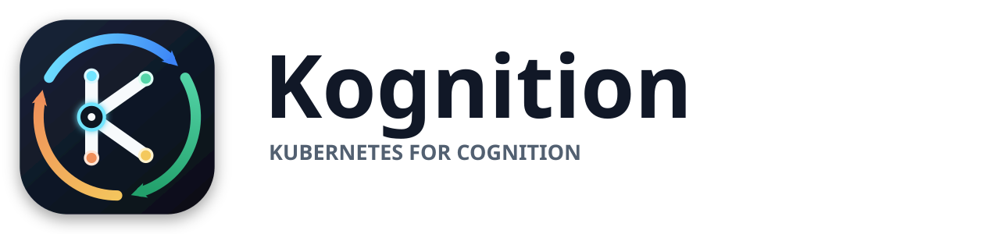

# Kognition — Declarative Cognitive Orchestration Platform

<p align="center">
    <picture>
        <source media="(prefers-color-scheme: dark)" srcset="docs/assets/kognition-logo-dark.svg">
        
    </picture>
</p>

> "Kubernetes for cognition" — Declare what your AI agents should do, not how.

Kognition is a declarative orchestration platform for autonomous AI agents. It uses a Kubernetes-inspired resource model where agents, workflows, memory, tools, and governance policies are expressed as declarative YAML manifests and reconciled by a control plane.

> [!WARNING]
> Kognition and several of its features are under heavy development. We are actively
> refining core concepts, protocols, and specifications, and will likely introduce
> major breaking changes before a stable release.

> Read the [**Kognition Manifest**](docs/kognition-manifest.md) for the
> case for a Kubernetes-native cognitive control plane and a complete
> mapping of every Kognition resource to its Kubernetes equivalent
> (e.g. `MemoryClaim` → `PersistentVolumeClaim`, `CognitiveQuota` →
> `ResourceQuota`, `AgentCommunicationPolicy` → `NetworkPolicy`).

## Project Status and License

The official repository is [microsoft/kognition](https://github.com/microsoft/kognition).

Kognition is under active development. Local tests and scoped acceptance do not
certify production readiness.

Microsoft-owned first-party code is licensed under the [MIT license](LICENSE.TXT).
Dependencies and redistributed third-party components retain their own licenses;
MIT licensing of this repository does not relicense those components. The project
uses Go dependencies, AutoGen/OpenAI and ingestion Python dependencies, browser
test dependencies, and deployment images. Distribution-specific attribution must
cover the actual components shipped, including container base images.
The [NOTICE](NOTICE) describes attribution scope and remaining distribution
reviews. Dependency inventories do not establish legal clearance.

Read [CONTRIBUTING.md](CONTRIBUTING.md), [SECURITY.md](SECURITY.md),
[CODE_OF_CONDUCT.md](CODE_OF_CONDUCT.md) and [SUPPORT.md](SUPPORT.md) for contribution,
private vulnerability reporting, community conduct and support policies.
This project follows the [Microsoft Open Source Code of
Conduct](https://opensource.microsoft.com/codeofconduct/).

## Telemetry

OpenTelemetry trace export is opt-in. Disable it by setting
`KOGNITION_OTEL_TRACES_ENABLED=false` and, for Helm deployments,
`observability.openTelemetry.enabled=false`. Remove or disable separately
configured collector exporters to stop their downstream forwarding. See
[docs/observability.md](docs/observability.md) for configuration and data handling.
Operators choose the telemetry destinations. External AI and search providers
receive requests when configured; their data handling is separate from tracing.
The prescribed Microsoft data-collection notice is included in [PRIVACY](PRIVACY).
Its inclusion does not enable collection. The release review must still verify
SDK behavior, shipped defaults and destinations; this repository is not attested
as telemetry-free.

### Data Collection Notice

Data Collection. The software may collect information about you and your use of
the software and send it to Microsoft. Microsoft may use this information to
provide services and improve our products and services. You may turn off the
telemetry as described in the repository. There are also some features in the
software that may enable you and Microsoft to collect data from users of your
applications. If you use these features, you must comply with applicable law,
including providing appropriate notices to users of your applications together
with a copy of Microsoft's privacy statement. Our privacy statement is located
at https://go.microsoft.com/fwlink/?LinkID=824704. You can learn more about data
collection and use in the help documentation and our privacy statement. Your use
of the software operates as your consent to these practices.

## Trademarks

This project may contain trademarks or logos for projects, products, or services.
Authorized use of Microsoft trademarks or logos is subject to and must follow
[Microsoft's Trademark & Brand Guidelines](https://www.microsoft.com/en-us/legal/intellectualproperty/trademarks/usage/general).
Use of Microsoft trademarks or logos in modified versions of this project must
not cause confusion or imply Microsoft sponsorship. Any use of third-party
trademarks or logos are subject to those third-party's policies.

## Documentation

- [TUTORIAL.md](TUTORIAL.md) — end-to-end guide to the resource model and deployment
- [docs/security.md](docs/security.md) — securing a production deployment (auth, TLS, network policies, HA)
- [docs/knowledge-base.md](docs/knowledge-base.md) — the KnowledgeBase subsystem
- [docs/observability.md](docs/observability.md) — OpenTelemetry trace export and collector configuration
- [docs/testing.md](docs/testing.md) — test tiers, required regression slices, and local validation commands
- [Kognition Studio](docs/studio.md): visual resource builders, YAML round trips, scope and safe operational views
- [docs/resource-interactions.md](docs/resource-interactions.md) — complete interaction map for all 43 resource kinds
- [Architecture Decision Records](docs/adr/) — the decisions behind the platform
- [Development plans and review records](docs/development-plans/README.md): implementation plans, refactor baselines, historical reviews, and tutorial-production material
- [Enterprise multi-agent reference architecture](docs/architecture/reference/README.md) — vendor-neutral layered diagrams, capability coverage, and source evidence
- [deploy/QUICKSTART.md](deploy/QUICKSTART.md) — platform installation

## Architecture

```
┌──────────────────────────────────────────────┐
│        kognitionctl  /  kubectl-kognition     │
└──────────────────┬───────────────────────────┘
                   │ REST + Watch (SSE)
┌──────────────────▼───────────────────────────┐
│             kognition-apiserver               │
│   (resource CRUD, validation, admission)     │
└──────────────────┬───────────────────────────┘
                   │ Store interface
┌──────────────────▼───────────────────────────┐
│    PostgreSQL + pgvector (state store)        │
└──────────────────┬───────────────────────────┘
                   │ Watch events
┌──────────────────▼───────────────────────────┐
│       kognition-controller-manager            │
│  (reconcilers: Agent, Workflow, Memory, ...)  │
└──────────────────┬───────────────────────────┘
                   │ Memory plane (HTTP/JSON)
┌──────────────────▼───────────────────────────┐
│         kognition-memory-service              │
│  (pluggable backends: inmemory, pgvector,    │
│   mem0, ...)                                  │
└──────────────────────────────────────────────┘

Optional Kubernetes mode: kognition-k8s-controller projects
Kognition resources onto a real Kubernetes cluster (CRDs +
admission webhooks).
```

## Quick Start

> **Kubernetes mode:** follow the reviewed inactive installation workflow in
> [docs/bootstrapping.md](docs/bootstrapping.md). Automatic `./bootstrap.ps1` and
> `make quickstart` installation are blocked. Credentials, samples and controller
> activation require separate preparation and approval.

### Prerequisites

- Go 1.26+
- Docker & Docker Compose
- [Buf](https://buf.build) (for proto generation)

### Local Development

```bash
# Start PostgreSQL with pgvector
make up

# Build the core binaries (apiserver, controller-manager, kognitionctl)
make build

# Run the API server
./bin/kognition-apiserver

# In another terminal, apply a sample resource
./bin/kognitionctl apply -f samples/simple-agent/manifests.yaml
```

See the [`samples/`](samples) directory for runnable examples
(`simple-agent`, `full-stack-agent`, `multi-agent-workflow`,
`foundry-agent`).

### Using Docker Compose

Follow the [standalone Compose setup](docs/standalone-compose.md) to configure
credentials and migrate an existing database before starting the services.
Compose starts PostgreSQL, the API server, the controller, Memory, the
KnowledgeBase ingester, and all four gateways.

### Service Manager Script

Use the local helper script to manage all required services during development.

```bash
services start [service-name]
services stop [service-name]
services restart [service-name]
services log [service-name]
services status [service-name]
services list
services down
```

When `service-name` is omitted, the command applies to all services.

On Unix/Linux/macOS:

```bash
chmod +x ./services
./services start
```

Optional (global command in your shell):

```bash
export PATH="$PWD:$PATH"
services start
```

On Windows, run from PowerShell:

```powershell
.\services.ps1 start
```

Or use the command wrapper:

```powershell
.\services.cmd start
```

You can also use Make to delegate to the wrappers:

```bash
make services ACTION=start
make services ACTION=start SERVICE=postgres
make services ACTION=status
make services ACTION=log SERVICE=apiserver
```

If `make` is not installed (common on Windows), use the local shim:

```powershell
.\make.ps1 services ACTION=start
.\make.ps1 services ACTION=start SERVICE=postgres
.\make.ps1 services ACTION=status
```

Or the command wrapper:

```powershell
.\make.cmd services ACTION=log SERVICE=apiserver
```

## kognitionctl CLI Reference

`kognitionctl` is the command-line interface for interacting with the Kognition API server. It follows a `kubectl`-like UX for managing declarative cognitive resources.

### Installation

```bash
# Build from source
make build

# Or directly with Go
go build -o bin/kognitionctl ./cmd/kognitionctl
```

### Global Flags

| Flag | Short | Default | Description |
|------|-------|---------|-------------|
| `--server` | | `http://localhost:8080` | API server URL |
| `--output` | `-o` | _(table)_ | Output format: `yaml`, `json`, or `wide` |
| `--namespace` | `-n` | `default` | Target namespace for the operation |
| `--mode` | | `auto` | Backend mode: `standalone`, `kubernetes`, or automatic detection |
| `--kube-context` | | current context | Kubeconfig context used in Kubernetes mode |
| `--kube-namespace` | | `kognition` | Namespace of the standalone API server Service when proxying through Kubernetes |
| `--kube-service` | | `kognition-apiserver` | API server Service name used by the standalone proxy |
| `--kube-port` | | `8080` | API server Service port used by the standalone proxy |

### Commands

#### `get` — List or retrieve resources

```bash
# List all agents in the default namespace
kognitionctl get agents

# List agents in a specific namespace
kognitionctl get agents -n production

# Get a specific agent (outputs YAML by default)
kognitionctl get agent my-agent

# Get as JSON
kognitionctl get agent my-agent -o json
```

When listing resources, the default output is a table with columns: `NAMESPACE`, `NAME`, `KIND`, `AGE`.
When retrieving a single resource, the default output is YAML.

#### `describe` — Show detailed resource information

```bash
# Describe a specific agent
kognitionctl describe agent my-agent

# Describe a workflow in another namespace
kognitionctl describe workflow data-pipeline -n staging
```

Outputs the full resource manifest in YAML format by default.

#### `apply` — Create or update resources from a file

```bash
# Apply a resource manifest
kognitionctl apply -f agent.yaml

# Apply with a different server
kognitionctl apply -f workflow.yaml --server http://kognition.internal:8080
```

Uses optimistic concurrency control: if the resource already exists, it injects the current `resourceVersion` into the update payload to prevent conflicts.

#### `delete` — Delete a resource

```bash
# Delete an agent
kognitionctl delete agent my-agent

# Delete a tool in a specific namespace
kognitionctl delete tool web-search -n production
```

#### `events` — View event history for a resource

```bash
# Show events for an agent
kognitionctl events agent my-agent

# Output as JSON
kognitionctl events agent my-agent -o json
```

The default table output shows: `TYPE`, `REASON`, `MESSAGE`, `TIMESTAMP`.

#### `logs` — Stream agent instance output

```bash
# Show output from all instances of an agent
kognitionctl logs my-agent

# Follow output (poll for updates)
kognitionctl logs my-agent -f

# Target a specific instance
kognitionctl logs my-agent --instance my-agent-abc123
```

#### `chat` — Send a message to an agent

```bash
kognitionctl chat my-agent "Summarize today's incidents"
```

#### `status` — Show agent / instance status

```bash
# Status of all agents in the namespace
kognitionctl status

# Status of a specific agent
kognitionctl status my-agent
```

#### `workflow` — Inspect workflow runs

```bash
# Stream logs from a workflow run
kognitionctl workflow logs my-run
```

#### `watch` — Stream real-time resource changes

```bash
# Watch all agents in the default namespace
kognitionctl watch agents

# Watch workflows in production
kognitionctl watch workflows -n production

# Watch with YAML output for each event
kognitionctl watch agents -o yaml
```

Streams Server-Sent Events (SSE) from the API server. Default output shows `EVENT_TYPE  KIND/NAME`. Press `Ctrl+C` to stop.

#### `revisions` — List revision history

```bash
# List all revisions of an agent
kognitionctl revisions agent my-agent
```

Shows a table of `REVISION`, `RESOURCE VERSION`, and `TIMESTAMP`.

#### `revision` — Get a specific revision

```bash
# Get revision 3 of an agent
kognitionctl revision agent my-agent 3
```

Outputs the full resource state at that revision point.

#### `revision-diff` — Compare two revision specs

```bash
# Show the RFC 6902 configuration patch from revision 2 to revision 3
kognitionctl revision-diff agent my-agent 2 3 -o json
```

Returns a patch over immutable `spec` snapshots only. Metadata and status do
not appear in the diff.

In Kubernetes mode, Agent, Prompt, Workflow, and Solution revisions are immutable,
owner-linked ConfigMaps. Instance events use core/v1 Events and are returned in
timestamp order through the canonical store interface. Standalone mode stores
the same revision and event contracts in PostgreSQL.

#### `approve` — Submit an approval decision

```bash
# Approve a pending request
kognitionctl approve req-abc123 --decision approve --reason "Looks good"

# Deny a request
kognitionctl approve req-abc123 --decision deny --reason "Exceeds budget"
```

Used with the autonomy and governance system. The `--decision` flag is required and must be `approve` or `deny`.

#### `goal` — Submit a goal to an IntentGateway

```bash
# Submit a natural language goal
kognitionctl goal my-gateway "Analyze the Q4 sales report and summarize trends"

# Submit in a specific namespace
kognitionctl goal my-gateway "Deploy the latest model" -n production
```

Sends a goal (natural language instruction) to the named IntentGateway for autonomous processing by downstream agents.

#### `rtbf` — Right To Be Forgotten

```bash
# Erase a memory record
kognitionctl rtbf user-session-record-42

# In a specific namespace
kognitionctl rtbf conversation-abc -n staging
```

Submits a GDPR-compliant Right To Be Forgotten request to erase the specified memory record.

#### `dashboard` — Open the local operations interface

```bash
# Inspect resources and trust evidence from the current Kubernetes context
kognitionctl dashboard --mode kubernetes

# Read audit evidence from a nonstandard control-plane namespace
kognitionctl dashboard --mode kubernetes --audit-namespace custom-system
```

The namespace selector controls which workload namespace the Dashboard displays.
In Kubernetes mode, `--audit-namespace` controls where the Dashboard reads
centralized audit evidence and defaults to `kognition-system`. An empty
`--audit-namespace` value falls back to the global `--kube-namespace` value.

#### `version` — Display version information

```bash
kognitionctl version
```

Shows CLI version, git commit, build date, Go version, platform, and server connectivity status.

### Supported Resource Types

All registered kinds (see [`api/v1alpha1/register.go`](api/v1alpha1/register.go))
can be used with `get`, `describe`, `delete`, `events`, `revisions`, `watch`,
and `apply` in standalone mode. Kubernetes mode ships 42 CRDs for the same
behavioral surface; canonical `ToolGrant` entries are expressed through
`AgentPolicy.spec.toolGrants` and synthesized by the Kubernetes store adapter
instead of being installed as a separate CRD. The canonical set is:

| Group | Kinds |
|-------|-------|
| Agents | `Agent`, `AgentInstance`, `AgentJob`, `AgentService`, `AgentAutoscaler` |
| Workflows | `Workflow`, `WorkflowRun`, `IntentGateway`, `Solution`, `ApprovalDecision` |
| Memory | `Memory`, `MemoryClass`, `MemoryClaim`, `MemoryVolume`, `MemoryRecord`, `MemoryGrant` |
| Knowledge | `KnowledgeBase`, `KnowledgeBaseClass`, `KnowledgeBaseClaim`, `KnowledgeBaseIndexRun`, `KnowledgeBaseIndexSchedule` |
| Tools | `Tool`, `ToolClass`, `ToolGrant` |
| Models | `Model`, `ModelClass`, `ModelGrant`, `ModelAutoscaler` |
| Identity | `AgentIdentity`, `AgentRole`, `AgentRoleBinding`, `AgentCommunicationPolicy`, `CrossNamespaceGrant`, `Workspace` |
| Governance | `AgentPolicy`, `CognitiveAdmissionPolicy`, `CognitiveQuota`, `CognitiveLimitRange` |
| Autonomy | `AutonomyClass`, `TrustProfile`, `AutonomyReview` |
| Prompts / Secrets | `Prompt`, `SecretRef` |

Both singular and plural forms are accepted (e.g., `kognitionctl get agent`
and `kognitionctl get agents` both work).

### Examples

```bash
# Full workflow: create an agent and monitor it
kognitionctl apply -f samples/simple-agent/manifests.yaml
kognitionctl get agents
kognitionctl describe agent my-agent
kognitionctl events agent my-agent
kognitionctl watch agents

# Governance: approve an autonomy escalation
kognitionctl approve escalation-req-001 --decision approve --reason "Within policy"

# Memory compliance: erase user data
kognitionctl rtbf user-memory-record-789 -n production

# Check revision history after updates
kognitionctl apply -f samples/simple-agent/manifests.yaml
kognitionctl revisions agent my-agent
kognitionctl revision agent my-agent 2

# Submit a goal for autonomous processing
kognitionctl goal main-gateway "Summarize all open incidents from the last 24 hours"
```

## Project Structure

```
├── api/
│   ├── v1alpha1/          # Go type definitions (resource kinds)
│   └── k8s/v1alpha1/      # Kubernetes CRD-mode type definitions
├── cmd/
│   ├── kognition-apiserver/         # API server binary
│   ├── kognition-controller-manager/# Controller manager binary
│   ├── kognition-memory-service/    # Pluggable memory plane service
│   ├── kognition-k8s-controller/    # Optional Kubernetes-mode controller
│   ├── kognitionctl/                # CLI binary
│   └── kubectl-kognition/           # kubectl plugin (Kubernetes mode)
├── internal/
│   ├── admission/         # Admission validators / defaulters
│   ├── apiserver/         # HTTP server and handlers
│   ├── controller/        # Controller manager and reconcilers
│   ├── conformance/       # Conformance test harness
│   ├── convert/           # Inter-version conversion
│   ├── cpi/               # Cognitive Provider Interface + drivers
│   ├── invocation/        # Agent invocation pipeline
│   ├── k8s/               # Kubernetes controller / dispatcher / webhook
│   ├── lifecycle/         # Resource lifecycle helpers
│   ├── mcp/               # Model Context Protocol integration
│   ├── memory/            # Memory backends (inmemory, pgvector, mem0, ...)
│   ├── namespace/         # Namespace management
│   ├── observability/     # Metrics / tracing
│   ├── opa/               # OPA policy evaluation
│   ├── plugin/            # Plugin host
│   ├── requestid/         # Request ID middleware
│   ├── runtime/           # Agent runtimes (autogen, native, toolexec)
│   ├── store/             # Storage interface + PostgreSQL implementation
│   └── traceability/      # Traceability & audit
├── pkg/pluginsdk/         # Public plugin SDK
├── runtime/agent/         # Agent runtime support libraries
├── proto/                 # Protobuf definitions (Runtime + CPI)
├── deploy/                # Helm chart + ArgoCD application
│   └── helm/kognition/    # Helm chart
├── samples/               # Runnable sample manifests
├── e2e/                   # End-to-end test scripts
├── tests/integration/     # Integration tests
├── tools/trace/           # Trace tooling
├── docker-compose.yml     # Local dev environment
├── Dockerfile             # Multi-stage container build
├── Makefile               # Build targets
└── PROJECT.md             # Full specification document
```

## API Group

All resources belong to `kognition.dev/v1alpha1`. The system currently defines
43 resource kinds, grouped as:

- **Agent**, **AgentInstance**, **AgentJob**, **AgentService**, **AgentAutoscaler** — Agent lifecycle
- **Workflow**, **WorkflowRun**, **IntentGateway**, **Solution**, **ApprovalDecision** — Orchestration
- **Memory**, **MemoryClass**, **MemoryClaim**, **MemoryVolume**, **MemoryRecord**, **MemoryGrant** — Persistent memory
- **KnowledgeBase**, **KnowledgeBaseClass**, **KnowledgeBaseClaim**, **KnowledgeBaseIndexRun**, **KnowledgeBaseIndexSchedule** — Knowledge
- **Tool**, **ToolClass**, **ToolGrant** — Tool management
- **Model**, **ModelClass**, **ModelGrant**, **ModelAutoscaler** — LLM model binding and vertical scaling
- **AgentIdentity**, **AgentRole**, **AgentRoleBinding**, **AgentCommunicationPolicy**, **CrossNamespaceGrant**, **Workspace** — Identity and namespace access
- **AgentPolicy**, **CognitiveAdmissionPolicy**, **CognitiveQuota**, **CognitiveLimitRange** — Governance
- **AutonomyClass**, **TrustProfile**, **AutonomyReview** — Autonomy
- **Prompt**, **SecretRef** — Prompts & secrets

The canonical list lives in [`api/v1alpha1/register.go`](api/v1alpha1/register.go).
The Helm CRD set intentionally omits only `ToolGrant`; Kubernetes mode uses
`AgentPolicy.spec.toolGrants` for that authorization contract.

## Development

```bash
make build         # Build core binaries (apiserver, controller-manager, kognitionctl) into ./bin
make test          # Run tests with race detection
make lint          # Vet + format check
make vet           # go vet ./...
make fmt           # gofmt check
make proto         # Generate protobuf code (buf generate)
make proto-lint    # Lint .proto files
make docker        # Build all container images
make up / down     # Start/stop docker-compose dev stack
make services      # Drive ./services wrapper (ACTION=, SERVICE=)
make migrate       # Apply DB migrations
make tidy          # go mod tidy
make install-hooks # Enforce local commit traceability hooks
make clean         # Remove build artifacts
make help          # Show all targets
```

### Kubernetes Deployment

The Makefile (and its Windows equivalent `make.ps1`) provides end-to-end
lifecycle targets for deploying Kognition to a Kubernetes cluster via Helm.

#### Deploy

```bash
# Build images and deploy in standalone mode (API server + PostgreSQL)
make docker-standalone
make deploy-standalone

# Build images, then bootstrap reviewed inactive admission in Kubernetes mode
make docker-k8s
make deploy-kubernetes INSTALL_PLAN=./reviewed/install.json INSTALL_WRITERS_FROZEN=true
```

Kubernetes installation requires an explicit target, reviewed artifacts and live
inventory, an administrator authority namespace, and externally frozen writers.
Prepare CRDs, certificates and images separately. Neither deployment wrapper
installs cert-manager, loads credentials, installs samples or activates the
controller. Follow the [installation and recovery contract](docs/features/knowledge-provider-execution/installation-recovery-contract.md)
for plan preparation, upgrade ordering and recovery. Activation requires a separate
approved transaction with all runtime gates satisfied for the exact target.
Production approval is separate from local acceptance. Resource admission now runs
in a dedicated webhook Deployment while reconciliation remains inactive.
Guarded installation skips Helm hooks: complete the explicit
[database prerequisites](docs/features/knowledge-provider-execution/installation-recovery-contract.md#database-prerequisites)
before running Memory or KnowledgeBase workloads.

#### Fresh Kubernetes Demo

`fresh-kubernetes-demo`, `quickstart` and automatic bootstrap are blocked for
Kubernetes mode. They cannot safely combine reset, admission bootstrap and producer
startup. Use a task-owned isolated cluster and the reviewed workflow above; do not
reset shared clusters or bypass recovery with a Helm rollback.

#### Manage Samples

In Kubernetes mode, run sample installers only after explicit activation is
approved and the exact sample namespaces are enrolled. They are workload writers
and must remain stopped throughout installation and recovery.

```bash
make samples-list                     # List available samples
make samples-install                  # Install all manifest-based samples
make samples-install SAMPLE=simple-agent    # Install a single sample
make samples-install SAMPLE=evaluation      # Install the Evaluation sample after simple-agent
make samples-install SAMPLE=helm-multi-agent  # Helm-chart sample (auto-detected)
make samples-uninstall SAMPLE=simple-agent  # Remove a sample
```

See [docs/sample-matrix.md](docs/sample-matrix.md) for the complete sample
inventory, installation profile, and validation evidence.

For the four-plane Hackathon workload and its retained Trust Focus dashboard, use
the [Trustworthiness demo runbook](samples/hackathon-trustworthiness/runbook.md).
Automated approval and a populated panel do not establish human-presenter,
three-clean-run or deployed standalone-parity acceptance.

#### Monitor & Debug

```bash
make status                           # Helm releases, pods, CRD resources
make logs COMPONENT=k8s-controller    # Tail logs for a specific component
make logs                             # Tail all pod logs in the platform namespace
make port-forward                     # Forward apiserver port 8080 to localhost
```

#### Undeploy

```bash
make undeploy-standalone
make undeploy-kubernetes
```

#### End-to-End Tests

```bash
make e2e                              # Run the e2e test suite
```

#### Overridable Variables

| Variable | Default | Description |
|----------|---------|-------------|
| `NAMESPACE` | `kognition-system` | Platform namespace |
| `AGENT_NAMESPACE` | `default` | Namespace for sample agent deployments |
| `RELEASE` | `kognition` | Helm release name |
| `SAMPLE` | _(all)_ | Target sample for install/uninstall |
| `COMPONENT` | _(all pods)_ | Component name for `logs` target |

#### Windows

On Windows use `make.ps1` (or the `make.cmd` shim) with the same targets:

```powershell
.\make.ps1 docker-k8s
.\make.ps1 deploy-kubernetes INSTALL_PLAN=./reviewed/install.json INSTALL_WRITERS_FROZEN=true
.\make.ps1 status
# Only after separately approved activation and namespace enrollment:
.\make.ps1 samples-install SAMPLE=simple-agent
.\make.ps1 logs COMPONENT=k8s-controller
```

See [`deploy/QUICKSTART.md`](deploy/QUICKSTART.md) for a detailed guided
install, and [`deploy/helm/kognition`](deploy/helm/kognition) for the Helm
chart source.

## License

MIT — see [LICENSE.TXT](LICENSE.TXT). Third-party components retain their own
licenses; see [NOTICE](NOTICE).
