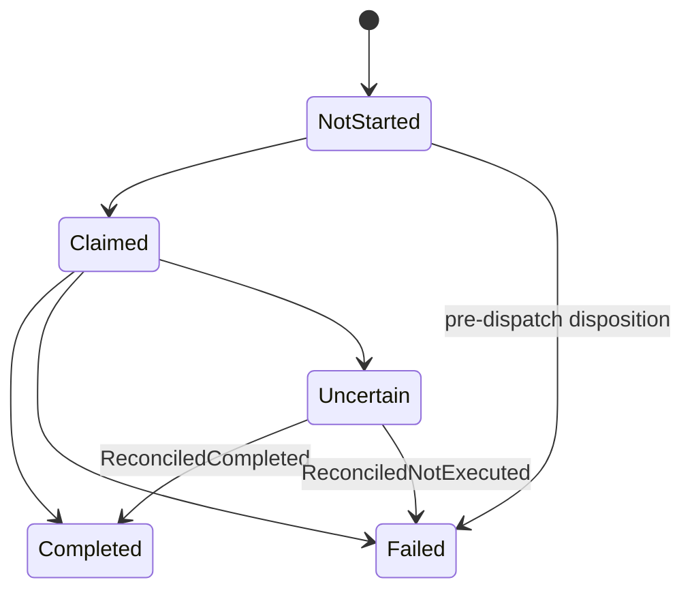

# ADR-0014: Runtime Autonomy Gate Completion and Recovery

- **Status:** Accepted
- **Date:** 2026-08-31
- **Deciders:** Kognition core team
- **Supersedes:** ADR-0013

## Context

ADR-0013 selected a shared runtime autonomy resolver and an exact-bound,
durable `RuntimeApproval`. A post-acceptance implementation review found that
several execution branches were not defined precisely enough to implement and
test safely:

- recovery from a gateway crash after execution claim;
- decision and execution races at approval expiry;
- replay ownership when human approval is not required;
- failures between quota preparation and target dispatch;
- replay verification after binding-key rotation and compaction;
- Agent incarnation binding and TrustProfile uniqueness;
- standalone control-plane authorization; and
- Tool input binding before executable capability issuance.

This ADR is the authoritative contract for T-0214. It retains ADR-0013's scope,
effective-class resolution, conservative `high-risk-only` behavior, redaction,
and separation from workflow `ApprovalDecision` and promotion
`AutonomyReview`, except where this ADR explicitly replaces the execution
protocol.

## Priorities and Requirements

1. **No duplicate or unauthorized target effect.** Crash recovery, expiry, and
   policy drift must not create a second execution path or revive authority.
2. **Complete durable state machine.** Every protected action and every failure
   boundary must have one persisted, testable disposition.
3. **Exact cross-mode parity.** PostgreSQL and Kubernetes may use different
   concurrency primitives, but must produce equivalent decisions and replay
   outcomes.
4. **Least-privilege decisions.** Human approval authority must be distinct
   from runtime Agent authority and scoped to workspace, resource, and verb.
5. **Bounded, explainable retention.** Compaction and key rotation must preserve
   replay conflict detection without unbounded storage or sensitive payloads.
6. **Implementable transport migration.** Existing Tool, Memory, and
   Communication clients must represent pending and terminal outcomes without
   silently creating a new invocation.

## Decision

### One RuntimeApproval for Every Protected Action

Every Tool invocation, Memory store/delete, and exact AgentService capability
exchange creates or retrieves one `RuntimeApproval`, including actions whose
current policy does not require a human decision. The name and binding rules
from ADR-0013 remain in force.

The decision state is initialized atomically as one of:

- `Pending` when human approval is required; or
- `NotRequired` when the live effective policy permits execution.

`NotRequired` is terminal for the decision state, is evidence-fenced, and does
not imply that AuthN or AuthZ may be skipped. A previous resource or tombstone
for the invocation ID is resolved before live policy may select
`NotRequired`. A pending, rejected, expired, stale, claimed, or terminal action
cannot be bypassed by later policy loosening.

The execution state is:

A `RuntimeApproval` therefore owns replay for every protected action. Tool and
Memory receipts retain plane-specific result and accounting data, but cannot
become an alternative execution owner.

### Decision and Expiry Transitions

`Decide` performs the vote, expiry predicate, state transition, and decision
audit-outbox creation atomically:

- before the effective expiry boundary, `Pending` may become `Approved` or
  `Rejected`;
- at or after the boundary, any attempted decision persists `Expired` instead;
- a concurrent `Decide` or `ExpireDecision` has one compare-and-swap winner;
- retries return the persisted state and never overwrite a terminal decision.

PostgreSQL uses transaction time. Kubernetes uses the conservative boundary
`trustedHostNow + maximumClockSkew >= expiresAt`, with the clock-health and
readiness requirements from ADR-0013.

`ClaimExecution` accepts only `Approved` or `NotRequired`, requires the
corresponding decision evidence-delivery fence, and repeats the same effective
expiry predicate for `Approved`. If an approved action reaches claim after
expiry, the operation atomically moves execution from `NotStarted` to `Failed`
with disposition `ApprovalExpiredBeforeClaim` and creates its outbox event. The
invocation ID is consumed, the record is terminal and compactable, and it can
never be claimed. `NotRequired` does not use the human-decision expiry, but its
preparation deadline below is still bounded and all live identity,
authorization, class, target, and session bindings are revalidated.

### Preparation, Claim, and Accounting Order

The execution order replaces the ordering in ADR-0013:

1. Validate the exact request and session capability.
2. Evaluate live Gate 1 AuthN and Gate 2 AuthZ.
3. Resolve Gate 3, create or get the exact-bound `RuntimeApproval`, and deliver
   its decision evidence.
4. Return the durable pending or terminal state unless the decision is
   `Approved` or `NotRequired`.
5. Revalidate live identity, authorization evidence, TrustProfile,
   AutonomyClass, target incarnation, resource versions, and session.
6. Create or reuse an idempotent quota reservation keyed by workspace and
   invocation ID. Quota denial atomically records the pre-dispatch
   `QuotaDenied` disposition and consumes the invocation ID.
7. Create or reuse a plane receipt in `Prepared` state. A changed binding is a
   conflict; an identical prepared receipt is resumable.
8. Deliver the write-ahead execution decision required by ADR-0011.
9. Atomically transition execution from `NotStarted` to `Claimed`.
10. Recheck claimant ownership, then contact the target or issue the exact
    executable capability without unrelated blocking work.
11. Persist the plane receipt, quota settlement, RuntimeApproval terminal
    execution state, and deterministic terminal audit outbox idempotently.

No irreversible execution claim occurs before quota, receipt preparation, and
write-ahead evidence are ready. Failures before claim follow these rules:

- transient quota-store, receipt-store, or audit-store unavailability leaves
  execution `NotStarted` and returns unavailable; an identical retry resumes;
- quota denial, binding conflict, or a permanent preparation rejection uses
  `AbortBeforeDispatch`, records `targetReached: false`, releases any owned
  reservation, and consumes the invocation ID;
- release and settlement use the invocation ID and are idempotent;
- a retry that did not create a shared reservation cannot release another
  claimant's reservation.

Quota reservation starts a five-minute server-assigned preparation deadline
and persists a preparation token in the RuntimeApproval, quota reservation,
and receipt. `ClaimExecution` atomically requires `NotStarted`, the same token,
and an unexpired preparation deadline. `ReapPreparation` atomically changes
only `NotStarted` with an expired matching token to `Failed` with disposition
`AbandonedPreparation`; a concurrent claim and reap have one winner. After the
terminal transition wins, idempotent cleanup releases only the reservation and
prepared receipt carrying that token. Ambiguous cleanup conservatively keeps
quota charged until reconciliation, but can never release a claimed action's
reservation. This applies equally to `Approved` and `NotRequired` actions.

The closed pre-dispatch dispositions are `QuotaDenied`, `ReceiptConflict`,
`PolicyChanged`, `TargetChanged`, `SessionChanged`, and
`PreparationRejected`, `ApprovalExpiredBeforeClaim`, and
`AbandonedPreparation`. Evidence unavailability is transient and is not
misreported as target failure.

Tool receipts add `Prepared` before the existing pending/executing and terminal
states. Memory store and delete add an equivalent durable mutation receipt.
Communication capability issuance uses the RuntimeApproval itself as its
single-execution receipt and stores only bounded capability metadata, never the
token.

### Claimant Incarnation and Crash Recovery

A successful claim persists:

- gateway workload incarnation;
- process-start nonce;
- monotonically increasing fencing token;
- `claimedAt`, last heartbeat, and diagnostic lease deadline; and
- the exact prepared receipt and quota reservation references.

A claim is never reassigned for execution. Lease or heartbeat expiry alone does
not authorize another claimant and does not permit redispatch. It only makes
the action eligible for recovery investigation.

`MarkClaimUncertain` may transition `Claimed` to `Uncertain` only after the
control plane proves that the recorded claimant incarnation has terminated:

- Kubernetes requires observation that the recorded Pod UID and container
  incarnation no longer exist;
- standalone requires startup recovery under the exclusive process lock and a
  mismatch with the persisted process-start nonce;
- inability to prove termination leaves the action `Claimed`.

The transition uses compare-and-swap, records the proof reference, and delivers
an outbox event. A claimant must verify that its fencing token still owns the
`Claimed` state immediately before target contact and before finalization. A
claimant whose incarnation is terminating cancels in-flight work and cannot
finalize after ownership loss. Because a proven-dead incarnation cannot resume,
`Claimed` to `Uncertain` does not create a stale-claimant execution path.

Recovery never automatically redispatches an `Uncertain` action. The
`RuntimeApproval/reconcile` operation and evidence rules from ADR-0013 remain
in force.

### Binding Identity and TrustProfile Uniqueness

`TrustProfileSpec` gains an immutable Agent incarnation field in addition to
`agentRef.name`. Kubernetes stores the Agent UID. Standalone stores the
server-assigned immutable object UID. Gate 3 accepts a profile only when both
name and incarnation match the live Agent.

All standalone resource creates assign `metadata.uid` from the PostgreSQL row
identity before returning or publishing the object. Reads, lists, watches, and
updates consistently project that UID. Existing rows receive a stable UID in a
migration before RuntimeApproval enforcement is enabled. Controller-created
built-in classes receive stable server-assigned UIDs as well.

PostgreSQL enforces one TrustProfile per `(namespace, agentUID)` with a unique
constraint. Kubernetes admission performs a side-effect-free best-effort
duplicate check; dry-run never creates supporting objects. A profile-index
controller creates a deterministic, owner-bound index keyed by Agent UID only
after the TrustProfile exists. The index stores the selected profile UID, and
create compare-and-swap gives concurrent candidates one winner. If multiple
profiles exist, Gate 3 fails closed even when the index has a winner.

The index has an Agent owner reference and the selected profile has a finalizer.
When that profile receives a deletion timestamp, the controller acquires the
index compare-and-swap, excludes terminating profiles from an authoritative
list, removes the index or selects the only remaining live profile, and then
removes the profile finalizer. An orphan reconciler removes an index whose
Agent or selected TrustProfile UID no longer exists. A profile creation failure
cannot orphan an index because indexing happens after persistence.

No profile and no index is the valid ADR-0013 cold-start state and resolves to
the fail-safe supervised policy. A missing index blocks Gate 3 only when one or
more live profiles exist. An orphaned or mismatched index, multiple live
profiles, or an index transition error also blocks until reconciliation.
Deleting and recreating an Agent cannot inherit its predecessor's profile.

### Decision Authorization

Kubernetes continues to use ADR-0013's canonical TokenReview identity mapping
and exact SubjectAccessReview contract for decisions. Approval and rejection
use API group `kognition.dev`, resource `runtimeapprovals`, subresource
`decision`, the approval namespace and exact name, and custom verb `approve`
or `reject`. Reconciliation uses the same group, resource, namespace, and exact
name with subresource `reconcile` and custom verb `reconcile`. Permission on one
subresource or verb never implies another. Runtime, gateway, and requesting
Agent service accounts receive none of these human-authority verbs; the API
service may create SubjectAccessReviews but may not impersonate their subjects.

Standalone adds `ControlPlaneRole` and `ControlPlaneRoleBinding` resources.
Bindings identify a human or service principal by canonical authentication
method, issuer, and subject. A rule contains:

- workspace;
- resource `RuntimeApproval`;
- resource names or an explicit bounded name selector; and
- distinct `approve`, `reject`, or `reconcile` verbs; and
- closed `effect: allow | deny`.

Default is deny. Any matching `deny` takes precedence over every matching
`allow`, independent of rule order. Only a
separately authorized control-plane administrator may manage these resources.
Decision and reconciliation records persist canonical issuer and subject;
display names and email remain non-authoritative. Agent, AgentIdentity,
AgentInstance, runtime capabilities, bootstrap tokens lacking a canonical
bound subject, and the requesting workload cannot approve themselves.
Authorization-store unavailability fails closed.

### Binding Keys and Compaction

Binding keys are separate from the two-key runtime capability ring. A
versioned `RuntimeBindingKeyStore` retains every HMAC key referenced by a live
RuntimeApproval or tombstone. New records use the active version; verification
selects the persisted version and algorithm/domain identifier. Missing required
key material fails readiness and blocks create, compare, claim, and compaction.
Mixed-version replicas must read every retained version and may write only the
single configured active version.

Key versions transition only from `Active` to `VerifyOnly` in T-0214.
`CreateOrGet` and activation serialize through the same binding-key epoch lock:
PostgreSQL uses an advisory transaction lock and Kubernetes uses a dedicated
Lease plus resource-version compare-and-swap. A writer persists the epoch and
key version selected while holding the lock; current admission rejects a new
write for a verify-only epoch. Rotation publishes a new active version and
makes the old version verify-only before releasing the lock.

Kubernetes admission and Lease persistence are not one transaction, so key
material for a verify-only version is never physically removed by T-0214. A
create that passed admission immediately before rotation therefore remains
verifiable even if its completion is delayed or ambiguous. The store supports
at most 16 versions; rotation fails closed at that limit. Physical key purge
requires a later ADR with an API-server request-quiescence protocol and is not
implied by zero observed references. PostgreSQL follows the same no-purge rule
for cross-mode parity. Lock unavailability blocks activation and new writes.

Every tombstone contains:

- binding format, algorithm/domain, and binding-key versions;
- workspace, invocation ID, plane, and stable Agent attribution;
- binding tag and terminal decision/execution disposition; and
- creation, compaction, and retention deadlines.

PostgreSQL compacts the live row and creates its tombstone in one transaction.
Kubernetes uses a namespaced `RuntimeApprovalTombstone` per logical invocation
and one `RuntimeApprovalQuotaTicket` per logical invocation. A workspace Lease
serializes ticket admission and retirement. Under the Lease, creation lists
tickets from a consistent Kubernetes resource version, sums workspace and
Agent record/byte charges, rejects an over-limit addition, and creates the
deterministically named ticket before creating the RuntimeApproval. The ticket
stores the logical key, Agent UID, charged bytes, phase, and matching retention
deadline. An orphan ticket is conservative overcount, never undercount.

Compaction creates and verifies the tombstone before deleting the live
resource. The same ticket covers live and tombstone overlap, so quota is counted
once. A finalizer forbids delete before the tombstone is durable. When the
tombstone retention deadline passes, the controller acquires the workspace
Lease, proves that no live RuntimeApproval or tombstone references the logical
key, and deletes the ticket. A failed or ambiguous delete remains an overcount;
the reconciler may remove it only after repeating that proof. Tickets are
individual bounded objects with a fixed schema and maximum serialized size of
2 KiB. At most the configured workspace record limit can exist, so no shard or
rollover can grow without bound. Lease, list, or proof failure blocks admission
or retirement.

PostgreSQL applies equivalent ticket accounting in the same transaction as
create and final retention deletion. Kubernetes tickets and tombstones are not
stored in one workspace ConfigMap. Receipt retention is 90 days, matching the
tombstone minimum, unless operators configure a longer shared retention.

### Tool and Other Transport Migration

Tool capability exchange now accepts the complete typed Tool input together
with tool name and caller-stable invocation ID. The gateway rejects duplicate
JSON keys and canonicalizes the input server-side. Exchange performs
invocation-aware Gate 2 argument authorization and Gate 3 before issuing an
executable capability.

A pending exchange returns `202 Accepted` with a tagged response containing the
same invocation ID, RuntimeApproval reference, decision state, and expiry. The
client retains the exact typed input and retries exchange with the same session
identity and invocation ID. An approved or not-required exchange returns the
exact capability. Tool capability issuance occurs after the decision evidence
fence but does not claim execution: the exact capability remains an
intermediate, non-replay-owning credential. Its invocation endpoint performs
preparation, write-ahead execution evidence, and `ClaimExecution` immediately
before Tool target contact. The capability binds RuntimeApproval UID,
invocation ID, binding format and tag, Tool UID and revision, AgentInstance
UID, and session. Invocation recomputes the tag, repeats live gates, and
rejects drift before preparation or target contact. Agent Communication differs
because exact capability issuance is itself the protected external action; it
claims immediately before issuance.

In-process Tool APIs and the Python client use the same tagged
`pending | ready | terminal | unavailable` result and never generate a new ID
when retrying a pending action. The session capability remains non-executable.

Memory mutations require the stable invocation ID and expose the same tagged
pending result. Agent Communication exchange carries the complete message and
uses the same response states. No compatibility helper may turn pending into a
generic denial or silently retry with a new invocation ID.

## Trust Decision Evidence

ADR-0011 remains closed. The mappings from ADR-0013 remain, with these added
bounded reasons and execution values:

| Runtime state or disposition | Outcome | Reason code | Approval status | Execution status | Target reached |
|---|---|---|---|---|---|
| `NotRequired/NotStarted` | `allowed` | `authorized` | `not_required` | `not_started` | false |
| `Approved/NotStarted` | `approved` | `approval_approved` | `approved` | `not_started` | false |
| `ApprovalExpiredBeforeClaim` | `rejected` | `approval_rejected` | `approved` | `blocked` | false |
| `QuotaDenied` | `denied` | `quota_exhausted` | decision value | `blocked` | false |
| `ReceiptConflict` | `replayed` | `replay_detected` | decision value | `blocked` | false |
| `PolicyChanged` | `denied` | `policy_denied` | decision value | `blocked` | false |
| `TargetChanged` | `denied` | `capability_invalid` | decision value | `blocked` | false |
| `SessionChanged` | `revoked` | `identity_not_ready` | decision value | `blocked` | false |
| `PreparationRejected` | `failed` | `target_failed` | decision value | `blocked` | false |
| `AbandonedPreparation` | `failed` | `target_failed` | decision value | `blocked` | false |
| `Claimed` completion unknown | `failed` | `target_failed` | decision value | `unavailable` | omitted |
| reconciled completed | `completed` | `target_completed` | decision value | `completed` | true |
| reconciled not executed | `failed` | `target_failed` | decision value | `failed` | false |

In this table, decision value means the persisted schema value `approved` or
`not_required`. `PreparationRejected` and `AbandonedPreparation` use the only
compatible closed v1 failure reason; their bounded `reason` names the exact
pre-dispatch disposition and makes clear that the target was not reached.
T-0214 must not add an undeclared schema value.

## Verification Requirements

T-0214 completion requires automated tests that verify both PostgreSQL and
Kubernetes behavior for:

- required and `NotRequired` actions, including policy loosening with existing
  live records and tombstones;
- approval just before, exactly at, and after the effective expiry boundary;
- approved-but-expired claim and exactly-once outbox delivery;
- preparation deadline races, `ReapPreparation`, and proof that cleanup cannot
  release a claimed action's reservation;
- crash after preparation, audit delivery, claim, target contact, target
  return, receipt completion, quota settlement, and finalization;
- proof-gated `Claimed` to `Uncertain`, fencing-token rejection, and no
  automatic uncertain replay;
- every pre-dispatch abort disposition and idempotent quota release;
- Agent delete/recreate, stale profile, concurrent profile creation, and
  standalone UID migration, plus index orphans and failed profile creation;
- cross-workspace, wrong-name, wrong-subresource, wrong-verb, forged-group,
  runtime-credential, bootstrap-token, self-approval, SubjectAccessReview
  failure, and explicit-deny precedence for decision and reconciliation;
- pending Tool, Memory, and Communication client retry with exact payload and
  invocation ID preservation;
- live-to-tombstone crashes before create, after create, and after delete;
- identical and conflicting replay after compaction and after at least three
  binding-key rotations, including rejection of new verify-only writes and
  verification of a delayed pre-rotation write; and
- bounded quota-ticket behavior, live/tombstone deduplication, orphan-ticket
  recovery, and conservative handling of ambiguous Kubernetes writes.

TC-0171 and TC-0172 are complete only when they submit real Tool invocations,
observe the durable pending RuntimeApproval, and prove the Tool target was not
contacted. Existing default-policy string assertions are configuration tests,
not completion evidence for those test-case IDs.

T-0214 met these requirements on 2026-09-06. PostgreSQL and Kubernetes
conformance suites, the full Go suite, 91 Python tests, and the deployed
TC-0171 and TC-0172 scenarios passed. The deployed scenarios observed durable
pending approvals, proved pre-approval target non-contact, and removed their
fixture namespaces during teardown. Standalone decision and reconciliation
authorization additionally passed focused tests for canonical identity,
exact resource and subresource scope, deny precedence, default denial,
administrator separation, self-approval prevention, namespace isolation, and
fail-closed policy storage.

## Options Evaluated

| Option | No duplicate effect | Complete state machine | Cross-mode parity | Least privilege | Bounded retention | Transport migration |
|---|---|---|---|---|---|---|
| Define the completion protocol in this ADR | Meets: claim is never reassigned and recovery is proof-gated | Meets: every protected action and failure boundary is durable | Meets: backend primitives differ but outcomes are normative | Meets: exact Kubernetes and standalone authorization contracts | Meets: versioned keys, tombstones, ledgers, and quotas are explicit | Meets: clients expose tagged asynchronous states |
| Implement ADR-0013 without further decisions | Does not meet: abandoned claims and pre-dispatch failures are ambiguous | Does not meet: no-approval execution has no owner | Partial: high-level parity lacks storage protocols | Partial: standalone authority is undefined | Does not meet: tombstones cannot select rotated keys | Does not meet: Tool input arrives after capability issuance |
| Reuse current receipts and synchronous clients | Does not meet for Memory or Communication and can strand Tool receipts | Does not meet: receipts do not represent human decisions | Does not meet across current plane implementations | Does not meet: receipts have no approver authority | Partial: Tool receipt retention is not a complete approval fence | Does not meet: synchronous clients cannot preserve pending state |

The first option is selected because it is the only option that meets the first
three priorities and gives T-0214 deterministic, testable failure boundaries.

## Consequences

**Positive.**

- Every protected action has one replay owner whether approval is required or
  not.
- Gateway crashes cannot authorize automatic redispatch.
- Expiry, quota, receipt, audit, and compaction races have deterministic
  outcomes.
- Tool approval binds the actual typed input before executable authority is
  issued.
- Standalone and Kubernetes approvers receive equivalent least-privilege
  authorization.

**Negative.**

- T-0214 now includes UID projection, profile indexing, control-plane RBAC,
  receipt preparation, durable Memory mutation receipts, binding-key storage,
  compaction resources, and asynchronous client changes.
- A claimed action can remain blocked until claimant termination is proven and
  an operator reconciles uncertainty.
- Kubernetes requires additional namespaced resources and controllers rather
  than one compact ConfigMap ledger.

## OPEN Items Closed

None. This ADR corrects the task-scoped runtime execution decision and does not
change the already resolved workflow-focused `OPEN-TOOL-3` decision.

## Related

- [ADR-0013: Durable runtime autonomy gate](0013-runtime-autonomy-gate.md)
- [ADR-0011: Trust Decision contract](0011-trust-decision-contract.md)
- [ADR-0007: Agent Gateway fabric](0007-agent-gateway-fabric.md)
- [BACKLOG.md](../../BACKLOG.md), T-0358 and T-0214
- [PROJECT.md](../../PROJECT.md), section 10B
