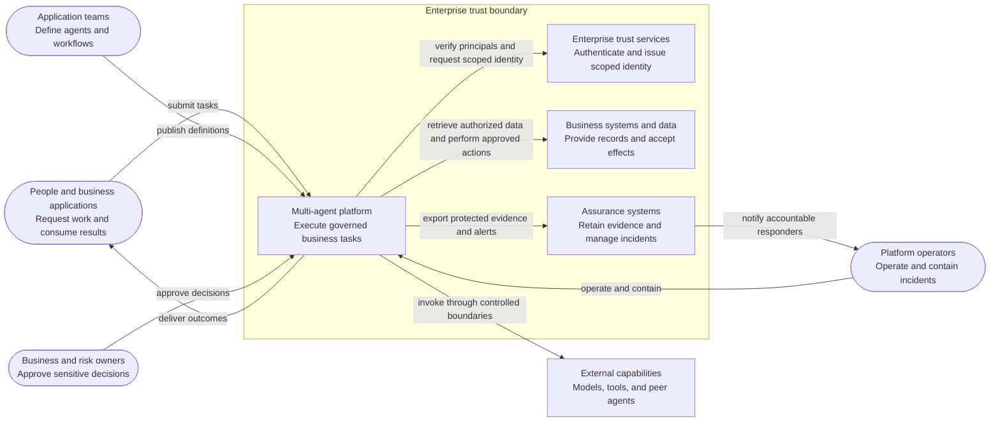

# L0: Enterprise ecosystem

The platform executes bounded business work on behalf of authenticated people
and applications. Business owners remain accountable for outcomes; platform
operators own the service; security and data owners control access and risk.

## D1: Platform context and accountable actors

Audience: business, enterprise architecture, and governance stakeholders.
Arrows show initiated interactions, including explicit delivery of outcomes.
Actor placement is logical; being drawn outside the enterprise container does
not mean an employee is an external or unauthenticated principal.

No external response, source document, or peer description becomes trusted
instruction merely because the transport is authenticated. External capability
access remains subject to data-use agreements, residency, rate limits,
permission checks, and provider failure behavior.

## Functional entry points

| Interaction | Required behavior |
| --- | --- |
| Interactive assistance | Authenticated session, streamed progress, interruption, accessible approval prompts, citations, and clear partial or failed outcomes. |
| Business automation | Typed inputs/outputs, event and schedule triggers, correlation and idempotency, durable task status, callbacks, and cancellation. |
| Team collaboration | Specialist discovery, bounded delegation, explicit shared-state rules, conflict resolution, and accountable result assembly. |
| Authoring and administration | Catalog search, definition editing, schema validation, non-executing review, separately authorized sandbox tests, version comparison, controlled publication, and tenant onboarding/offboarding. |
| Human oversight | Review queue, exact action preview, evidence access, separation of duties, expiry, escalation, override controls, and appeal/correction paths where required. |
| Operations and assurance | Run history, dependency health, policy decisions, cost, quality, incident response, and exportable evidence with independent access controls. |

Select the entry points the product actually supports; the table does not require
every application to expose every channel. All enabled channels share the same
identity, task, authorization, and outcome contracts. A scheduled task has an
explicit automation principal and accountable owner; it does not borrow a
permanently cached human session.

## Boundary decisions required for each enterprise

- Identify the business owner and operator for each use case, including who can
  stop work, accept residual risk, approve a release, and authorize recovery.
- Distinguish platform responsibilities from identity-provider, model-provider,
  data-owner, and business-system responsibilities. Contracts must cover outage
  handling, data retention, training use, incident notification, and deletion.
- Decide which actions are advisory, reversible, financially consequential, or
  otherwise high impact. Map them to pre-execution approvals and execution limits.
- Define supported inputs and outputs, including attachments and multimodal
  content if needed. Apply the same content, size, authorization, and provenance
  controls to every modality.

This view omits internal services. Continue with
[platform planes](02-platform-planes.md). Capability coverage: **C01, C02, C11,
C21, C22, C29** in the [matrix](capabilities.md).
