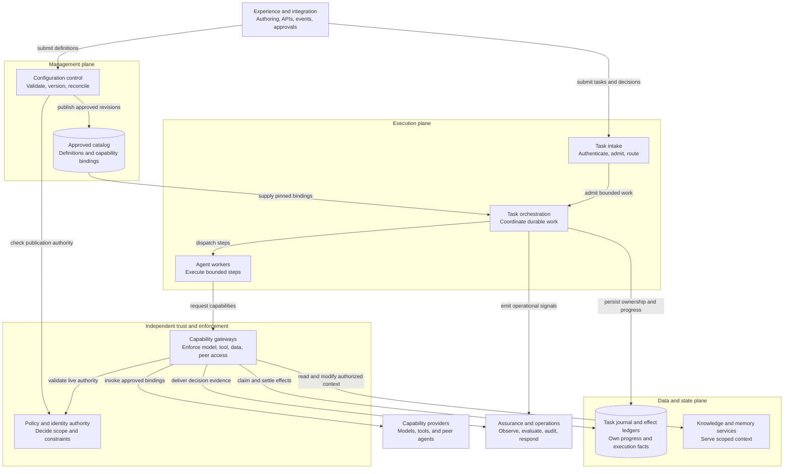
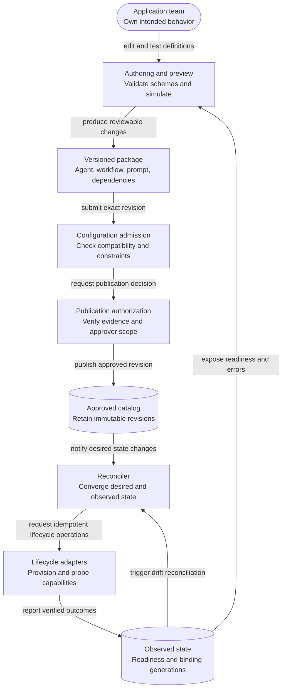

# L1/L2: Platform responsibilities and management

Separate configuration authority from execution authority. The management plane
publishes approved desired state. Runtime services accept work and enforce current
policy without giving agents permission to modify their own guardrails.

## D2: Logical platform planes

Audience: platform and solution architects. Containers group responsibilities;
arrows show labeled interactions. Each plane can have its own scaling and
availability profile.

The combined journal box is a logical grouping, not a single database mandate.
The [data view](05-data.md) separates its ownership and retention contracts.
Human approval and budget accounting are expanded in [D7](04-trust.md#d7-exact-action-approval-and-effect-ownership).

## Ownership and authority boundaries

| Responsibility | Owns | Must not decide by itself |
| --- | --- | --- |
| Management and catalog | Approved definitions, versions, enrollment, deployment intent and observed readiness. | Permission for an arbitrary runtime action merely because its definition was admitted. |
| Task orchestration | Accepted task state, step dependencies, execution-owner generations, deadlines and completion criteria. | New privileges, changed trust roots, or unbounded worker-created plans. |
| Identity and policy authority | Authenticated principals, delegation constraints, policy versions, revocation and approval authority. | Business success or whether a remote effect actually occurred. |
| Capability enforcement | Current per-action checks, exact target binding, effect claim and provider receipt collection. | Bypassing revoked authority or interpreting a timeout as proof of non-execution. |
| Data and recovery services | Scoped records, lineage, safe checkpoint access and lifecycle enforcement. | Promoting retrieved content into instruction or granting access through a query filter. |
| Evidence and accounting | Durable decision/effect facts and idempotent budget settlement under separate access policies. | Replacing execution facts with sampled metrics or estimated usage. |

Management and runtime are separate authorization surfaces even when co-located.
Protect tenant administration, catalog writes, enrollment, policy changes,
release/activation, evidence reads, approval decisions, and recovery operations.
The runtime principal cannot modify its grants, signing trust, isolation policy,
audit retention, or restore eligibility. Configuration changes are audited
against an authenticated administrative principal.

## D3: Definition admission and reconciliation

Audience: platform and application engineers. This view follows approved change;
it does not show per-request execution. The vertical flow keeps the publication
and reconciliation stages readable at document width.

Reconciliation uses resource generations, optimistic concurrency, retry limits,
and explicit dependency readiness. Removal drains work and confirms external
cleanup before deleting ownership evidence. A health probe is neither admission
approval nor proof of semantic correctness.
This flow prepares approved configuration and reconciles resources; it does not
silently activate execution. D12 supplies the release and installation-specific
activation gates. Lifecycle adapters also perform privileged effects and must
use scoped service authority, idempotent claims, budgets where relevant, and
audit rather than inheriting unrestricted controller credentials.

## Cross-view contracts

| Boundary | Minimum contract |
| --- | --- |
| Client to task intake | Authenticated initiator and tenant; schema version; input references and classifications; idempotency key; deadline; response/status/stream contract. Never trust client-supplied identity headers alone. |
| Catalog to run | Exact agent, workflow, prompt, runtime, adapter, model binding, tool schema, and retrieval configuration versions; approved capabilities; compatibility profile; artifact digests where meaningful. |
| Orchestrator to worker | Run/step/attempt IDs; workload incarnation; fenced owner generation; approved goal/plan version and purpose; bounded context references; deadline; token/cost/iteration/concurrency limits; explicit resume and cancel semantics. |
| Worker to capability gateway | Verified caller and delegation chain; tenant; invocation ID; target and verb; input and approved-intent binding; audience; expiry; policy and approval references; remaining task limits. |
| Gateway to provider | Allowlisted target identity and protocol version; schema-validated arguments; scoped credentials; deadline; idempotency support; normalized result, usage, receipt, and error classes. |
| Execution to retained state | Versioned transitions under conditional writes; deduplication; immutable terminal facts; transactional outbox or equivalent recoverable evidence delivery; protected result references. |
| Execution to assurance | Correlation IDs, revision and policy references, bounded decision metadata, timing and usage; separate confidential content access and retention. No credentials or hidden reasoning required. |
| Data service to context assembly | Authorized scope, source/version/ACL lineage, freshness, citations, classification, size bounds, and explicit retrieval or memory errors. |

The owning journal, effect ledger, and accounting ledger must agree on recovery
ordering. If they use separate stores, define an idempotent prepare/claim/settle
protocol and reconciliation; do not imply cross-service transactions exist.

## Extension and compatibility rules

- Discover runtime and provider capabilities before activation: supported
  operations, versions, streaming, cancellation, checkpoint format, modalities,
  retrieval modes, deletion, and usage reporting.
- Treat registration, enrollment, and credential provisioning as privileged
  administrative actions. Discovery is not authorization.
- Keep core task and policy semantics independent of provider SDKs. Adapters
  translate wire formats and errors without silently dropping constraints.
- Reject unsupported features explicitly. Compatibility profiles require
  conformance tests; changing an adapter must not silently select a different
  runtime, model, retrieval mode, or isolation tier.
- Support schema evolution and migration across desired state, journals,
  checkpoints, events, and plugins. Record upgrade and rollback compatibility.
- Maintain a machine-readable inventory of software and AI components, including
  runtime-selected prompts, descriptors, peers, dependencies, digests, and
  affected runs. Revalidate changed discovery data before use; a cached catalog
  entry cannot override a revoked binding.
- Support operator-authorized recall by component identity or digest across
  deployments. Stop new use, identify dependent runs, and reconcile in-flight
  effects before safe replacement or retirement. A compromised runtime cannot
  create trusted registry entries or self-replicate through provisioning APIs.

Tenant or provider offboarding first stops new work, revokes discovery and
delegation, drains or reconciles claimed effects, then applies data retention,
credential removal, and confirmed external cleanup. Final ownership records
remain until cleanup or a documented retention disposition is proven. Emergency
revocation takes precedence over availability; recovery may require a separately
authorized cleanup principal instead of re-enabling compromised credentials.

Source basis: [S01, S02, S13 through S16, S22 through S24](sources.md);
[OWASP identity and supply-chain mapping](owasp-coverage.md).
Capability coverage: **C03, C04, C05, C06, C23, C24, C28** in the
[matrix](capabilities.md).
