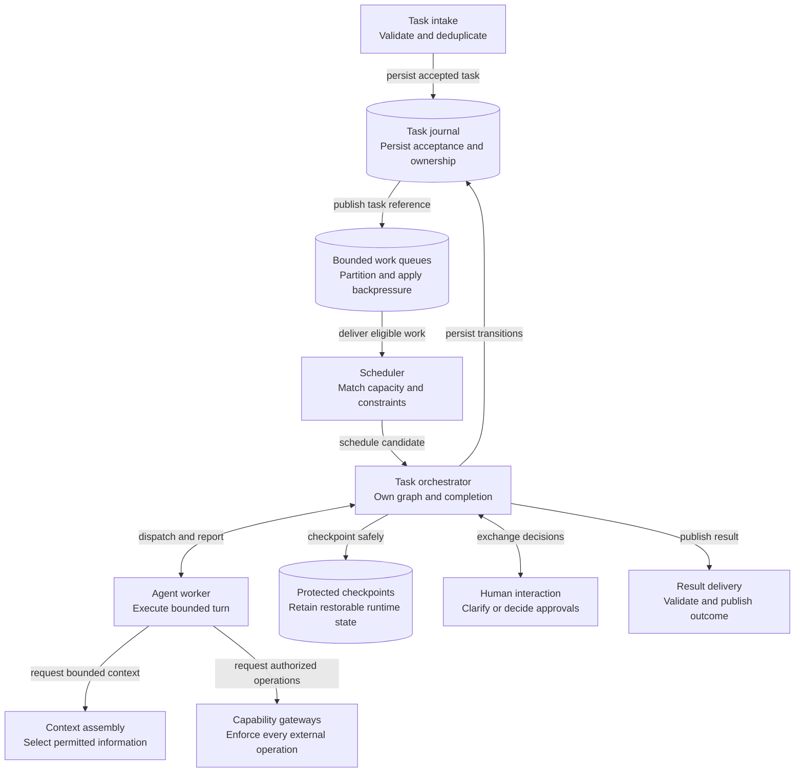
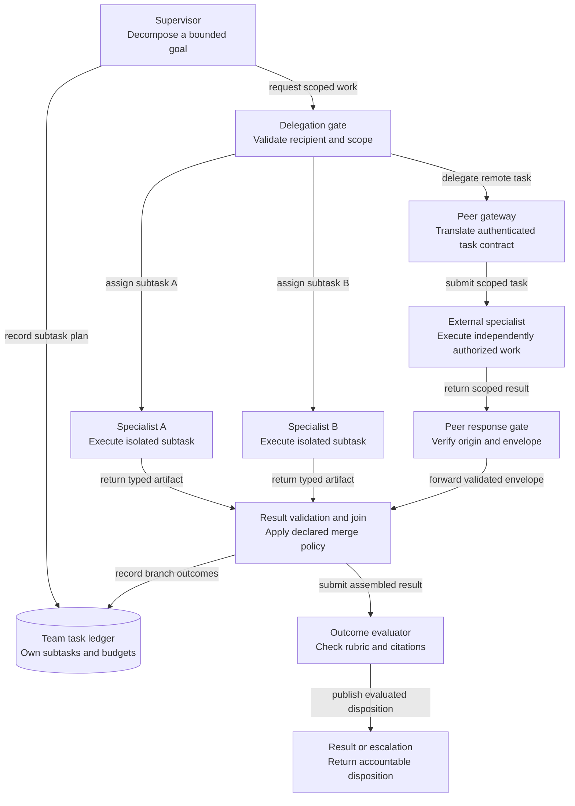
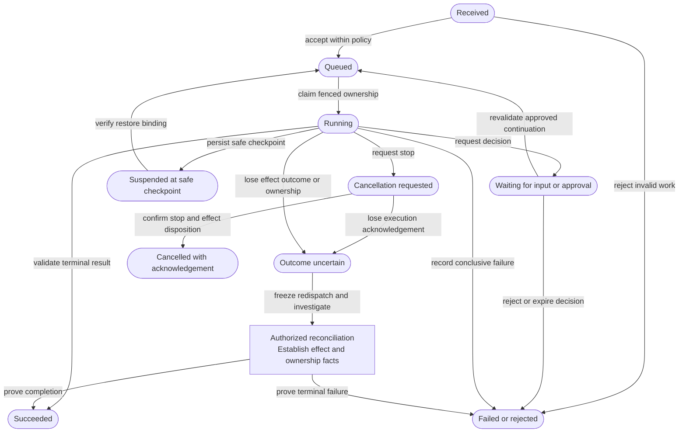

# L2/L3: Durable execution and multi-agent collaboration

Orchestration owns task progress, deadlines, budgets, and recovery. Agent workers
own bounded execution within that contract. A language model can recommend the
next step; it cannot bypass the orchestrator's limits or a capability gateway.

## D4: Runtime coordination

Audience: runtime and distributed-systems engineers. Arrows show initiated
interactions; the queue transports work while the journal owns its state.
All run, context, checkpoint, and result records are tenant-scoped. Shared
scheduling and storage services enforce that scope; this is a coordination view,
not a deployment or physical-isolation diagram.

The journal-to-queue edge is a transactional outbox or equivalent recoverable
publication mechanism. A task is accepted only after durable persistence, not
after placing a message in a best-effort buffer. Scheduler delivery selects an
eligible task; the orchestrator still conditionally acquires journal ownership
before executing it. The queue is not a second execution authority.

### Task delivery and streaming contract

- Bind admission idempotency to the authenticated tenant/principal, operation,
  and canonical input. Matching retries resolve the same task; changed input
  conflicts. Specify the retention window and behavior after its expiry.
- Scheduled and event-triggered tasks use stable trigger/event identities,
  authorized automation principals, and explicit duplicate and missed-run rules.
- Bound stream buffers and apply flow control. Define event sequence/cursor,
  terminal status retrieval, and what happens when an expired cursor cannot
  replay missed events; do not imply every transport retains a full event log.
- Declare whether a client disconnect leaves a durable task running or requests
  cancellation. A lost stream is not proof that a worker stopped. Late results
  are correlated to their original invocation, not used to create a new one.
- Pause or release compute while awaiting human input only at a supported safe
  boundary. Keep decision deadlines and task identity durable; refresh authority
  on resumption rather than retaining long-lived credentials.
- Bound retry delivery and isolate malformed/poison messages in a failure queue
  or equivalent review state. Re-drive requires current authorization and the
  original task/effect lookup; it must not discard uncertain-outcome evidence.

## Team patterns and their contracts

These patterns are alternatives and compositions, not capabilities that must all
run simultaneously. Evidence: [S01, S04, S05, S06, S08, S09](sources.md).

| Pattern | Suitable use | Required controls |
| --- | --- | --- |
| Sequential workflow | Known ordered stages with typed intermediate results. | Validate each boundary; stop or branch on explicit failure. |
| Router with specialists | Known domains requiring different instructions or tools. | Approved destinations; bounded routing confidence and an explicit no-match path. |
| Parallel workers and join | Independent subtasks whose results can be merged. | Concurrency ceiling; branch-local context; deterministic merge policy; all/any/quorum semantics; straggler deadlines. |
| Supervisor and workers | Decomposition and centralized result synthesis. | Subtask ledger, reduced child budgets, approved delegation graph, recursion depth and worker count limits. |
| Handoff | Transfer of conversation or task responsibility. | Explicit new owner, filtered context, separately authenticated authority, return/cancel route, and loop limit. |
| Review and revise | Iterative improvement with a measurable rubric. | Independent grader, maximum iterations, improvement threshold, disagreement and escalation policy. |
| Shared-workspace collaboration | Multiple specialists contributing to shared artifacts. | Versioned writes, conflict arbitration, provenance, scoped reads, and a moderator/termination rule. |
| Adaptive planning | Subtasks are not knowable at authoring time. | Validate each plan revision; constrain permissible nodes/edges; approve new effects; record revisions and stop criteria. |

For every delegation specify **goal, expected output schema, recipient,
permitted tools/data, context subset, remaining deadline, budget allocation,
parent task, and escalation behavior**. Deduct child reservations from the
parent's remaining allowance; do not grant every child the full parent budget.
Treat a peer result as untrusted input to validate, not as a command to execute.

## D14: Bounded specialist collaboration

Audience: application architects. This is one concrete supervisor/worker
composition, not a mandate to use all orchestration patterns. Arrows distinguish
delegation from returned artifacts; remote work crosses an additional trust
boundary.

The peer response gate is the response-side responsibility of the same logical
peer gateway, drawn separately to keep the path explicit. It authenticates the
origin and validates the envelope before the join; that does not establish that
the result is correct.
No specialist shares credentials or full history by default. Local workers still
use capability gateways for models, tools, and data. A join identifies incomplete,
conflicting, or untrusted results rather than silently concatenating them.
Iterative re-planning creates a recorded plan revision within the original
limits, or requests a new human-authorized scope.

For external peers, negotiate discovery, task creation, status retrieval,
streaming, artifact types, cancellation, and authentication independently.
Authenticate callbacks and authorize every task read/cancel/subscription.
Deduplicate notifications; use status reconciliation after reconnect when missed
event replay is unsupported. Validate callback destinations and downloaded
artifacts. An advertised skill or task ID does not grant access.

## Goal and message integrity

The orchestrator retains the approved goal, purpose, constraints, and plan
version separately from agent-generated proposals. Bind each delegated task and
effect to that record. Scope-changing or high-impact deviations require the
applicable policy and human decision before execution. A signed intent envelope
can protect the binding where required; it does not prove semantic alignment.

Peer exchanges carry authenticated issuer, recipient/audience, tenant, task,
plan/context binding, schema version, and freshness/ordering information.
Reject cross-context replays, unauthorized downgrades, and ambiguous discovery
identities. Use message-level integrity and origin verification across brokers
or relays where transport protection does not preserve the full trust boundary;
keep long-lived signing authority outside agent access.

Re-establish authority on a change of user, purpose, or task scope, including
re-authentication when the identity policy requires it. Cached credentials or
conversation history cannot authorize the new context. Record the delegation
chain and original initiator rather than attributing all work to the final peer.

Validate semantic constraints as well as message schemas. Incompatible
interpretations cause rejection or escalation, not silent schema conversion.
Evaluate metadata side channels for sensitive collaborations; minimize exposed
topology and consider padding or traffic shaping when justified by the threat
model and service objectives.

These requirements are informed by [S24, ASI01/ASI03/ASI07](owasp-coverage.md).

## D5: Task lifecycle and explicit uncertainty

Audience: runtime engineers and operators. Arrows are state transitions. Decision
state, task state, and per-invocation effect state remain separate records.
This is the disposition of the current run; a task cannot be presented as
successfully completed while an owned required effect remains uncertain.

This is the core active-run lifecycle. Queued, waiting, and suspended work can
also be cancelled before dispatch after checking that no claimed effect remains.
Expired tasks that have no in-flight effect fail with an explicit deadline reason.
Cancellation of one branch propagates according to the declared join policy.
An accepted cancellation request is not proof of remote termination, and cannot
undo an effect already committed.

Completion has distinct dimensions: task criteria, execution/effect disposition,
result delivery, audit delivery, and accounting settlement. For example, a
completed tool effect can coexist with pending accounting; a failed workflow may
contain successful earlier effects. Preserve these facts instead of collapsing
them into one success/failure flag. Required unresolved effects block successful
completion; optional partial outcomes must be explicitly allowed by the task.

Reconciliation may close the current run or authorize a safe continuation after
proving the relevant effect disposition and fencing prior owners. Such a
continuation, omitted from D5 for readability, returns through admission and
current-policy checks. Compensation is a new effect with its own authorization,
not a retroactive transition from "effect happened" to "effect did not happen".

## Persistence and recovery invariants

- Persist accepted tasks before acknowledging durable acceptance. Queue messages
  carry references; redelivery must resolve the original task and ownership.
- Use conditional writes, lease generations, and fencing at effect boundaries.
  Losing a lease does not prove an earlier remote operation has stopped.
- Checkpoint only at a supported safe boundary; bind tenant, workload incarnation,
  session, run generation, runtime version, configuration digest, and expiry.
  Keep storage decryption keys outside untrusted workers. A restoring worker
  necessarily sees its authorized plaintext context; encryption at rest cannot
  protect that context from a compromised worker during execution.
- Persist the effect claim before dispatch and retain receipts afterward.
  Across a crash, retry a non-idempotent or paid operation only when its absence
  is established or the target's deduplication contract makes retry safe.
- Historical inspection must not invoke providers. An explicit new run from
  history needs fresh authorization and must first resolve prior effect claims.
  New run or invocation IDs cannot authorize repetition of an unknown effect.
- Retain unresolved claims even after payload expiry. Deleting a checkpoint,
  renaming a task, changing a worker, or failover must not reset replay protection.
- Use bounded retries with jitter for classified transient failures. Policy denial,
  invalid binding, unsupported protocol, and unknown effects are not ordinary
  transient failures. Compensation is a separately authorized action, not rollback.

Exactly-once execution across an arbitrary provider is not assumed. Conditional
claims prevent competing local dispatch; a remote target's idempotency contract,
receipt lookup, or explicit reconciliation is still needed after uncertain
delivery. One-time credentials or expiring leases alone do not solve this.

The source checkpoint and interrupt semantics [S10, S11, S12](sources.md)
motivate these guarantees; the exact journal/effect protocol is this reference's
distributed-systems design requirement.

Capability coverage: **C01, C05 through C10, C12, C15, C16, C17, C25, C28** in the
[matrix](capabilities.md).
