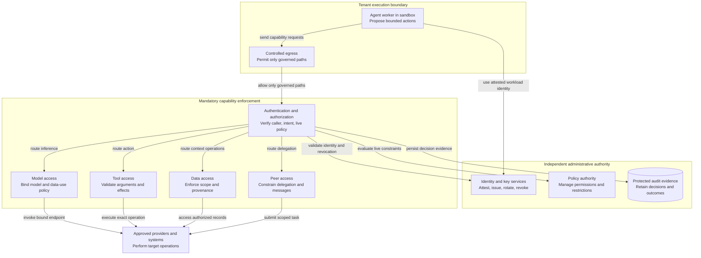
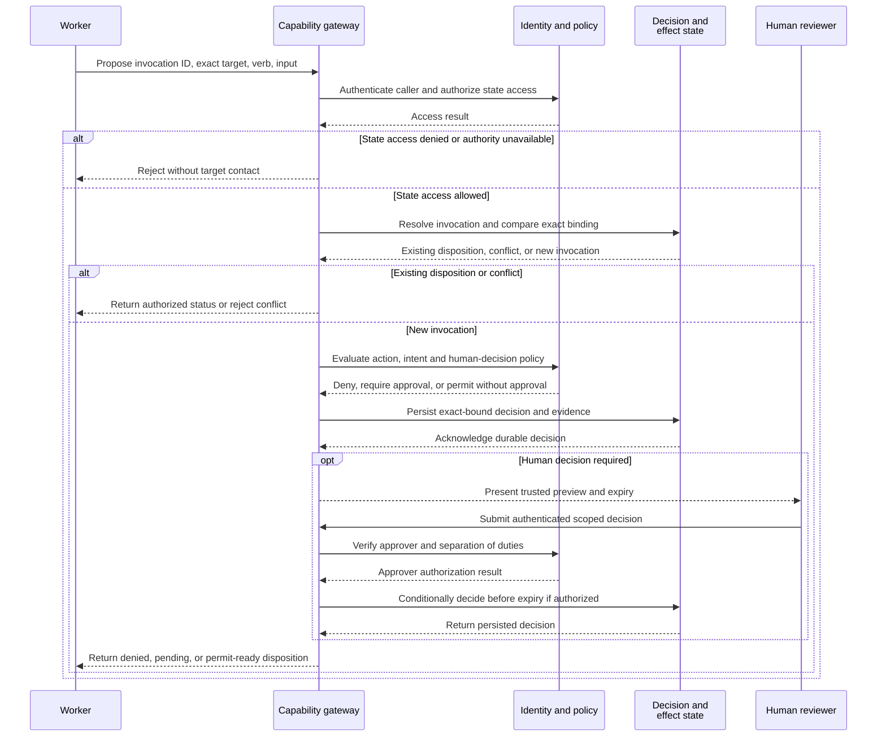
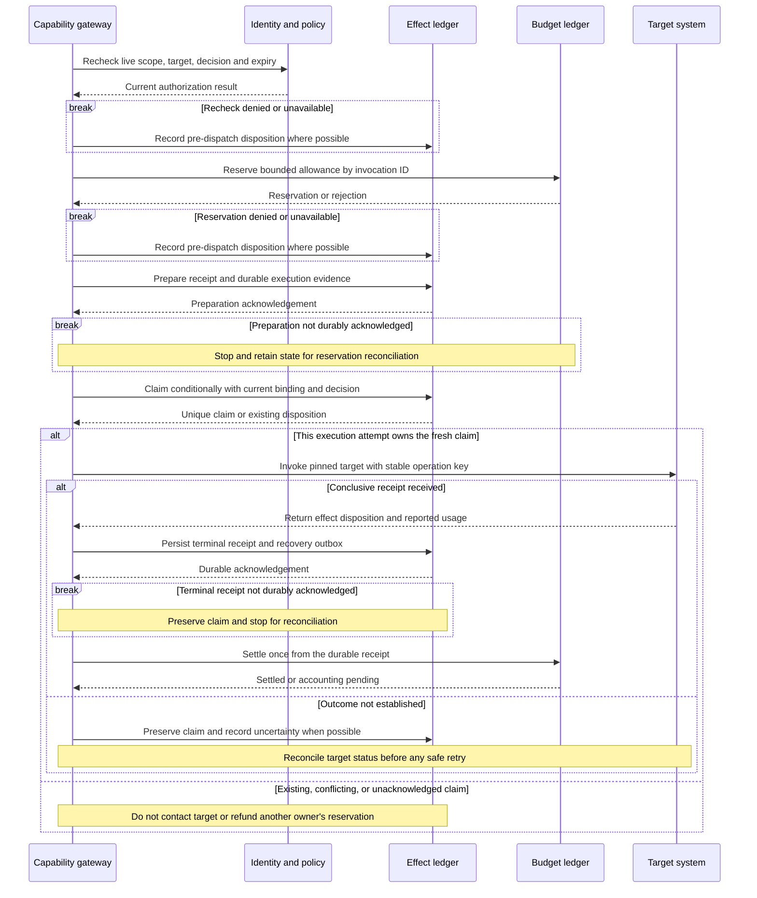
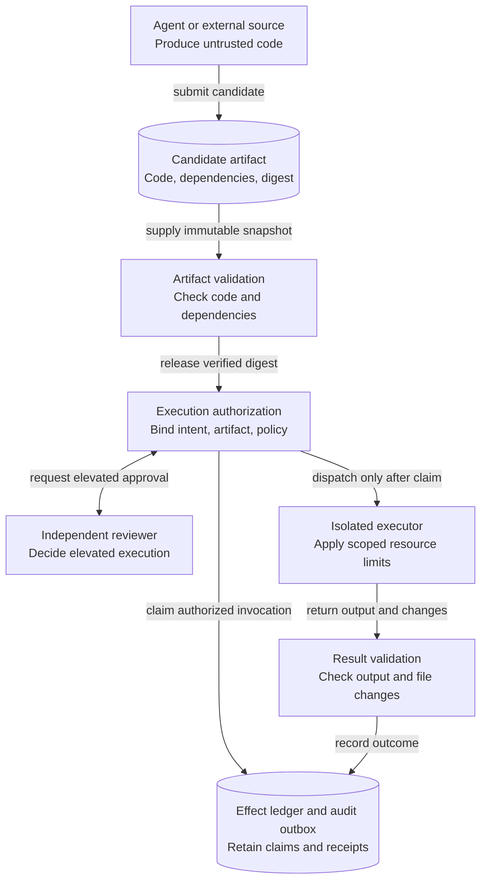

# L2/L3: Identity, policy, and action authorization

Authenticate the initiator and each workload separately. Derive effective
authority from the intersection of caller permissions, delegated scope,
workload permissions, current tenant policy, and target restrictions. Human
approval adds a condition; it does not expand that intersection.

For unattended work, the initiator is an explicitly authorized automation
principal with an accountable owner. A privileged service can offer an approved
business operation without delegating its backend credentials, but it must
authorize the caller for that operation and its exact parameters. It cannot
infer authority from an agent's persona or conversation.

## D6: Independently enforced trust boundaries

Audience: security, platform, and integration architects. Arrows identify
requests across boundaries. Logical gateways need not be separate deployments.

The gate represents shared checks; each specialized boundary repeats any
target-specific, freshness, quota, or binding checks immediately before execution.
Do not give workers raw provider credentials or an ungoverned network escape.
Protect enforcement configuration from the controller or worker it constrains.

The egress node denotes an enforcement responsibility, not a mandatory proxy
product. Process, filesystem, compute, and network limits surround the worker.
The trust model assumes these independent controls and their administrators
remain trustworthy; it does not promise containment against compromise of all
enforcement, signing, and evidence authorities.

### Current policy and revocation

Policy decisions may be evaluated locally using authenticated, versioned state
within an explicitly approved freshness limit. This is not permission to ignore
an unavailable mandatory check. When identity, revocation, approval, or policy
freshness cannot be established, deny new protected effects and expose the
dependency failure. Persist the policy version and validity boundary used.

Specify revocation behavior for long-lived streams and already dispatched
operations. Rechecking before the next call does not retract disclosed data,
cancel a committed effect, or instantly stop an existing remote session.

## D7: Exact-action approval and effect ownership

Audience: runtime, identity, audit, and business-system engineers. This sequence
shows authorization and decision preparation for one action. It deliberately
contains no target dispatch: a permit proceeds to D16, where current authority
is rechecked and execution ownership is claimed.

An existing permit-ready decision may enter D16. Pending, denied, expired,
conflicting, claimed, or terminal dispositions do not create a new execution
path. Status and retained results require their own read authorization, even
when new execution is forbidden. Result expiry returns "unavailable", not a
fresh dispatch.

Bind approvals to tenant, workload incarnation, session, action digest, target
version, risk, approver scope, and expiry. Separate proposal, approval, claim, and terminal facts
so an approval cannot be raced, reused, or transferred to a changed action.
Expiry and decision are conditional transitions against trusted time. A human
wait is durable asynchronous state; the sequence does not require an open HTTP
request or occupied worker. Changed action inputs require a new review, not an
edit to an existing approval.
The human-decision handler also processes previously persisted pending decisions;
it is not limited to the first delivery shown in D7. Missing state or decision
acknowledgement stops progression. Denial evidence is retained when possible,
with independent alerts when required storage is unavailable.

## D16: Effect claim, dispatch, and recovery

Audience: gateway, storage, and integration engineers. This continues D7 for a
permit-ready invocation. The gateway owns dispatch; the effect ledger owns its
conditional claim. A new transport attempt must resolve the same record.

Each pre-dispatch failure branch stops target contact. A post-dispatch failure
preserves the claim and stops new execution. A lost claim acknowledgement is
resolved by reading durable state; it is never treated as an absent claim.
A claim left after process loss does not itself authorize a replacement worker to dispatch.
Reconciliation must establish target disposition, safe retry support, and current
authority first.

### Effect and accounting guarantees

- **Covered effects:** paid inference, tools, data writes/deletes, delegated
  work, and disclosure-sensitive reads all need an explicit policy and retry
  classification. Side-effect-free metadata reads can use a lighter authorized
  path; naming an operation "read" is not sufficient to exempt it.
- **At-most-one local owner is not exactly-once remote execution.** Record
  target idempotency scope, retention, receipt/status lookup, and partial-effect
  behavior. A remote error or timeout can follow a committed effect. If the
  target provides no safe recovery mechanism, retain uncertainty and stop.
- **Claims and receipts are authoritative.** A new run, rotated capability,
  expired lease, or erased result cannot reset execution ownership. Concurrent
  delivery and orphan recovery consult the same effect ledger.
- **Close the preparation window.** Recheck versioned authorization and decision
  validity at claim; if blocking preparation exceeded their validity, restart
  pre-dispatch checks. Remote revocation remains bounded by the declared policy
  and transport contract rather than an implied global transaction.
- **Reserve before cost is incurred.** Define the worst-case allowance or
  enforceable incremental limit, rate/price version, and late-usage treatment.
  A hard ceiling cannot be promised for an unbounded, uncancellable provider.
- **Settle without repeating the effect.** Persist the target receipt before
  idempotent audit/accounting delivery. Keep effect outcome, audit delivery, and
  accounting state separate. Missing usage stays unknown; settlement retry does
  not invoke the provider. Reclaim unused preparation reservations only after
  proving no live owner or dispatched effect depends on them.
- **Fail closed on lost authority or evidence.** If mandatory state cannot be
  persisted or verified, stop and alert through an independent operational
  channel. A durable outbox can satisfy a documented pre-effect evidence fence;
  an in-memory log or eventual attempt to write cannot.

## Intent and tool composition

An allowed operation can still be inappropriate for the approved task. Validate
the proposed action against declared purpose, goal/plan version, semantic
argument constraints, data classification, and destination. Check combinations
of operations, such as an internal read followed by an external transfer, rather
than relying on per-tool allowlists alone. Reject ambiguous tool aliases; resolve
fully qualified identities and approved versions before asking for approval.

Unexpected goal changes, skipped checks, or new tool combinations pause the
affected work for review. An agent-generated rationale, valid signature, or
nominally read-only tool is not proof of acceptable intent. These controls
specialize D6/D7; they do not change approval into permission.

## Human-review integrity

The review surface must show the exact proposed target, parameters or safe diff,
expected effects, source provenance, and verification status. Derive the risk
summary from trusted policy and operation metadata, separately from the agent's
explanation. Label unverified sources and uncertainty without presenting model
self-confidence as calibrated assurance.

Keep preview rendering non-executing: it must not initiate tool calls, callbacks,
external content fetches, or state changes. Any live inspection is a separately
authorized operation, distinct from opening the review. Bind the final decision
to the displayed action digest and expire or invalidate it after changes.

Offer a clear reject/escalate/report path for suspicious or manipulative
interactions. Monitor approval workload and repeated rubber-stamping; use
risk-based multi-step or independent approval where warranted. Avoid persuasive
urgency or anthropomorphic authority cues in high-impact decisions. Test the
review experience with users, including accessibility and manipulation scenarios.

## D15: Generated-code validation and execution

Audience: runtime, tool, and release engineers. Arrows show artifact movement
and authorization requests. This optional execution path expands the Tool access
boundary in D6; applications without code execution must reject it.

Validation alone does not authorize execution. Gate dispatch requires the live
checks and approvals in D7 plus the successful durable claim and budget in D16.
Reject altered artifacts; validate interpreter settings, lockfiles, templates,
and install/import hooks as part of the executable boundary. Do not deserialize untrusted checkpoints
into arbitrary objects or evaluate memory content as code.

Use non-privileged, per-session isolation with explicit filesystem, network,
system-call, time, and resource limits. Generated artifacts receive no direct
production credentials or deployment authority. Promote reviewed changes through
the normal release process; a passing static scan cannot guarantee safe behavior.

## Threat-driven controls

| Threat or failure | Required architectural control |
| --- | --- |
| Prompt injection in messages, documents, tools, or peer cards | Treat content as untrusted data; separate instructions and data; restrict available actions; validate outputs; gate consequential effects before dispatch. Content classifiers are fallible. |
| Excessive agency or confused delegation | Reduce scope at every hop; retain initiator and actor identity; enforce audience, target, verb, expiry, depth, and budget; prohibit token passthrough. |
| Credential theft or stale identity | Attest immutable workload incarnations; short-lived credentials; protected issuance and rotation; explicit revocation; exact peer verification; no secrets in status or traces. |
| Tool abuse, malicious code, or unsafe URLs | Argument/schema constraints; isolated filesystem/process/compute; non-bypassable egress; destination and redirect validation; response-size and execution limits; controlled artifact downloads. |
| Cross-tenant retrieval, cache leakage, or memory poisoning | Mandatory tenant/ACL predicates outside agent filters; scoped cache keys; provenance and write controls; quarantine and revoke poisoned content. |
| Compromised provider or plugin | Privileged enrollment, approved endpoint identity, version and provenance checks, limited credentials, conformance, isolation, and rapid disablement. |
| Policy drift, outage, or expired approval | Recheck immediately before execution; bounded policy freshness; fail closed for unavailable mandatory checks; never auto-approve on timeout. |
| Unsafe output handling or data exfiltration | Validate structured output, sanitize rendering, apply destination/data-loss controls, and block disallowed outbound fields before transmission. |
| Compromised operator or control plane | Separation of duties; independently owned enforcement/evidence; privileged access review; time-bounded audited emergency access; explicit compromise recovery. |

Pre-execution preventive checks and post-execution detection have different
guarantees. An asynchronous guardrail or rejected final answer cannot undo
earlier tool effects. Behavioral trust scores may inform a reviewed autonomy
ceiling; they must never self-authorize privileges.

Source basis: [S06, S07, S13 through S19, S21, S24](sources.md); see the
[page-cited OWASP mapping](owasp-coverage.md). Capability coverage:
**C02, C04, C10 through C16, C22, C24, C26, C27, C29** in the [matrix](capabilities.md).
