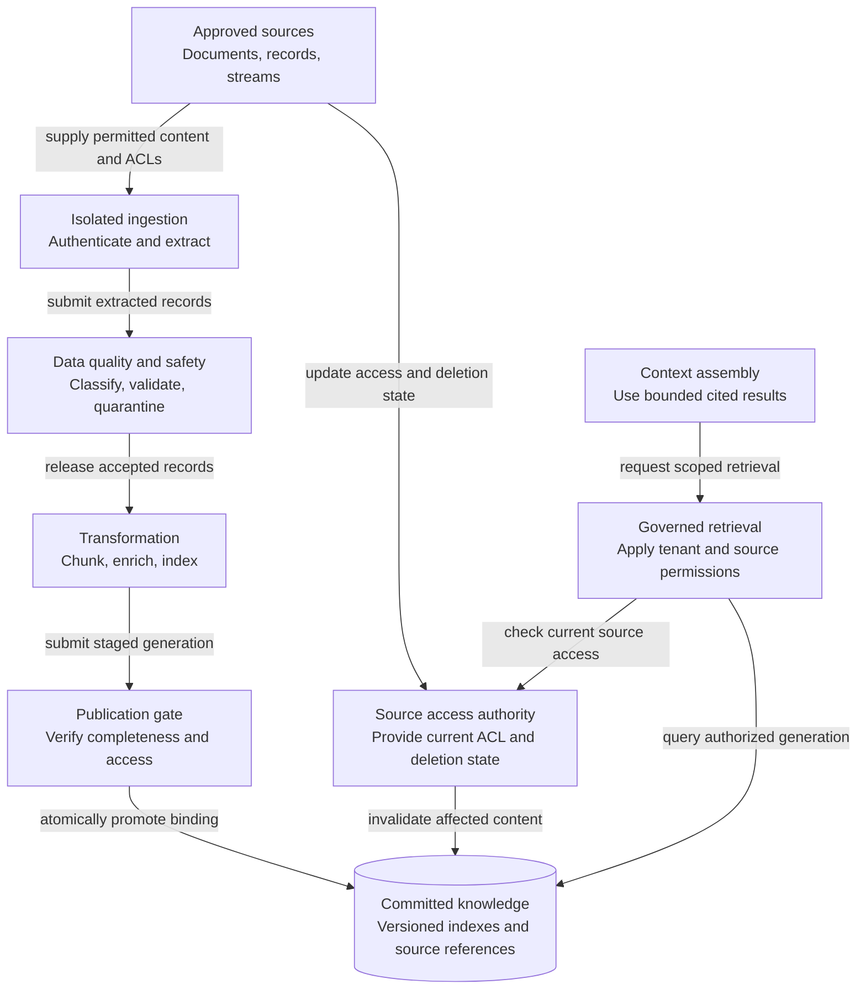
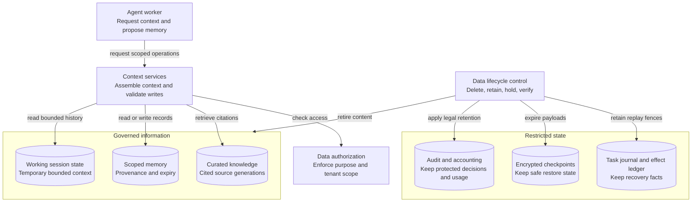

# L2: Knowledge, memory, and context

Keep curated knowledge, interaction-derived memory, temporary context, execution
state, and evidence logically separate. They can share infrastructure only when
their authorization, consistency, encryption, retention, and recovery contracts
remain independently enforceable.

## D8: Governed knowledge publication and retrieval

Audience: data and retrieval engineers. Arrows label publication and query
interactions. Ingestion, publication, and query permissions are distinct.

Transformation writes an unpublished generation before submitting it to the
publication gate. The gate verifies all batches and atomically changes the
visible generation binding; it need not copy the underlying index. Queries
return bounded results, citations, and freshness to context assembly. Publication
does not freeze access rights: current ACL and deletion checks remain independent
of index refresh.

- Track source identity, document/chunk identity, content digest, classification,
  ACL version, extraction/chunking/embedding configuration, and generation.
- Support required structured, lexical, semantic, hybrid, or graph retrieval
  through negotiated adapters. Do not pretend that scores from different
  providers represent the same calibrated confidence.
- Partial ingestion never publishes a successful generation. Preserve the
  previous committed generation while a new one is staged and verified.
- Recheck current source access at query time, including user-delegated access.
  Permission filters must precede result exposure and cannot be overridden by
  agent-supplied filters. Partition or security-trim retrieval and caches.
- Missing or stale permission state blocks affected content even if its
  generation remains available. Changes to permissions and deletion are not
  ordinary index freshness delays.
- Use cited evidence in responses. A citation identifies provenance; it does
  not prove truth, relevance, licensing permission, or absence of injection.

## D9: Context assembly and distinct state responsibilities

Audience: runtime, data, and privacy architects. Arrows show who reads or writes
state. All accesses use the policy enforcement described in [D6](04-trust.md).

Context services expand into context assembly and memory write gates in an
implementation. They do not grant agent access to the restricted operational
state. Lifecycle control applies each store's own deletion and retention policy;
the grouping does not make those policies identical.

## State and consistency contracts

| State | Owning responsibility | Required properties |
| --- | --- | --- |
| Definitions and bindings | Management plane | Immutable published versions, conditional promotion, schema migration, explicit rollback. |
| Task journal and effect ledger | Orchestration and gateways | Durable acceptance, fenced ownership, deduplicated transitions, immutable terminal facts, unresolved-outcome retention, and restoration that does not lose acknowledged claims. |
| Checkpoints | Runtime recovery service | Encrypted bounded state, exact identity/version binding, safe-point restore, key rotation, expiry independent of execution claims, and authorized plaintext delivery to the restoring worker. |
| Working context | Session/context service | Bounded size and lifetime, turn ordering, tenant isolation, documented reconnect behavior. |
| Long-term memory | Memory service | User/agent/task/team scope, read-your-writes where promised, conflict handling for shared writes, provenance, correction and forgetting. |
| Curated knowledge | Data publication service | Staged and committed generations, source authorization, lineage, freshness, retrieval and deletion verification. |
| Telemetry | Observability service | Sampling allowed where appropriate, redaction, cardinality and retention limits, explicit loss/failure indicators. |
| Audit evidence | Independent evidence service | Protected writes and reads, tamper evidence, required durability, legal hold, bounded safe metadata. |
| Accounting | Budget service | Atomic reservations, idempotent settlement, estimated versus measured usage, explicit uncertain charges. |

Context selection applies a token/byte budget and keeps instruction provenance
separate from retrieved content. Summaries can be lossy or poisoned; preserve
references and revalidate before using them for consequential decisions. Do not
promote session observations into reusable procedural instructions automatically.

## Memory integrity and poisoning recovery

Treat interaction-derived records as unverified until the applicable promotion
checks pass. Record origin, producer, transformation history, verification state,
and expiry separately from the record's content. Repeated exposure or retrieval
does not make an assertion authoritative, and an agent's own output must not
automatically re-enter trusted knowledge or memory.

For high-impact use, require independent corroboration or human verification
according to policy. Expire unverified entries and detect unusual write rates,
cross-session influence, or self-reinforcing summaries. Trust signals can rank
eligible records; they cannot bypass tenant permissions or establish truth.

Support quarantine by source or record lineage, including dependent summaries,
caches, and shared context. Keep versioned recovery points and validate a clean
baseline before restoring data. Restoration must preserve current revocations,
deletion obligations, and effect-ledger replay fences; rolling back memory is
not rolling back an external action.

These requirements are informed by [S24, ASI06](owasp-coverage.md).

## Privacy, residency, and deletion

- Classify and minimize data before model, tool, peer, or telemetry export.
  Document permitted purpose, consent or other lawful basis, external retention,
  training use, residency, and approved destinations.
- Scope semantic and response caches by tenant, authorization context, model
  binding, prompt version, and knowledge generation. Invalidate on revocation.
- Trace derived data from source through chunks, embeddings, summaries, memory,
  caches, checkpoints, and backups. Record deletion completion or exceptions.
- Separate a legal hold from ordinary retention and access revocation. A hold
  preserves authorized evidence; it does not grant continued agent access.
- Define backup expiry and restore-time deletion reapplication. A deletion
  request is not complete merely because a live index row disappeared.
- Keep minimal non-content replay-denial facts under an approved retention basis
  when erasing payloads would otherwise permit duplicate effects.
- Model training is outside this platform's baseline. If interaction data feeds
  training or fine-tuning, add separate approval, dataset lineage, privacy,
  evaluation, and model-release controls.

Large results and attachments use bounded, integrity-checked object references
rather than unlimited journal or message payloads. Authorize every read and
download; an opaque URI or previously issued link is not a permanent access
grant. Apply malware/content checks and safe rendering to each supported format.

Before external disclosure, define what deletion, data recall, and audit evidence
the receiving provider can actually supply. Local deletion cannot erase data
already exported beyond the platform's control. Document that limitation in
data-use agreements and response procedures.

Retention must reconcile legal obligations with unresolved effects. If minimum
replay-denial evidence must be destroyed, retire the corresponding execution
scope so it cannot be replayed; do not silently reopen it. Protect lineage and
hashes as potentially sensitive metadata as well as protecting raw content.

Source basis: [S02, S03, S09 through S12, S17 through S20, S24](sources.md). Capability
coverage: **C16 through C20, C27, C29** in the [matrix](capabilities.md).
