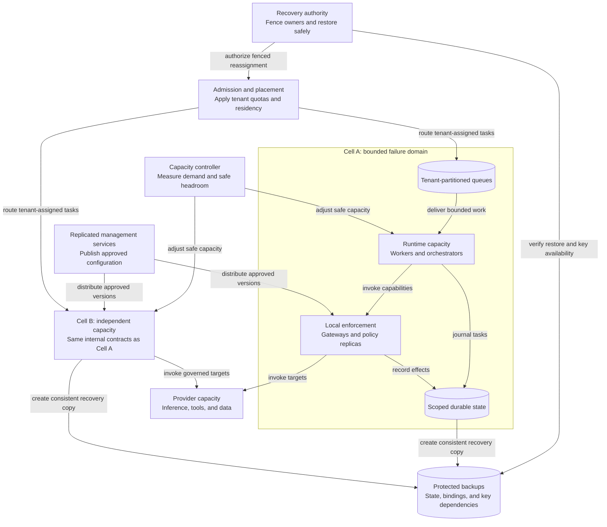

# L2: Scale, placement, and resilience

Start with one bounded runtime cell when it meets the workload's objectives;
add cells when capacity, isolation, or failure containment requires them. A cell
is a failure and capacity boundary; tenant authorization remains mandatory within
and between cells. The two-cell view below illustrates scale-out, not a minimum
enterprise deployment.

## D10: Cell-based deployment and recovery boundary

Audience: infrastructure architects and service operators. Arrows show initiated
requests or controlled replication. This is a deployment pattern, not a required
multi-region topology.

Cell A is expanded; Cell B collapses the same queue, execution, enforcement,
and state responsibilities to avoid duplicating the diagram. Each cell has its
own bounded capacity and explicit authority/state scope.

Cells may share a region, use separate zones, or map to dedicated tenants.
Replicate management metadata independently from sensitive data. Cross-region
movement is conditional on residency, recovery objectives, and split-brain
prevention; the arrows do not imply unrestricted data replication.

### Placement, replication, and failure scope

- Assign each task a home cell and one authoritative ownership/effect scope.
  Routing or session affinity is not the ownership record. Cross-cell delivery
  must consult the same effect identity or a fenced ownership transfer.
- "Replicated management services" includes available metadata storage and
  control of concurrent writers, not merely several stateless processes.
  Replicate approved configuration and current authority to each cell with
  explicit version, expiry, and revocation behavior.
- Local enforcement accesses the cell's authoritative effect/accounting state.
  Shared provider-account quotas require coordinated reservations or conservatively
  partitioned allowances; independent per-cell counters cannot enforce a global
  hard limit.
- List shared failure dependencies: identity issuers, DNS, management stores,
  policy distribution, provider accounts, audit sinks, networks, and key services.
  Two cells sharing one such dependency do not eliminate its failure mode.
- Protect high-impact claims with durability consistent with the effect-safety
  requirement. An older backup with missing acknowledged claims cannot be used
  as evidence that those operations never happened.

## Capacity and fairness

- Bound concurrent sessions, steps, tool calls, queue depth/age, recursion,
  fan-out, context size, tokens, and total run duration. Apply hierarchical limits
  to organization, tenant, workload, run, and invocation.
- Use fair queues and admission control to prevent noisy-neighbor starvation.
  Define priority, starvation bounds, and the effect-safety conditions for
  preemption. Reserve capacity for approvals, cancellation, and recovery.
- Autoscale using queue age, service time, active sessions, token throughput,
  dependency saturation, and provider limits; CPU alone is insufficient.
  Use stabilization, scale ceilings, and safe draining for scale-down.
- Placement considers model capability, data residency, context locality,
  dependency availability, warm capacity, cost, and latency. Session affinity
  optimizes continuity; it must not be the only recovery mechanism.
- Hosted inference imposes shared request/token limits across cells. Coordinate
  quota and reservations globally at the provider-account boundary where needed.
  Self-hosted serving additionally needs accelerator capacity, batching,
  model-load/warmup, health, and model artifact management.
- A cheaper or alternate model is a behavior change. Permit fallback only for
  pre-evaluated bindings with compatible safety, schema, quality, and residency.
  Report the actual serving version and degraded behavior.

## Failure policy

| Failure | Safe disposition |
| --- | --- |
| Client stream disconnect | Apply the declared detach-or-cancel policy; preserve task progress and bound buffers. The task may still be running; reconnect through authorized status/cursor retrieval. |
| Worker crash or lost control connection | Fence replacement execution; inspect durable task/effect state before restore. A lost connection does not prove remote termination or absence of an effect. |
| Orchestrator failover | Acquire fenced ownership; inspect claims and terminal facts before dispatch; prevent split-brain execution. |
| Model/tool outage or throttling | Retry only after classifying effect disposition and target idempotency support; then apply bounded backoff, circuit breaking, bulkheads and overload rejection. |
| Slow or failed branch | Apply declared join and deadline semantics; identify partial results; do not fabricate missing specialist output. |
| Policy or identity dependency outage | Use a verified local authority snapshot only within its approved validity/freshness contract; otherwise deny new protected effects. Never skip an unavailable mandatory check. |
| Journal, evidence, or budget outage | Reject new effect claims; preserve pending work; alert. Telemetry buffering cannot substitute for required audit durability. |
| Cell or region loss | Fence old owners; verify state/key recovery and identify any lost-claim interval. Reconcile in-flight and potentially lost effects before permitting reassignment. |
| Management-plane outage | Existing pinned runs may continue only while runtime authority, revocation freshness, and required dependencies remain valid; block new changes. |

### Recovery ordering

1. Stop new effects for the affected scope and fence previous owners at
   independently enforced boundaries; a new lease alone cannot stop an isolated
   old worker.
2. Restore and verify state, compatible schemas, keys, current policy/revocation,
   and data-deletion records. Keep restored work inactive.
3. Identify the recovery-point gap. Recover acknowledged effect claims from
   surviving replicas/receipts, or mark the affected tasks uncertain. Absence in
   a restored database is not proof of non-execution.
4. Reconcile target receipts and accounting, validate safe checkpoints, and
   authorize ownership transfer. If the target cannot establish disposition,
   retain uncertainty rather than automatically replaying work.
5. Resume limited traffic and verify task, evidence, and cost outcomes.

For high-impact effects, either acknowledged claims survive the required failure
domain without loss, or recovery blocks potentially affected work until reconciled.
This tradeoff must be explicit in the RPO/RTO; backups alone do not provide it.

## Semantic cascade containment

A cell can remain available while propagating an incorrect or manipulated
decision. Validate outputs before delegation, shared-memory promotion, or
downstream effects. Preserve origin and goal/plan lineage so repeated
recommendations can be recognized as one source rather than independent evidence.

- Monitor repeated intents, anomalous delegation fan-out, cross-domain spread,
  oscillating agent feedback, and skipped checks alongside resource saturation.
- Define maximum affected tasks, agents, cells, and sensitive-data domains for a
  suspected faulty result. Independently pause propagation at planner/executor
  and cell boundaries; reserve capacity for containment and reconciliation.
- Require reviewed policy changes to pass bounded cascade tests in an isolated
  environment with simulated effects. Include a poisoned result or shared-memory
  item while latency and infrastructure-health metrics remain nominal.
- Recall compromised prompts, tools, descriptors, or peer bindings across cells.
  Measure revocation propagation and verify affected streams and descendants;
  stopping one worker does not prove that dependent work has stopped.

These requirements are informed by [S24, ASI04/ASI08/ASI10](owasp-coverage.md).

## Service-objective worksheet

Values are deliberately **unassigned**: business owners and operators must choose
them per risk class and verify them under representative load. Availability alone
does not measure correct task completion.

| Objective | Define and measure | Required acceptance exercise |
| --- | --- | --- |
| Task success and quality | Eligible tasks, success rubric, partial-result policy, review sample, threshold and observation window. | Ground-truth and adversarial multi-step cases across workload classes. |
| User responsiveness | p95/p99 time to acceptance, first progress, first token, and completed task, including queue time. | Cold/warm starts, long context, slow tools, human pauses, reconnects. |
| Sustained capacity | Concurrent runs, arrivals/second, tokens/second, fan-out, burst length, tenant mix and growth headroom. | Saturation and burst tests showing bounded queues and admission rejection. |
| Fairness | Maximum queue wait and reserved share by tenant/priority; starvation and resource ceilings. | Saturate one tenant and verify others' latency and completion objectives. |
| Semantic blast radius | Maximum downstream tasks/cells affected, detection delay, and time to stop propagation after a suspect result. | Inject one faulty decision into a bounded test team; verify lineage, pause, and recovery without relying on CPU or latency alerts. |
| Recovery | RPO and RTO separately for definitions, tasks, effect claims, data, and evidence; time and procedure for resolving a lost-claim interval. | Restore an intentionally older backup with key rotation, stale owners, unknown effects, and deletion records; prove no automatic redispatch of potentially completed operations. |
| Revocation | Maximum identity/policy/data-permission propagation delay and allowable cache age. | Revoke during long-running work and test the next effect and data read. |
| Effect safety | Duplicate target effects under the target's declared idempotency/receipt contract; uncertain-outcome detection and resolution time. | Lose target responses and crash between claim, dispatch, receipt, and settlement; verify safe blocking when remote deduplication or proof is unavailable. |
| Cost | Per-task and per-tenant budgets, cost of successful outcome, reservation headroom and uncertain usage. | Fan-out, retries, provider throttling, missing usage and billing reconciliation. |
| Evidence and privacy | Required evidence delivery delay, telemetry loss budget, retention/deletion deadlines. | Collector outage, audit-store outage, cross-tenant query, erasure and restore. |

For availability and latency objectives define the measurement window, error
budget, exclusions, and burn-rate response. Do not copy unvalidated numeric
targets from a reference diagram.
Report human-wait time separately from active execution and total end-to-end
duration. Define eligible-task denominators, partial outcomes, provider exclusions,
and detection-versus-prevention metrics so dashboards cannot conceal failures.
Measure residual-risk bounds in explicit scenarios; no detector guarantees
recognition of every semantic cascade.

Source basis: [S01 through S03, S10, S11, S24](sources.md). Capability coverage:
**C07, C08, C12, C20, C25, C26, C28** in the [matrix](capabilities.md).
