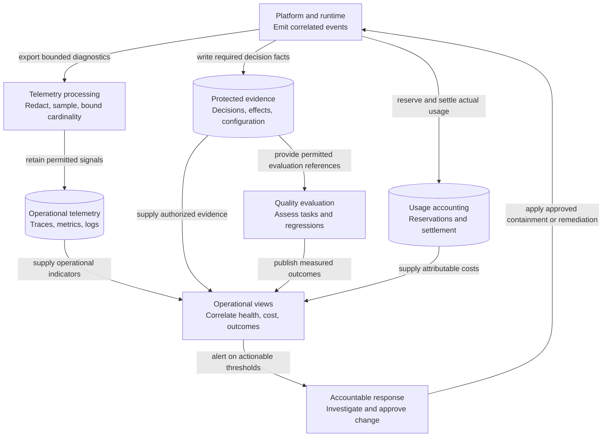
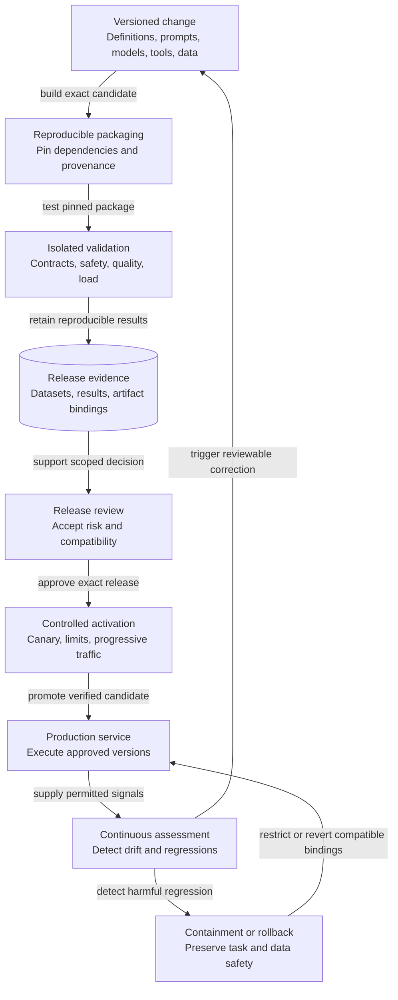
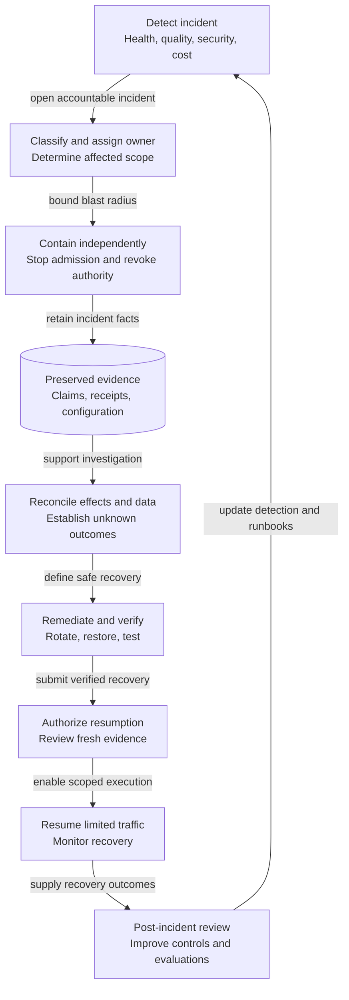

# L2/L3: Observability, assurance, and lifecycle

Measure infrastructure health, task behavior, business outcomes, policy
enforcement, and cost together. Keep sampled diagnostics separate from protected
audit and accounting. Neither a trace nor an evaluation score authorizes release.

## D11: Signals, evidence, and operational feedback

Audience: operators, risk owners, and quality engineers. Arrows show signal or
evidence delivery and controlled feedback.

## Required signals and evidence

| Category | Minimum observations |
| --- | --- |
| Service health | Availability, saturation, queue depth/age, reconciliation lag, dependency readiness, state-store latency, error classes, circuit state. |
| Task execution | Run/step/attempt hierarchy, approved goal/plan version, active agent, delegation and handoffs, waits, branch outcomes, loop count, cancellation acknowledgement, checkpoint and recovery state. |
| Capability use | Model/tool/data/peer target and version, latency, input/output size, retries, receipts, policy outcome, quota disposition, and provider error class. |
| Quality | Task success, relevance, grounding and citation quality, unsafe/unsupported output, tool-selection and argument correctness, retrieval quality, goal drift, correlated misleading peer results, repeated failures and human overrides. |
| Cost | Actual and estimated tokens/compute/tool charges, reserved/settled/uncertain amounts, per-tenant/run/revision attribution, evaluation and failed-call costs. |
| Trust and privacy | Identity incarnation, authorization and policy version, approval/claim references, revocation, data-access decisions, redaction/deletion failures, and privileged changes. |

Use trace links for asynchronous tasks, fan-out, handoffs, and resumes; a single
parent span is insufficient for every causal relationship. Do not use tenant or
run IDs as unbounded metric dimensions. Restrict evidence queries by tenant and
role; redact before export, including errors and provider metadata.

Capture structured decisions, actions, citations, and bounded user-facing
explanations rather than hidden model reasoning. Raw prompts, responses, tool
arguments, attachments, and checkpoints require explicit purpose, access,
classification, and retention; content capture is not the default.

Required audit events use a durable write or recoverable outbox before protected
effects. Monitor evidence-delivery lag and failure separately from trace-export
loss. Define integrity verification, restricted administration, retention/hold,
and incident export for the audit store. Accounting must reconcile to provider
receipts or bills and label uncertain charges rather than reporting zero.

Audit records are produced by their owning services, not freely writable by
agent workers. A claimed effect references its decision, owner generation, target
binding, and eventual receipt. Audit integrity and restricted administration
must be enforceable even when an ordinary runtime operator or worker is
compromised.

Cost reporting separates estimated, reserved, provider-reported, settled, and
disputed/unknown amounts. Define price/currency version, late usage, quota reset
boundaries, and charge attribution for retries, child tasks, evaluations, and
failed calls. Settlement retry is idempotent and never authorizes another model
or tool operation; see [D16](04-trust.md#d16-effect-claim-dispatch-and-recovery).

## D12: Versioned delivery and continuous evaluation

Audience: application, release, and governance teams. Arrows show approved
promotion stages and feedback. The vertical layout keeps each gate legible.

- Evaluate the whole changed path: routing, retrieval, delegation, model calls,
  tool selection and arguments, effect authorization, memory, and final output.
- Use versioned representative datasets, adversarial cases, deterministic
  assertions, calibrated model judges, and human review. Include group-specific
  quality/bias measures where relevant; avoid a single aggregate hiding failures.
- Record dataset provenance, contamination controls, rubric/judge versions,
  uncertainty, and baseline comparison. Missing required metrics fail the gate.
- Run evaluations in isolated tenants with synthetic or authorized data and
  restricted effects. Evaluation agents and canaries use the same identity,
  quotas, audit, and tool controls as production.
- Test adapter compatibility, policy denial, outages, concurrent load,
  revocation, retries, unknown effects, and restore. A unit test or sandbox result
  is not deployed acceptance.
- Bind release evidence to exact executable/configuration/data versions.
  Signatures and provenance establish origin and approval, not semantic safety.
- Link software and AI component inventories to live run dependencies, including
  dynamically selected descriptors and prompts. Test emergency recall and cached
  binding invalidation before relying on a supply-chain kill switch.
- Separate installation from activation of privileged producers. Verify identity,
  policy, isolation, dependencies, and evidence before enabling traffic.
- A rollback is safe only if data schemas, checkpoint formats, and active effects
  remain compatible. Otherwise freeze, drain, migrate, and approve recovery.
- Feed production feedback into reviewed changes. Autonomous rewriting of policy,
  tools, prompts, or autonomy limits is not an implicit improvement mechanism.

### Release, activation, and retirement

A release decision approves exact artifacts and their evidence. Activation
separately verifies the installation's identity, isolation, policies, migrations,
dependencies, and operational ownership before granting execution authority.
Neither decision overrides current per-action authorization.

Canaries and shadow evaluations must not duplicate production effects; use
synthetic tasks, disabled side effects, or an explicitly approved test account.
Pin active runs to their configuration while applying live revocation. A
rollback changes eligible bindings for future work; it does not silently rewrite
in-flight task history, repeat effects, or reverse already committed actions.

For retirement, disable new admission, drain or reconcile outstanding work,
revoke delegated authority, apply data/credential lifecycle rules, and retain
required evidence. Restore and offboarding exercises are release acceptance
inputs, not procedures left undefined until an incident.

## D13: Incident containment and safe resumption

Audience: operators and security/risk owners. Arrows show controlled incident
transitions; resumption requires a new authorization decision.

Containment must stop new effects even when a worker is compromised. Account for
existing streams, issued credentials, delegated tasks, and copied data; stopping
one process or rotating a source secret alone may not revoke them. Preserve
unknown-effect claims through restore. Define notification, business remediation,
legal escalation, accountable emergency access, and post-incident review.

## Behavioral assurance and reintegration

Maintain reviewed baselines for expected goals, tools, data movement,
delegation, and authority ceilings. Detect harmful sequences that individually
pass permission checks, unauthorized self-replication, collusion-like patterns,
and optimization that games quality, cost, or safety metrics. Do not let the
evaluated agent modify the baseline or suppress its own independent evidence.

Use periodic challenge tasks and independent outcome review where risk warrants
them. A watchdog agent is a fallible detector with limited privileges; it cannot
be the sole containment authority or approve its own peers solely from their
self-reported scores. Protect long-lived signing keys from workers and bind any
attestation to its actual verification scope.

Quarantine affected instances and revoke their capabilities while preserving
claims and receipts. Before reintegration, verify dependencies and clean
state, establish fresh workload identity evidence, rerun relevant behavioral
checks, and obtain scoped human approval. Recovery must address downstream
tasks and poisoned shared context as well as the original worker.

These requirements are informed by [S24, ASI08/ASI09/ASI10](owasp-coverage.md).

## Operational efficiency

Track idle capacity, storage growth, evaluation overhead, and cost per successful
task. Use retention, model selection, batching, and scale-to-idle only where
quality, response-time, privacy, and recovery objectives remain satisfied.
Where sustainability reporting is required, report measured consumption and
provider-estimate limitations rather than deriving impact from token count alone.

Source basis: [S02, S03, S07, S16 through S24](sources.md). Capability coverage:
**C12, C21 through C30** in the [matrix](capabilities.md).
