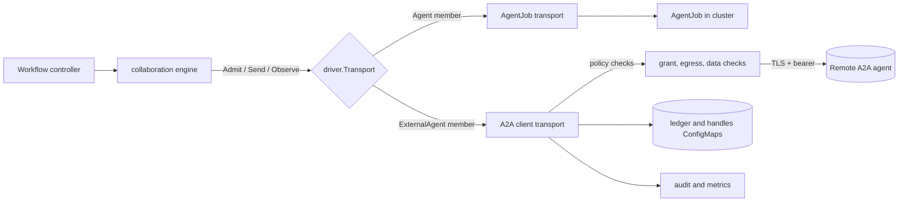

# ExternalAgent: interoperating with remote A2A agents

> **Status:** Proposed. v1 scope approved by the feature owner on 2026-11-18 (static
> endpoint, pinned card digest, bearer-token credential, egress allow-list). The
> later evolution is design intent recorded in [EPIC-0024](../../../../BACKLOG.md);
> it is not approved for implementation.
> **Decision record:** [ADR-0030](../../../adr/0030-external-agent-outbound-a2a.md).
> **Requirements:** FR-0617..FR-0623 in [PROJECT.md](../../../../PROJECT.md).
> **Builds on:** [workflow collaboration](../../../workflow-collaboration.md) and
> [ADR-0029](../../../adr/0029-workflow-execution-boundaries.md).

## 1. Problem and decision

Collaboration steps run a team of Kognition `Agent` members as `AgentJob` turns.
Real organisations also need a team member that lives outside the cluster: a
partner's agent, a vendor service, or another platform. The industry interface
for that is the Agent2Agent (A2A) protocol.

An external agent is not a Kognition `Agent`. Kognition does not run it, meter its
model use, issue it an identity, or control its code. Pretending otherwise (for
example by wrapping it in a local loopback agent) would hide the trust boundary
that matters most. The decision is therefore:

- Add a separate, namespaced `ExternalAgent` resource whose `protocol` field is
  required and accepts `A2A` only in v1.
- Keep MCP as the `Tool` mechanism. An MCP server is a tool, not a peer agent.
- Let a collaboration member or an ordinary Workflow step reference an
  `ExternalAgent` through `externalAgentRef`, mutually exclusive with `agentRef`.
- Treat every call as crossing a trust boundary: explicit grant, egress allow-list,
  bounded payload, untrusted reply, audited call.

## 2. Goals and non-goals

**Goals (v1)**

1. A Workflow author can name an approved remote A2A agent as a member of any of
   the four strategies, or as a single step, with no change to the strategy rules.
2. The platform operator controls which remote endpoints can ever be reached and
   which namespaces may use them.
3. Secrets never reach workflow authors, Studio, logs, ledgers or the remote's
   reply path.
4. A remote failure, slow reply, lie or hostile payload can cost at most the
   declared limits and can never exceed them.
5. Restart, cancellation and timeout behave as in local collaboration: a
   completed remote task is never repeated and an ambiguous send is never resent.

**Non-goals (v1)**

- Inbound federation. Exposing Kognition Agents to external callers stays
  FR-0616.
- MCP as an agent protocol, and any protocol other than A2A.
- Dynamic discovery of agents, automatic card trust, or a public registry.
- mTLS, OAuth, token exchange, card refresh or signature verification (v1.1 and
  later; see section 9).
- Streaming, push notifications and multi-hour tasks (later).
- Making an external agent a Workflow `Agent` replacement for scheduling,
  scaling, probes or `AgentInstance`.

## 3. Use cases

| ID | Use case | Strategy | Key requirement |
| --- | --- | --- | --- |
| UC-1 | A partner's compliance agent reviews a draft produced by the in-cluster writer. | Parallel branch + local synthesizer | Remote result is untrusted input to the synthesizer |
| UC-2 | A supervisor delegates a specialist lookup to a vendor's agent. | Supervisor | Delegation counts against `maxDelegations`; vendor usage counts against `maxTokens` |
| UC-3 | A local triage agent hands a case to a regional operator's agent. | Handoff | Ownership transfer to a remote member; no resend after ambiguous send |
| UC-4 | A remote reviewer joins a peer discussion. | Peer | Only the local finalizer can complete the step |
| UC-5 | A single step calls a remote agent. | Ordinary step | `externalAgentRef` without a collaboration block |
| UC-6 | Platform operator blocks all egress except two partner hosts. | Operations | Allow-list is enforced by admission and by the network |
| UC-7 | Security reviewer asks which remote agents received which data. | Governance | Audit names the ExternalAgent, card digest and remote task ID |
| UC-8 | A partner rotates its credential or card. | Operations | v1 detects and fails closed; automated handling is later |

## 4. Resource model (v1)

```yaml
apiVersion: kognition.dev/v1alpha1
kind: ExternalAgent
metadata:
  name: partner-compliance
  namespace: kognition-work
spec:
  protocol: A2A                    # required; only A2A in v1
  endpoint: agents.partner.example:443   # static host:port; TLS is required
  card:
    digest: sha256:<hex>           # pinned digest of the canonical Agent Card
    skills: [review-draft]         # optional subset the platform will use
  credentialRef:
    name: partner-compliance-token # SecretRef holding a bearer token
  limits:
    maxTokensPerTask: 8192
    taskTimeout: 5m
    maxRequestBytes: 65536
    maxResponseBytes: 262144
    maxConcurrentTasks: 2
status:
  observedCardDigest: sha256:<hex>
  conditions: []                   # Ready, CardPinned, Reachable, EgressAllowed
```

Rules:

- `protocol`, `endpoint`, `card.digest` and `credentialRef` are required. `limits`
  fields have platform-defined defaults and ceilings; a value above the ceiling is
  rejected.
- `endpoint` is a DNS name and port. IP literals, userinfo, paths and schemes are
  rejected. Admission rejects names that resolve to loopback, link-local,
  private-cluster or cloud-metadata ranges, and the transport re-checks the
  resolved address at connect time (DNS rebinding) and refuses redirects.
- The card digest is the SHA-256 of the canonicalised Agent Card. The transport
  fetches the card, compares digests and fails closed on mismatch. A fetched card
  is never trusted without a matching pin.
- The `SecretRef` is resolved only by the transport at call time. It is not
  copied into status, events, ledgers, logs or traces.
- Immutable once referenced by a running collaboration: `protocol`, `endpoint`
  and `card.digest`. Changing them is a new revision or a new resource.
- A `Workflow` references it as `externalAgentRef: {name: ..., namespace: ...}`.
  A cross-namespace reference needs a `CrossNamespaceGrant` as with other kinds.
- Using it requires an explicit grant, modelled like `ToolGrant` with an `invoke`
  verb (`ExternalAgentGrant`, see US-0102). There is no implicit access for a
  namespace's Agents or Workflows.

### Collaboration member shape

```yaml
members:
  - name: analyst
    agentRef: { name: wfteam-analyst }
  - name: compliance
    externalAgentRef: { name: partner-compliance }
```

Exactly one of `agentRef` and `externalAgentRef` per member. Aliases, strategy
blocks and limits are unchanged. The existing distinct-member rule becomes
"distinct Agent or ExternalAgent".

## 5. Architecture



Components:

1. **API types and admission** validate the resource, the reference, the grant and
   the endpoint rules.
2. **Client-only A2A transport** (`internal/collaboration/a2atransport`, new
   remote mode) implements `driver.Transport` for `ExternalAgent` members. It uses
   the a2a-go client over gRPC (`lf.a2a.v1.A2AService`, `a2a-version: 1.0`). No
   server, listener or receiver is added.
3. **Policy gate** runs before every send: grant is live, endpoint passes the
   allow-list, resolved address is permitted, payload is within limits, concurrency
   cap is available, member allowance is reserved.
4. **Ledger** persists the remote task handle in the owned `-handles` ConfigMap
   before the first observation, so a controller restart resumes the same remote
   task instead of creating another.
5. **Chart** adds the Helm flag, controller RBAC to read the referenced
   `SecretRef` Secrets, and the NetworkPolicy egress rule driven by the allow-list.

### Call semantics

| Event | Behaviour |
| --- | --- |
| Send | Reserve allowance, write intent to the ledger, call `SendMessage`, persist the remote task ID before observing |
| Ambiguous send (timeout or connection loss before a task ID) | Mark `Unknown`; never resend; the member fails with a recoverable reason unless a later poll finds the task |
| Observe | Poll `GetTask` until a terminal state or `taskTimeout`; bounded response size |
| Restart | Read handles from the ledger and resume `GetTask`; completed turns are not repeated |
| Cancel or timeout | Call remote `CancelTask` (best effort), record the result, abandon the handle |
| Remote `input-required` or `auth-required` | Fail the member; a member cannot ask a human, as for local members |
| Oversized, malformed or non-text reply | Fail the member with `InvalidPayload` |

### Accounting

Kognition cannot meter a remote model. Controls are therefore:

- The member allowance is reserved before send (FR-0456 hybrid accounting).
- If the reply artifact carries `kognition.dev/usage`, charge the reported tokens,
  capped at the allowance.
- Otherwise charge the whole allowance.
- `maxTokensPerTask` on the `ExternalAgent` is sent as a request hint and is the
  ceiling for the charge. It is not an enforcement on the remote.
- Wall-clock (`taskTimeout`) and byte limits are enforced locally.

## 6. Trust model and threats

| Threat | Control (v1) | Test |
| --- | --- | --- |
| SSRF to cluster services or the metadata endpoint | Name-only endpoints, resolved-address check at admission and connect time, redirect refusal, NetworkPolicy allow-list | TC-0346, TC-0353 |
| DNS rebinding | Connect-time address re-check; connection pinned to the checked address | TC-0346 |
| Malicious or swapped Agent Card | Pinned digest; mismatch fails closed; fetched card never trusted unpinned | TC-0345, TC-0355 |
| Credential leak to workflow authors, logs or ledgers | `SecretRef` resolved only in the transport; no secret in status, events, traces, ledger | TC-0348 |
| Credential sent to the wrong host | Token attached only to the pinned endpoint's connection; refuse redirects and card-supplied URLs | TC-0348 |
| Unauthorised namespace uses a partner agent | Explicit grant; cross-namespace grant; live re-check per send | TC-0349, TC-0350 |
| Data exfiltration through step input | Only the declared step input is sent; payload byte cap; operator allow-list; data-class policy later | TC-0351, TC-0380 |
| Prompt injection in the remote reply | Reply is data, never instructions, never executed or used as a tool call; the local finalizer or synthesizer remains in control | TC-0358 |
| Resource exhaustion by the remote | Task timeout, response byte cap, concurrency cap, member and step token ceilings | TC-0356 |
| Duplicate side effects on retry | Handle persisted before observe; no resend after ambiguous send | TC-0357 |
| Remote lies about usage | Usage capped at allowance; unreported usage charged in full | TC-0359 |
| Controller compromise widens egress | Controller can read only Secrets referenced by admitted ExternalAgents; egress is policy-limited | TC-0352 |

Residual risks, accepted for v1 and tracked in the backlog: no mutual
authentication (US-0107), no automatic credential rotation (US-0108), no card
refresh or signature check (US-0109), and no data classification beyond explicit
input and size (US-0111).

## 7. Compatibility and migration

- Existing `agentRef` members, strategies and the ledger format are unchanged. A
  member with `externalAgentRef` adds a `kind` discriminator to the ledger member
  record; older controllers reject unknown kinds rather than ignoring them.
- `protocol` on `collaboration` stays `A2A`; the new `ExternalAgent.spec.protocol`
  is a separate field with the same value set so later protocols are additive.
- The feature is behind a Helm flag and disabled by default. Admission rejects
  `externalAgentRef` when the flag is off.

## 8. Test strategy

| Level | What | Fixture |
| --- | --- | --- |
| Unit | Types, defaults, canonical card digest, endpoint classifier, usage capping | none |
| Admission | Every rule in section 4, immutability, grant requirement, flag off | envtest and the admission validator tests |
| Transport | Send, observe, restart resume, ambiguous send, cancel, timeout, oversize, malformed, usage | a2a-go bufconn fixture |
| Strategy matrix | Supervisor, Parallel, Handoff and Peer each with one external member and with a mixed team | bufconn fixture and the fake `Agent` jobs |
| Security | SSRF and rebinding, redirect, secret non-disclosure, grant revocation mid-run, hostile reply | bufconn plus a hostile fixture |
| Chart | Flag off renders nothing; flag on renders RBAC and NetworkPolicy | chart render tests |
| Studio | Create, reference picker, problems panel, standalone blocked | Playwright studio config |
| Live interop | One real external A2A endpoint on the AKS cluster, all four strategies | a deployed second a2a-go service in another namespace, then a third-party endpoint if available |
| Fresh install | New namespace with the flag on | task 7 install check |

Acceptance for v1 is the bufconn matrix, the security suite, the chart tests and
one live interop run. Independent security approval and any production use remain
the feature owner's decision.

## 9. Evolution (backlog, not v1)

| Release | Capability | Stories |
| --- | --- | --- |
| v1 | Static endpoint, pinned card digest, bearer `SecretRef`, egress allow-list, grant, A2A client transport, collaboration and step references, Studio and docs | US-0100..US-0106 |
| v1.1 | mTLS with custom CA, workload-identity-derived credentials | US-0107 |
| v1.2 | OAuth 2.0 client credentials and token exchange, non-disruptive rotation | US-0108 |
| v1.3 | Card refresh, signature verification, drift policy and skill-set review | US-0109 |
| v1.4 | Status probes, metrics, cost and quota attribution, Trust Explorer | US-0110 |
| v2 | Data classification and release policy | US-0111 |
| v2 | Long-running tasks, streaming and resilience (circuit breaker, multi-endpoint) | US-0112 |
| v2 | Additional protocols, inbound federation alignment and conformance suite | US-0113 |

Dependencies: the order within v1 is US-0100 → US-0101/US-0102 → US-0103 →
US-0104 → US-0105 → US-0106. Evolution stories depend on US-0106 acceptance and
can be reordered by operator demand, except US-0109 which should precede wide
use of unattended partner agents.

## 10. Open decisions

| ID | Question | Recommendation | Needed before |
| --- | --- | --- | --- |
| OD-1 | Name and shape of the grant (`ExternalAgentGrant` or an `invoke` verb on an existing grant kind) | New small grant kind modelled on `ToolGrant` | US-0102 |
| OD-2 | Where the operator allow-list lives (Helm value, cluster-scoped resource) | Helm value rendered to a ConfigMap plus NetworkPolicy; cluster-scoped resource later | US-0102 |
| OD-3 | Canonical form of the Agent Card for the digest | RFC 8785 JSON canonicalisation of the card JSON | US-0100 |
| OD-4 | How the remote reports usage | `kognition.dev/usage` artifact metadata, matching local members; charge the whole allowance when absent | US-0103 |
| OD-5 | Whether standalone mode supports `ExternalAgent` | Kubernetes only in v1, like collaboration | US-0104 |
| OD-6 | Whether a failed card probe blocks reconciliation or only readiness | Readiness only; a send always re-verifies | US-0100 |

Each recommendation is the working assumption for implementation unless the feature
owner decides otherwise.
