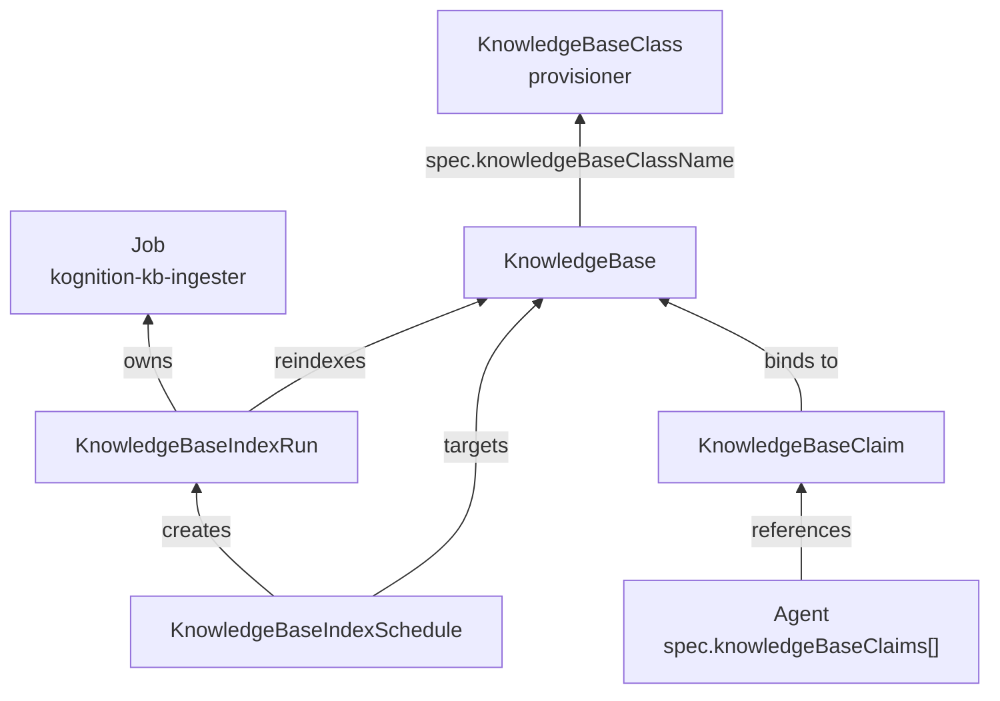

# Knowledge Bases

Kognition treats **operator-curated knowledge** as a first-class resource,
separate from agent-produced [memory](./kognition-manifest.md). This guide
covers the day-to-day model: what the CRDs mean, how to enable a backend, how
agents consume a KB, and how to keep it fresh.

For the design rationale behind the current shape, see:

- [ADR-0001 — `KnowledgeBaseClaim` + built-in in-memory provisioner](./adr/0001-knowledge-base-claims.md)
- [ADR-0002 — Default `KnowledgeBaseClass` via annotation](./adr/0002-knowledge-base-default-class.md)

## Resource model

Five CRDs cooperate. All of them live in the `kognition.dev/v1alpha1` API
group.

| Kind                       | Scope       | Short  | Analog                    | Purpose                                                              |
| -------------------------- | ----------- | ------ | ------------------------- | -------------------------------------------------------------------- |
| `KnowledgeBaseClass`       | Cluster     | `kbc`  | `StorageClass`            | Names a provisioner (`memory`, `pgvector`, …) and default parameters. |
| `KnowledgeBase`            | Namespaced  | `kb`   | `PersistentVolume`        | A concrete corpus: which class, which sources, how often to refresh. |
| `KnowledgeBaseClaim`       | Namespaced  | —      | `ServiceAccount`+`RoleBinding` | Binds an agent (or agents) to an existing KB with access mode + retrieval overrides. |
| `KnowledgeBaseIndexRun`    | Namespaced  | `kbrun`| `Job`                     | One imperative reindex attempt. Owns a `batch/v1` `Job` running the ingester. |
| `KnowledgeBaseIndexSchedule` | Namespaced | —      | `CronJob`                 | Cron-driven creation of `KnowledgeBaseIndexRun`s.                    |

The relationship at a glance:



## Picking a class

For inline demos, create a class that requires no external system:

```yaml
apiVersion: kognition.dev/v1alpha1
kind: KnowledgeBaseClass
metadata:
  name: inline-kb
spec:
  provisioner: inline
  indexMode: inline
```

The basic KnowledgeBase sample defines this class. For durable retrieval, use
the pgvector service and ingester shipped by the chart.

### Default class

If most `KnowledgeBase`s in your cluster should use the same class, annotate
the class as default:

```yaml
metadata:
  annotations:
    kognition.dev/is-default-class: "true"
```

Admission then fills empty `spec.knowledgeBaseClassName` on any new
`KnowledgeBase` or `KnowledgeBaseClaim`. Exactly one class per cluster may
carry the annotation — a second is rejected. See ADR-0002 for the full rules.

## Enabling the pgvector backend

The chart ships an opt-in pgvector StatefulSet plus the Python ingester image
that the index-run reconciler launches. Both are off by default; enable them
together:

```powershell
helm upgrade --install kognition ./deploy/helm/kognition -n kognition-system `
  --set kbPgvector.enabled=true `
  --set kbIngester.enabled=true
```

The ingester image is built by both `make docker` (POSIX) and
`.\make.ps1 docker` (Windows). If you push to a registry, point the chart at
it:

```powershell
--set kbIngester.image.repository=<your-registry>/kognition-kb-ingester
--set kbIngester.image.tag=<version>
```

Leaving `kbIngester.enabled=false` disables external ingestion. The
KnowledgeBase and IndexRun reconcilers still maintain lifecycle status, and
inline sources remain searchable through the runtime's keyword fallback, but
URL, Git, ConfigMap, and blob content is not copied into pgvector.

## Sources

`spec.sources[]` on a `KnowledgeBase` is a list of typed source records. For a
class with `vectorStore.type: pgvector`, the ingester expands each source into
documents, chunks them, embeds them with the class or KB
`embeddingModelRef`, and writes the result to the backing store.

| Type | Fields | Notes |
| ---- | ------ | ----- |
| `inline` | `data` | Searchable directly; the external ingester also accepts it as one document. |
| `url` | `uri` | One HTTP(S) document. |
| `git` | `git.url`, optional `git.branch`, optional `git.path` | The ingester clones the selected branch and indexes matching files. |
| `configMap` | `configMap.name` | Kubernetes mode expands every ConfigMap data value into an inline document. |
| `blob` | `blob.provider`, `bucket`, optional `prefix`, `region`, `endpoint`, `include`, `exclude`, and `credentialSecretRef` | `provider` is `azure` or `s3`; `bucket` is the Azure container or S3 bucket. |
| `file`, `directory` | `uri` or `directory` | Declared by the API but rejected by the current ingester because no safe shared-filesystem contract exists. |

The `blob/*` types are useful when the corpus lives outside the cluster and
you don't want to mirror it into a ConfigMap.

## Agent wiring

Agents attach to a KB through a `KnowledgeBaseClaim`, never a direct KB
reference. The claim carries the *binding* (access mode, retrieval overrides,
verb grants) so the agent author does not have to be the KB curator.

```yaml
apiVersion: kognition.dev/v1alpha1
kind: KnowledgeBaseClaim
metadata:
  name: docs-reader
  namespace: default
spec:
  knowledgeBaseName: kognition-docs-kb
  accessMode: ReadOnly           # ReadOnly (default) or ReadWrite
  retrieval:
    topK: 5
    minScore: 0.35
---
apiVersion: kognition.dev/v1alpha1
kind: Agent
metadata:
  name: docs-agent
  namespace: default
spec:
  knowledgeBaseClaims:
    - name: docs-reader
      required: true             # gates agent readiness on KB Ready
```

At runtime the agent gets one `knowledge_search` tool spanning all resolved
claims. The tool respects claim-level `topK` and `minScore` retrieval
overrides and the caller's requested result count. Claims and their target
KnowledgeBases must currently be in the same namespace. The design document
describes a future dual-gate `MemoryGrant` policy for data-plane calls, but the
current runtime path authorizes KB attachment through the claim itself.

## Refreshing

Two mechanisms create `KnowledgeBaseIndexRun`s:

- **Imperative.** Apply a `KnowledgeBaseIndexRun` manually. The reconciler
  creates a Job, tracks its phases (`Pending` → `Running` → `Succeeded` /
  `Failed`), and copies per-run stats onto the KB status.
- **Scheduled.** A `KnowledgeBaseIndexSchedule` with a cron expression or an
  `@every` descriptor creates runs on schedule, honoring
  `concurrencyPolicy: Forbid | Replace | Allow` and retaining a history window
  of successful/failed runs.
- **Periodic policy.** Setting `KnowledgeBase.spec.refreshPolicy` to
  `mode: periodic` synthesizes an owned `<knowledgebase>-refresh`
  `KnowledgeBaseIndexSchedule` with `schedule: "@every <interval>"`. Updating
  the interval repairs that child schedule; changing to `onDemand` or
  `webhook`, or deleting the KnowledgeBase, removes it. Intervals must be
  greater than zero.

Queries during a refresh keep serving the previous generation of chunks;
`status.generation` on the KB increments only after a run's chunks land in
the store. See §9A.5 of [PROJECT.md](../PROJECT.md) for the full
generation-consistency contract.

## End-to-end sample

The [`samples/knowledge-base-kognition-docs/`](../samples/knowledge-base-kognition-docs/README.md)
sample indexes this repository's own top-level docs (`README.md`,
`PROJECT.md`, `BACKLOG.md`, `docs/kognition-manifest.md`) into pgvector, wires
them to an agent via a `KnowledgeBaseClaim`, and lets you ask the agent
questions about its own project. It exercises every hop in this document
(class, KB, IndexRun, Claim, and agent). Standalone mode has a separate real
ingestion check in [`e2e/standalone-kb-ingestion.ps1`](../e2e/standalone-kb-ingestion.ps1).
