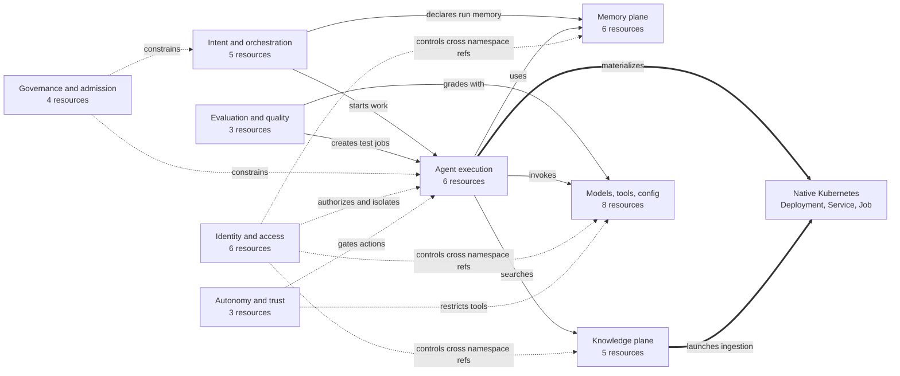
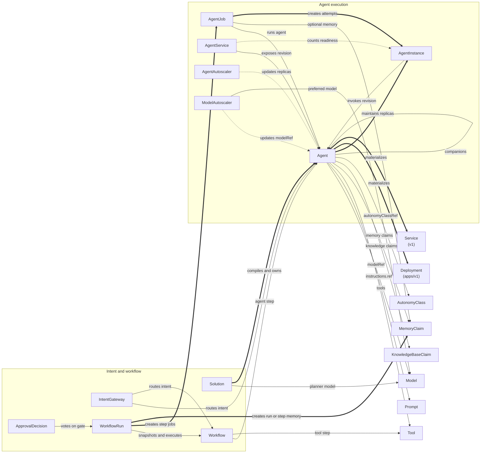
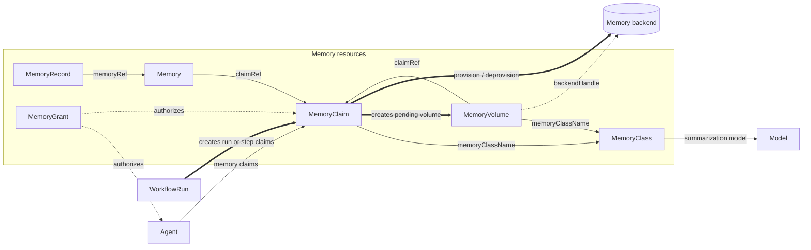
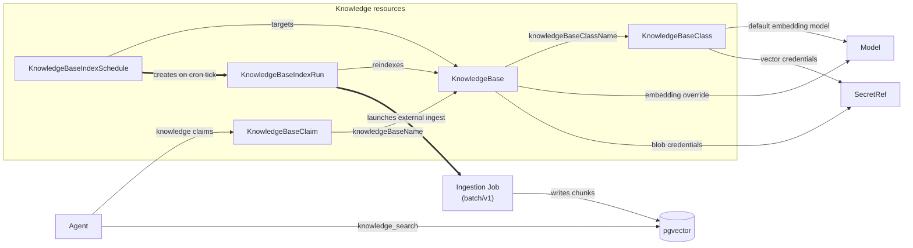
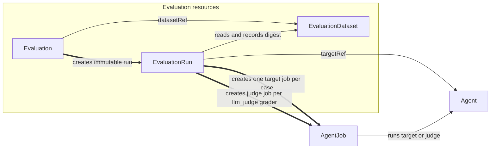
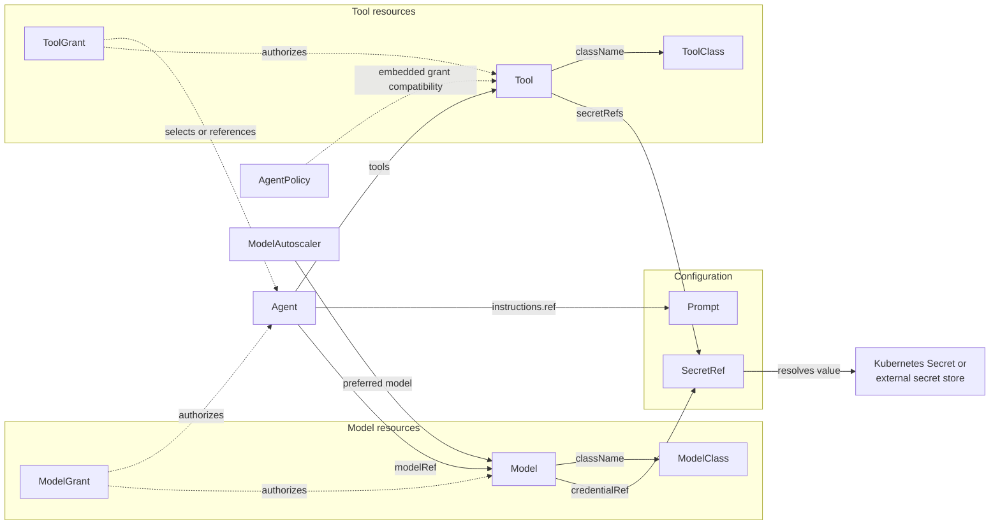
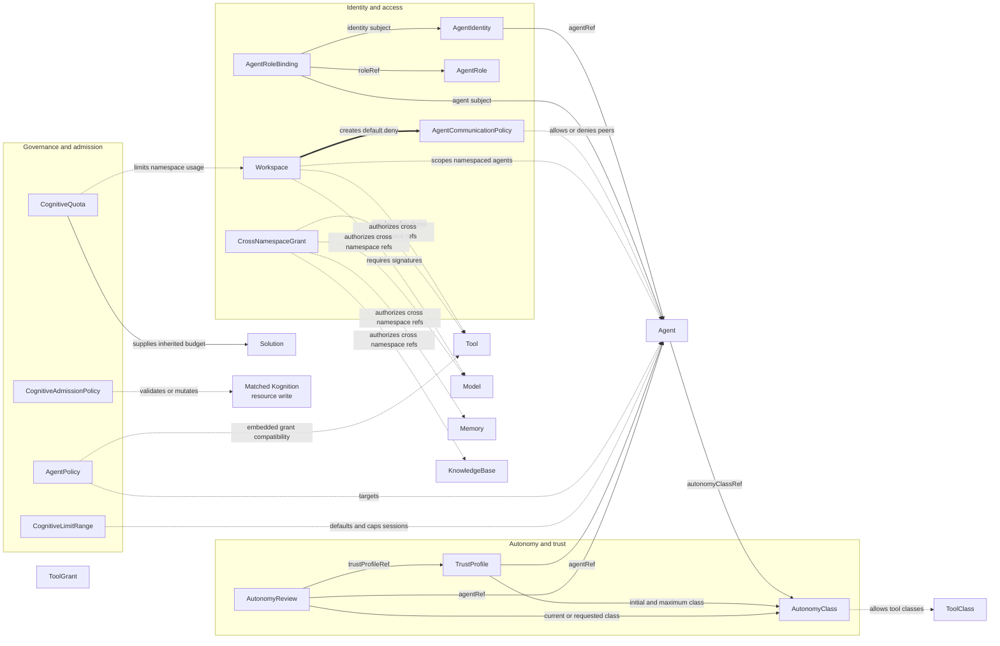

# Kognition Resource Interaction Map

> **Status:** Current implementation map, reviewed 2026-08-31.
> **Scope:** All 47 canonical `kognition.dev/v1alpha1` resource kinds.

This map answers how Kognition resources reference, create, govern, and feed
status to one another. It includes the native Kubernetes workloads created by
Kognition at the outer boundary. Those native objects are not part of the
43-kind canonical count.

## Relationship Legend

| Line | Meaning |
| --- | --- |
| `A --> B` | `A.spec` references, routes to, or binds `B`. |
| `A ==> B` | The controller for `A` creates or owns `B`. |
| `A -.-> B` | `A` selects, governs, authorizes, or mutates `B`. |

Kubernetes mode installs a CRD for each canonical kind, including `ToolGrant`.
Embedded `AgentPolicy.spec.toolGrants` entries remain available as a runtime
authorization compatibility path.

## Domain Overview

The overview keeps domain boundaries visible. The focused maps below show the
individual resources and exact edges.

## Intent And Agent Lifecycle

## Memory Plane

## Knowledge Plane

## Evaluation And Quality

EvaluationRuns record the SHA-256 digest of the dataset specification as 64
lowercase hexadecimal characters. A changed dataset fails an in-progress run
closed before additional target or judge jobs are created.

When upgrading from SHA-1 dataset digests, non-terminal runs with legacy digests
fail with `DatasetDigestUpgradeRequired`. Create a new EvaluationRun against the
reviewed dataset; do not overwrite the old run's digest to bypass the check.
Completed historical runs are left unchanged. Generated names longer than 63
characters now use a truncated SHA-256 suffix, so long EvaluationRun, target job,
judge job and Solution promotion run names differ from pre-upgrade names.
Drain in-flight evaluations before upgrading where possible, and inspect retained
jobs and promotion runs before rerunning to avoid unintended duplicate model calls.

## Models, Tools, And Configuration

## Identity, Governance, And Autonomy

## Domain Coverage

| Domain | Canonical resources |
| --- | --- |
| Intent and orchestration | `Solution`, `IntentGateway`, `Workflow`, `WorkflowRun`, `ApprovalDecision` |
| Agent execution | `Agent`, `AgentInstance`, `AgentJob`, `AgentService`, `AgentAutoscaler`, `ModelAutoscaler` |
| Evaluation and quality | `EvaluationDataset`, `Evaluation`, `EvaluationRun` |
| Knowledge | `KnowledgeBaseClass`, `KnowledgeBase`, `KnowledgeBaseClaim`, `KnowledgeBaseIndexRun`, `KnowledgeBaseIndexSchedule` |
| Memory | `MemoryClass`, `MemoryClaim`, `MemoryVolume`, `Memory`, `MemoryRecord`, `MemoryGrant` |
| Models and tools | `ModelClass`, `Model`, `ModelGrant`, `ToolClass`, `Tool`, `ToolGrant` |
| Configuration | `Prompt`, `SecretRef` |
| Identity and namespace access | `Workspace`, `AgentIdentity`, `AgentRole`, `AgentRoleBinding`, `AgentCommunicationPolicy`, `CrossNamespaceGrant` |
| Governance and admission | `AgentPolicy`, `CognitiveAdmissionPolicy`, `CognitiveQuota`, `CognitiveLimitRange` |
| Autonomy and trust | `AutonomyClass`, `TrustProfile`, `AutonomyReview` |

## Current Boundaries

- Agent controllers create `AgentInstance` resources. In Kubernetes mode, the
  dispatcher also ensures one runtime Deployment and Service per Agent.
- WorkflowRun creates AgentJobs for agent-backed steps and MemoryClaims for
  declared run or step memory. Tool-backed steps invoke Tool directly.
- Evaluation creates immutable EvaluationRuns. Each run snapshots its grader
  configuration, reads its dataset, creates one target AgentJob per case, and
  creates judge AgentJobs after target completion for `llm_judge` graders.
- MemoryClaim creates a pending MemoryVolume, provisions its generated handle
  through `kognition-memory-service`, then marks the volume and claim Bound.
  `ReclaimDelete` deprovisions the handle before deleting the volume.
- KnowledgeBaseIndexRun launches a Kubernetes Job only when the class has an
  external vector store and the ingester is enabled. Inline sources use the
  runtime keyword-search path without a Job.
- CognitiveAdmissionPolicy can match any Kognition kind. The governance view
  uses one `Matched Kognition resource write` boundary node instead of drawing
  43 duplicate policy arrows.
- CrossNamespaceGrant accepts arbitrary resource kinds. The diagram shows the
  currently important Tool, Model, Memory, and KnowledgeBase families.
