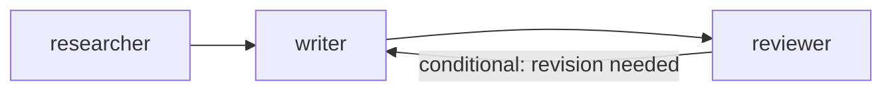

# Helm Multi-Agent Sample

A Helm chart that deploys a **multi-agent content-creation pipeline** on Kognition. This demonstrates how to package Kognition resources (ModelClass, Model, Agents, Workflow) as a reusable, configurable Helm release.

## Architecture



- **Researcher** — gathers information on a topic
- **Writer** — drafts an article from the research
- **Reviewer** — reviews the draft and provides feedback
- An **approval gate** between writer and reviewer lets a human inspect the draft
- A **revision loop** sends the article back to the writer if the reviewer says "revision-needed"

## Prerequisites

1. Kognition installed through the [guarded installer](../../docs/features/knowledge-provider-execution/installation-recovery-contract.md)
  and separately approved for activation. Direct platform Helm installation is
  unsupported. Missing security gates block activation.

2. Valid AI provider credentials (Azure AI Foundry or OpenAI).

3. A dedicated enrolled workload namespace and reviewed credential writers. The
  sample Helm commands below require the explicit reviewed `--kubeconfig` and
  `--namespace`; do not execute them during a bootstrap or recovery writer freeze.

## Installation

### Using Azure AI Foundry (default)

```bash
helm install my-pipeline samples/helm-multi-agent \
  --set credentials.azure.tenantId=YOUR_TENANT_ID \
  --set credentials.azure.clientId=YOUR_CLIENT_ID \
  --set credentials.azure.clientSecret=YOUR_CLIENT_SECRET \
  --set model.endpoint=https://your-endpoint.openai.azure.com
```

### Using OpenAI directly

Create a `values-openai.yaml` override:

```yaml
model:
  name: gpt-4o
  className: openai
  modelID: gpt-4o
  provider: openai-compatible
  endpoint: https://api.openai.com/v1
  apiVersion: ""
  capabilities:
    - chat
    - tool-calling

modelClass:
  create: true
  name: openai
  provisioner: openai
  latencyClass: low
  costTier: standard
  contextWindow: 128000
  modalities:
    - text
    - vision

credentials:
  name: openai-api-key
  backendType: env
  backendRef: OPENAI_API_KEY
  key: OPENAI_API_KEY
```

Then install:

```bash
helm install my-pipeline samples/helm-multi-agent -f values-openai.yaml
```

### Custom namespace

```bash
helm install my-pipeline samples/helm-multi-agent \
  --set namespace=my-agents \
  ...
```

## Triggering the Workflow

After install, create an `AgentInstance` to kick off the pipeline:

```bash
kubectl apply -f - <<EOF
apiVersion: kognition.dev/v1alpha1
kind: AgentInstance
metadata:
  name: content-run-1
spec:
  agentRef:
    name: researcher
  workflowRef:
    name: content-pipeline
  goal: "Explain the benefits of Kubernetes-native AI orchestration"
EOF
```

Monitor progress:

```bash
kubectl get agentinstances -w
```

## Configuration

All values are documented in [values.yaml](./values.yaml). Key overrides:

| Parameter | Description | Default |
|-----------|-------------|---------|
| `namespace` | Target namespace for resources | `default` |
| `model.name` | Model resource name; Azure-generated values match `MS_FOUNDRY_MODEL` | `gpt-6-luna` |
| `model.endpoint` | Provider API endpoint | (placeholder) |
| `model.modelID` | Model identifier | `gpt-6-luna` |
| `modelClass.create` | Create a ModelClass resource | `true` |
| `credentials.backendType` | Credential backend | `internal` |
| `agents.researcher.enabled` | Deploy researcher agent | `true` |
| `agents.writer.enabled` | Deploy writer agent | `true` |
| `agents.reviewer.enabled` | Deploy reviewer agent | `true` |
| `workflow.approvalGates.enabled` | Require human approval | `true` |
| `workflow.revisionLoop.enabled` | Enable feedback loop | `true` |
| `workflow.budgets.maxTokens` | Token budget for the run | `50000` |

## Uninstall

```bash
helm uninstall my-pipeline
```

This removes all Kognition resources created by the chart (agents, workflow, model, etc.).
